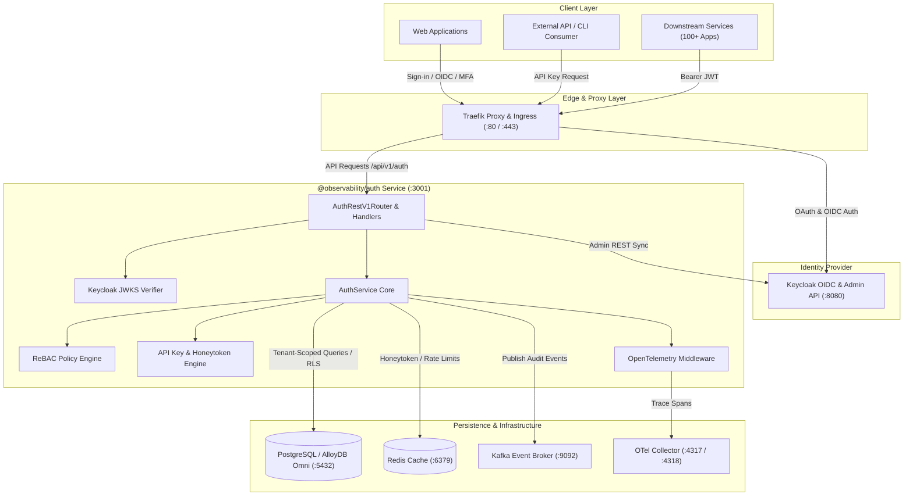
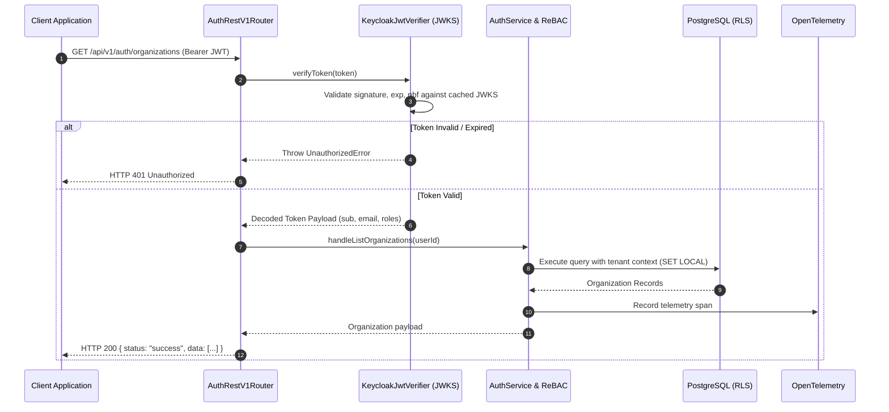

<div align="center">

# 🔒 Multi-Tenant Auth Service & Keycloak OIDC Gateway

### Traefik Proxy · Keycloak OIDC/Admin · PostgreSQL / AlloyDB Omni RLS · ReBAC & Honeytoken Engine

*A production-grade, multi-tenant authentication and authorization microservice fronted by Traefik, utilizing Keycloak OpenID Connect (OIDC) identity brokering, PostgreSQL Row-Level Security (RLS) tenant isolation, Zanzibar-style ReBAC policy evaluation, 3-tier API key management, honeytoken tripwires, and OpenTelemetry distributed tracing.*


</div>

---

## 📖 Table of Contents

1. [Executive Summary](#-executive-summary)
2. [High-Level Architecture (HLD)](#-high-level-architecture-hld)
3. [Authentication & Verification Flow (LLD)](#-authentication--verification-flow-lld)
4. [Standardized API Response Envelope](#-standardized-api-response-envelope)
5. [Hexagonal Ports & Adapters Architecture](#-hexagonal-ports--adapters-architecture)
6. [OpenAPI 3.0 Contract & Interactive Swagger UI](#-openapi-30-contract--interactive-swagger-ui)
7. [Database Schema & Migrations](#-database-schema--migrations)
8. [Architecture Decision Records (ADRs)](#-architecture-decision-records-adrs)
9. [Running with Docker Compose](#-running-with-docker-compose)
10. [Automated Test Suite & Verification](#-automated-test-suite--verification)
11. [Security & Engineering Roadmap](./TODO.md)

---

## 🧭 Executive Summary

The `@observability/auth` service serves as the core authentication, tenant context, and granular authorization layer across the LLM Observability suite.

Key capabilities include:
- **Centralized Identity via Keycloak**: Native OpenID Connect (OIDC) identity provider, social identity brokering, MFA, credential management, and admin user provisioning delegated to hardened Keycloak.
- **Local JWKS Token Verification**: High-throughput Bearer JWT verification using cached JWKS public keys without latency-inducing network hops per request.
- **Multi-Tenant Isolation**: N-to-N organization membership model, tenant context switching, and PostgreSQL Row-Level Security (RLS) enforcement.
- **Zanzibar Fine-Grained Authorization (ReBAC)**: Relationship tuple engine supporting granular resource-level permissions and transitive relationship evaluation.
- **3-Tier API Key Management**: Hash-protected API keys with IP/CIDR restrictions, rate quotas, and instant revocation for M2M communication and CLI tools.
- **Deception & Active Defense**: Honeytoken canaries with automated IP blocking and WORM audit archive sealing for regulatory compliance.
- **Full Observability**: OpenTelemetry W3C trace propagation, Prometheus metrics, and structured audit logs.

---

## 🏛 High-Level Architecture (HLD)

The Auth service follows **Hexagonal Architecture (Ports & Adapters)**, cleanly isolating HTTP routing and database infrastructure from core authorization domain logic.



---

## 🔬 Authentication & Verification Flow (LLD)

### 1. User Sign-in & OIDC Token Issuance
User credentials, MFA, and SSO identity brokering are handled directly by Keycloak:
1. Client logs in via Keycloak OIDC flow (`/protocol/openid-connect/token` or browser login).
2. Keycloak issues standard signed OIDC JWT access tokens containing user claims (`sub`, `email`, roles).
3. The auth service syncs and provisions tenant organizations and membership in the local application DB via Keycloak Admin API integration.

### 2. Request Verification Pipeline



---

## 📦 Standardized API Response Envelope

Every endpoint consistently returns the unified API response envelope:

### Success Envelope (`HTTP 200 / 201`)
```json
{
  "success": true,
  "status": "success",
  "statusCode": 200,
  "message": "Resource retrieved successfully",
  "data": { ... },
  "error": null,
  "meta": {
    "requestId": "req_1792150314097",
    "correlationId": "req_1792150314097",
    "timestamp": "2026-10-16T11:31:54.109Z",
    "executionTimeMs": 12,
    "apiVersion": "1.0.0"
  }
}
```

### Error Envelope (`HTTP 400 / 401 / 403 / 404 / 429 / 500`)
```json
{
  "success": false,
  "status": "error",
  "statusCode": 401,
  "message": "Missing or invalid Authorization header",
  "data": null,
  "error": {
    "code": "UNAUTHORIZED",
    "details": "Bearer token is expired or signature cannot be verified"
  },
  "meta": {
    "requestId": "req_1792150314098",
    "correlationId": "req_1792150314098",
    "timestamp": "2026-10-16T11:31:54.120Z",
    "executionTimeMs": 3,
    "apiVersion": "1.0.0"
  }
}
```

---

## 📄 OpenAPI 3.0 Contract & Interactive Swagger UI

The service publishes and self-hosts full OpenAPI 3.0.3 documentation:

- **Local Contract File**: [`contracts/openapi/v1.yaml`](./contracts/openapi/v1.yaml)
- **Live OpenAPI Spec**: `GET http://localhost:3001/openapi.yaml` (served as `text/yaml`)
- **Embedded Swagger UI**: `GET http://localhost:3001/docs` (interactive API documentation viewer)

---

## 🗄️ Database Schema & Migrations

All database tables are version-controlled via SQL migrations in [`database/migrations/`](./database/migrations) executed automatically at service startup.

Key tables:
- `auth_organizations`: Multi-tenant organization definitions, settings, and quotas.
- `auth_users`: Local application user records and profile metadata linked to Keycloak identity (`keycloak_user_id`).
- `auth_user_organizations`: N-to-N mapping for organization memberships, roles, and tenant context.
- `auth_api_keys`: Hashed API credentials with CIDR restrictions, usage quotas, and expiry.
- `auth_relations`: Zanzibar 6-ary relationship tuples for ReBAC policy graph checks.
- `auth_audit_logs`: Append-only audit events capturing user actions, IP addresses, and user-agents.
- `auth_honeytokens`: Canary decoy credentials for intrusion detection.
- `auth_break_glass_sessions`: Ephemeral emergency administrative access logs.

---

## 📐 Architecture Decision Records (ADRs)

Key architectural decisions are documented in [`adr/`](./adr/README.md):

| ADR | Title | Key Architectural Focus | Status |
|---|---|---|---|
| [**ADR 0001**](./adr/0001-hexagonal-architecture-and-rule-engine-router.md) | Hexagonal Architecture & Declarative Router | Ports & Adapters separation, OTel tracing middleware | Accepted |
| [**ADR 0003**](./adr/0003-multi-tenant-organization-switching-and-rls.md) | N-to-N Multi-Tenancy & Org Context Switching | Row-Level Security (RLS) tenant isolation | Accepted |
| [**ADR 0005**](./adr/0005-opentelemetry-end-to-end-auth-tracing-and-middleware.md) | OpenTelemetry Tracing & Middleware | W3C traceparent context propagation | Accepted |
| [**ADR 0008**](./adr/0008-master-api-catalog-parameter-contracts-and-response-envelopes.md) | Master API Catalog & Contracts | Endpoint request/response contracts and curl verification | Accepted |
| [**ADR 0023**](./adr/0023-fine-grained-policy-engine-abac-rebac.md) | Fine-Grained Policy Engine (ReBAC) | Zanzibar-style relationship tuples & graph evaluation | Accepted |
| [**ADR 0027**](./adr/0027-api-key-ip-cidr-allowlist-and-zero-trust-rate-quotas.md) | API Key IP CIDR Allowlisting & Quotas | Zero-trust subnet matching, constant-time compare | Accepted |
| [**ADR 0039**](./adr/0039-monitored-break-glass-emergency-access-workflow.md) | Break-Glass Emergency Access Workflow | Ephemeral administrative emergency elevation | Accepted |
| [**ADR 0041**](./adr/0041-honeytokens-and-active-canary-secret-scanning.md) | Honeytokens & Active Canary Tripwires | Decoy credentials, automated IP blocking | Accepted |
| [**ADR 0042**](./adr/0042-immutable-worm-audit-archive-s3-object-lock.md) | Immutable WORM Audit Archive | Merkle tree verification, compliance retention | Accepted |
| [**ADR 0044**](./adr/0044-non-superuser-rls-bounded-revocation-audience-scoping.md) | Non-Superuser DB Role, RLS Isolation & Audience Scoping | Dedicated `auth_app` role, forced RLS, `aud` validation, Keycloak hardening | Accepted |

*(Note: ADRs 0002 and 0004 covering deprecated custom argon2id login and Redis denylist have been superseded by Keycloak OIDC integration).*

---

## 🐳 Running with Docker Compose

The environment can be launched locally with all dependencies (Auth Service, Keycloak 26, PostgreSQL 17, Redis, Kafka, and OpenTelemetry) configured:

```bash
# Start all services
docker compose -f docker-compose.yml up -d
```

### Environment Configuration

Configure runtime settings via `.env` (refer to [`.env.example`](./.env.example)):

```bash
# Application Port & Database
PORT=3001
DATABASE_URL=postgresql://${AUTH_DB_USER}:${AUTH_DB_PASSWORD}@${AUTH_DB_HOST}:5432/${AUTH_DB_NAME}

# Keycloak OIDC Configuration
KEYCLOAK_BASE_URL=http://localhost:8080
KEYCLOAK_ISSUER_URL=http://localhost:8080/realms/llm-observability
KEYCLOAK_REALM=llm-observability
KEYCLOAK_CLIENT_ID=auth-service-admin
KEYCLOAK_CLIENT_SECRET=auth-service-admin-secret
KEYCLOAK_ADMIN=admin
KEYCLOAK_ADMIN_PASSWORD=admin

# Infrastructure & Observability
REDIS_URL=redis://localhost:6379/0
KAFKA_BROKERS=localhost:9092
OTEL_EXPORTER_OTLP_ENDPOINT=http://localhost:4318
```

---

## 🧪 Automated Test Suite & Verification

The codebase includes comprehensive unit, contract, and live integration tests:

### 1. TypeScript Verification
```bash
npm run typecheck
```

### 2. Unit & Contract Vitest Suite
```bash
npm test
```

### 3. Live API End-to-End Curl Test Suite
Executes all live endpoints against a running service instance:
```bash
npm run test:curl
```

### 4. Service Health Check
```bash
curl -s http://localhost:3001/api/v1/auth/health | jq .
```
Expected response:
```json
{
  "status": "healthy",
  "service": "auth-service",
  "timestamp": "2026-10-16T13:30:00.000Z"
}
```

---

## 📋 Security & Engineering Roadmap

For active and future initiatives, architectural hardening priorities (RLS non-superuser enforcement, CAEP revocation sync, per-app token audience constraints, post-quantum cryptography, and AI agent authorization), refer to [**TODO.md**](./TODO.md).
