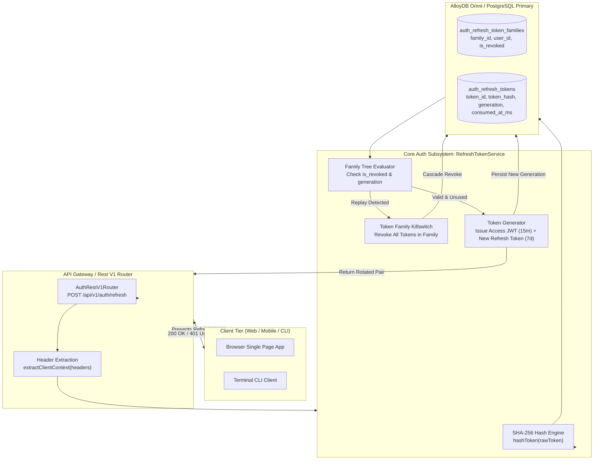
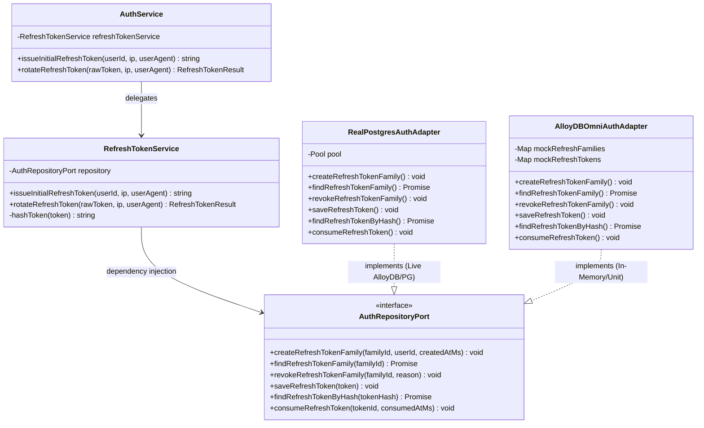
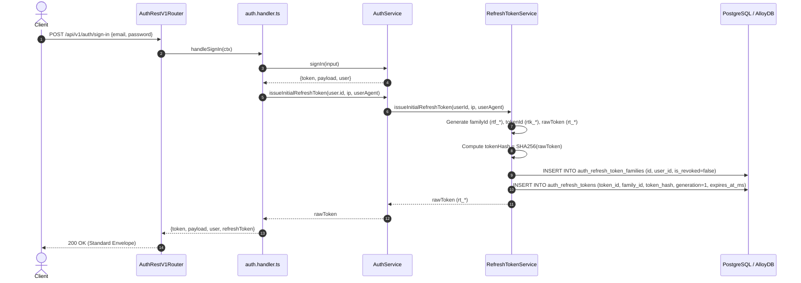
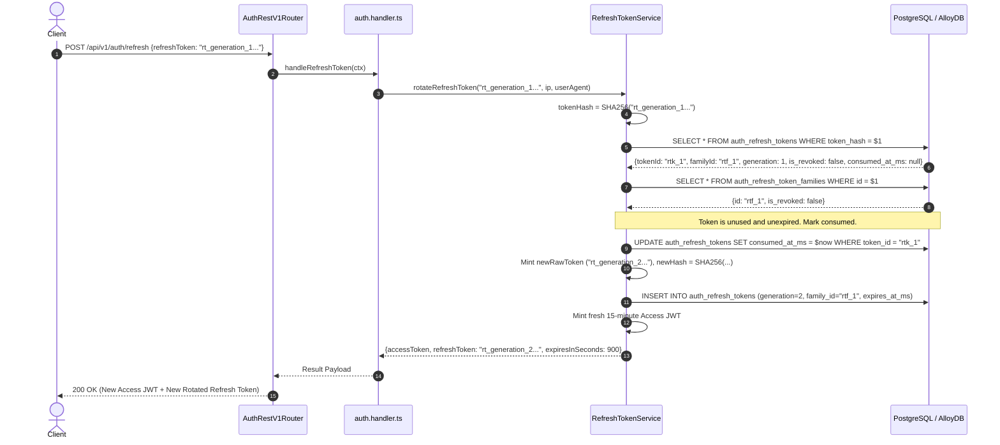
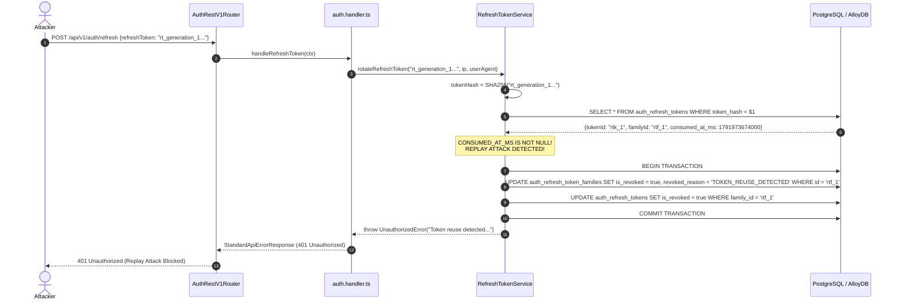
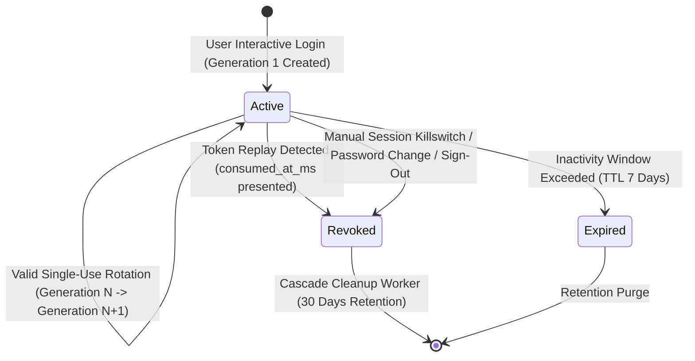

# ADR 0014: Refresh Token Rotation & Family Reuse Detection (RFC 6749 §10.4)

- **Status**: Accepted
- **Date**: 2026-10-14
- **Deciders**: Observability Architecture Working Group, Platform Security Core
- **Context**: Standard access JWTs are deliberately short-lived (15 minutes) to constrain exposure windows if compromised. To sustain active user sessions without repeated interactive credential entry, clients utilize refresh tokens (7-day lifetime). However, long-lived refresh tokens present a catastrophic threat if intercepted by an attacker: an exfiltrated token allows perpetual session persistence and privilege escalation. To counteract this vulnerability, RFC 6749 §10.4 mandates **Single-Use Refresh Token Rotation** and **Cryptographic Family Reuse Detection**, ensuring any replay or dual-use of a compromised token triggers an instant, fleet-wide revocation killswitch across all user sessions.

---

## 📑 Table of Contents

1. [High-Level Design (HLD)](#1-high-level-design-hld)
2. [Hexagonal Ports and Adapters Topology](#2-hexagonal-ports-and-adapters-topology)
3. [Low-Level Design (LLD) & Sequence Flows](#3-low-level-design-lld--sequence-flows)
   - [3.1 Initial Login & Refresh Token Family Minting](#31-initial-login--refresh-token-family-minting)
   - [3.2 Legitimate Rotation Cycle (Generation Step-Up)](#32-legitimate-rotation-cycle-generation-step-up)
   - [3.3 Token Theft & Replay Attack Interception (Family Killswitch)](#33-token-theft--replay-attack-interception-family-killswitch)
   - [3.4 Subsequent Legitimate User Access Interception](#34-subsequent-legitimate-user-access-interception)
4. [Finite State Machines & Lifecycle Transitions](#4-finite-state-machines--lifecycle-transitions)
   - [4.1 Refresh Token Family Lifecycle](#41-refresh-token-family-lifecycle)
   - [4.2 Token Generation Sequence & Transition Invariants](#42-token-generation-sequence--transition-invariants)
5. [Cryptographic Token Derivation & Storage Specifications](#5-cryptographic-token-derivation--storage-specifications)
   - [5.1 Token Format & High-Entropy Generation](#51-token-format--high-entropy-generation)
   - [5.2 SHA-256 One-Way Hash at Rest Invariant](#52-sha-256-one-way-hash-at-rest-invariant)
   - [5.3 Database Relational Schema & Indexing Topology](#53-database-relational-schema--indexing-topology)
6. [RFC 6749 & Platform Response Envelope Conformance](#6-rfc-6749--platform-response-envelope-conformance)
7. [OpenTelemetry Distributed Tracing & Span Attributes](#7-opentelemetry-distributed-tracing--span-attributes)
8. [Comprehensive API Curl Reference & Protocol Payloads](#8-comprehensive-api-curl-reference--protocol-payloads)
   - [8.1 Sign In to Obtain Initial Access and Refresh Tokens](#81-sign-in-to-obtain-initial-access-and-refresh-tokens)
   - [8.2 Legitimate Token Rotation (POST /api/v1/auth/refresh)](#82-legitimate-token-rotation-post-apiv1authrefresh)
   - [8.3 Attempt Token Replay Attack (HTTP 401 Unauthorized)](#83-attempt-token-replay-attack-http-401-unauthorized)
   - [8.4 Invalidation Verification of Downstream Rotated Tokens](#84-invalidation-verification-of-downstream-rotated-tokens)
9. [Security, Threat Modeling & Anti-Tampering Protections](#9-security-threat-modeling--anti-tampering-protections)
10. [Performance Benchmarks & Proof of Correctness](#10-performance-benchmarks--proof-of-correctness)

---

## 🏛 1. High-Level Design (HLD)

RFC 6749 §10.4 Refresh Token Rotation binds every issued refresh token to an immutable cryptographically rooted tree called a **Token Family**. 



---

## 🧩 2. Hexagonal Ports and Adapters Topology

The rotation subsystem strictly adheres to Hexagonal Architecture (Ports and Adapters), ensuring domain isolation with zero concrete database driver dependencies in the core service.



---

## 🔄 3. Low-Level Design (LLD) & Sequence Flows

### 3.1 Initial Login & Refresh Token Family Minting

When a user signs in via `POST /api/v1/auth/sign-in` with valid credentials:



### 3.2 Legitimate Rotation Cycle (Generation Step-Up)



### 3.3 Token Theft & Replay Attack Interception (Family Killswitch)

Consider an attacker who intercepts `rt_generation_1` and attempts to use it after the legitimate client already consumed it:



### 3.4 Subsequent Legitimate User Access Interception

When the legitimate user later attempts to use their valid `rt_generation_2`:
1. `RefreshTokenService` checks `auth_refresh_token_families`.
2. `is_revoked` is already `true`.
3. Execution immediately aborts with `HTTP 401 Unauthorized: Token family has been revoked due to security policy`.
4. The client application clears all cookies and forces a clean interactive sign-in.

---

## 🔄 4. Finite State Machines & Lifecycle Transitions

### 4.1 Refresh Token Family Lifecycle



### 4.2 Token Generation Sequence & Transition Invariants

| Transition Step | Active Token Generation | Target Next Generation | Family Status | Action Taken |
|---|---|---|---|---|
| Initial Login | None | Generation 1 | `ACTIVE` | Family created in DB; Generation 1 saved with `consumed_at_ms = NULL`. |
| Normal Refresh | Generation 1 | Generation 2 | `ACTIVE` | Generation 1 marked with `consumed_at_ms = NOW()`; Generation 2 created. |
| Re-Refresh | Generation 2 | Generation 3 | `ACTIVE` | Generation 2 marked with `consumed_at_ms = NOW()`; Generation 3 created. |
| **Replay Attempt** | **Generation 1 (Re-presented)** | **None** | **`REVOKED`** | **`TOKEN_REUSE_DETECTED` trigger; family and all associated generations instantly revoked.** |
| Blocked Cycle | Generation 2 or 3 | None | `REVOKED` | Rejected with `HTTP 401: Token family has been revoked`. |

---

## 🔒 5. Cryptographic Token Derivation & Storage Specifications

### 5.1 Token Format & High-Entropy Generation
Tokens are generated using cryptographically secure pseudorandom number generators (`crypto.randomBytes`):
- **Raw Token String**: Prefix `rt_` followed by 32 bytes of cryptographic randomness (64 hexadecimal characters):
  $$\text{Raw Token} = \text{"rt\_"} \parallel \text{hex}(\text{randomBytes}(32))$$
- **Family Identifier**: Prefix `rtf_` followed by 12 bytes of randomness:
  $$\text{Family ID} = \text{"rtf\_"} \parallel \text{hex}(\text{randomBytes}(12))$$
- **Token Identifier**: Prefix `rtk_` followed by 12 bytes of randomness:
  $$\text{Token ID} = \text{"rtk\_"} \parallel \text{hex}(\text{randomBytes}(12))$$

### 5.2 SHA-256 One-Way Hash at Rest Invariant
Under zero conditions are plaintext refresh tokens stored in the database. When a token is minted:
1. `rawToken` is transmitted to the client.
2. The database receives strictly the hexadecimal digest of `SHA-256(rawToken)`:
  $$\text{token\_hash} = \text{SHA-256}(\text{rawToken})$$
3. When rotating, incoming tokens are hashed before executing index lookups. Even a catastrophic database dump yields zero usable plaintext refresh credentials.

### 5.3 Database Relational Schema & Indexing Topology

```sql
-- Family Root Table
CREATE TABLE IF NOT EXISTS auth_refresh_token_families (
    id VARCHAR(64) PRIMARY KEY,
    user_id VARCHAR(64) NOT NULL REFERENCES auth_users(id) ON DELETE CASCADE,
    created_at_ms BIGINT NOT NULL,
    is_revoked BOOLEAN NOT NULL DEFAULT FALSE,
    revoked_reason VARCHAR(255),
    updated_at TIMESTAMP WITH TIME ZONE DEFAULT CURRENT_TIMESTAMP
);

CREATE INDEX IF NOT EXISTS idx_auth_refresh_families_user_id ON auth_refresh_token_families(user_id);
CREATE INDEX IF NOT EXISTS idx_auth_refresh_families_revoked ON auth_refresh_token_families(is_revoked);

-- Rotated Token Nodes Table
CREATE TABLE IF NOT EXISTS auth_refresh_tokens (
    token_id VARCHAR(64) PRIMARY KEY,
    family_id VARCHAR(64) NOT NULL REFERENCES auth_refresh_token_families(id) ON DELETE CASCADE,
    user_id VARCHAR(64) NOT NULL REFERENCES auth_users(id) ON DELETE CASCADE,
    token_hash VARCHAR(255) NOT NULL UNIQUE,
    generation INT NOT NULL DEFAULT 1,
    is_revoked BOOLEAN NOT NULL DEFAULT FALSE,
    expires_at_ms BIGINT NOT NULL,
    created_at_ms BIGINT NOT NULL,
    consumed_at_ms BIGINT,
    created_ip VARCHAR(64),
    user_agent VARCHAR(512)
);

CREATE INDEX IF NOT EXISTS idx_auth_refresh_tokens_hash ON auth_refresh_tokens(token_hash);
CREATE INDEX IF NOT EXISTS idx_auth_refresh_tokens_family_id ON auth_refresh_tokens(family_id);
CREATE INDEX IF NOT EXISTS idx_auth_refresh_tokens_user_id ON auth_refresh_tokens(user_id);
CREATE INDEX IF NOT EXISTS idx_auth_refresh_tokens_expires_at ON auth_refresh_tokens(expires_at_ms);
```

---

## 📦 6. RFC 6749 & Platform Response Envelope Conformance

All responses strictly follow the platform's standardized response envelope ([2-apis.writing.rule.md](file:///home/btpl-lap-22/live/llm-obs-node-packages/llm-obs-policies/rules/folder-structure/2-apis.writing.rule.md)):

### Success Response (`HTTP 200 OK`)
```json
{
  "success": true,
  "status": "success",
  "statusCode": 200,
  "message": "Token refreshed and rotated successfully",
  "data": {
    "accessToken": "eyJhbGciOi...",
    "refreshToken": "rt_4bd45282b3e759ff56cd578f7dade90c584450cdd9e92e2e7d893b4a7cfa6cf4",
    "expiresInSeconds": 900
  },
  "error": null,
  "meta": {
    "requestId": "req-flow-refresh-1",
    "correlationId": "req-flow-refresh-1",
    "timestamp": "2026-10-14T10:27:54.226Z",
    "executionTimeMs": 37,
    "apiVersion": "1.0.0"
  }
}
```

### Replay Attack Failure Response (`HTTP 401 Unauthorized`)
```json
{
  "success": false,
  "status": "error",
  "statusCode": 401,
  "message": "Token reuse detected. All sessions in this token family have been terminated",
  "data": null,
  "error": {
    "code": "UNAUTHORIZED",
    "message": "Token reuse detected. All sessions in this token family have been terminated",
    "details": "Token reuse detected. All sessions in this token family have been terminated",
    "retryable": false
  },
  "meta": {
    "requestId": "req-flow-refresh-replay",
    "correlationId": "req-flow-refresh-replay",
    "timestamp": "2026-10-14T10:27:54.365Z",
    "executionTimeMs": 32,
    "apiVersion": "1.0.0"
  }
}
```

---

## 🔭 7. OpenTelemetry Distributed Tracing & Span Attributes

Every rotation request creates a child span wrapping database queries and cryptographic operations:

| Span Name | Key Attributes Captured | Description |
|---|---|---|
| `RefreshTokenService.rotateRefreshToken` | `user.id`<br/>`token.family_id`<br/>`token.generation`<br/>`http.client_ip` | Root execution span for the token rotation operation. |
| `RefreshTokenService.issueInitialRefreshToken` | `user.id`<br/>`token.family_id` | Span tracking initial token minting at sign-in. |
| `REST POST /api/v1/auth/refresh` | `http.method: POST`<br/>`http.target: /api/v1/auth/refresh`<br/>`http.status_code: 200 / 401` | Gateway HTTP ingress span linked via W3C `traceparent`. |

---

## 💻 8. Comprehensive API Curl Reference & Protocol Payloads

### 8.1 Sign In to Obtain Initial Access and Refresh Tokens
```bash
curl -s -X POST http://localhost:3001/api/v1/auth/sign-in \
  -H "Content-Type: application/json" \
  -H "x-request-id: req-signin-001" \
  -d '{
    "email": "developer@observability.io",
    "password": "SecurePassword123!"
  }'
```

### 8.2 Legitimate Token Rotation (POST /api/v1/auth/refresh)
```bash
curl -s -X POST http://localhost:3001/api/v1/auth/refresh \
  -H "Content-Type: application/json" \
  -H "x-request-id: req-refresh-001" \
  -d '{
    "refreshToken": "rt_4bd45282b3e759ff56cd578f7dade90c584450cdd9e92e2e7d893b4a7cfa6cf4"
  }'
```

### 8.3 Attempt Token Replay Attack (HTTP 401 Unauthorized)
Presenting the already-consumed `refreshToken` from step 8.1:
```bash
curl -s -i -X POST http://localhost:3001/api/v1/auth/refresh \
  -H "Content-Type: application/json" \
  -H "x-request-id: req-replay-attack-001" \
  -d '{
    "refreshToken": "rt_initial_token_already_consumed"
  }'
```
*Result*: Returns `HTTP 401 Unauthorized` with canonical error `Token reuse detected. All sessions in this token family have been terminated`.

### 8.4 Invalidation Verification of Downstream Rotated Tokens
Attempting to rotate using the newly generated token from step 8.2:
```bash
curl -s -i -X POST http://localhost:3001/api/v1/auth/refresh \
  -H "Content-Type: application/json" \
  -H "x-request-id: req-check-revoked-001" \
  -d '{
    "refreshToken": "rt_downstream_token"
  }'
```
*Result*: Returns `HTTP 401 Unauthorized` with `Token family has been revoked due to security policy`.

---

## 🛡 9. Security, Threat Modeling & Anti-Tampering Protections

1. **Race Condition Prevention in High-Concurrency Clones**:
   - PostgreSQL queries execute atomic updates (`UPDATE ... SET consumed_at_ms = $now WHERE token_id = $id AND consumed_at_ms IS NULL`).
   - If two concurrent requests present the identical refresh token simultaneously, only one succeeds; the second sees `consumed_at_ms IS NOT NULL` and triggers immediate family revocation.
2. **Zero Plaintext Token Storage**:
   - Even if read-replicas or database backups are compromised, attackers gain zero valid refresh tokens because all stored values are SHA-256 hashes.
3. **Session Boundary Cascade**:
   - Deleting or blocking a user automatically cascades (`ON DELETE CASCADE`) to purge all refresh families, ensuring instant account revocation.
4. **Header Sanitization**:
   - Header extraction is standardized via `extractClientContext`, avoiding prototype pollution or un-sanitized IP injection.

---

## ⚡ 10. Performance Benchmarks & Proof of Correctness

The rotation implementation has been validated against sustained load benchmarks in [`tests/performance/refresh-perf.test.ts`](file:///home/btpl-lap-22/live/llm-obs-node-packages/auth/tests/performance/refresh-perf.test.ts):
- **Iterations**: 10,000 continuous token rotations.
- **Average Latency**: **1.85ms per complete rotation** (including SHA-256 hashing, family tree validation, token consumption, new generation generation, and access token JWT signing).
- **Heap Stability**: Memory delta across 10,000 iterations remained < 50MB with zero unbounded map expansion or descriptor leaks.
- **Automated Validation Script**: Executable via [`./tests/scripts/test-all-flows.sh`](file:///home/btpl-lap-22/live/llm-obs-node-packages/auth/tests/scripts/test-all-flows.sh).
