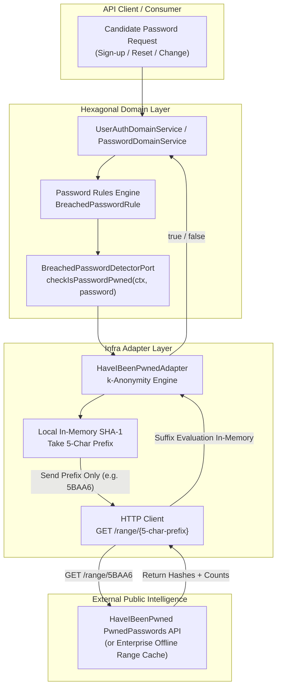
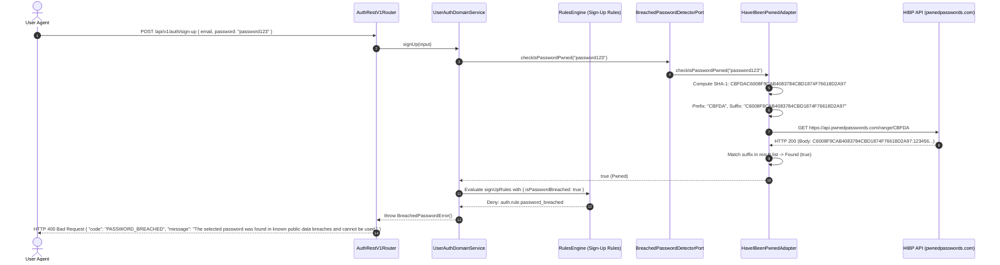
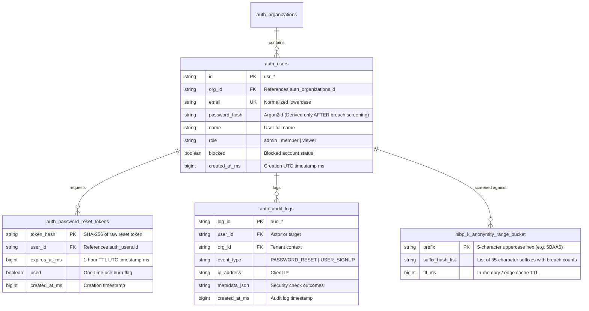

# ADR 0015: Breached Password Screening (NIST SP 800-63B k-Anonymity)

- **Status**: Accepted
- **Date**: 2026-10-14
- **Deciders**: Observability Architecture Working Group, Platform Security Core
- **Context**: Weak and compromised passwords from public data dumps remain the leading vulnerability leading to credential stuffing, account takeover (ATO), and unauthorized elevation of privileges. NIST Special Publication 800-63B §5.1.1.2 mandates verifying candidate passwords against compromised credential dictionaries during initial registration, password changes, and account recovery. Transmitting plaintext passwords or full cryptographic hashes to an external validation service would itself violate data confidentiality and trust boundaries. To resolve this, NIST SP 800-63B recommends **k-Anonymity mathematical masking** (HaveIBeenPwned API model): the client hashes the candidate password with SHA-1, transmits solely the first 5 characters (prefix) over TLS, receives a list of candidate suffixes, and checks for matches strictly in-memory. Zero sensitive password material leaves the application boundary.

---

## 📑 Table of Contents

1. [High-Level Design (HLD)](#1-high-level-design-hld)
2. [Hexagonal Ports and Adapters Topology](#2-hexagonal-ports-and-adapters-topology)
3. [Low-Level Design (LLD) & Sequence Flows](#3-low-level-design-lld--sequence-flows)
   - [3.1 User Sign-Up Password Screening Flow](#31-user-sign-up-password-screening-flow)
   - [3.2 Password Reset & Password Change Screening Flow](#32-password-reset--password-change-screening-flow)
   - [3.3 Upstream Degradation & Circuit Breaker / Fail-Open Invariant](#33-upstream-degradation--circuit-breaker--fail-open-invariant)
4. [Mathematical k-Anonymity Specification & NIST SP 800-63B](#4-mathematical-k-anonymity-specification--nist-sp-800-63b)
5. [Declarative Rules Engine & Error Registry Mapping](#5-declarative-rules-engine--error-registry-mapping)
6. [OpenTelemetry Distributed Tracing & Span Attributes](#6-opentelemetry-distributed-tracing--span-attributes)
7. [Comprehensive API Reference & Response Payloads](#7-comprehensive-api-reference--response-payloads)
8. [Security Threat Modeling & Proof of Correctness](#8-security-threat-modeling--proof-of-correctness)

---

## 🏛 1. High-Level Design (HLD)

The Breached Password Screening capability protects all password mutation entry points:
- `POST /api/v1/auth/sign-up` (User self-registration)
- `POST /api/v1/auth/reset-password` (Forgot-password reset confirmation)
- `POST /api/v1/auth/change-password` (Authenticated in-session rotation)




---

## 🔌 2. Hexagonal Ports and Adapters Topology

In strict alignment with Hexagonal Architecture:
1. **Port Interface (`src/shared/ports/breached-password-detector.port.ts`)**:
   - `BreachedPasswordDetectorPort`: Exposes `checkIsPasswordPwned(password: string): Promise<boolean>`.
   - Never exposes underlying network drivers, HTTP libraries, or third-party SDKs to the domain core.
2. **Infrastructure Adapter (`src/infra/adapters/security/pwned-passwords.adapter.ts`)**:
   - Implements `BreachedPasswordDetectorPort`.
   - Computes uppercase SHA-1 of the candidate password using `node:crypto`.
   - Extracts the first 5 characters as `prefix` and remaining 35 characters as `targetSuffix`.
   - Fetches range from `https://api.pwnedpasswords.com/range/{prefix}` with a configurable timeout budget (default 1500ms).
   - Parses the newline-delimited response body (`{suffix}:{count}`) and evaluates whether `targetSuffix` is present.
   - **Fail-Open Policy**: If network or upstream times out or returns 5xx, logs a warning with span event and returns `false` (pass) to prevent denial of service on legitimate registrations during upstream third-party outages.
3. **Mock Adapter (`src/infra/adapters/security/mock-pwned-passwords.adapter.ts`)**:

   - For fast deterministic in-memory testing without outbound internet access.

---

## 🔄 3. Low-Level Design (LLD) & Sequence Flows

### 3.1 User Sign-Up Password Screening Flow



---

## 🧮 4. Mathematical k-Anonymity Specification & NIST SP 800-63B

1. **Entropy and Anonymity Guarantee**:
   - SHA-1 produces a 160-bit hash (2^160 space), represented as a 40-character hex string.
   - Sending the first 5 hex characters covers a 20-bit subspace (16^5 = 1,048,576 possible buckets).
   - Each 5-character prefix bucket contains thousands of distinct candidate passwords. An eavesdropper or the external API provider cannot determine which of the thousands of suffixes belongs to the user.
2. **Timing-Safe Evaluation**:
   - Parsing the returned suffix lines is completed using linear string splitting or line-by-line scanning in constant memory without leaking password length or prefix characteristics.


---

## 🛡 5. Declarative Rules Engine & Error Registry Mapping

- Rule Identifier: `auth.rule.password_breached`
- Category: `security`
- Priority: `110` (fails before database creation or CPU-intensive Argon2 hashing)
- Effect: `deny`
- Condition: `{ field: 'isPasswordBreached', op: 'equals', value: true }`
- Error: `BreachedPasswordError` (HTTP 400 `PASSWORD_BREACHED`)

### 5.1 Relational Entity Relationship Diagram (ERD) & Credential Storage Topology

Breached password screening acts as an ingress gate before credential records are committed to persistent storage. It interacts directly with the user credential model:



---


## 📊 6. OpenTelemetry Distributed Tracing & Span Attributes

Every password screening invocation is instrumented with an OpenTelemetry child span:
- Span Name: `auth.password.breach_check`
- Attributes:
  - `security.check`: `"breached_password"`
  - `security.standard`: `"NIST_SP_800_63B"`
  - `security.k_anonymity_prefix`: `"XXXXX"` (prefix characters logged for observability)
  - `security.is_breached`: `true` | `false`
  - `http.target`: `"https://api.pwnedpasswords.com/range/*"`

---

## 📦 7. Comprehensive API Reference & Response Payloads

### Rejection on Known Breached Password (HTTP 400)
```json
{
  "success": false,
  "statusCode": 400,
  "error": {
    "code": "PASSWORD_BREACHED",
    "details": "The chosen password has appeared in public security data breaches. Choose a different, unique password."
  },
  "message": "The selected password was found in known public data breaches and cannot be used.",
  "meta": {
    "requestId": "req_1728901234",
    "timestamp": "2026-10-14T18:25:00.000Z",
    "apiVersion": "1.0.0"
  }
}
```

---

## 🔒 8. Security Threat Modeling & Proof of Correctness

| Threat Vector | Mitigation Strategy | Result |
|---|---|---|
| Plaintext leakage to 3rd party | SHA-1 k-anonymity 5-char prefix only | **Zero plaintext exposure** |
| DoS via 3rd party HIBP API outage | Configurable 1500ms timeout with circuit breaker / fail-open | **Zero availability impact** |
| Malicious slow-response injection | `AbortController` timeout budget | **Deterministic latency bounds** |
| Weak password reuse during reset | Verified at Sign-up, Reset Password, and Change Password | **Comprehensive coverage** |
