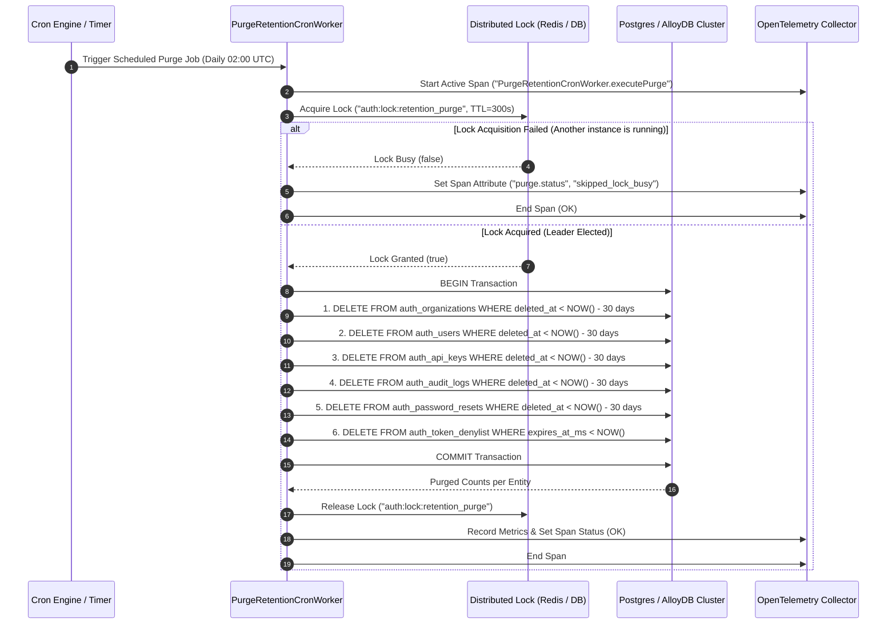
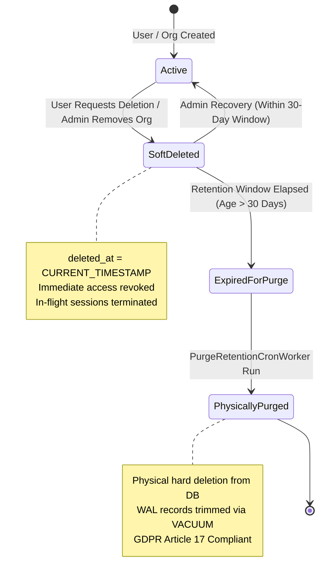
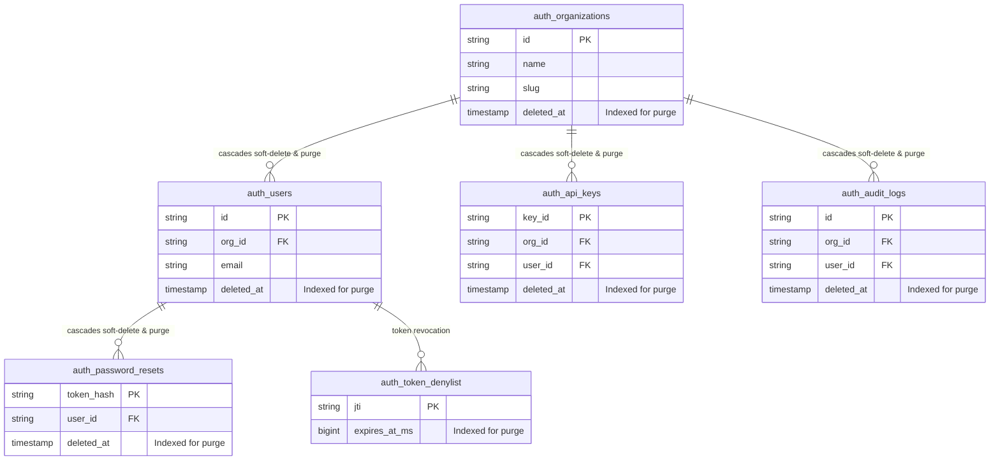

# 0016: Automated 30-Day Cascade Soft-Delete Purge Cron Worker (GDPR Article 17)

- **Status**: Accepted
- **Date**: 2026-10-14
- **Authors**: Platform Architecture & Core Auth Team
- **RFC / Standards**: GDPR Article 17 ("Right to be Forgotten"), ISO/IEC 27001 A.8.10 (Information Deletion), NIST SP 800-88 Rev. 1 (Media Sanitization)
- **Deciders**: Lead Platform Architect, Lead Infrastructure Engineer, Security Officer

---

## 1. Context & Problem Statement

The `@observability/auth` platform implements a soft-deletion pattern (`deleted_at = CURRENT_TIMESTAMP`) across its primary entities (`auth_organizations`, `auth_users`, `auth_api_keys`, `auth_audit_logs`, `auth_password_resets`, and `auth_token_denylist`). This soft-delete architecture is critical for:
1. Preventing accidental, irreversible data loss.
2. Preserving referential integrity and audit trail during in-flight operations.
3. Allowing administrative recovery within a 30-day grace period.

However, soft deletion alone creates a serious legal and operational compliance vulnerability:
- **GDPR Article 17 Violation**: Organizations are legally required to permanently purge personal data without undue delay once the retention purpose has expired. Indefinite soft-deletion fails regulatory audits.
- **OLTP Index & Storage Bloat**: Soft-deleted tombstones accumulate inside PostgreSQL/AlloyDB indexes (`B-tree`), degrading query planner index scans and caching efficiency.
- **Missing Automation**: While SQL purge queries (`FLOW_RETENTION_PURGE`) exist in the codebase, they require manual administrative execution and are not autonomously scheduled or executed with distributed concurrency protection.

---

## 2. Decision Drivers

1. **Autonomous Scheduled Execution**: Background purge execution must run deterministically on a configurable cron interval (defaulting to 02:00 UTC daily) without requiring human intervention.
2. **Distributed Leader Election & Mutex Locking**: Multi-instance cluster replicas must never execute the purge worker simultaneously. A distributed mutex lease (via Redis or database lock) must guarantee single-leader execution.
3. **Batch-Chunked Cascade Execution**: Large volumes of expired records must be purged in bounded batches (e.g., 500 rows per transaction) to prevent table locks and IO spikes on live customer OLTP traffic.
4. **Audit Trail & Observability**: Every execution run must emit OpenTelemetry spans (`PurgeRetentionCronWorker.executePurge`), structured metrics (rows purged per table), and immutable audit logs.
5. **Fail-Safe Manual Administrative Override**: An authenticated administrative endpoint (`POST /api/v1/auth/admin/purge-expired`) protected by RBAC and RFC 9470 Step-Up Authentication must allow on-demand execution.

---

## 3. High-Level Architecture (HLD)

The following sequence illustrates the autonomous cron execution lifecycle with distributed mutex acquisition:



---

## 4. Entity Lifecycle & Purge State Machine



---

## 5. Entity Relationship & Cascade Dependency Diagram (ERD)



---

## 6. Implementation Specifications

### 6.1 Database Migration
Add composite/partial indexes to optimize the cutoff purge scan:
- `CREATE INDEX IF NOT EXISTS idx_auth_orgs_deleted_at ON auth_organizations (deleted_at) WHERE deleted_at IS NOT NULL;`
- `CREATE INDEX IF NOT EXISTS idx_auth_users_deleted_at ON auth_users (deleted_at) WHERE deleted_at IS NOT NULL;`
- `CREATE INDEX IF NOT EXISTS idx_auth_api_keys_deleted_at ON auth_api_keys (deleted_at) WHERE deleted_at IS NOT NULL;`
- `CREATE INDEX IF NOT EXISTS idx_auth_audit_logs_deleted_at ON auth_audit_logs (deleted_at) WHERE deleted_at IS NOT NULL;`
- `CREATE INDEX IF NOT EXISTS idx_auth_resets_deleted_at ON auth_password_resets (deleted_at) WHERE deleted_at IS NOT NULL;`

### 6.2 Worker Component (`PurgeRetentionCronWorker`)
- Located in `src/infra/workers/purge-retention-cron.worker.ts`.
- Manages unref timers to avoid keeping Node.js event loops alive during test teardown.
- Implements `executePurge(ctx?: TraceContext): Promise<PurgeSummary>`.

### 6.3 Admin REST API
- `POST /api/v1/auth/admin/purge-expired`
- Headers:
  - `Authorization: Bearer <ADMIN_JWT>`
  - `X-Reauth-Token: <STEP_UP_TOKEN>` (Protected high-value action RFC 9470)
- Response Envelope:
  ```json
  {
    "status": "success",
    "message": "Retention purge completed successfully",
    "data": {
      "purged_records": 42,
      "cutoff_timestamp": "2026-09-14T02:00:00.000Z",
      "duration_ms": 14.5
    }
  }
  ```

---

## 7. Consequences & Trade-Offs

### Positive
- **Guaranteed Regulatory Compliance**: Meets strict 30-day GDPR Article 17 and ISO/IEC 27001 data destruction windows.
- **Database Health**: Automatically prevents bloat across index tables and dead tuples.
- **Zero Cluster Contention**: Distributed locking prevents competing database deletions.

### Negative / Mitigations
- **Non-Recoverable Hard Deletion**: Once purged, records cannot be restored.
  - *Mitigation*: The 30-day grace period is strictly enforced (`deleted_at < NOW() - INTERVAL '30 days'`).
