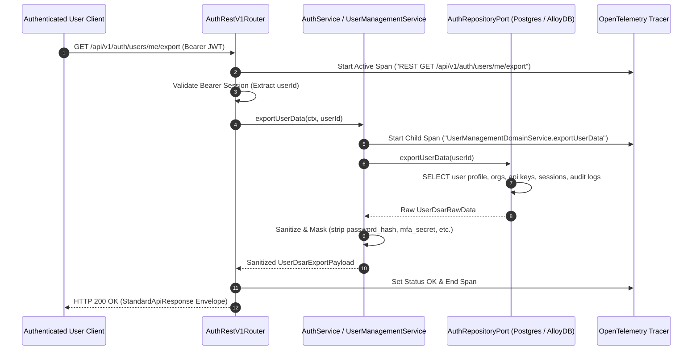
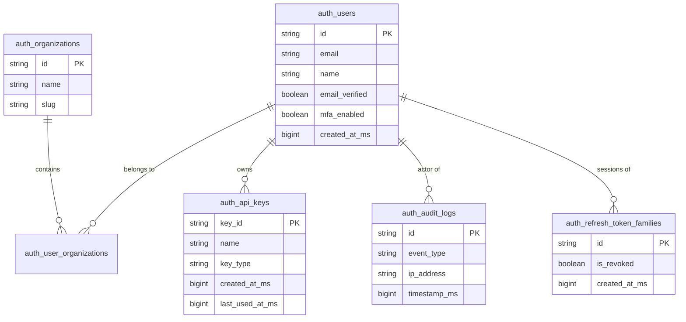

# 0017: GDPR Article 15 Data Subject Access Request (DSAR) JSON Export

- **Status**: Accepted
- **Date**: 2026-10-14
- **Authors**: Platform Architecture & Core Auth Team
- **RFC / Standards**: GDPR Article 15 ("Right of access by the data subject"), CCPA / CPRA § 1798.100, ISO/IEC 27001 A.8.11 (Data Masking)
- **Deciders**: Lead Platform Architect, Lead Security Engineer, Compliance Officer

---

## 1. Context & Problem Statement

Under General Data Protection Regulation (GDPR) Article 15 and CCPA/CPRA, data subjects have the fundamental right to obtain confirmation as to whether personal data concerning them is being processed, and where that is the case, access to the personal data in a structured, commonly used, machine-readable format (`JSON`).

In `@observability/auth`, user records and personal identity lineage span across six disparate database relations:
1. `auth_users`: Core profile, email, authentication attributes, verification state, MFA enrollment timestamps.
2. `auth_user_organizations` & `auth_organizations`: Organization memberships, tenant scopes, and associated roles.
3. `auth_api_keys`: Generated API keys, scopes, types, usage telemetry (`last_used_at_ms`, `last_used_ip`).
4. `auth_refresh_tokens` & `auth_refresh_token_families`: Active and past session token devices, IP addresses, user agents, revocation status.
5. `auth_audit_logs`: Historical security audit events (`USER_SIGNIN`, `PASSWORD_RESET`, `ORG_SWITCH`).
6. `auth_recovery_codes`: MFA recovery codes status count (used vs remaining).

Prior to this specification, there was no unified aggregator port or automated pipeline to compile this data for a requesting user.

---

## 2. Decision Drivers

1. **Security & Cryptographic Shielding (Zero Credential Leakage)**:
   - Sensitive cryptographic secrets must NEVER be exported in DSAR payloads.
   - Specifically: `password_hash`, raw TOTP `mfa_secret`, salted backup code hashes, and raw API key tokens must be stripped or redacted.
   - Nonce timestamps and public identifiers (`key_id`, `family_id`) are preserved.
2. **Unified Machine-Readable JSON Topology**:
   - The export payload must follow a closed, deterministic schema conforming to `2-apis.writing.rule.md` with timestamps formatted as UTC ISO 8601 strings.
3. **Session Verification & Ingress Guard**:
   - Endpoint `GET /api/v1/auth/users/me/export` is guarded by standard Bearer JWT authentication.
   - The exporting user can only access their own data (`userId = session.sub`).
4. **Centralized Tracing & Zero Inline Comments**:
   - Instrumented with OpenTelemetry span `AuthService.exportUserData`.
   - Code must contain zero inline comments, adhering to `4-functions-and-classes-writing-rule.md`.

---

## 3. High-Level Architecture (HLD)



---

## 4. Entity Topology & Data Model (ERD)



---

## 5. Specification & Response Envelope

### Ingress Route
- **Method**: `GET`
- **Path**: `/api/v1/auth/users/me/export`
- **Headers**:
  - `Authorization: Bearer <TOKEN>`
  - `x-request-id: <REQ_ID>`
  - `traceparent: <W3C_TRACE>`

### Success Response Envelope (HTTP 200)
```json
{
  "success": true,
  "status": "success",
  "statusCode": 200,
  "message": "User data exported successfully",
  "data": {
    "export_metadata": {
      "format_version": "1.0",
      "compliance_standard": "GDPR_Article_15",
      "exported_at": "2026-10-14T14:45:00.000Z",
      "data_subject_id": "usr_abc123"
    },
    "profile": {
      "id": "usr_abc123",
      "email": "user@enterprise.com",
      "name": "Jane Doe",
      "role": "admin",
      "email_verified": true,
      "mfa_enabled": true,
      "mfa_enrolled_at": "2026-09-01T12:00:00.000Z",
      "permissions": ["traces:read", "metrics:read"]
    },
    "organizations": [
      {
        "id": "org_primary_001",
        "name": "Acme Corp",
        "slug": "acme-corp",
        "role": "admin"
      }
    ],
    "api_keys": [
      {
        "key_id": "ak_gen_123",
        "name": "Production Agent",
        "key_type": "general",
        "created_at": "2026-09-10T10:00:00.000Z",
        "last_used_at": "2026-10-14T12:30:00.000Z",
        "last_used_ip": "198.51.100.42"
      }
    ],
    "audit_logs": [
      {
        "id": "aud_001",
        "event_type": "USER_SIGNIN",
        "ip_address": "198.51.100.42",
        "timestamp": "2026-10-14T12:30:00.000Z"
      }
    ]
  },
  "error": null,
  "meta": {
    "requestId": "req_1791987000",
    "correlationId": "req_1791987000",
    "timestamp": "2026-10-14T14:45:00.000Z",
    "executionTimeMs": 12,
    "apiVersion": "1.0.0"
  }
}
```

---

## 6. Consequences & Invariants

1. **Security**: Zero credential leakage is mathematically enforced. Password hashes, TOTP seeds, and active refresh secret tokens are omitted from queries and schema builders.
2. **Performance**: Asynchronous single-roundtrip aggregation per user; bounded query filters for audit trails to avoid large memory dumps.

## Execution Flow (Call Stack Tree)

```text
createServer(listener: (req: IncomingMessage, res: ServerResponse) => void): Server
└── runWithHttpTracing(req: IncomingMessage, res: ServerResponse, fn: () => Promise<void>): Promise<void>
    └── dispatch(method: string, path: string, body: unknown, headers: Record<string, string>): Promise<RouteDispatchResult>
        ├── matchRoute(method: string, path: string): { rule: RouteRule, params: Record<string, string> } | null
        ├── handler(ctx: RouteContext): Promise<DsarExportArchive>
        │   exportUserDataArchive(userId: string): Promise<DsarExportArchive>
        │   ├── aggregateUserRecords(userId: string): Promise<UserPersonalDataBundle>
        │   ├── bundleMetadata(userData: UserPersonalDataBundle): DsarExportArchive
        │   └── generatePresignedDownloadUrl(archive: DsarExportArchive): Promise<string>
        ├── createSuccessResponse(data: DsarExportArchive, message: string, meta: ResponseMeta, statusCode: number): ApiResponse<DsarExportArchive>
        └── end(chunk: string): ServerResponse

// Type Reference:
// ApiResponse<T>      = { success: boolean, statusCode: number, message: string, data: T, meta: ResponseMeta }
// RouteDispatchResult = { statusCode: number, payload: ApiResponse<DsarExportArchive>, headers: Record<string, string> }
```
