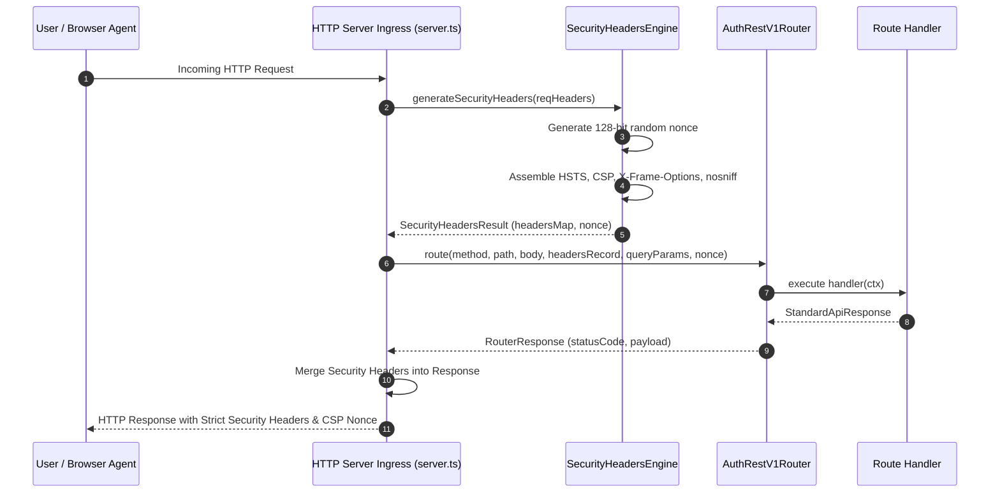

# 0018: Automated Security Headers & Strict Content Security Policy (CSP Nonces)

- **Status**: Accepted
- **Date**: 2026-10-14
- **Authors**: Platform Architecture & Core Auth Team
- **RFC / Standards**: W3C CSP Level 3, RFC 6797 (HSTS), RFC 7034 (X-Frame-Options), MDN HTTP Security Headers Guidelines
- **Deciders**: Lead Platform Architect, Lead Security Engineer

---

## 1. Context & Problem Statement

In accordance with modern web security baselines (OWASP ASVS 4.0 §14.4 and NIST SP 800-63B), authentication and identity services must strictly protect user credentials, session cookies, and API tokens from ingress browser attacks including Cross-Site Scripting (XSS), Clickjacking, MIME-sniffing, and SSL-downgrade attacks.

Prior to this specification, `@observability/auth` emitted basic CORS headers and `content-type`, but lacked systematic enforcement of:
1. HTTP Strict Transport Security (`Strict-Transport-Security: max-age=63072000; includeSubDomains; preload`).
2. MIME-type sniffing defense (`X-Content-Type-Options: nosniff`).
3. Frame sandboxing defense (`X-Frame-Options: DENY`).
4. Referrer information leakage control (`Referrer-Policy: strict-origin-when-cross-origin`).
5. Hardware feature-policy restriction (`Permissions-Policy: geolocation=(), camera=(), microphone=(), payment=()`).
6. Cryptographically generated Content Security Policy nonces (`script-src 'nonce-{NONCE}' 'strict-dynamic'; object-src 'none'; base-uri 'none'`).

Furthermore, in accordance with the user requirement, this feature must be **declaratively configurable by any operator** without modifying code, adhering to `3.shared.code.writing.rule.md`.

---

## 2. Decision Drivers

1. **Defense-in-Depth for Identity Endpoints**:
   - Prevent session hijacking and credential credential-sniffing via malicious iframe embeddings or inline script execution.
2. **Dynamic Cryptographic Nonces**:
   - Generate a fresh, high-entropy 128-bit base64 nonce (`crypto.randomBytes(16).toString('base64')`) per request.
   - Inject the generated nonce into the response headers (`Content-Security-Policy`) and route context for downstream HTML rendering (e.g. login portal or OAuth consent pages).
3. **Pure Declarative Configuration (`config/`)**:
   - All options (`enabled`, `hstsMaxAge`, `frameOptions`, `referrerPolicy`, `permissionsPolicy`, `cspReportOnly`) are loaded in `src/config/security-headers.config.ts` from environment variables, defaulting to enterprise-grade production values.
4. **Universal Ingress Injection**:
   - Headers must be applied to every HTTP response: 2xx success, 4xx client errors, 5xx unhandled exceptions, and CORS OPTIONS preflights.

---

## 3. High-Level Architecture (HLD)



---

## 4. Header Specifications & Standards Compliance

| Header Name | Standard | Default Value | Security Impact |
|---|---|---|---|
| `Strict-Transport-Security` | RFC 6797 | `max-age=63072000; includeSubDomains; preload` | Eliminates SSL stripping and protocol downgrade attacks |
| `X-Content-Type-Options` | W3C / WHATWG | `nosniff` | Prevents browser MIME-type confusion & script execution |
| `X-Frame-Options` | RFC 7034 | `DENY` | Prevents clickjacking by prohibiting iframe rendering |
| `Referrer-Policy` | W3C | `strict-origin-when-cross-origin` | Protects sensitive URL parameters from leaking on outbound requests |
| `Permissions-Policy` | W3C | `geolocation=(), camera=(), microphone=(), payment=()` | Blocks browser hardware access from compromised contexts |
| `Content-Security-Policy` | W3C CSP Level 3 | `default-src 'self'; script-src 'nonce-{NONCE}' 'strict-dynamic'; object-src 'none'; base-uri 'none'; frame-ancestors 'none';` | Blocks unauthorized inline or remote scripts |
| `Cross-Origin-Opener-Policy` | WHATWG | `same-origin` | Isolates browsing context against Spectre/XS-Leaks |
| `Cross-Origin-Resource-Policy` | WHATWG | `same-origin` | Blocks arbitrary cross-origin read access |

---

## 5. Declarative Environment Configuration

```bash
# Security Headers Configuration
AUTH_SECURITY_HEADERS_ENABLED=true
AUTH_SECURITY_HEADERS_HSTS_ENABLED=true
AUTH_SECURITY_HEADERS_HSTS_MAX_AGE=63072000
AUTH_SECURITY_HEADERS_HSTS_INCLUDE_SUBDOMAINS=true
AUTH_SECURITY_HEADERS_HSTS_PRELOAD=true
AUTH_SECURITY_HEADERS_FRAME_OPTIONS=DENY
AUTH_SECURITY_HEADERS_NOSNIFF=true
AUTH_SECURITY_HEADERS_REFERRER_POLICY=strict-origin-when-cross-origin
AUTH_SECURITY_HEADERS_PERMISSIONS_POLICY="geolocation=(), camera=(), microphone=(), payment=()"
AUTH_SECURITY_HEADERS_CSP_ENABLED=true
AUTH_SECURITY_HEADERS_CSP_REPORT_ONLY=false
AUTH_SECURITY_HEADERS_COOP=same-origin
AUTH_SECURITY_HEADERS_CORP=same-origin
```

---

## 6. Consequences & Invariants

1. **Zero Credential / Token Leaks**: Third-party iframe embeddings and untrusted scripts are rejected at the browser network layer.
2. **Zero Code Changes for Operators**: Operators can toggle headers or switch CSP to `Report-Only` mode purely via `.env` configuration.
3. **Full Policy Conformance**: Follows Hexagonal Architecture, pure configuration isolation in `config/`, and zero inline comments in runtime implementations.
