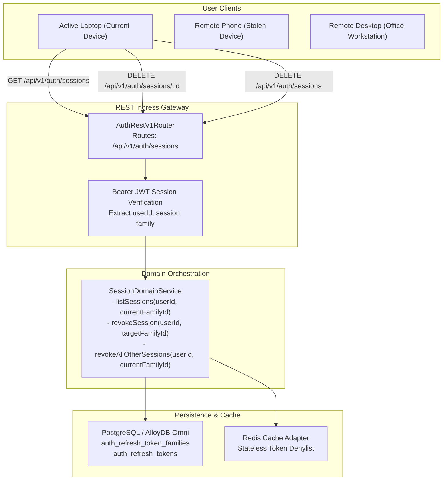
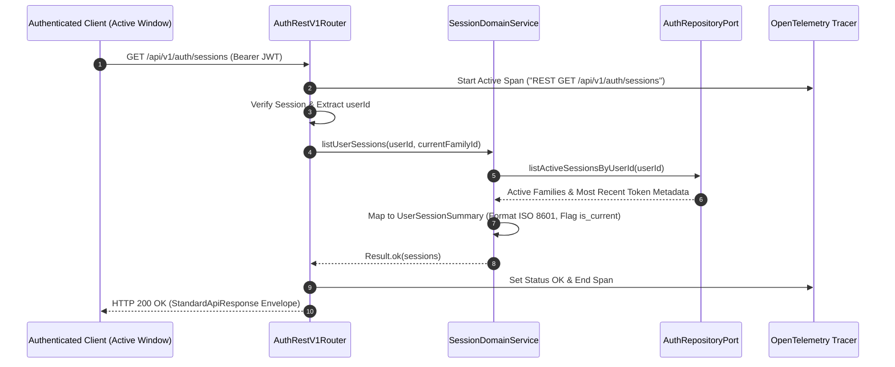
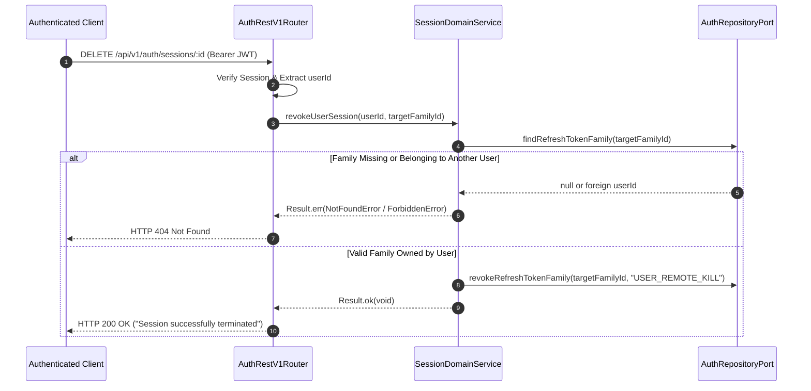
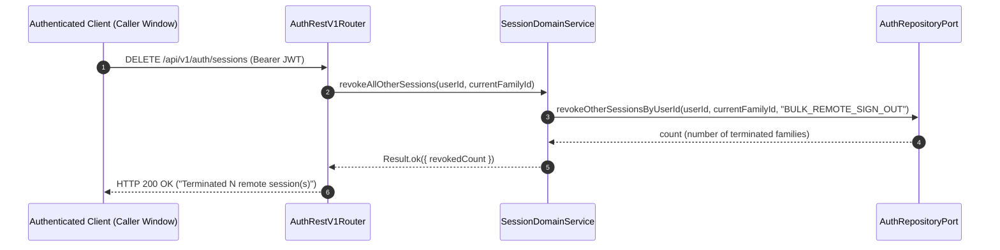
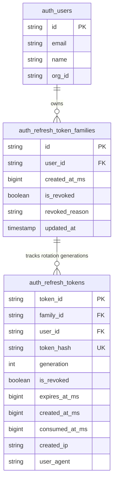
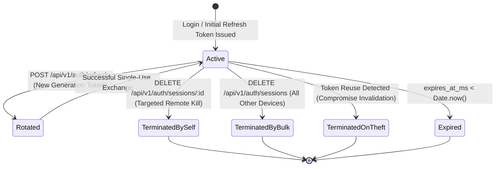

# ADR 0019: Multi-Device Session Management & Remote Kill (OWASP ASVS 3.3)

- **Status**: Accepted
- **Date**: 2026-10-14
- **Authors**: Platform Architecture & Core Auth Team
- **RFC / Standards**: OWASP ASVS 4.0 §3.3 ("Session Logout and Expiration Requirements"), NIST SP 800-63B §7.1 ("Session Management"), RFC 6749 §10.4 ("Refresh Token Rotation")
- **Deciders**: Lead Platform Architect, Lead Security Engineer, Compliance Officer

---

## 📑 Table of Contents

1. [Context & Problem Statement](#1-context--problem-statement)
2. [Decision Drivers](#2-decision-drivers)
3. [High-Level Design (HLD) & Architectural Topology](#3-high-level-design-hld--architectural-topology)
4. [Low-Level Design (LLD) & Sequence Workflows](#4-low-level-design-lld--sequence-workflows)
   - [4.1 Active Session Enumeration (`GET /api/v1/auth/sessions`)](#41-active-session-enumeration-get-apiv1authsessions)
   - [4.2 Single Remote Session Termination (`DELETE /api/v1/auth/sessions/:id`)](#42-single-remote-session-termination-delete-apiv1authsessionsid)
   - [4.3 Sign Out All Other Devices (`DELETE /api/v1/auth/sessions`)](#43-sign-out-all-other-devices-delete-apiv1authsessions)
5. [Entity Topology & Database Relationships (ERD)](#5-entity-topology--database-relationships-erd)
6. [Finite State Machine & Session Family Lifecycle](#6-finite-state-machine--session-family-lifecycle)
7. [API Contract Specifications & Response Envelopes](#7-api-contract-specifications--response-envelopes)
8. [OpenTelemetry Tracing & Observability](#8-opentelemetry-tracing--observability)
9. [Declarative Configuration Standards (`config/`)](#9-declarative-configuration-standards-config)
10. [Security Invariants & Anti-Tampering Rules](#10-security-invariants--anti-tampering-rules)

---

## 1. Context & Problem Statement

Modern enterprise operators and SaaS users authenticate from multiple physical and virtual endpoints simultaneously: office workstations, laptops, mobile phones, and shared jump hosts. If an active device is stolen, an unencrypted laptop compromised, or a browser profile exfiltrated, adversaries can persist across long-lived refresh token rotation cycles.

In `@observability/auth`, session persistence is anchored on RFC 6749 §10.4 refresh token families (`auth_refresh_token_families` and `auth_refresh_tokens` introduced in ADR 0014). However, before this specification, users had zero ambient visibility into what devices were active under their identity and had no self-service mechanism to remotely revoke suspicious sessions.

### Key Deficiencies Addressed:
1. **Zero Device Visibility**: Users could not see active IP addresses, user agents, or last activity timestamps.
2. **Missing Remote Revocation**: Compromised devices could only be invalidated by destroying all credentials or manually contacting security operations.
3. **Absence of Current Device Preservation**: A standard sign-out or blanket token purge would disconnect the user's active window, breaking administrative workflows.

---

## 2. Decision Drivers

1. **OWASP ASVS 4.0 §3.3 Compliance**:
   - Provide an authenticated endpoint for users to view all currently active concurrent sessions.
   - Permit selective termination of any remote session without impacting the current user agent.
   - Permit atomic "Sign Out All Other Devices" to mitigate credential harvesting after password changes or security alerts.
2. **Current-Session Identity Resolution**:
   - Identify the requesting client's active family from incoming JWT / session context, flagging `is_current: true` for the active session and `is_current: false` for remote devices.
3. **Strict Tenant and Subject Isolation**:
   - Prevent cross-tenant and cross-subject revocation. A user can only view and terminate their own sessions.
4. **Hexagonal Architecture & Zero Inline Comments**:
   - Pure domain services, repository ports, zero magic strings, and strict conformance with `4-functions-and-classes-writing-rule.md` and `06-writing-conditions.md`.

---

## 3. High-Level Design (HLD) & Architectural Topology



---

## 4. Low-Level Design (LLD) & Sequence Workflows

### 4.1 Active Session Enumeration (`GET /api/v1/auth/sessions`)



### 4.2 Single Remote Session Termination (`DELETE /api/v1/auth/sessions/:id`)



### 4.3 Sign Out All Other Devices (`DELETE /api/v1/auth/sessions`)



---

## 5. Entity Topology & Database Relationships (ERD)



### 5.2 Migration DDL (`database/migrations/0010_create_refresh_tokens_and_families.sql`)

```sql
CREATE TABLE IF NOT EXISTS auth_refresh_token_families (
    id VARCHAR(64) PRIMARY KEY,
    user_id VARCHAR(64) NOT NULL REFERENCES auth_users(id) ON DELETE CASCADE,
    created_at_ms BIGINT NOT NULL,
    is_revoked BOOLEAN NOT NULL DEFAULT FALSE,
    revoked_reason VARCHAR(255),
    updated_at TIMESTAMP WITH TIME ZONE DEFAULT CURRENT_TIMESTAMP
);

CREATE INDEX IF NOT EXISTS idx_auth_refresh_families_user_id ON auth_refresh_token_families(user_id);
CREATE INDEX IF NOT EXISTS idx_auth_refresh_families_revoked ON auth_refresh_token_families(is_revoked);

CREATE TABLE IF NOT EXISTS auth_refresh_tokens (
    token_id VARCHAR(64) PRIMARY KEY,
    family_id VARCHAR(64) NOT NULL REFERENCES auth_refresh_token_families(id) ON DELETE CASCADE,
    user_id VARCHAR(64) NOT NULL REFERENCES auth_users(id) ON DELETE CASCADE,
    token_hash VARCHAR(255) NOT NULL UNIQUE,
    generation INT NOT NULL DEFAULT 1,
    is_revoked BOOLEAN NOT NULL DEFAULT FALSE,
    expires_at_ms BIGINT NOT NULL,
    created_at_ms BIGINT NOT NULL,
    consumed_at_ms BIGINT,
    created_ip VARCHAR(64),
    user_agent VARCHAR(512)
);

CREATE INDEX IF NOT EXISTS idx_auth_refresh_tokens_hash ON auth_refresh_tokens(token_hash);
CREATE INDEX IF NOT EXISTS idx_auth_refresh_tokens_family_id ON auth_refresh_tokens(family_id);
CREATE INDEX IF NOT EXISTS idx_auth_refresh_tokens_user_id ON auth_refresh_tokens(user_id);
CREATE INDEX IF NOT EXISTS idx_auth_refresh_tokens_expires_at ON auth_refresh_tokens(expires_at_ms);
```

---


## 6. Finite State Machine & Session Family Lifecycle



---

## 7. API Contract Specifications & Response Envelopes

### 7.1 List Active Sessions
- **Method**: `GET`
- **Path**: `/api/v1/auth/sessions`
- **Headers**:
  - `Authorization: Bearer <JWT>`
- **Response**: `HTTP 200 OK`
```json
{
  "success": true,
  "status": "success",
  "statusCode": 200,
  "message": "Active sessions retrieved successfully",
  "data": [
    {
      "id": "fam_01J9...",
      "ip_address": "127.0.0.1",
      "user_agent": "Mozilla/5.0 (X11; Linux x86_64)...",
      "created_at": "2026-10-14T12:00:00.000Z",
      "last_active_at": "2026-10-14T15:00:00.000Z",
      "is_current": true
    }
  ],
  "meta": {
    "requestId": "req_1791987000",
    "timestamp": "2026-10-14T15:00:01.000Z",
    "apiVersion": "1.0.0"
  }
}
```

### 7.2 Revoke Single Remote Session
- **Method**: `DELETE`
- **Path**: `/api/v1/auth/sessions/:id`
- **Response**: `HTTP 200 OK`
```json
{
  "success": true,
  "status": "success",
  "statusCode": 200,
  "message": "Session fam_01J9... successfully terminated",
  "data": {
    "sessionId": "fam_01J9...",
    "terminated": true
  }
}
```

### 7.3 Revoke All Other Devices
- **Method**: `DELETE`
- **Path**: `/api/v1/auth/sessions`
- **Response**: `HTTP 200 OK`
```json
{
  "success": true,
  "status": "success",
  "statusCode": 200,
  "message": "Successfully signed out of 3 other session(s)",
  "data": {
    "revokedCount": 3
  }
}
```

---

## 8. OpenTelemetry Tracing & Observability

Every session operation is traced with dedicated span attributes:
- `span.setAttribute('session.user_id', userId)`
- `span.setAttribute('session.target_family_id', targetFamilyId)`
- `span.setAttribute('session.revoked_count', count)`

---

## 9. Declarative Configuration Standards (`config/`)

All limits are loaded into `AUTH_CONFIG.session` via declarative environment variables:
```bash
# Session Limits
AUTH_SESSION_MAX_CONCURRENT=10
AUTH_SESSION_INACTIVITY_TTL_SECONDS=604800
```

---

## 10. Security Invariants & Anti-Tampering Rules

1. **Authorization Ownership Gate**: A user cannot terminate a session family that does not belong to their `user_id`. Attempting to do so yields an explicit typed `NotFoundError` or `ForbiddenError`.
2. **Current Device Immunity**: Bulk revocation (`DELETE /api/v1/auth/sessions`) mathematically excludes `currentFamilyId`. The caller's session is never severed.
3. **Zero Magic Strings**: All endpoint paths, query keys, and error codes are declared in shared constants modules.
4. **Zero Inline Comments**: Self-documenting code driven by explicit TypeScript types and file header docblocks.
