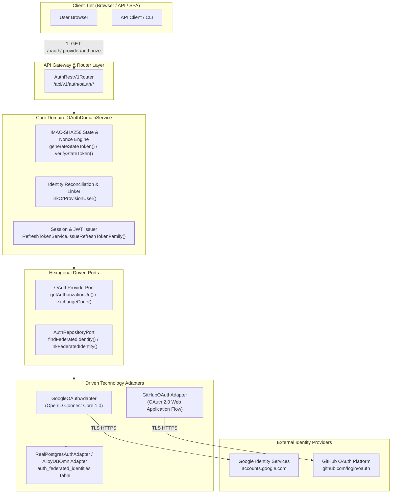
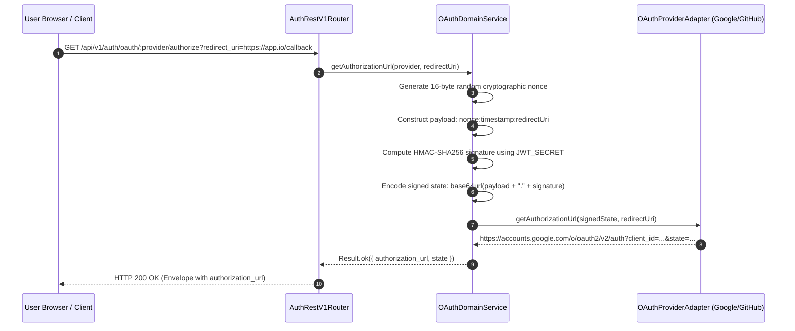
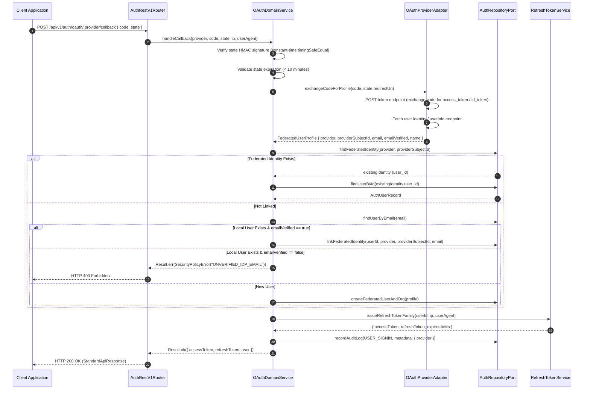
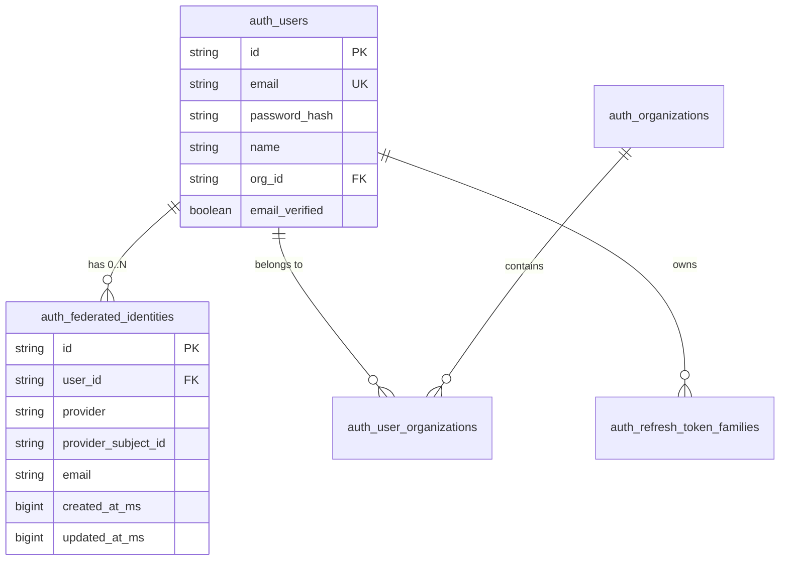
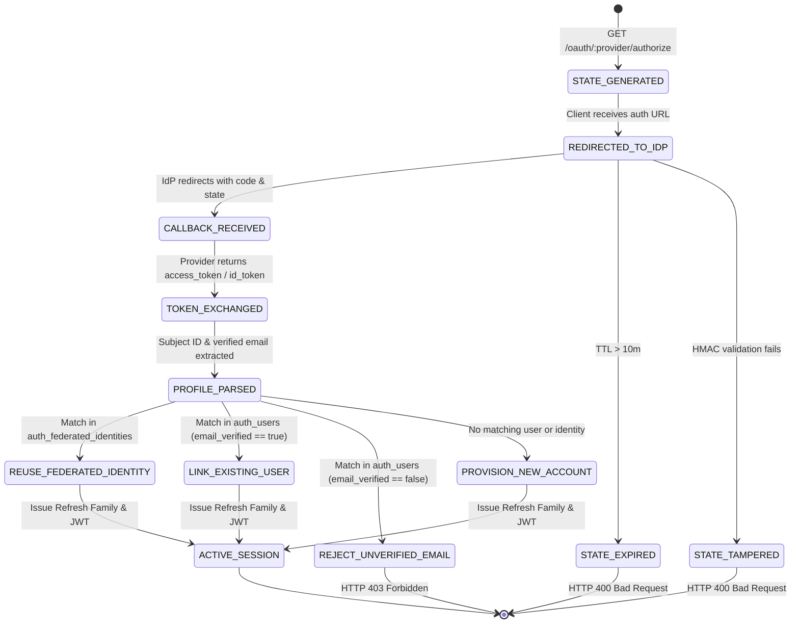

# ADR 0020: Federated Identity Provider (OAuth 2.0 / OIDC) SSO & Account Linking

- **Status**: Accepted
- **Date**: 2026-10-15
- **Authors**: Platform Architecture & Core Auth Team
- **RFC / Standards**: RFC 6749 ("The OAuth 2.0 Authorization Framework"), RFC 7636 ("Proof Key for Code Exchange by OAuth Public Clients"), OpenID Connect Core 1.0, NIST SP 800-63C ("Digital Identity Guidelines: Federation and Assertions"), OWASP ASVS 4.0 §3.1 & §3.7
- **Deciders**: Lead Platform Architect, Lead Security Engineer, Compliance Officer

---

## 📑 Table of Contents

1. [High-Level Design (HLD) & Architectural Philosophy](#1-high-level-design-hld--architectural-philosophy)
2. [Hexagonal Ports & Adapters Topology](#2-hexagonal-ports--adapters-topology)
3. [Low-Level Design (LLD) & Comprehensive Sequence Workflows](#3-low-level-design-lld--comprehensive-sequence-workflows)
   - [3.1 Signed Authorization Initiation (`GET /api/v1/auth/oauth/:provider/authorize`)](#31-signed-authorization-initiation-get-apiv1authoauthproviderauthorize)
   - [3.2 Provider Callback & Authorization Code Exchange (`POST /api/v1/auth/oauth/:provider/callback`)](#32-provider-callback--authorization-code-exchange-post-apiv1authoauthprovidercallback)
   - [3.3 Automatic Account Linking & Pre-Existing Subject Consolidation](#33-automatic-account-linking--pre-existing-subject-consolidation)
   - [3.4 First-Time User & Organization Auto-Provisioning](#34-first-time-user--organization-auto-provisioning)
   - [3.5 Manual Provider Unlinking (`DELETE /api/v1/auth/oauth/identities/:provider`)](#35-manual-provider-unlinking-delete-apiv1authoauthidentitiesprovider)
4. [Entity Topology & Database Relationships (ERD)](#4-entity-topology--database-relationships-erd)
5. [Finite State Machines & Lifecycle Transitions](#5-finite-state-machines--lifecycle-transitions)
6. [RFC 6749 & OpenID Connect Response Envelopes & Parameter Schemas](#6-rfc-6749--openid-connect-response-envelopes--parameter-schemas)
7. [OpenTelemetry Distributed Tracing & Span Invariants](#7-opentelemetry-distributed-tracing--span-invariants)
8. [Declarative Configuration Standards (`src/config/`)](#8-declarative-configuration-standards-srcconfig)
9. [Comprehensive API Curl Reference & Protocol Payloads](#9-comprehensive-api-curl-reference--protocol-payloads)
10. [Security Threat Modeling & Anti-Tampering Protections](#10-security-threat-modeling--anti-tampering-protections)

---

## 1. High-Level Design (HLD) & Architectural Philosophy

`@observability/auth` provides multi-tenant authentication, session management, Argon2id password hashing, and RFC 6238 TOTP MFA. However, identity verification has historically remained bound exclusively to local credential management (`email` + `password_hash`).

In modern enterprise cloud environments:
1. **Password Fatigue & Security Risk**: Local password stores introduce credential exposure vectors, dictionary attacks, and enforce continuous password rotation overhead on users.
2. **Enterprise Single Sign-On (SSO)**: Developers and enterprise operators mandate authenticating with existing corporate identity providers (Google Workspace, GitHub Organization).
3. **Frictionless Onboarding**: Prospective customers frequently abandon registration when confronted with manual email verification challenges and password strength gates.

Federated authentication with OpenID Connect (OIDC) and OAuth 2.0 solves these issues by offloading primary identity verification to trusted third-party Identity Providers (IdPs) while issuing native platform sessions and JWTs.



---

## 2. Hexagonal Ports & Adapters Topology

To adhere to Hexagonal Architecture standards (`4-functions-and-classes-writing-rule.md`), all provider-specific HTTP exchanges, token parsing, and user info mapping are isolated inside Driven Adapters behind an abstract port:

```mermaid
classDiagram
    class OAuthProviderPort {
        <<interface>>
        +getAuthorizationUrl(state: string, redirectUri?: string) Promise~string~
        +exchangeCodeForProfile(code: string, redirectUri?: string) Promise~FederatedUserProfile~
    }

    class GoogleOAuthAdapter {
        -clientId: string
        -clientSecret: string
        -redirectUri: string
        -httpClient: ScalableHttpClient
        +getAuthorizationUrl(state: string, redirectUri?: string) Promise~string~
        +exchangeCodeForProfile(code: string, redirectUri?: string) Promise~FederatedUserProfile~
    }

    class GitHubOAuthAdapter {
        -clientId: string
        -clientSecret: string
        -redirectUri: string
        -httpClient: ScalableHttpClient
        +getAuthorizationUrl(state: string, redirectUri?: string) Promise~string~
        +exchangeCodeForProfile(code: string, redirectUri?: string) Promise~FederatedUserProfile~
    }

    class OAuthDomainService {
        -providers: Map~string, OAuthProviderPort~
        -repo: AuthRepositoryPort
        -refreshTokenService: RefreshTokenService
        -jwtSecret: string
        +getAuthorizationUrl(provider: string, redirectUri?: string) Promise~{ url: string, state: string }~
        +handleCallback(provider: string, code: string, state: string, ip: string, userAgent: string) Promise~AuthSessionPayload~
        +listLinkedIdentities(userId: string) Promise~FederatedIdentityRecord[]~
        +unlinkIdentity(userId: string, provider: string) Promise~void~
    }

    OAuthProviderPort <|.. GoogleOAuthAdapter : implements
    OAuthProviderPort <|.. GitHubOAuthAdapter : implements
    OAuthDomainService --> OAuthProviderPort : delegates provider calls
```

---

## 3. Low-Level Design (LLD) & Comprehensive Sequence Workflows

### 3.1 Signed Authorization Initiation (`GET /api/v1/auth/oauth/:provider/authorize`)

To prevent Cross-Site Request Forgery (RFC 6749 §10.12), the authorization state parameter must be cryptographically signed, tamper-proof, and ephemeral:



### 3.2 Provider Callback & Authorization Code Exchange (`POST /api/v1/auth/oauth/:provider/callback`)



### 3.3 Automatic Account Linking & Pre-Existing Subject Consolidation

When an existing user created via standard sign-up subsequently signs in with Google or GitHub using the exact same verified email:
1. The system verifies `emailVerified === true` from the IdP payload.
2. An atomic record is inserted into `auth_federated_identities` associating `user_id` with `(provider, provider_subject_id)`.
3. Subsequent logins via either method map seamlessly to the identical `user_id`, preserving organization memberships, roles, and audit trails.

### 3.4 First-Time User & Organization Auto-Provisioning

If no existing user record matches the verified IdP email:
1. A new organization is generated: `org_<nanoid>` named `"${profile.name}'s Organization"`.
2. A new user record is created with:
   - `email`: Normalized lowercase email from IdP.
   - `password_hash`: `$oauth$disabled$<random_salt>` (disabling direct password auth until user explicitly initiates password reset).
   - `role`: `admin` (since they are founding the initial organization).
   - `email_verified`: `true` (inheriting IdP cryptographic attestation).
3. An entry is created in `auth_user_organizations` and `auth_federated_identities`.

### 3.5 Manual Provider Unlinking (`DELETE /api/v1/auth/oauth/identities/:provider`)

Users may revoke third-party links from their profile:
1. **Safety Invariant**: Unlinking is prohibited if the account has no password set and no other linked federated identities (preventing permanent account lockout).
2. Deletes the specific `(user_id, provider)` entry from `auth_federated_identities`.
3. Emits audit log `FEDERATED_IDENTITY_UNLINKED`.

---

## 4. Entity Topology & Database Relationships (ERD)

```sql
-- Migration 0013: create_federated_identities_table.sql

CREATE TABLE IF NOT EXISTS auth_federated_identities (
  id VARCHAR(64) PRIMARY KEY,
  user_id VARCHAR(64) NOT NULL REFERENCES auth_users(id) ON DELETE CASCADE,
  provider VARCHAR(32) NOT NULL,
  provider_subject_id VARCHAR(255) NOT NULL,
  email VARCHAR(255) NOT NULL,
  created_at_ms BIGINT NOT NULL,
  updated_at_ms BIGINT NOT NULL,
  CONSTRAINT uq_auth_fed_provider_subject UNIQUE (provider, provider_subject_id),
  CONSTRAINT uq_auth_fed_user_provider UNIQUE (user_id, provider)
);

CREATE INDEX IF NOT EXISTS idx_auth_fed_user_id ON auth_federated_identities(user_id);
CREATE INDEX IF NOT EXISTS idx_auth_fed_email ON auth_federated_identities(email);
```



---

## 5. Finite State Machines & Lifecycle Transitions



---

## 6. RFC 6749 & OpenID Connect Response Envelopes & Parameter Schemas

### 6.1 `GET /api/v1/auth/oauth/:provider/authorize`
- **Query Parameters**:
  - `redirect_uri` (optional): Validated against whitelist.
- **Response `200 OK`**:
```json
{
  "status": "success",
  "message": "OAuth authorization URL generated",
  "data": {
    "provider": "google",
    "authorization_url": "https://accounts.google.com/o/oauth2/v2/auth?client_id=...&response_type=code&scope=openid%20email%20profile&state=...",
    "state": "eyJub25jZSI6ImY2Y...-hmac"
  }
}
```

### 6.2 `POST /api/v1/auth/oauth/:provider/callback`
- **Request Body**:
```json
{
  "code": "4/0AX4XfWhvQ...",
  "state": "eyJub25jZSI6ImY2Y...-hmac"
}
```
- **Response `200 OK`**:
```json
{
  "status": "success",
  "message": "OAuth authentication successful",
  "data": {
    "access_token": "eyJhbGciOi...",
    "token_type": "Bearer",
    "expires_in": 900,
    "refresh_token": "rt_live_f6a839e...",
    "user": {
      "id": "usr_91af238c",
      "email": "developer@example.com",
      "name": "Jane Developer",
      "org_id": "org_default_001",
      "org_name": "Acme Observability",
      "role": "admin",
      "email_verified": true
    }
  }
}
```

---

## 7. OpenTelemetry Distributed Tracing & Span Invariants

- Traces created using `@withSpan("auth.oauth.authorize")` and `@withSpan("auth.oauth.callback")`.
- **Span Attributes**:
  - `oauth.provider`: `google` | `github`
  - `oauth.action`: `login` | `link` | `register`
  - `oauth.subject_id`: SHA-256 masked subject ID.
  - Zero sensitive token logging (`access_token`, client secrets, and code parameters are never captured in spans).

---

## 8. Declarative Configuration Standards (`src/config/`)

Declared in `src/config/oauth.config.ts` and validated via `env.config.ts`:

```typescript
export interface OAuthConfig {
  google: {
    clientId: string;
    clientSecret: string;
    redirectUri: string;
    authEndpoint: string;
    tokenEndpoint: string;
    userInfoEndpoint: string;
  };
  github: {
    clientId: string;
    clientSecret: string;
    redirectUri: string;
    authEndpoint: string;
    tokenEndpoint: string;
    userInfoEndpoint: string;
    userEmailsEndpoint: string;
  };
}
```

---

## 9. Comprehensive API Curl Reference & Protocol Payloads

### 9.1 Initiate Google OAuth Authorization
```bash
curl -X GET "http://localhost:3000/api/v1/auth/oauth/google/authorize" \
  -H "Accept: application/json"
```

### 9.2 Complete OAuth Callback Exchange
```bash
curl -X POST "http://localhost:3000/api/v1/auth/oauth/google/callback" \
  -H "Content-Type: application/json" \
  -d '{
    "code": "4/0AX4XfWhvQ...",
    "state": "eyJub25jZSI6..."
  }'
```

### 9.3 List Linked Identities
```bash
curl -X GET "http://localhost:3000/api/v1/auth/oauth/identities" \
  -H "Authorization: Bearer eyJhbGciOi..."
```

---

## 10. Security Threat Modeling & Anti-Tampering Protections

| Threat | Attack Vector | Mitigation / Architecture Invariant |
|---|---|---|
| **CSRF Login Attack** | Attacker tricks victim into completing OAuth flow using attacker's code | Cryptographic HMAC-SHA256 state token bound to ephemeral nonce and secret |
| **Account Takeover via Email Spoofing** | Attacker registers IdP account with victim's email (unverified) | Automatic linking strictly denied unless `email_verified: true` from IdP |
| **Token Interception in Referrer** | Authorization code leaked via browser referer headers | Callback parameters delivered via POST body; HTTPS strict transport security (HSTS) |
| **Permanent Account Lockout** | User deletes sole federated identity when no local password is set | Precondition check: unlinking rejected if no password and no other identities exist |
