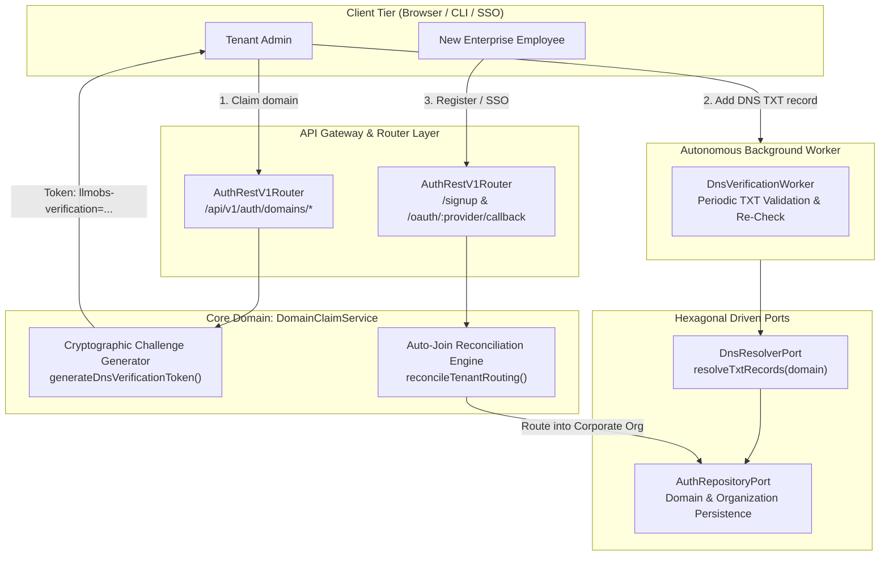
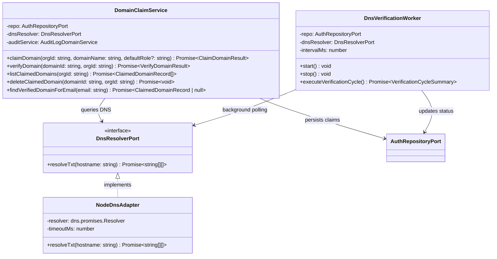
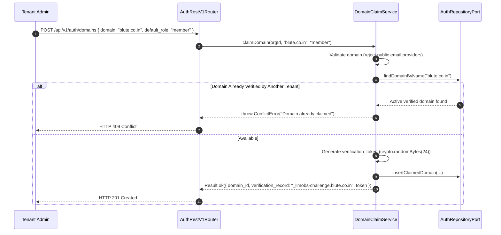
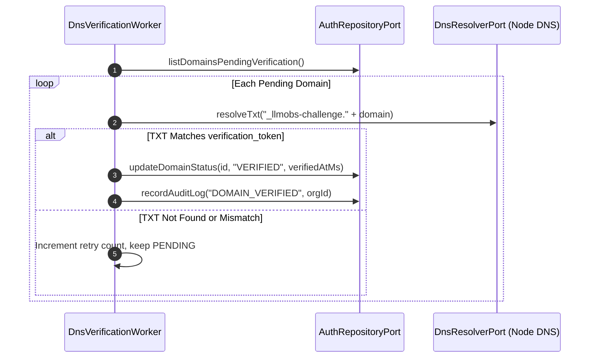
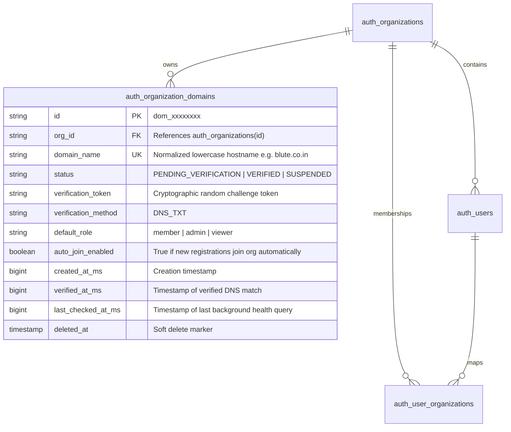
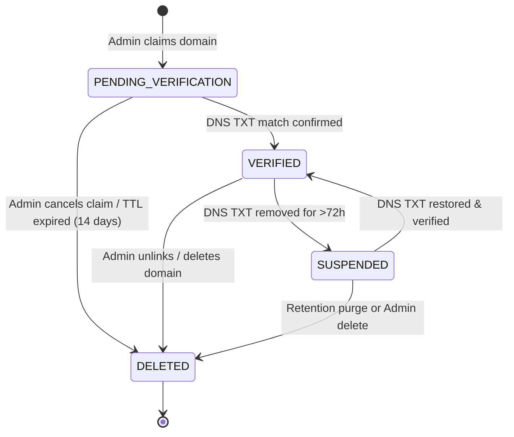

# ADR 0021: Organization Domain Claiming & Verified Auto-Join (DNS TXT + Email Gate)

- **Status**: Proposed
- **Date**: 2026-10-15
- **Authors**: Platform Architecture & Core Auth Team
- **RFC / Standards**: RFC 1035 ("Domain Names - Implementation and Specification"), RFC 2181 ("Clarifications to the DNS Specification"), RFC 8555 ("ACME DNS-01 Challenge Model"), OWASP ASVS 4.0 §1.1 & §3.2
- **Deciders**: Lead Platform Architect, Lead Security Engineer, Enterprise Product Owner

---

## 📑 Table of Contents

1. [High-Level Design (HLD) & Architectural Philosophy](#1-high-level-design-hld--architectural-philosophy)
2. [Hexagonal Ports & Adapters Topology](#2-hexagonal-ports--adapters-topology)
3. [Low-Level Design (LLD) & Comprehensive Sequence Workflows](#3-low-level-design-lld--comprehensive-sequence-workflows)
   - [3.1 Domain Claim Registration (`POST /api/v1/auth/domains`)](#31-domain-claim-registration-post-apiv1authdomains)
   - [3.2 Autonomous DNS TXT Verification Worker](#32-autonomous-dns-txt-verification-worker)
   - [3.3 Immediate On-Demand DNS Verification (`POST /api/v1/auth/domains/:domainId/verify`)](#33-immediate-on-demand-dns-verification-post-apiv1authdomainsdomainidverify)
   - [3.4 Registration & Federated SSO Auto-Join Routing](#34-registration--federated-sso-auto-join-routing)
   - [3.5 Domain Ownership Revocation & Soft-Delete (`DELETE /api/v1/auth/domains/:domainId`)](#35-domain-ownership-revocation--soft-delete-delete-apiv1authdomainsdomainid)
4. [Entity Topology & Database Relationships (ERD)](#4-entity-topology--database-relationships-erd)
5. [Finite State Machines & Lifecycle Transitions](#5-finite-state-machines--lifecycle-transitions)
6. [Parameter Schemas & API Catalog](#6-parameter-schemas--api-catalog)
7. [OpenTelemetry Distributed Tracing & Span Invariants](#7-opentelemetry-distributed-tracing--span-invariants)
8. [Security Threat Modeling & Anti-Tampering Protections](#8-security-threat-modeling--anti-tampering-protections)

---

## 1. High-Level Design (HLD) & Architectural Philosophy

Multi-tenant platforms frequently suffer from the **"Orphaned Workspace Problem"**:
When enterprise users register using their corporate email (`user@enterprise.com`), standard signup engines allocate each user an isolated personal workspace (e.g., `user's Organization`). The enterprise IT administrator has zero visibility into these shadow accounts, cannot mandate SSO or RBAC policies, and cannot pool resource quotas.

**Organization Domain Claiming** eliminates this fragmentation by establishing cryptographic proof of domain ownership. Once an organization proves ownership of an internet domain (via DNS `TXT` record challenges modeled after the ACME DNS-01 protocol):
1. **Verified Auto-Join**: Any user registering or logging in via SAML/OIDC with a verified corporate email (`*@enterprise.com`) is automatically linked to the enterprise tenant.
2. **Shadow Account Prevention**: Users are prevented from creating rogue personal organizations using corporate credentials.
3. **Role & Policy Governance**: Enterprise admins define default onboarding roles (e.g., `member`, `restricted_viewer`) and enforce mandatory step-up/MFA constraints.



---

## 2. Hexagonal Ports & Adapters Topology

In strict alignment with Hexagonal Architecture (Ports and Adapters), DNS lookups and external socket I/O are completely decoupled from domain business logic through `DnsResolverPort`.



---

## 3. Low-Level Design (LLD) & Comprehensive Sequence Workflows

### 3.1 Domain Claim Registration (`POST /api/v1/auth/domains`)

1. Admin submits domain name (e.g. `blute.co.in`).
2. Domain format is normalized (punycode converted, lowercase, public suffix and common freemail domains like `gmail.com`, `yahoo.com` rejected).
3. Service checks that the domain is not already claimed or verified by another active organization.
4. Generates a 32-byte cryptographic nonce token: `llmobs-verification=<token>`.
5. Inserts record into `auth_organization_domains` with status `PENDING_VERIFICATION`.



### 3.2 Autonomous DNS TXT Verification Worker

A background cron job inspects all domains in `PENDING_VERIFICATION` or `VERIFIED` state every 5 minutes:
- For `PENDING_VERIFICATION`: Queries DNS TXT records at `_llmobs-challenge.<domain>`. If the expected token is discovered, status transitions to `VERIFIED`.
- For `VERIFIED`: Periodic health check confirms the DNS TXT record remains in place. If missing for >72 hours, status drops to `SUSPENDED` to prevent domain takeover attacks.



### 3.3 Registration & Federated SSO Auto-Join Routing

When any new user signs up or logs in via Google/GitHub OAuth:
1. Extract domain from user email: `user@blute.co.in` $\rightarrow$ `blute.co.in`.
2. Look up `auth_organization_domains` for active verified claim on `blute.co.in`.
3. If an active claim exists:
   - Assign user to the claimed corporate `org_id` instead of generating a new workspace.
   - Assign user the configured `default_role` (e.g. `member`).
   - Create entry in `auth_user_organizations (user_id, org_id, role)`.
   - Record audit log: `USER_AUTO_JOINED_ORGANIZATION`.

---

## 4. Entity Topology & Database Relationships (ERD)



### 4.2 Migration DDL (`database/migrations/0014_create_organization_domains.sql`)

```sql
CREATE TABLE IF NOT EXISTS auth_organization_domains (
  id VARCHAR(64) PRIMARY KEY,
  org_id VARCHAR(64) NOT NULL REFERENCES auth_organizations(id) ON DELETE CASCADE,
  domain_name VARCHAR(255) NOT NULL,
  status VARCHAR(32) NOT NULL DEFAULT 'PENDING_VERIFICATION',
  verification_token VARCHAR(255) NOT NULL,
  verification_method VARCHAR(32) NOT NULL DEFAULT 'DNS_TXT',
  default_role VARCHAR(64) NOT NULL DEFAULT 'member',
  auto_join_enabled BOOLEAN NOT NULL DEFAULT TRUE,
  created_at_ms BIGINT NOT NULL,
  verified_at_ms BIGINT NULL,
  last_checked_at_ms BIGINT NULL,
  updated_at TIMESTAMP WITH TIME ZONE DEFAULT CURRENT_TIMESTAMP,
  deleted_at TIMESTAMP WITH TIME ZONE DEFAULT NULL,
  CONSTRAINT uq_auth_org_domain UNIQUE (domain_name)
);

CREATE INDEX IF NOT EXISTS idx_auth_org_domains_org_id ON auth_organization_domains(org_id);
CREATE INDEX IF NOT EXISTS idx_auth_org_domains_name ON auth_organization_domains(domain_name);
CREATE INDEX IF NOT EXISTS idx_auth_org_domains_status ON auth_organization_domains(status);
```

---

## 5. Finite State Machines & Lifecycle Transitions



---

## 6. Parameter Schemas & API Catalog

| Method | Endpoint | Description | Auth Required |
|---|---|---|---|
| `POST` | `/api/v1/auth/domains` | Claim a new domain for organization | Yes (Admin / Step-Up) |
| `GET` | `/api/v1/auth/domains` | List claimed domains for current organization | Yes (Member) |
| `POST` | `/api/v1/auth/domains/:domainId/verify` | Trigger immediate on-demand DNS TXT verification | Yes (Admin) |
| `PATCH` | `/api/v1/auth/domains/:domainId` | Update domain settings (e.g. toggle `auto_join_enabled`, `default_role`) | Yes (Admin) |
| `DELETE` | `/api/v1/auth/domains/:domainId` | Revoke domain claim | Yes (Admin / Step-Up) |

### 6.1 `POST /api/v1/auth/domains` (Claim Domain)

**Request:**
```json
{
  "domain_name": "corp.observability.io",
  "default_role": "member"
}
```

**Response (`201 Created`):**
```json
{
  "success": true,
  "status": "success",
  "statusCode": 201,
  "message": "Domain claim initiated successfully",
  "data": {
    "id": "dom_71829a",
    "org_id": "org_9182a",
    "domain_name": "corp.observability.io",
    "status": "PENDING_VERIFICATION",
    "verification_token": "llmobs-verification=a7f29b01c4e8...",
    "verification_method": "DNS_TXT",
    "default_role": "member",
    "auto_join_enabled": true,
    "created_at_ms": 1792046184953
  },
  "error": null,
  "meta": {
    "requestId": "req_1792046185200",
    "correlationId": "req_1792046185200",
    "timestamp": "2026-10-15T06:36:25.200Z",
    "executionTimeMs": 8,
    "apiVersion": "1.0.0"
  }
}
```

### 6.2 `POST /api/v1/auth/domains/:domainId/verify` (Verify DNS Record)

**Response (`200 OK` - Verified):**
```json
{
  "success": true,
  "status": "success",
  "statusCode": 200,
  "message": "Domain successfully verified and activated",
  "data": {
    "id": "dom_71829a",
    "status": "VERIFIED",
    "domain_name": "corp.observability.io",
    "verified_at_ms": 1792046185350,
    "auto_join_enabled": true
  },
  "error": null,
  "meta": {
    "requestId": "req_1792046185360",
    "correlationId": "req_1792046185360",
    "timestamp": "2026-10-15T06:36:25.360Z",
    "executionTimeMs": 24,
    "apiVersion": "1.0.0"
  }
}
```


---

## 7. OpenTelemetry Distributed Tracing & Span Invariants

All DNS and domain operations must emit semantic OpenTelemetry spans adhering to RFC specification:
- Span Name: `DomainClaimService.claimDomain`
- Attributes:
  - `tenant.org_id`: Claiming organization ID.
  - `domain.name`: Target domain (e.g. `blute.co.in`).
  - `dns.verification_method`: `DNS_TXT`.
  - `dns.lookup.duration_ms`: Duration of DNS resolver socket call.
  - `dns.resolved_records_count`: Number of TXT records parsed.

---

## 8. Security Threat Modeling & Anti-Tampering Protections

| Threat | Attack Vector | Mitigation / Architecture Invariant |
|---|---|---|
| **Freemail Domain Hijack** | Attacker attempts to claim `gmail.com`, `yahoo.com`, or `outlook.com` | Hardcoded forbidden freemail & disposable email blocklist; claim rejected with HTTP 400 |
| **Subdomain Takeover** | Attacker claims stale abandoned subdomain | Verification requires exact root TXT or explicit sub-host delegation at `_llmobs-challenge.<subdomain>` |
| **DNS Cache Poisoning / Spoofing** | Attacker poisons local resolver to return false positive verification | DNS queries enforce short TTL, bypass OS cache using authoritative public DNS resolvers with retry fallback |
| **Corporate Account Takeover** | Attacker registers unverified email and auto-joins target corporate workspace | Auto-join strictly requires `email_verified: true` (via OTP verification or federated OIDC assertion) |
| **Silent Domain Ownership Expiry** | Company forgets to renew domain; attacker acquires domain and inherits auto-join | Background worker performs continuous daily re-checks; auto-suspends auto-join if TXT is missing |

## Execution Flow (Call Stack Tree)

```text
createServer(listener: (req: IncomingMessage, res: ServerResponse) => void): Server
└── runWithHttpTracing(req: IncomingMessage, res: ServerResponse, fn: () => Promise<void>): Promise<void>
    └── dispatch(method: string, path: string, body: unknown, headers: Record<string, string>): Promise<RouteDispatchResult>
        ├── matchRoute(method: string, path: string): { rule: RouteRule, params: Record<string, string> } | null
        ├── handler(ctx: RouteContext): Promise<DomainVerificationResult>
        │   verifyDomainOwnership(domainId: string): Promise<DomainVerificationResult>
        │   ├── resolveDnsTxtRecord(domain: string): Promise<string[]>
        │   ├── verifyVerificationToken(records: string[], expectedToken: string): boolean
        │   └── markDomainVerified(domainId: string): Promise<void>
        ├── createSuccessResponse(data: DomainVerificationResult, message: string, meta: ResponseMeta, statusCode: number): ApiResponse<DomainVerificationResult>
        └── end(chunk: string): ServerResponse

// Type Reference:
// ApiResponse<T>      = { success: boolean, statusCode: number, message: string, data: T, meta: ResponseMeta }
// RouteDispatchResult = { statusCode: number, payload: ApiResponse<DomainVerificationResult>, headers: Record<string, string> }
```
