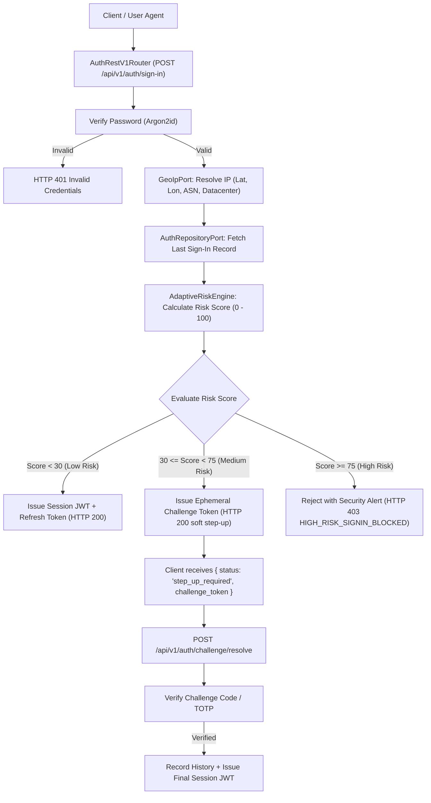
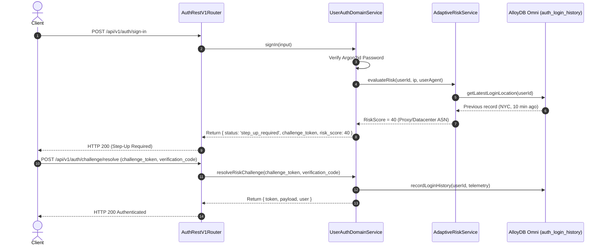

# ADR 0022: Unified Adaptive Risk-Based Authentication (Soft Step-Up)

- **Status**: Accepted
- **Date**: 2026-10-15
- **Deciders**: Platform Architecture Working Group, Cyber Defense Core
- **Context**: Static authentication rules either fail against distributed credential stuffing and rotating datacenter proxies, or impose crippling false-positive session lockouts on legitimate mobile CGNAT and roaming VPN users. Per NIST SP 800-63-3 and zero-trust guidelines, authentication systems must evaluate dynamic session context (ASN reputation, physical travel velocity, and browser fingerprint anomalies) to compute a normalized risk score ($0 - 100$) and prompt a non-destructive soft step-up challenge before granting full access.

---

## 📑 Table of Contents

1. [High-Level Design (HLD)](#1-high-level-design-hld)
2. [Risk Scoring Heuristics & Mathematical Model](#2-risk-scoring-heuristics--mathematical-model)
3. [Hexagonal Architecture & Port Topology](#3-hexagonal-architecture--port-topology)
4. [Low-Level Design (LLD) & Sequence Flows](#4-low-level-design-lld--sequence-flows)
   - [4.1 Low Risk Sign-In Flow (Seamless Access)](#41-low-risk-sign-in-flow-seamless-access)
   - [4.2 Moderate Risk Soft Step-Up Challenge Flow](#42-moderate-risk-soft-step-up-challenge-flow)
   - [4.3 Critical Risk Hard Denial Flow](#43-critical-risk-hard-denial-flow)
5. [Database Schema & Telemetry Retention](#5-database-schema--telemetry-retention)
6. [Challenge Token Specification & Resolution Protocol](#6-challenge-token-specification--resolution-protocol)
7. [Zero-Magic-Strings & Canonical Constants](#7-zero-magic-strings--canonical-constants)
8. [OpenTelemetry Distributed Tracing & Observability](#8-opentelemetry-distributed-tracing--observability)

---

## 🏛 1. High-Level Design (HLD)

Adaptive Risk-Based Authentication intercepts the authentication pipeline after credential verification (Argon2id) and before final session token issuance. It resolves the client's network telemetry, compares it against the user's historical sign-in trajectory, and classifies the attempt into one of three deterministic risk tiers:



---

## 📐 2. Risk Scoring Heuristics & Mathematical Model

The dynamic risk score $R \in [0, 100]$ is the cumulative sum of weighted threat signals:

$$R = \min(100, S_{\text{asn}} + S_{\text{velocity}} + S_{\text{device}})$$

### 2.1 Threat Vector Breakdown

| Threat Vector | Condition | Weight ($S_i$) | Rationale |
|---|---|---|---|
| **Datacenter / Tor / Proxy ASN** | Client IP originates from known hosting provider, Tor exit node, or anonymous VPN ASN. | **+40** | High correlation with automated attacks, brute-force tooling, and credential stuffing proxies. |
| **Extreme Velocity (Impossible Travel)** | Great-circle speed between previous sign-in location and current location exceeds **900 km/h**. | **+35** | Physical impossibility of human air travel within recorded time delta $\Delta t$. |
| **Device / User-Agent Shift** | SHA-256 fingerprint of `User-Agent` + client headers does not match the user's historical footprint. | **+25** | Potential session hijacking or browser change. |

### 2.2 Great-Circle Distance via Haversine Formula

Given consecutive coordinates $(\phi_1, \lambda_1)$ at time $t_1$ and $(\phi_2, \lambda_2)$ at time $t_2$:

$$\Delta \phi = \phi_2 - \phi_1, \quad \Delta \lambda = \lambda_2 - \lambda_1$$
$$a = \sin^2\left(\frac{\Delta \phi}{2}\right) + \cos(\phi_1)\cos(\phi_2)\sin^2\left(\frac{\Delta \lambda}{2}\right)$$
$$c = 2 \cdot \operatorname{atan2}\left(\sqrt{a}, \sqrt{1-a}\right)$$
$$d = R_{\text{earth}} \cdot c \quad (R_{\text{earth}} = 6371\text{ km})$$
$$v = \frac{d}{\Delta t} \quad (\text{km/h})$$

If $v > 900\text{ km/h}$ and $\Delta t \ge 60\text{ s}$, trigger $+35$ risk score.

---

## 🔌 3. Hexagonal Architecture & Port Topology

Following our zero-coupling hexagonal invariant:

```
src/
├── features/auth/
│   ├── ports/
│   │   ├── geo-ip.port.ts             # GeoIpPort (resolve IP to Lat, Lon, ASN, isDatacenter)
│   │   └── adaptive-risk.port.ts      # Risk evaluation contracts & DTOs
│   ├── services/
│   │   └── adaptive-risk.service.ts   # Core pure algorithmic risk calculator
│   └── types.ts                       # RiskEvaluationResult, LoginRiskProfile
├── infra/
│   ├── adapters/
│   │   ├── geo/
│   │   │   └── mock-geo-ip.adapter.ts # Hexagonal GeoIp adapter with deterministic CIDR tables
│   │   └── postgres/
│   │       └── alloydb-omni-auth.adapter.ts # Persists & queries auth_login_history
└── shared/
    ├── constants/
    │   └── auth.constants.ts          # Centralized RISK_THRESHOLDS, RISK_FACTORS, AUDIT_EVENT_RISK_*
    └── errors/
        └── auth.errors.ts             # AdaptiveStepUpRequiredError, HighRiskSignInBlockedError
```

---

## 🔁 4. Low-Level Design (LLD) & Sequence Flows

### 4.1 Low Risk Sign-In Flow (Seamless Access)
When $R < 30$, authentication proceeds normally. The sign-in event is recorded asynchronously in `auth_login_history` to update the user's location baseline.

### 4.2 Moderate Risk Soft Step-Up Challenge Flow
When $30 \le R < 75$, the service generates a signed ephemeral HMAC-SHA256 challenge token with a 300-second TTL:



### 4.3 Critical Risk Hard Denial Flow
When $R \ge 75$ (e.g. Datacenter IP $+40$ AND Impossible Velocity $+35$):
- Service raises `HighRiskSignInBlockedError` (`HTTP 403 Forbidden`).
- SIEM audit event `SECURITY_HIGH_RISK_SIGNIN_BLOCKED` is emitted with client IP, coordinates, and calculated velocity.
- No session or challenge tokens are issued.

---

## 🗄 5. Database Schema & Telemetry Retention

Migration `0016_create_auth_risk_events.sql` provisions the `auth_login_history` table:

```sql
CREATE TABLE IF NOT EXISTS auth_login_history (
    id VARCHAR(64) PRIMARY KEY,
    user_id VARCHAR(64) NOT NULL REFERENCES auth_users(id) ON DELETE CASCADE,
    ip_address VARCHAR(45) NOT NULL,
    latitude DOUBLE PRECISION,
    longitude DOUBLE PRECISION,
    asn VARCHAR(64),
    is_datacenter BOOLEAN NOT NULL DEFAULT FALSE,
    device_fingerprint VARCHAR(64) NOT NULL,
    risk_score INTEGER NOT NULL DEFAULT 0,
    created_at_ms BIGINT NOT NULL
);

CREATE INDEX IF NOT EXISTS idx_auth_login_history_user_time 
    ON auth_login_history(user_id, created_at_ms DESC);
```

---

## 🔐 6. Challenge Token Specification & Resolution Protocol

Challenge tokens use HMAC-SHA256 signature verification over an ephemeral payload:
```json
{
  "type": "risk_challenge",
  "userId": "usr_123456",
  "email": "user@example.com",
  "riskScore": 40,
  "reasons": ["DATACENTER_OR_PROXY_ASN"],
  "exp": 1776249600000
}
```
Verification codes are 6-digit cryptographically secure pseudorandom numbers or TOTP codes validated against the user's secret.

---

## 🏷 7. Zero-Magic-Strings & Canonical Constants

All configuration keys and risk factors are declared in `AUTH_CONSTANTS`:
- `RISK_THRESHOLDS.LOW = 30`
- `RISK_THRESHOLDS.HIGH = 75`
- `RISK_FACTORS.DATACENTER_ASN = 40`
- `RISK_FACTORS.IMPOSSIBLE_VELOCITY = 35`
- `RISK_FACTORS.DEVICE_FINGERPRINT_SHIFT = 25`
- `AUDIT_EVENT_RISK_CHALLENGE_ISSUED = 'RISK_CHALLENGE_ISSUED'`
- `AUDIT_EVENT_RISK_CHALLENGE_RESOLVED = 'RISK_CHALLENGE_RESOLVED'`
- `AUDIT_EVENT_HIGH_RISK_BLOCKED = 'HIGH_RISK_SIGNIN_BLOCKED'`
