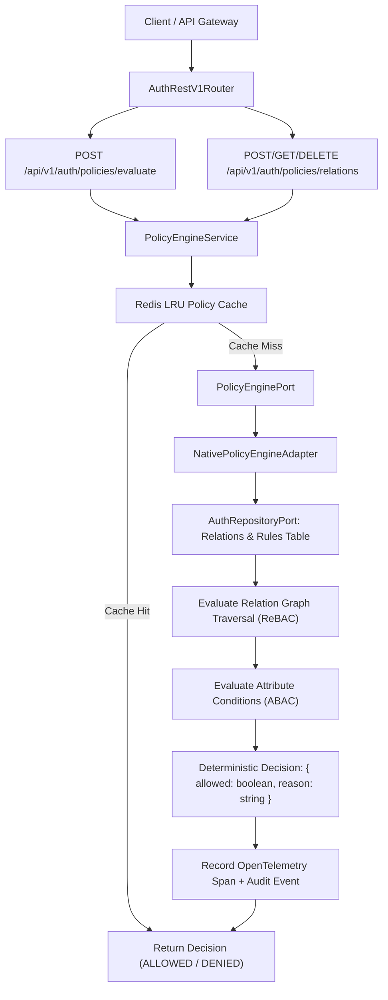
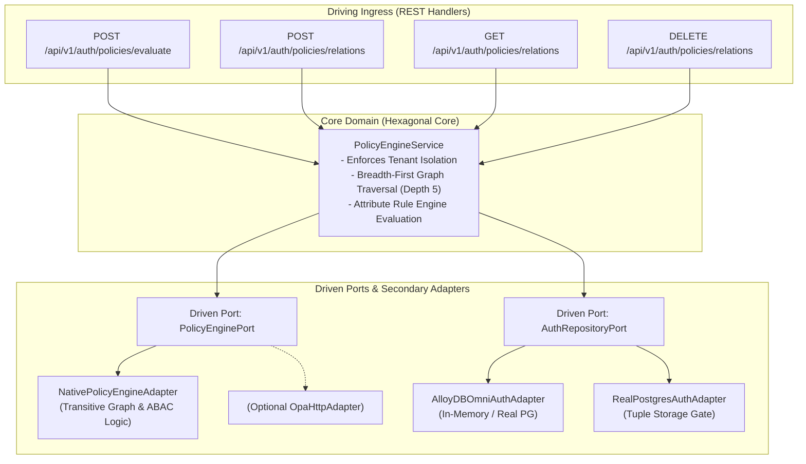
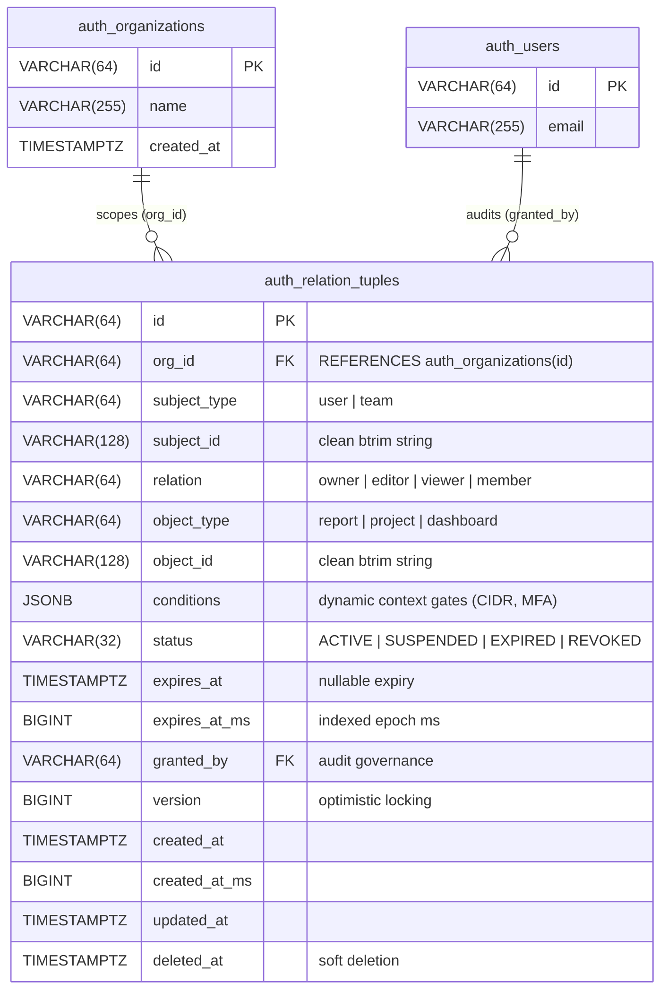

# ADR 0023: Fine-Grained Policy Engine (ABAC / ReBAC) with Zanzibar-Style Relationship Tuples

- **Status**: Accepted
- **Date**: 2026-10-15
- **Deciders**: Platform Architecture Working Group, Cyber Defense Core
- **Context**: Enterprise multi-tenancy requires fine-grained authorization beyond static roles (`admin`, `member`). Cross-organization resource sharing, nested departmental inheritance, document collaboration (viewer, editor, owner), and dynamic environment policies (time of day, network subnet, MFA step-up verification status) require a unified Attribute-Based Access Control (ABAC) and Relationship-Based Access Control (ReBAC) engine following Google Zanzibar principles.

---

## 📑 Table of Contents

1. [High-Level Design (HLD)](#1-high-level-design-hld)
2. [Data Model & Zanzibar-Style Relationship Tuples](#2-data-model--zanzibar-style-relationship-tuples)
3. [Hexagonal Architecture & Port Topology](#3-hexagonal-architecture--port-topology)
4. [Evaluation Algorithm (ReBAC Graph Traversal & ABAC Conditions)](#4-evaluation-algorithm-rebac-graph-traversal--abac-conditions)
5. [Database Schema & Migrations](#5-database-schema--migrations)
6. [API Specifications & Contracts](#6-api-specifications--contracts)
7. [Zero-Magic-Strings & Canonical Constants](#7-zero-magic-strings--canonical-constants)
8. [OpenTelemetry Distributed Tracing & Observability](#8-opentelemetry-distributed-tracing--observability)

---

## 🏛 1. High-Level Design (HLD)

The Fine-Grained Policy Engine integrates directly into the authentication & authorization lifecycle via a dedicated `PolicyEnginePort`. Incoming requests to check permissions or mutate relations are evaluated deterministically against persisted relationship tuples and dynamic attribute conditions:



---

## 📐 2. Data Model & Zanzibar-Style Relationship Tuples

Authorization state is modeled as 6-ary relationship tuples:

$$\langle \mathrm{tenant\_id}, \mathrm{subject\_type}, \mathrm{subject\_id}, \mathrm{relation}, \mathrm{object\_type}, \mathrm{object\_id} \rangle$$

### 2.1 Standard Relations & Hierarchy
- `owner`: Transitive super-relation implies `editor`, `viewer`, and `admin`.
- `editor`: Implies `viewer`.
- `viewer`: Read-only access to object.
- `member`: Membership in an organization or team group.

### 2.2 ReBAC Relation Transitivity Table
| Requested Permission | Target Relation | Satisfied By Relations |
|---|---|---|
| `read` | `viewer` | `viewer`, `editor`, `owner` |
| `write` | `editor` | `editor`, `owner` |
| `delete` | `owner` | `owner` |
| `manage` | `admin` | `admin`, `owner` |

### 2.3 ABAC Contextual Attributes
In addition to relational links, policy checks evaluate environmental attributes:
- `user.is_mfa_authenticated`: Requires MFA verification for high-risk actions.
- `environment.ip_cidr`: Enforces corporate IP allowlists.
- `environment.time_epoch`: Validates temporal access windows.

---

## 🔌 3. Hexagonal Architecture & Port Topology



---

## ⚙️ 4. Evaluation Algorithm (ReBAC Graph Traversal & ABAC Conditions)

1. **Direct Relation Lookup**: Check if a direct tuple $\langle \mathrm{tenant}, \mathrm{subject}, \mathrm{relation}, \mathrm{object} \rangle$ exists.
2. **Implied Relation Lookup**: Traverse hierarchy (`owner` $\implies$ `editor` $\implies$ `viewer`).
3. **Indirect Subject Group Traversal**: If subject is member of team/group $G$, evaluate if $\langle \mathrm{tenant}, G, \mathrm{relation}, \mathrm{object} \rangle$ exists (bounded recursion depth $= 5$).
4. **Context Condition Gate**: Evaluate dynamic JSON logic conditions (MFA status, IP CIDR).
5. **Fail-Closed Default**: Any cycle or unmatched branch defaults to `DENIED`.

---

## 🗄 5. Database Schema, ERD & Migrations

### 5.1 Entity-Relationship Diagram (ERD)



### 5.2 Migration DDL (`database/migrations/0017_create_auth_policies_and_relations.sql`)

Enforces strict compliance with `05-db-writing-rules.md` (explicit foreign keys, bounded string checks, JSON validation, optimistic versioning, and partial indexing):

```sql
CREATE TABLE IF NOT EXISTS auth_relation_tuples (
    id VARCHAR(64) PRIMARY KEY,
    org_id VARCHAR(64) NOT NULL REFERENCES auth_organizations(id) ON DELETE CASCADE,
    subject_type VARCHAR(64) NOT NULL,
    subject_id VARCHAR(128) NOT NULL,
    relation VARCHAR(64) NOT NULL,
    object_type VARCHAR(64) NOT NULL,
    object_id VARCHAR(128) NOT NULL,
    
    -- ABAC dynamic constraints & policy payload
    conditions JSONB NOT NULL DEFAULT '{}'::jsonb,
    
    -- Status & Lifecycle
    status VARCHAR(32) NOT NULL DEFAULT 'ACTIVE',
    
    -- Time-bounded / Temporary grants
    expires_at TIMESTAMPTZ NULL,
    expires_at_ms BIGINT NULL,
    
    -- Audit & Concurrency
    granted_by VARCHAR(64) NULL,
    version BIGINT NOT NULL DEFAULT 1,
    created_at_ms BIGINT NOT NULL,
    created_at TIMESTAMPTZ NOT NULL DEFAULT CURRENT_TIMESTAMP,
    updated_at TIMESTAMPTZ NOT NULL DEFAULT CURRENT_TIMESTAMP,
    deleted_at TIMESTAMPTZ NULL,

    -- Explicit Named Constraints
    CONSTRAINT auth_relation_tuples_unique_uk UNIQUE (org_id, subject_type, subject_id, relation, object_type, object_id),
    CONSTRAINT auth_relation_tuples_status_ck CHECK (status IN ('ACTIVE', 'SUSPENDED', 'EXPIRED', 'REVOKED')),
    CONSTRAINT auth_relation_tuples_conditions_ck CHECK (jsonb_typeof(conditions) = 'object'),
    CONSTRAINT auth_relation_tuples_expiry_ck CHECK (expires_at IS NULL OR expires_at > created_at),
    CONSTRAINT auth_relation_tuples_subject_clean_ck CHECK (subject_id = btrim(subject_id) AND subject_id <> ''),
    CONSTRAINT auth_relation_tuples_object_clean_ck CHECK (object_id = btrim(object_id) AND object_id <> '')
);

CREATE INDEX IF NOT EXISTS idx_auth_relation_subject
    ON auth_relation_tuples(org_id, subject_type, subject_id) WHERE deleted_at IS NULL AND status = 'ACTIVE';

CREATE INDEX IF NOT EXISTS idx_auth_relation_object
    ON auth_relation_tuples(org_id, object_type, object_id) WHERE deleted_at IS NULL AND status = 'ACTIVE';

CREATE INDEX IF NOT EXISTS idx_auth_relation_lookup
    ON auth_relation_tuples(org_id, object_type, object_id, relation) WHERE deleted_at IS NULL AND status = 'ACTIVE';

CREATE INDEX IF NOT EXISTS idx_auth_relation_expiry
    ON auth_relation_tuples(expires_at_ms) WHERE expires_at_ms IS NOT NULL AND status = 'ACTIVE';
```

---


## 📜 6. API Specifications & Contracts

### 6.1 `POST /api/v1/auth/policies/evaluate`
Request:
```json
{
  "subject_type": "user",
  "subject_id": "usr_123",
  "action": "write",
  "object_type": "project",
  "object_id": "proj_456",
  "context": {
    "is_mfa_verified": true,
    "ip_address": "192.168.1.1"
  }
}
```
Response:
```json
{
  "success": true,
  "statusCode": 200,
  "data": {
    "allowed": true,
    "reason": "Subject satisfies relation 'editor' via direct assignment",
    "evaluated_at": "2026-10-15T11:45:00.000Z"
  }
}
```

### 6.2 `POST /api/v1/auth/policies/relations`
Request:
```json
{
  "subject_type": "user",
  "subject_id": "usr_123",
  "relation": "editor",
  "object_type": "project",
  "object_id": "proj_456"
}
```

### 6.3 `DELETE /api/v1/auth/policies/relations`
Request:
```json
{
  "subject_type": "user",
  "subject_id": "usr_123",
  "relation": "editor",
  "object_type": "project",
  "object_id": "proj_456"
}
```

---

## 🔒 7. Zero-Magic-Strings & Canonical Constants

All relations, object types, error codes, and audit events are declared in `src/shared/constants/auth.constants.ts`:
- `AUTH_CONSTANTS.POLICY.RELATION_OWNER`
- `AUTH_CONSTANTS.POLICY.RELATION_EDITOR`
- `AUTH_CONSTANTS.POLICY.RELATION_VIEWER`
- `AUTH_CONSTANTS.POLICY.RELATION_ADMIN`
- `AUTH_CONSTANTS.POLICY.RELATION_MEMBER`
- `AUTH_CONSTANTS.POLICY.ACTION_READ`
- `AUTH_CONSTANTS.POLICY.ACTION_WRITE`
- `AUTH_CONSTANTS.POLICY.ACTION_DELETE`
- `AUTH_CONSTANTS.POLICY.ACTION_MANAGE`
- `AUTH_CONSTANTS.AUDIT_EVENT_RELATION_CREATED`
- `AUTH_CONSTANTS.AUDIT_EVENT_RELATION_REVOKED`

---

## 📊 8. OpenTelemetry Distributed Tracing & Observability

- Root Span: `auth.policy.evaluated`
  - Attributes: `tenant.org_id`, `policy.subject_type`, `policy.subject_id`, `policy.action`, `policy.object_type`, `policy.object_id`, `policy.allowed`, `policy.depth`.
- Root Span: `auth.policy.relation_mutated`
  - Attributes: `tenant.org_id`, `policy.relation`, `policy.mutation_type`.
