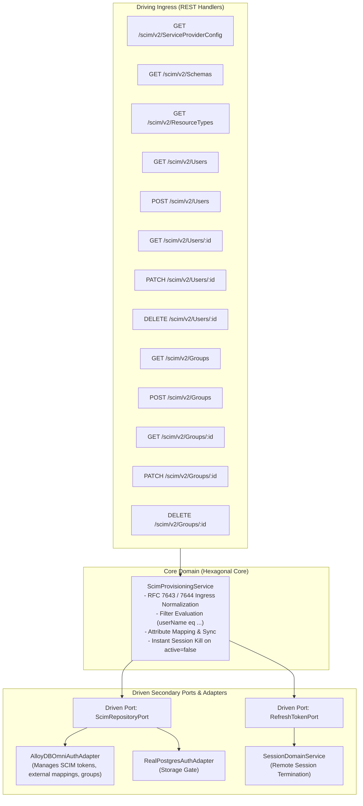
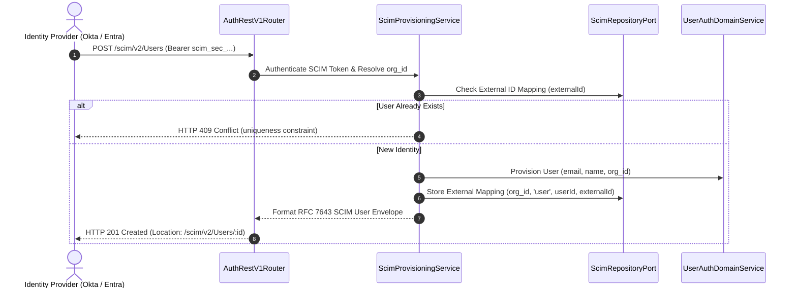
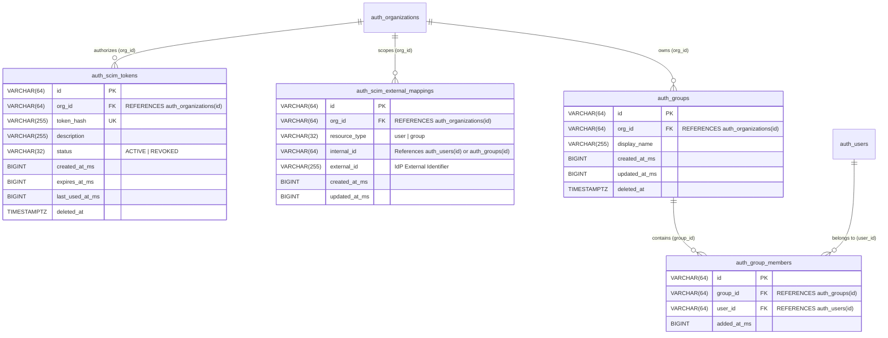

# ADR 0024: SCIM 2.0 User & Group Provisioning API (RFC 7643 / RFC 7644)

- **Status**: Accepted
- **Date**: 2026-10-15
- **Author**: Platform Architecture Team
- **Area**: Enterprise Identity Lifecycle & Directory Synchronization
- **RFC Standard**: [RFC 7643 (SCIM Core Schema)](https://datatracker.ietf.org/doc/html/rfc7643) & [RFC 7644 (SCIM Protocol)](https://datatracker.ietf.org/doc/html/rfc7644)

---

## 🎯 1. Context & Business Drivers

As enterprise clients scale, manual user onboarding and offboarding introduce substantial security vulnerabilities, access sprawl, and compliance audit failures (SOC2 Type II, ISO 27001, HIPAA). 

Enterprises rely on centralized Identity Providers (IdPs)—such as **Okta**, **Microsoft Entra ID (Azure AD)**, **OneLogin**, and **JumpCloud**—to orchestrate employee lifecycles. When an employee is offboarded in Okta, their access across downstream SaaS applications must be terminated within seconds.

This ADR introduces full multi-tenant **SCIM 2.0 (System for Cross-domain Identity Management)** compliance into the authentication service, enabling automated push-based user provisioning, attribute synchronization, group mapping, and immediate session termination upon de-provisioning.

---

## 📐 2. Architecture & RFC Specifications

### 2.1 Standard URN Schemas (RFC 7643)
- **User Core**: `urn:ietf:params:scim:schemas:core:2.0:User`
- **Group Core**: `urn:ietf:params:scim:schemas:core:2.0:Group`
- **Enterprise User Extension**: `urn:ietf:params:scim:schemas:extension:enterprise:2.0:User`
- **List Response**: `urn:ietf:params:scim:api:messages:2.0:ListResponse`
- **Error Response**: `urn:ietf:params:scim:api:messages:2.0:Error`

### 2.2 SCIM Authentication & Tenant Isolation
1. Each tenant organization generates a dedicated SCIM bearer token (`scim_sec_...`).
2. The hash of the token (`SHA-256`) is stored in `auth_scim_tokens` scoped to `org_id`.
3. Ingress SCIM requests (`/scim/v2/*`) validate the Bearer token and automatically resolve and bind the request context to the tenant's `org_id`. Cross-tenant directory leaks are mathematically impossible.

---

## 🔌 3. Hexagonal Architecture & Port Topology



---

## 🔁 4. Sequence Workflows (LLD)

### 4.1 User Provisioning via Okta/Azure AD (`POST /scim/v2/Users`)



### 4.2 Deprovisioning & Immediate Session Kill (`PATCH /scim/v2/Users/:id`)

When an employee is deactivated (`active: false`):
1. User status in `auth_user_organizations` is set to `SUSPENDED`.
2. All active refresh token families (`auth_refresh_token_families`) are revoked with reason `SCIM_DEPROVISIONED`.
3. Active access token JTIs are pushed to Redis denylist with remaining TTL.
4. Returns RFC 7643 updated user representation.

---

## 🗄 5. Database Schema, ERD & Migrations

### 5.1 Entity-Relationship Diagram (ERD)



### 5.2 Migration DDL (`database/migrations/0018_create_auth_scim_tables.sql`)

Enforces strict compliance with `05-db-writing-rules.md`:

```sql
CREATE TABLE IF NOT EXISTS auth_scim_tokens (
    id VARCHAR(64) PRIMARY KEY,
    org_id VARCHAR(64) NOT NULL REFERENCES auth_organizations(id) ON DELETE CASCADE,
    token_hash VARCHAR(255) NOT NULL UNIQUE,
    description VARCHAR(255) NOT NULL,
    status VARCHAR(32) NOT NULL DEFAULT 'ACTIVE',
    created_at_ms BIGINT NOT NULL,
    expires_at_ms BIGINT NULL,
    last_used_at_ms BIGINT NULL,
    created_at TIMESTAMPTZ NOT NULL DEFAULT CURRENT_TIMESTAMP,
    updated_at TIMESTAMPTZ NOT NULL DEFAULT CURRENT_TIMESTAMP,
    deleted_at TIMESTAMPTZ NULL,

    CONSTRAINT auth_scim_tokens_status_ck CHECK (status IN ('ACTIVE', 'REVOKED'))
);

CREATE INDEX IF NOT EXISTS idx_auth_scim_tokens_hash 
    ON auth_scim_tokens(token_hash) WHERE deleted_at IS NULL AND status = 'ACTIVE';

CREATE TABLE IF NOT EXISTS auth_scim_external_mappings (
    id VARCHAR(64) PRIMARY KEY,
    org_id VARCHAR(64) NOT NULL REFERENCES auth_organizations(id) ON DELETE CASCADE,
    resource_type VARCHAR(32) NOT NULL,
    internal_id VARCHAR(64) NOT NULL,
    external_id VARCHAR(255) NOT NULL,
    created_at_ms BIGINT NOT NULL,
    updated_at_ms BIGINT NOT NULL,

    CONSTRAINT auth_scim_external_mapping_uk UNIQUE (org_id, resource_type, external_id),
    CONSTRAINT auth_scim_external_resource_type_ck CHECK (resource_type IN ('user', 'group'))
);

CREATE INDEX IF NOT EXISTS idx_auth_scim_internal_map 
    ON auth_scim_external_mappings(org_id, resource_type, internal_id);

CREATE TABLE IF NOT EXISTS auth_groups (
    id VARCHAR(64) PRIMARY KEY,
    org_id VARCHAR(64) NOT NULL REFERENCES auth_organizations(id) ON DELETE CASCADE,
    display_name VARCHAR(255) NOT NULL,
    created_at_ms BIGINT NOT NULL,
    updated_at_ms BIGINT NOT NULL,
    deleted_at TIMESTAMPTZ NULL,

    CONSTRAINT auth_groups_display_name_clean_ck CHECK (display_name = btrim(display_name) AND display_name <> '')
);

CREATE INDEX IF NOT EXISTS idx_auth_groups_org ON auth_groups(org_id) WHERE deleted_at IS NULL;

CREATE TABLE IF NOT EXISTS auth_group_members (
    id VARCHAR(64) PRIMARY KEY,
    group_id VARCHAR(64) NOT NULL REFERENCES auth_groups(id) ON DELETE CASCADE,
    user_id VARCHAR(64) NOT NULL REFERENCES auth_users(id) ON DELETE CASCADE,
    added_at_ms BIGINT NOT NULL,

    CONSTRAINT auth_group_members_uk UNIQUE (group_id, user_id)
);
```

---

## 📜 6. API Specifications & Contracts

### 6.1 `GET /scim/v2/ServiceProviderConfig`

**Response (`200 OK`):**
```json
{
  "schemas": ["urn:ietf:params:scim:schemas:core:2.0:ServiceProviderConfig"],
  "patch": { "supported": true },
  "bulk": { "supported": false },
  "filter": { "supported": true, "maxResults": 100 },
  "changePassword": { "supported": false },
  "sort": { "supported": false },
  "etag": { "supported": false },
  "authenticationSchemes": [
    {
      "name": "OAuth Bearer Token",
      "description": "Authentication via SCIM Bearer Token",
      "specUri": "http://www.rfc-editor.org/info/rfc6750",
      "type": "oauthbearertoken",
      "primary": true
    }
  ]
}
```

### 6.2 `POST /scim/v2/Users`

**Request:**
```json
{
  "schemas": ["urn:ietf:params:scim:schemas:core:2.0:User"],
  "userName": "employee@enterprise.com",
  "externalId": "okta_usr_9981",
  "name": {
    "formatted": "Jane Doe",
    "familyName": "Doe",
    "givenName": "Jane"
  },
  "emails": [
    {
      "value": "employee@enterprise.com",
      "primary": true,
      "type": "work"
    }
  ],
  "active": true
}
```

**Response (`201 Created`):**
```json
{
  "schemas": ["urn:ietf:params:scim:schemas:core:2.0:User"],
  "id": "usr_scim_91820a",
  "externalId": "okta_usr_9981",
  "userName": "employee@enterprise.com",
  "name": {
    "formatted": "Jane Doe",
    "familyName": "Doe",
    "givenName": "Jane"
  },
  "emails": [
    {
      "value": "employee@enterprise.com",
      "primary": true,
      "type": "work"
    }
  ],
  "active": true,
  "meta": {
    "resourceType": "User",
    "created": "2026-10-15T06:40:00.000Z",
    "lastModified": "2026-10-15T06:40:00.000Z",
    "location": "/scim/v2/Users/usr_scim_91820a"
  }
}
```

### 6.3 `PATCH /scim/v2/Users/:id` (Deactivation)

**Request:**
```json
{
  "schemas": ["urn:ietf:params:scim:api:messages:2.0:PatchOp"],
  "Operations": [
    {
      "op": "replace",
      "path": "active",
      "value": false
    }
  ]
}
```

**Response (`200 OK`):**
```json
{
  "schemas": ["urn:ietf:params:scim:schemas:core:2.0:User"],
  "id": "usr_scim_91820a",
  "userName": "employee@enterprise.com",
  "active": false,
  "meta": {
    "resourceType": "User",
    "lastModified": "2026-10-15T06:42:00.000Z",
    "location": "/scim/v2/Users/usr_scim_91820a"
  }
}
```

---

## 🏷 7. Canonical Constants & Zero-Magic-Strings

All SCIM schemas, paths, headers, and error codes are centralized in `AUTH_CONSTANTS.SCIM`:
- `CONTENT_TYPE = 'application/scim+json'`
- `SCHEMA_USER = 'urn:ietf:params:scim:schemas:core:2.0:User'`
- `SCHEMA_GROUP = 'urn:ietf:params:scim:schemas:core:2.0:Group'`
- `SCHEMA_SERVICE_PROVIDER_CONFIG = 'urn:ietf:params:scim:schemas:core:2.0:ServiceProviderConfig'`
- `SCHEMA_LIST_RESPONSE = 'urn:ietf:params:scim:api:messages:2.0:ListResponse'`
- `SCHEMA_ERROR = 'urn:ietf:params:scim:api:messages:2.0:Error'`
- `ERROR_UNIQUENESS = 'uniqueness'`
- `ERROR_INVALID_VALUE = 'invalidValue'`
- `ERROR_NO_TARGET = 'noTarget'`

## Execution Flow (Call Stack Tree)

```text
createServer(listener: (req: IncomingMessage, res: ServerResponse) => void): Server
└── runWithHttpTracing(req: IncomingMessage, res: ServerResponse, fn: () => Promise<void>): Promise<void>
    └── dispatch(method: string, path: string, body: unknown, headers: Record<string, string>): Promise<RouteDispatchResult>
        ├── matchRoute(method: string, path: string): { rule: RouteRule, params: Record<string, string> } | null
        ├── handler(ctx: RouteContext): Promise<ScimUserResource>
        │   handleScimUserCreate(payload: ScimUserCreateDto): Promise<ScimUserResource>
        │   ├── mapScimToInternalUser(payload: ScimUserCreateDto): CreateUserInput
        │   ├── createUser(input: CreateUserInput): Promise<AuthUserRecord>
        │   └── formatScimUserResource(user: AuthUserRecord): ScimUserResource
        ├── createSuccessResponse(data: ScimUserResource, message: string, meta: ResponseMeta, statusCode: number): ApiResponse<ScimUserResource>
        └── end(chunk: string): ServerResponse

// Type Reference:
// ApiResponse<T>      = { success: boolean, statusCode: number, message: string, data: T, meta: ResponseMeta }
// RouteDispatchResult = { statusCode: number, payload: ApiResponse<ScimUserResource>, headers: Record<string, string> }
```
