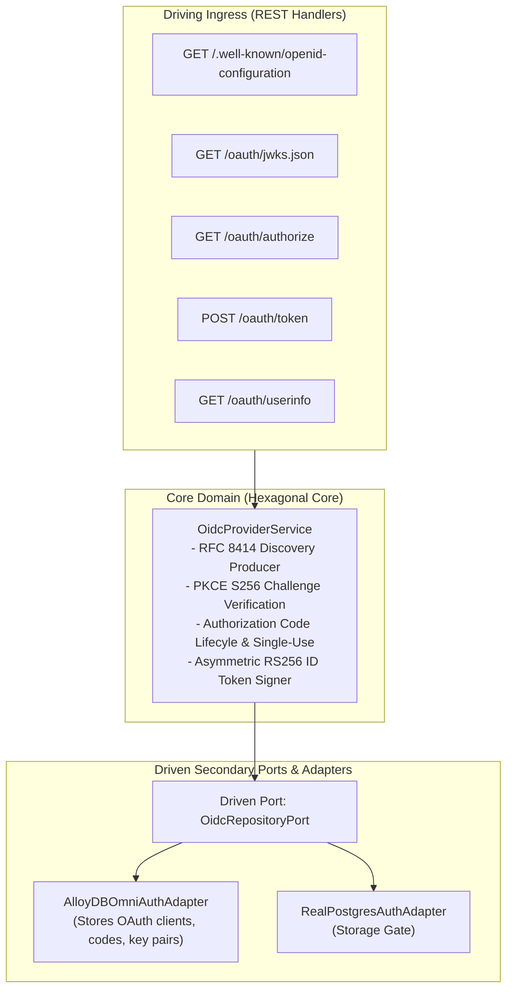
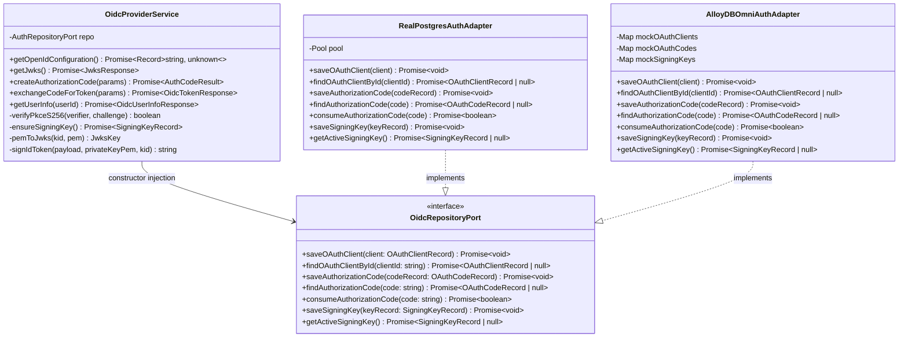
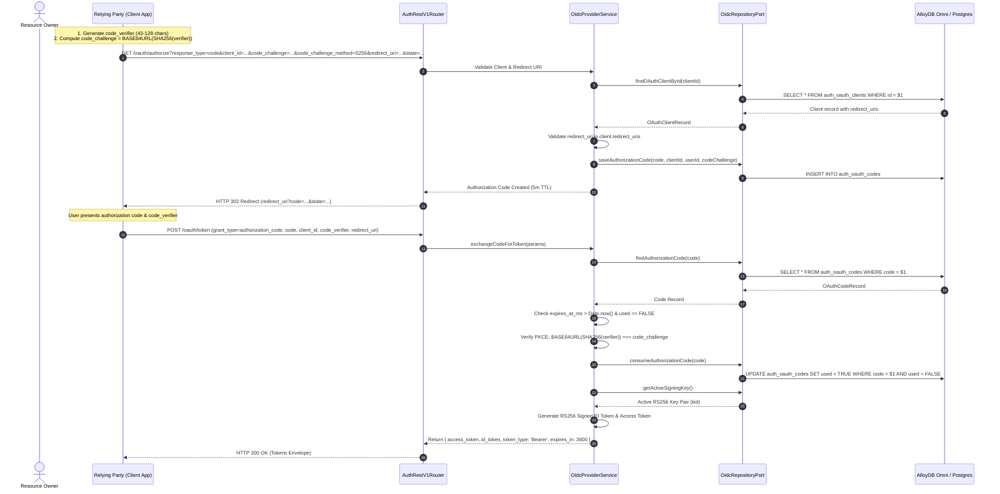
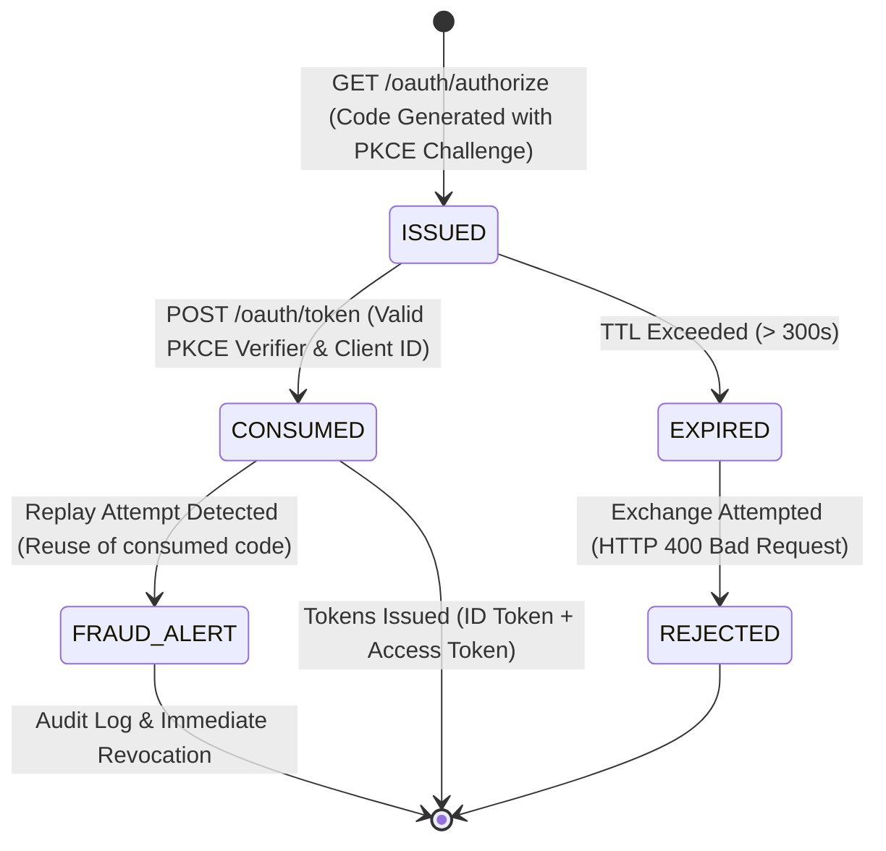
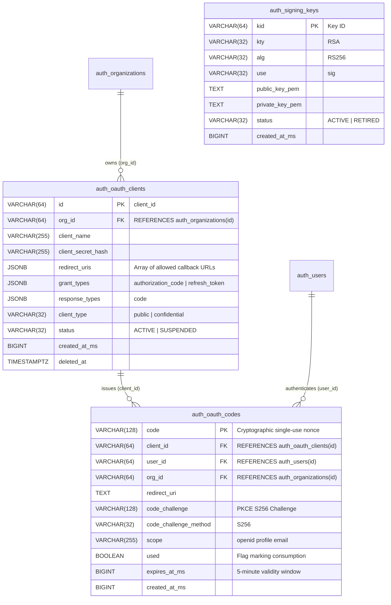

# ADR 0025: OpenID Connect (OIDC) Identity Provider & Discovery Core

- **Status**: Accepted
- **Date**: 2026-10-15
- **Author**: Platform Architecture Team
- **Area**: Authoritative Identity Provider & OAuth 2.0 / OIDC Federation
- **RFC Standards**: [RFC 8414 (OAuth 2.0 Authorization Server Metadata)](https://datatracker.ietf.org/doc/html/rfc8414), [OpenID Connect Discovery 1.0](https://openid.net/specs/openid-connect-discovery-1_0.html), [RFC 7636 (PKCE)](https://datatracker.ietf.org/doc/html/rfc7636), [RFC 7517 (JWK)](https://datatracker.ietf.org/doc/html/rfc7517)

---

## 🎯 1. Context & Business Drivers

Modern distributed architectures require a single authoritative Identity Provider (IdP) to issue verifiable, cryptographically signed credentials across internal microservices, external partner apps, and command-line developer tools.

Without standard OIDC IdP capabilities:
1. Microservices must couple directly to the auth database or share symmetric JWT secrets, creating architectural security leaks.
2. Third-party integrations require custom proprietary token formats rather than industry-standard OAuth2 / OIDC clients.
3. Downstream services cannot dynamically verify tokens via standard OpenID configuration discovery (`/.well-known/openid-configuration`) and JSON Web Key Sets (`/oauth/jwks.json`).

This ADR introduces full multi-tenant **OpenID Connect (OIDC) Identity Provider Core** compliance, enabling OAuth2 Authorization Code Grant with mandatory PKCE (Proof Key for Code Exchange), signed asymmetric JWT ID Tokens, dynamic key rotation, and discovery endpoints.

---

## 📐 2. Architecture & Standards Compliance

### 2.1 Core Endpoints & Flow Topology
- **Discovery**: `GET /.well-known/openid-configuration`
- **Public Keys**: `GET /oauth/jwks.json`
- **Authorization**: `GET /oauth/authorize`
- **Token Exchange**: `POST /oauth/token`
- **UserInfo**: `GET /oauth/userinfo`

### 2.2 Security Invariants
1. **Mandatory PKCE (RFC 7636)**: Authorization code requests require `code_challenge` and `code_challenge_method = S256` to prevent code interception attacks.
2. **Strict Redirect URI Whitelisting**: `redirect_uri` is strictly checked against the pre-registered client whitelist. Wildcards and open redirects are rejected with HTTP 400.
3. **Single-Use Authorization Codes**: Authorization codes expire within 300 seconds and are immediately invalidated upon first exchange. Reuse attempts trigger security alerts.
4. **Asymmetric RS256 / Ed25519 Signing**: Tokens are signed using asymmetric private keys; clients verify signatures purely using public keys published at `/oauth/jwks.json`.

---

## 🔌 3. Hexagonal Architecture & Port Topology

### 3.1 Hexagonal Service & Adapter Boundary Topology



### 3.2 Hexagonal Class & Interface Contract Topology



---

## 🔁 4. Sequence Workflows & Cryptographic Verification (LLD)

### 4.1 OIDC Authorization Code Grant with PKCE (RFC 7636)



### 4.2 Authorization Code Lifecycle State Machine




---

## 🗄 5. Database Schema, ERD & Migrations

### 5.1 Entity-Relationship Diagram (ERD)



### 5.2 Migration DDL (`database/migrations/0019_create_auth_oidc_tables.sql`)

Enforces strict compliance with `05-db-writing-rules.md`:

```sql
CREATE TABLE IF NOT EXISTS auth_oauth_clients (
    id VARCHAR(64) PRIMARY KEY,
    org_id VARCHAR(64) NOT NULL REFERENCES auth_organizations(id) ON DELETE CASCADE,
    client_name VARCHAR(255) NOT NULL,
    client_secret_hash VARCHAR(255) NULL,
    redirect_uris JSONB NOT NULL DEFAULT '[]'::jsonb,
    grant_types JSONB NOT NULL DEFAULT '["authorization_code"]'::jsonb,
    response_types JSONB NOT NULL DEFAULT '["code"]'::jsonb,
    client_type VARCHAR(32) NOT NULL DEFAULT 'public',
    status VARCHAR(32) NOT NULL DEFAULT 'ACTIVE',
    created_at_ms BIGINT NOT NULL,
    created_at TIMESTAMPTZ NOT NULL DEFAULT CURRENT_TIMESTAMP,
    updated_at TIMESTAMPTZ NOT NULL DEFAULT CURRENT_TIMESTAMP,
    deleted_at TIMESTAMPTZ NULL,

    CONSTRAINT auth_oauth_clients_type_ck CHECK (client_type IN ('public', 'confidential')),
    CONSTRAINT auth_oauth_clients_status_ck CHECK (status IN ('ACTIVE', 'SUSPENDED')),
    CONSTRAINT auth_oauth_clients_uris_ck CHECK (jsonb_typeof(redirect_uris) = 'array')
);

CREATE INDEX IF NOT EXISTS idx_auth_oauth_clients_org 
    ON auth_oauth_clients(org_id) WHERE deleted_at IS NULL AND status = 'ACTIVE';

CREATE TABLE IF NOT EXISTS auth_oauth_codes (
    code VARCHAR(128) PRIMARY KEY,
    client_id VARCHAR(64) NOT NULL REFERENCES auth_oauth_clients(id) ON DELETE CASCADE,
    user_id VARCHAR(64) NOT NULL REFERENCES auth_users(id) ON DELETE CASCADE,
    org_id VARCHAR(64) NOT NULL REFERENCES auth_organizations(id) ON DELETE CASCADE,
    redirect_uri TEXT NOT NULL,
    code_challenge VARCHAR(128) NOT NULL,
    code_challenge_method VARCHAR(32) NOT NULL DEFAULT 'S256',
    scope VARCHAR(255) NOT NULL DEFAULT 'openid profile email',
    used BOOLEAN NOT NULL DEFAULT FALSE,
    expires_at_ms BIGINT NOT NULL,
    created_at_ms BIGINT NOT NULL,

    CONSTRAINT auth_oauth_codes_method_ck CHECK (code_challenge_method = 'S256')
);

CREATE INDEX IF NOT EXISTS idx_auth_oauth_codes_client 
    ON auth_oauth_codes(client_id, expires_at_ms) WHERE used = FALSE;

CREATE TABLE IF NOT EXISTS auth_signing_keys (
    kid VARCHAR(64) PRIMARY KEY,
    kty VARCHAR(32) NOT NULL DEFAULT 'RSA',
    alg VARCHAR(32) NOT NULL DEFAULT 'RS256',
    use VARCHAR(32) NOT NULL DEFAULT 'sig',
    public_key_pem TEXT NOT NULL,
    private_key_pem TEXT NOT NULL,
    status VARCHAR(32) NOT NULL DEFAULT 'ACTIVE',
    created_at_ms BIGINT NOT NULL,

    CONSTRAINT auth_signing_keys_status_ck CHECK (status IN ('ACTIVE', 'RETIRED'))
);
```

---

## 📜 6. API Specifications & Contracts

### 6.1 `GET /.well-known/openid-configuration`

**Response (`200 OK`):**
```json
{
  "issuer": "https://auth.observability.io",
  "authorization_endpoint": "https://auth.observability.io/oauth/authorize",
  "token_endpoint": "https://auth.observability.io/oauth/token",
  "userinfo_endpoint": "https://auth.observability.io/oauth/userinfo",
  "jwks_uri": "https://auth.observability.io/oauth/jwks.json",
  "response_types_supported": ["code"],
  "subject_types_supported": ["public"],
  "id_token_signing_alg_values_supported": ["RS256"],
  "scopes_supported": ["openid", "profile", "email"],
  "token_endpoint_auth_methods_supported": ["none", "client_secret_post", "client_secret_basic"],
  "code_challenge_methods_supported": ["S256"]
}
```

### 6.2 `POST /oauth/token` (Authorization Code Exchange)

**Request:**
```json
{
  "grant_type": "authorization_code",
  "client_id": "client_app_123",
  "code": "auth_code_991823...",
  "redirect_uri": "https://client.observability.io/callback",
  "code_verifier": "dBjftJeZ4CVP-mB92K27uhbUJU1p1r_wW1gFWFOEjXk"
}
```

**Response (`200 OK`):**
```json
{
  "access_token": "eyJhbGciOiJSUzI1NiIsImtpZCI6...",
  "token_type": "Bearer",
  "expires_in": 3600,
  "id_token": "eyJhbGciOiJSUzI1NiIsImtpZCI6...",
  "scope": "openid profile email"
}
```

---

## 🏷 7. Canonical Constants & Zero-Magic-Strings

All OIDC endpoints, grant types, and PKCE parameters are declared in `AUTH_CONSTANTS.OIDC`:
- `GRANT_TYPE_AUTHORIZATION_CODE = 'authorization_code'`
- `RESPONSE_TYPE_CODE = 'code'`
- `PKCE_METHOD_S256 = 'S256'`
- `SCOPE_OPENID = 'openid'`
- `SCOPE_PROFILE = 'profile'`
- `SCOPE_EMAIL = 'email'`
- `DEFAULT_TOKEN_EXPIRY_SECONDS = 3600`
- `DEFAULT_CODE_EXPIRY_MS = 300000`
