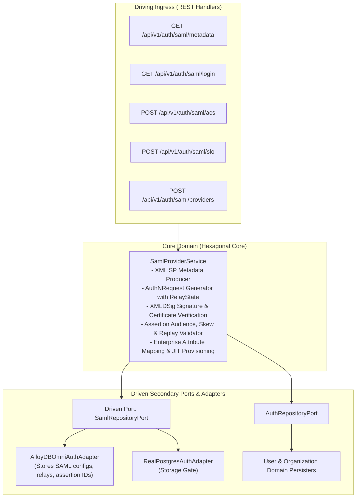
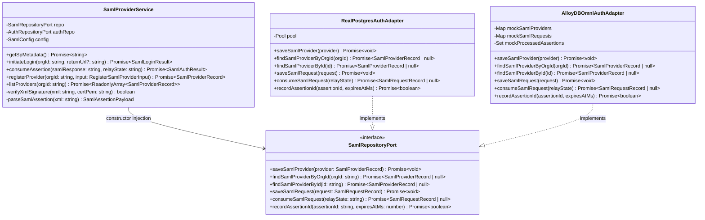
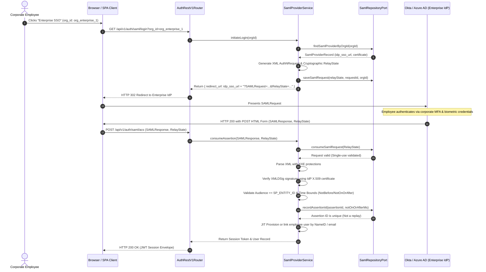
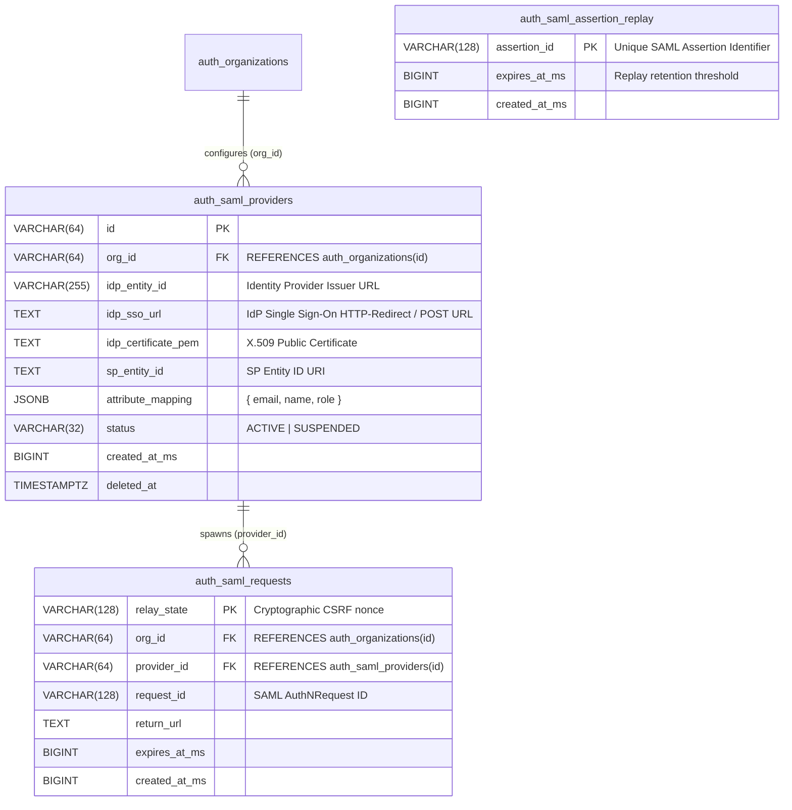

# ADR 0026: SAML 2.0 Enterprise Identity Provider & Service Provider Federation

- **Status**: Accepted
- **Date**: 2026-10-15
- **Author**: Platform Architecture Team
- **Area**: Enterprise Single Sign-On (SSO) & SAML 2.0 Web Browser SSO Profile
- **Standards**: [OASIS SAML 2.0 Core](http://docs.oasis-open.org/security/saml/v2.0/saml-core-2.0-os.pdf), [SAML 2.0 Profiles](http://docs.oasis-open.org/security/saml/v2.0/saml-profiles-2.0-os.pdf), [W3C XML Signature (XMLDSig)](https://www.w3.org/TR/xmldsig-core/)

---

## 🎯 1. Context & Business Drivers

Large enterprise customers (Fortune 500 / Government) rely on centralized Identity Providers (IdPs) such as Okta, Microsoft Entra ID (Azure AD), PingFederate, and Shibboleth using the SAML 2.0 protocol.

Without SAML 2.0 Service Provider (SP) federation:
1. Enterprise customers cannot enforce centralized corporate sign-on, identity governance, or conditional access policies.
2. User identities cannot be dynamically mapped or provisioned from SAML assertions with enterprise attributes (e.g. `department`, `groups`, `costCenter`).
3. Enterprise security auditors reject vendor solutions lacking SAML 2.0 SP capabilities and Single Logout (SLO).

This ADR specifies a native, secure **SAML 2.0 Service Provider (SP) Federation Subsystem** that supports SP-initiated AuthNRequest, Assertion Consumer Service (ACS) validation, XMLDSig cryptographic signature verification, replay protection, and SAML metadata publishing.

---

## 📐 2. Architecture & Standards Compliance

### 2.1 Core Endpoints
- **SP Metadata**: `GET /api/v1/auth/saml/metadata`
- **SSO Login Initiation**: `GET /api/v1/auth/saml/login`
- **Assertion Consumer Service (ACS)**: `POST /api/v1/auth/saml/acs`
- **Single Logout (SLO)**: `POST /api/v1/auth/saml/slo`
- **Provider Admin CRUD**: `POST /api/v1/auth/saml/providers`, `GET /api/v1/auth/saml/providers`

### 2.2 Security Invariants & Attack Mitigations
1. **XML External Entity (XXE) Prevention**: The XML parser completely disables external general/parameter entities, DTD evaluation, and external schema fetching to prevent local file inclusion and SSRF.
2. **Cryptographic XMLDSig Verification**: SAML assertions and responses must be cryptographically signed by the registered IdP's X.509 certificate using RSA-SHA256 (`http://www.w3.org/2001/04/xmldsig-more#rsa-sha256`).
3. **Assertion Replay Prevention**: The `ID` attribute of every accepted `<saml:Assertion>` is tracked in the repository with a TTL matching the assertion's validity window (`NotOnOrAfter`). Re-evaluating an identical Assertion ID is strictly rejected with `HTTP 401 Unauthorized`.
4. **Time & Audience Invariants**:
   - `NotBefore` - 120s $\le$ `CurrentTime` $\le$ `NotOnOrAfter` + 120s (tolerates 2-minute clock skew).
   - `<saml:Audience>` must strictly match the configured SP Entity ID.
5. **RelayState Integrity**: `RelayState` binds an ephemeral cryptographic challenge to prevent CSRF / injection across redirects.

---

## 🔌 3. Hexagonal Architecture & Port Topology

### 3.1 Service & Adapter Boundary Topology



### 3.2 Hexagonal Class & Interface Contract Topology



---

## 🔁 4. Sequence Workflows & Cryptographic Verification (LLD)

### 4.1 SP-Initiated SAML 2.0 Web Browser SSO Flow



---

## 🗄 5. Database Schema, ERD & Migrations

### 5.1 Entity-Relationship Diagram (ERD)



### 5.2 Migration DDL (`database/migrations/0020_create_auth_saml_tables.sql`)

```sql
CREATE TABLE IF NOT EXISTS auth_saml_providers (
    id VARCHAR(64) PRIMARY KEY,
    org_id VARCHAR(64) NOT NULL REFERENCES auth_organizations(id) ON DELETE CASCADE,
    idp_entity_id VARCHAR(255) NOT NULL,
    idp_sso_url TEXT NOT NULL,
    idp_certificate_pem TEXT NOT NULL,
    sp_entity_id VARCHAR(255) NOT NULL,
    attribute_mapping JSONB NOT NULL DEFAULT '{"email":"email","name":"name"}'::jsonb,
    status VARCHAR(32) NOT NULL DEFAULT 'ACTIVE',
    created_at_ms BIGINT NOT NULL,
    created_at TIMESTAMPTZ NOT NULL DEFAULT CURRENT_TIMESTAMP,
    updated_at TIMESTAMPTZ NOT NULL DEFAULT CURRENT_TIMESTAMP,
    deleted_at TIMESTAMPTZ NULL,

    CONSTRAINT auth_saml_providers_status_ck CHECK (status IN ('ACTIVE', 'SUSPENDED')),
    CONSTRAINT auth_saml_providers_mapping_ck CHECK (jsonb_typeof(attribute_mapping) = 'object')
);

CREATE INDEX IF NOT EXISTS idx_auth_saml_providers_org 
    ON auth_saml_providers(org_id) WHERE deleted_at IS NULL AND status = 'ACTIVE';

CREATE TABLE IF NOT EXISTS auth_saml_requests (
    relay_state VARCHAR(128) PRIMARY KEY,
    org_id VARCHAR(64) NOT NULL REFERENCES auth_organizations(id) ON DELETE CASCADE,
    provider_id VARCHAR(64) NOT NULL REFERENCES auth_saml_providers(id) ON DELETE CASCADE,
    request_id VARCHAR(128) NOT NULL,
    return_url TEXT NULL,
    expires_at_ms BIGINT NOT NULL,
    created_at_ms BIGINT NOT NULL
);

CREATE INDEX IF NOT EXISTS idx_auth_saml_requests_expires 
    ON auth_saml_requests(expires_at_ms);

CREATE TABLE IF NOT EXISTS auth_saml_assertion_replay (
    assertion_id VARCHAR(128) PRIMARY KEY,
    expires_at_ms BIGINT NOT NULL,
    created_at_ms BIGINT NOT NULL
);

CREATE INDEX IF NOT EXISTS idx_auth_saml_replay_expires 
    ON auth_saml_assertion_replay(expires_at_ms);
```

---

## 📜 6. API Specifications & Contracts

### 6.1 `GET /api/v1/auth/saml/metadata`
**Response (`200 OK`, `application/xml`):**
```xml
<?xml version="1.0"?>
<md:EntityDescriptor xmlns:md="urn:oasis:names:tc:SAML:2.0:metadata" entityID="https://auth.observability.io/api/v1/auth/saml/metadata">
  <md:SPSSODescriptor protocolSupportEnumeration="urn:oasis:names:tc:SAML:2.0:protocol" AuthnRequestsSigned="false" WantAssertionsSigned="true">
    <md:NameIDFormat>urn:oasis:names:tc:SAML:1.1:nameid-format:emailAddress</md:NameIDFormat>
    <md:AssertionConsumerService Binding="urn:oasis:names:tc:SAML:2.0:bindings:HTTP-POST" Location="https://auth.observability.io/api/v1/auth/saml/acs" index="1" isDefault="true"/>
  </md:SPSSODescriptor>
</md:EntityDescriptor>
```

### 6.2 `POST /api/v1/auth/saml/acs`
**Request (`application/json` or URL-encoded form):**
```json
{
  "SAMLResponse": "PHNhbWxwOlJlc3BvbnNlIHhtbG5zOnNhbWxwPSJ1cm46b2FzaXM6bmFtZXM6dGM6U0FNTDoyLjA6cHJvdG9jb2wiPjwvc2FtbHA6UmVzcG9uc2U+",
  "RelayState": "relay_1792051200000_abc123"
}
```

---

## 🏷 7. Canonical Constants & Zero-Magic-Strings

Declared in `AUTH_CONSTANTS.SAML`:
- `BINDING_HTTP_POST = 'urn:oasis:names:tc:SAML:2.0:bindings:HTTP-POST'`
- `BINDING_HTTP_REDIRECT = 'urn:oasis:names:tc:SAML:2.0:bindings:HTTP-Redirect'`
- `NAMEID_FORMAT_EMAIL = 'urn:oasis:names:tc:SAML:1.1:nameid-format:emailAddress'`
- `DEFAULT_CLOCK_SKEW_MS = 120000`
- `DEFAULT_RELAY_STATE_TTL_MS = 300000`

---

## 🛠 8. How to Configure, Integrate & Operate Enterprise SAML (Operator Runbook)

### 8.1 Step 1: Register Service Provider (SP) in Identity Provider (Okta / Entra ID)
1. **Fetch SP Metadata**: Run `GET /api/v1/auth/saml/metadata`.
2. **Configure in IdP Console**:
   - **Single Sign On URL (ACS)**: `https://<YOUR_AUTH_DOMAIN>/api/v1/auth/saml/acs`
   - **Audience URI (SP Entity ID)**: `https://<YOUR_AUTH_DOMAIN>/api/v1/auth/saml/metadata`
   - **Name ID Format**: `EmailAddress`
   - **Attribute Statements**:
     - `email` $\rightarrow$ `user.email`
     - `name` $\rightarrow$ `user.displayName`

### 8.2 Step 2: Register Enterprise IdP in Auth Service
Admins register the IdP metadata via `POST /api/v1/auth/saml/providers`:

```bash
curl -X POST "https://<YOUR_AUTH_DOMAIN>/api/v1/auth/saml/providers" \
  -H "Authorization: Bearer <ADMIN_JWT_TOKEN>" \
  -H "Content-Type: application/json" \
  -d '{
    "idp_entity_id": "https://identity-provider.com/saml/metadata",
    "idp_sso_url": "https://identity-provider.com/saml/sso",
    "idp_certificate_pem": "-----BEGIN CERTIFICATE-----\nMIID...\n-----END CERTIFICATE-----",
    "sp_entity_id": "https://<YOUR_AUTH_DOMAIN>/api/v1/auth/saml/metadata",
    "attribute_mapping": {
      "email": "email",
      "name": "displayName"
    }
  }'
```

### 8.3 Step 3: Trigger SP-Initiated Login
When an employee clicks "Log in with SAML SSO", redirect their browser to:
```bash
GET /api/v1/auth/saml/login?org_id=<ORGANIZATION_ID>&return_url=https://app.observability.io/dashboard
```
The Auth Service:
1. Validates the organization's active SAML provider.
2. Generates an `AuthNRequest` XML using `buildAuthNRequestXml()`.
3. Stores an ephemeral `RelayState` challenge in `auth_saml_requests` with a 5-minute TTL.
4. Returns an IdP redirect URL: `https://identity-provider.com/saml/sso?SAMLRequest=...&RelayState=...`

### 8.4 Step 4: Assertion Consumption & Automatic JIT Provisioning
The IdP posts the user back to `/api/v1/auth/saml/acs` with `SAMLResponse` and `RelayState`.
The service:
1. Consumes and deletes the `RelayState` challenge (single-use).
2. Verifies XMLDSig cryptographic signature against the registered IdP certificate.
3. Checks `NotBefore` and `NotOnOrAfter` with 120s clock skew tolerance.
4. Checks and records `assertion_id` in `auth_saml_assertion_replay` to prevent replay attacks.
5. Locates or Just-In-Time (JIT) provisions the user with `ROLE_MEMBER` and issues a valid session JWT.


## Execution Flow (Call Stack Tree)

```text
createServer(listener: (req: IncomingMessage, res: ServerResponse) => void): Server
└── runWithHttpTracing(req: IncomingMessage, res: ServerResponse, fn: () => Promise<void>): Promise<void>
    └── dispatch(method: string, path: string, body: unknown, headers: Record<string, string>): Promise<RouteDispatchResult>
        ├── matchRoute(method: string, path: string): { rule: RouteRule, params: Record<string, string> } | null
        ├── handler(ctx: RouteContext): Promise<SamlAssertionResult>
        │   processSamlAssertion(samlResponseXml: string): Promise<SamlAssertionResult>
        │   ├── validateXmlSignature(xml: string, cert: string): boolean
        │   ├── decryptAssertion(xml: string, privateKey: string): Promise<string>
        │   └── extractSamlAttributes(decryptedXml: string): Record<string, string>
        ├── createSuccessResponse(data: SamlAssertionResult, message: string, meta: ResponseMeta, statusCode: number): ApiResponse<SamlAssertionResult>
        └── end(chunk: string): ServerResponse

// Type Reference:
// ApiResponse<T>      = { success: boolean, statusCode: number, message: string, data: T, meta: ResponseMeta }
// RouteDispatchResult = { statusCode: number, payload: ApiResponse<SamlAssertionResult>, headers: Record<string, string> }
```
