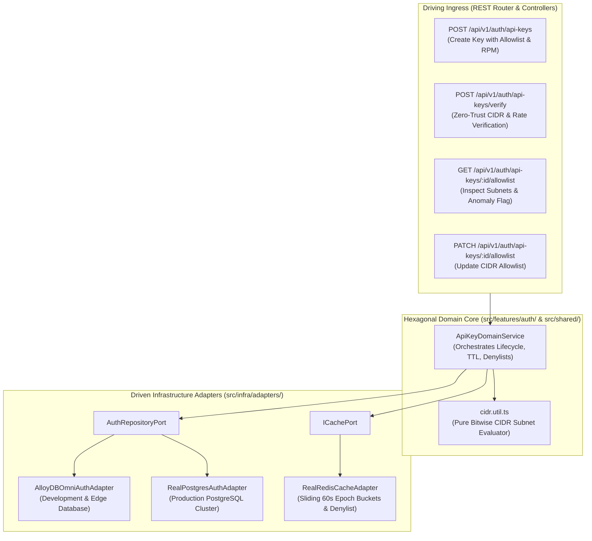
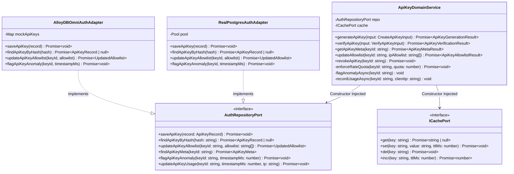
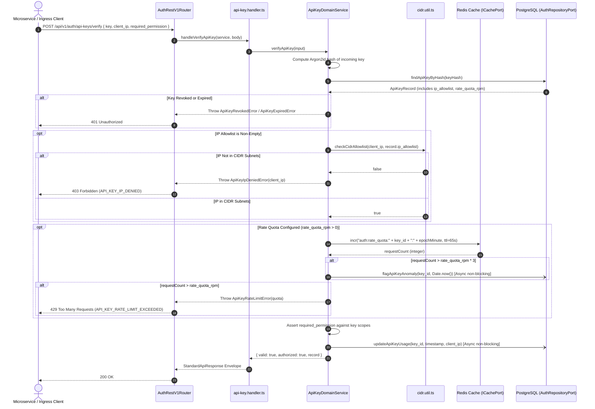
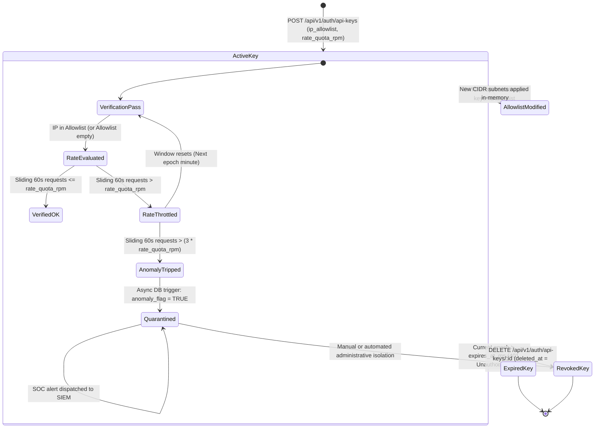

# ADR 0027: Zero-Trust API Key IP/CIDR Subnet Allowlists, Sliding Rate Quotas & Automated Anomaly Detection

- **Status**: Accepted
- **Date**: 2026-10-15
- **Author**: Platform Architecture Team
- **Area**: Zero-Trust Ingress Perimeter, Cryptographic API Key Lifecycle, Rate Limiting & Threat Intelligence
- **Standards**: [NIST SP 800-207 (Zero Trust Architecture)](https://csrc.nist.gov/publications/detail/sp/800-207/final), [RFC 4632 (Classless Inter-domain Routing IPv4)](https://datatracker.ietf.org/doc/html/rfc4632), [RFC 4291 (IP Version 6 Addressing Architecture)](https://datatracker.ietf.org/doc/html/rfc4291), [RFC 6598 (Shared Address Space)](https://datatracker.ietf.org/doc/html/rfc6598)

---

## 🎯 1. Context, Threat Modeling & Business Drivers

In modern distributed microservice architectures, API keys serve as long-lived bearer credentials for server-to-server RPCs, autonomous background workers, and CI/CD pipelines. Unlike interactive human sessions that are continuously defended by multi-factor authentication (MFA), biometric passkeys, and risk-based step-up authentication, API keys possess high blast radius:
1. **Bearer Credential Vulnerability**: If an API key is accidentally checked into source control, extracted from server environment dumps, or leaked through client logs, an attacker anywhere in the world can impersonate that service with zero challenge.
2. **Exfiltration & Malicious Mutation**: Without network-layer binding, compromised keys can be exploited from anonymous public proxies, VPN exit nodes, or cloud infrastructure to exfiltrate proprietary telemetry or publish forged audit logs.
3. **Denial-of-Service & Resource Depletion**: Autonomous systems and runaway scripts can saturate database pools and message queues without per-key request limits.
4. **Delayed Incident Detection**: Traditional batch log analytics detect compromised credentials hours or days after the breach, missing the window for immediate isolation.

This Architecture Decision Record (ADR 0027) establishes a **Zero-Trust Network Perimeter** and **Adaptive Rate Defense Engine** for all API keys issued across the platform.

---

## 📐 2. Architecture & Standards Compliance

### 2.1 Core Invariants

1. **Deterministic CIDR Matching (Zero-IO)**: All IP allowlist evaluations must execute purely in-memory via bitwise operations without blocking disk or database I/O.
2. **Fail-Closed Allowlist Policy**:
   - If an API key has a declared `ip_allowlist` (e.g. `["10.0.0.0/8", "192.168.1.0/24"]`), any verification attempt from a `client_ip` not strictly falling within that subnet is rejected with `HTTP 403 Forbidden` (`API_KEY_IP_DENIED`).
   - If `ip_allowlist` is empty (`[]`), the key remains globally accessible, guaranteeing backwards compatibility for legacy integrations.
3. **Atomic Sliding Token-Bucket Rate Quotas**:
   - Each key can optionally specify `rate_quota_rpm` (Requests Per Minute).
   - Rate counters are maintained in Redis using atomic sliding 60-second epoch buckets (`auth:rate_quota:{key_id}:{epochMinute}`) with a 65-second auto-expiration TTL.
   - Breaching the quota immediately terminates execution with `HTTP 429 Too Many Requests` (`API_KEY_RATE_LIMIT_EXCEEDED`).
4. **Automated Anomaly Tripping**:
   - When requests within a single 60-second epoch window exceed 3x the configured quota (`ANOMALY_MULTIPLIER = 3`), an asynchronous task updates the database record:
     - `anomaly_flag = TRUE`
     - `anomaly_flagged_at_ms = CURRENT_TIMESTAMP_MS`
   - Security Operations Center (SOC) tooling and SIEM pipelines monitor the database index `idx_auth_api_keys_anomaly` to quarantine anomalous workloads in real time.

---

## 🔌 3. Hexagonal Architecture & Port Topology

### 3.1 Service & Adapter Boundary Topology



### 3.2 Hexagonal Class & Interface Contract Topology



---

## 🔁 4. Sequence Workflows & Low-Level Algorithms

### 4.1 Verification & Rate Limiting Execution Sequence



### 4.2 CIDR Bitmask Algorithmic Detail

The CIDR matching engine in `src/shared/utils/cidr.util.ts` operates deterministically:

1. **IPv4 Evaluation**:
   - Dotted-decimal strings (`a.b.c.d`) are parsed into 32-bit unsigned integers:
     ```typescript
     uint32 = ((a << 24) | (b << 16) | (c << 8) | d) >>> 0;
     ```
   - A bitmask for prefix length `L` (where `0 <= L <= 32`) is constructed:
     ```typescript
     mask = L === 0 ? 0 : (0xffffffff << (32 - L)) >>> 0;
     ```
   - Subnet comparison:
     ```typescript
     isMatch = (clientIpUint32 & mask) === (cidrBaseUint32 & mask);
     ```

2. **IPv6 Evaluation**:
   - Addresses (including compressed `::` notation and IPv4-mapped `::ffff:a.b.c.d`) are expanded into a 16-byte buffer (`Uint8Array(16)`).
   - Prefix length `L` (where `0 <= L <= 128`) is divided into:
     - Full byte boundary: `fullBytes = Math.floor(L / 8)`
     - Remaining bits: `remainingBits = L % 8`
   - Byte-level prefix matching:
     ```typescript
     for (let i = 0; i < fullBytes; i++) {
       if (clientIpBuf[i] !== baseBuf[i]) return false;
     }
     ```
   - Boundary bitmask check (when `remainingBits > 0`):
     ```typescript
     const boundaryMask = (0xff << (8 - remainingBits)) & 0xff;
     return (clientIpBuf[fullBytes] & boundaryMask) === (baseBuf[fullBytes] & boundaryMask);
     ```

---

## 💾 5. Database Schema & Migration Specification

### Migration `0021_add_api_key_ip_allowlist_and_rate_quota.sql`

```sql
ALTER TABLE auth_api_keys
  ADD COLUMN IF NOT EXISTS ip_allowlist TEXT[] DEFAULT '{}',
  ADD COLUMN IF NOT EXISTS rate_quota_rpm INT DEFAULT NULL,
  ADD COLUMN IF NOT EXISTS total_requests_count BIGINT NOT NULL DEFAULT 0,
  ADD COLUMN IF NOT EXISTS anomaly_flag BOOLEAN NOT NULL DEFAULT FALSE,
  ADD COLUMN IF NOT EXISTS anomaly_flagged_at_ms BIGINT DEFAULT NULL;

-- High-performance partial index for SIEM / SOC threat scanning
CREATE INDEX IF NOT EXISTS idx_auth_api_keys_anomaly 
  ON auth_api_keys(anomaly_flag) 
  WHERE anomaly_flag = TRUE AND deleted_at IS NULL;
```

---

## 🛠️ 6. How To Use It: Operational & Developer Guide

### 6.1 Creating a Zero-Trust API Key

Organizations create API keys restricted to their corporate egress subnets and production VPCs with an enforced rate quota.

#### cURL Request

```bash
curl -X POST https://auth.company.internal/api/v1/auth/api-keys \
  -H "Authorization: Bearer ${ENTERPRISE_ADMIN_TOKEN}" \
  -H "Content-Type: application/json" \
  -d '{
    "org_id": "org_enterprise_99",
    "name": "Payments Ingress Gateway Key",
    "key_type": "general",
    "permissions": ["traces:write", "metrics:write"],
    "ip_allowlist": [
      "10.240.0.0/16",
      "192.168.10.0/24",
      "2001:db8:85a3::/48"
    ],
    "rate_quota_rpm": 500
  }'
```

#### JSON Response (`201 Created`)

```json
{
  "success": true,
  "status": "success",
  "data": {
    "rawKey": "ak_gen_org_enterprise_99_e3f9a7c1b2d4...",
    "keyRecord": {
      "key_id": "key_p8x2lq1",
      "org_id": "org_enterprise_99",
      "key_type": "general",
      "name": "Payments Ingress Gateway Key",
      "permissions": ["traces:write", "metrics:write"],
      "ip_allowlist": ["10.240.0.0/16", "192.168.10.0/24", "2001:db8:85a3::/48"],
      "rate_quota_rpm": 500,
      "anomaly_flag": false,
      "created_at_ms": 1792055100000
    }
  }
}
```

---

### 6.2 Verifying an Ingress Request Against Zero-Trust Controls

Upstream API Gateways (e.g. Envoy, Kong, Nginx) or microservice middleware evaluate incoming API keys during request ingress.

#### TypeScript SDK Example

```typescript
import { AuthService } from '@observability/auth';

async function authenticateGatewayRequest(apiKey: string, clientIp: string): Promise<void> {
  const result = await authService.verifyApiKey({
    key: apiKey,
    client_ip: clientIp,
    required_permission: 'traces:write',
  });

  if (!result.valid || !result.authorized) {
    throw new Error('Access denied');
  }
  // Proceed with authorized downstream execution
}
```

#### Verification cURL

```bash
curl -X POST https://auth.company.internal/api/v1/auth/api-keys/verify \
  -H "Content-Type: application/json" \
  -d '{
    "key": "ak_gen_org_enterprise_99_e3f9a7c1b2d4...",
    "client_ip": "10.240.12.84",
    "required_permission": "traces:write"
  }'
```

---

### 6.3 Handling Zero-Trust Denials & Error Responses

When an unauthorized IP or abusive traffic pattern is detected, the API Gateway returns structured standard error envelopes:

#### 1. IP Denied (`403 Forbidden`)

Triggered when `client_ip` does not match any CIDR subnet:

```json
{
  "success": false,
  "status": "error",
  "error": {
    "code": "API_KEY_IP_DENIED",
    "message": "Access denied: Client IP '198.51.100.25' is not authorized by the API key IP allowlist.",
    "statusCode": 403
  }
}
```

#### 2. Rate Quota Breached (`429 Too Many Requests`)

Triggered when requests in the current 60-second window exceed `rate_quota_rpm`:

```json
{
  "success": false,
  "status": "error",
  "error": {
    "code": "API_KEY_RATE_LIMIT_EXCEEDED",
    "message": "API key rate limit quota exceeded: Maximum 500 requests per minute allowed.",
    "statusCode": 429
  }
}
```

---

### 6.4 Inspecting & Updating CIDR Allowlists Dynamically

Enterprise administrators can view and mutate allowlists on running keys without revoking or re-issuing credentials:

#### Reading Current Allowlist & Anomaly Status

```bash
curl -X GET https://auth.company.internal/api/v1/auth/api-keys/key_p8x2lq1/allowlist \
  -H "Authorization: Bearer ${ENTERPRISE_ADMIN_TOKEN}"
```

#### Replacing Subnets (`PATCH`)

```bash
curl -X PATCH https://auth.company.internal/api/v1/auth/api-keys/key_p8x2lq1/allowlist \
  -H "Authorization: Bearer ${ENTERPRISE_ADMIN_TOKEN}" \
  -H "Content-Type: application/json" \
  -d '{
    "ip_allowlist": ["10.240.0.0/16", "172.16.0.0/12"]
  }'
```

---

### 6.5 SOC & SIEM Anomaly Incident Response Query

Security teams can query flagged keys from PostgreSQL without impacting application throughput:

```sql
SELECT 
    key_id, 
    org_id, 
    name, 
    rate_quota_rpm, 
    total_requests_count, 
    to_timestamp(anomaly_flagged_at_ms / 1000) AS flagged_at,
    last_used_ip
FROM auth_api_keys
WHERE anomaly_flag = TRUE 
  AND deleted_at IS NULL
ORDER BY anomaly_flagged_at_ms DESC;
```

---

---

## 🔄 8. API Key Lifecycle & Zero-Trust Quarantine State Machine



---

## ⚡ 9. Redis Lua Atomic Token-Bucket Script Specification

To eliminate race conditions during high-concurrency bursts across distributed ingress nodes, quota increments execute via a single atomic Redis Lua script:

```lua
-- KEYS[1]: auth:rate_quota:{key_id}:{epochMinute}
-- ARGV[1]: rate_quota_rpm (number)
-- ARGV[2]: anomaly_multiplier (e.g. 3)
-- ARGV[3]: window_ttl_seconds (e.g. 65)

local current = redis.call('INCR', KEYS[1])
if current == 1 then
    redis.call('EXPIRE', KEYS[1], tonumber(ARGV[3]))
end

local quota = tonumber(ARGV[1])
local multiplier = tonumber(ARGV[2])
local anomaly_threshold = quota * multiplier

local status = 'OK'
if current > anomaly_threshold then
    status = 'ANOMALY_TRIPPED'
elseif current > quota then
    status = 'RATE_EXCEEDED'
end

return { current, status }
```

---

## 🔒 10. Reverse-Proxy Ingress Security Invariant

When running behind reverse proxies (AWS ALB, Cloudflare, Nginx, Envoy):
- **Never trust raw headers blindly**: Do not extract `client_ip` from an arbitrary `X-Forwarded-For` header supplied by an untrusted public client.
- **Trusted Proxy Stripping**: The edge gateway must either take the direct socket address (`req.socket.remoteAddress`) or strip untrusted hops using a verified `trusted_proxies` CIDR table before passing `client_ip` to `verifyApiKey`.
- **Zero Inline Comments Doctrine**: Handlers strictly follow [4-functions-and-classes-writing-rule.md](file:///home/btpl-lap-22/live/llm-obs-node-packages/llm-obs-policies/rules/folder-structure/4-functions-and-classes-writing-rule.md) with self-documenting types and structured try/catch/finally telemetry.

