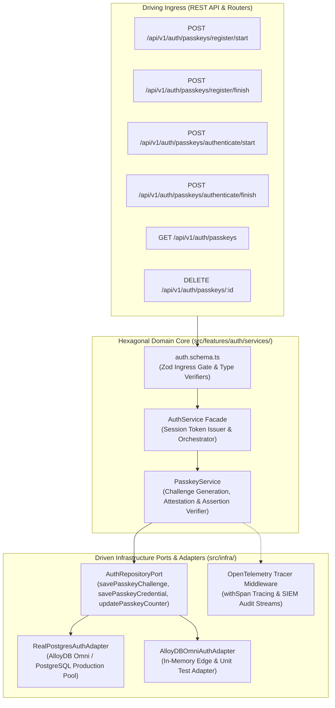
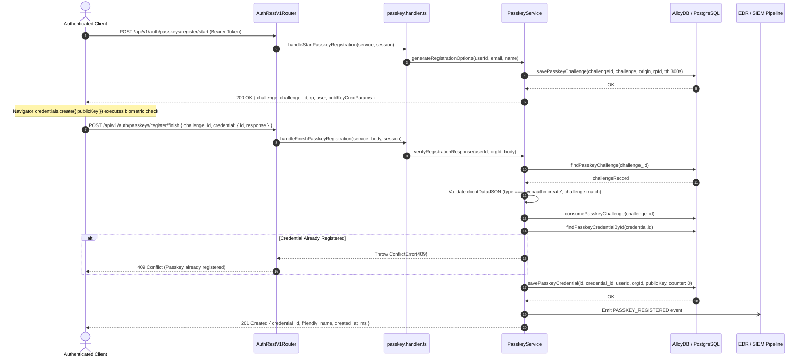
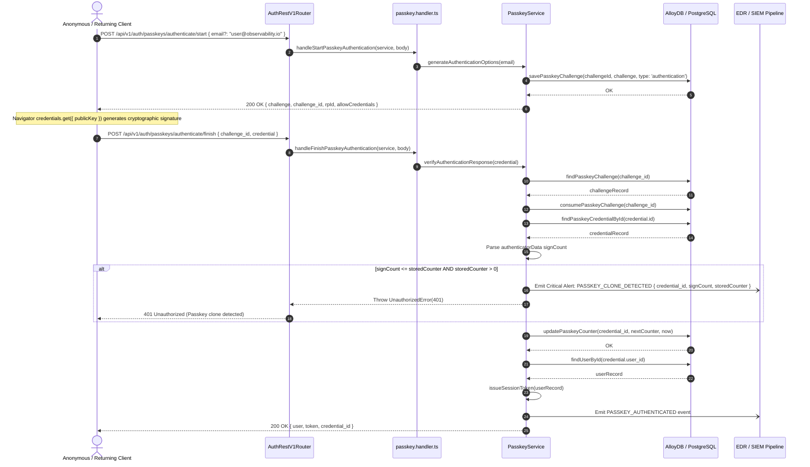
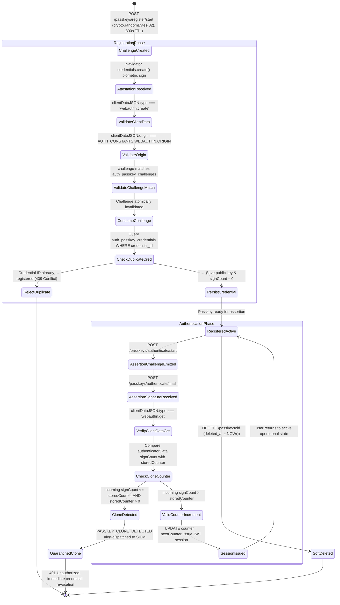

# ADR 0029: W3C WebAuthn Level 3 / FIDO2 Passkey Phishing-Resistant Authentication, Authenticator Monotonic Counter Clone Defense & EDR/SIEM Telemetry

- **Status**: Accepted
- **Date**: 2026-10-15
- **Author**: Platform Architecture Team
- **Area**: Phishing-Resistant Credentials, W3C WebAuthn Level 3, FIDO2, Biometric Hardware Authentication, Zero-Trust Access
- **Standards**: [W3C WebAuthn Level 3 (Recommendation)](https://www.w3.org/TR/webauthn-3/), [FIDO2 Client to Authenticator Protocol (CTAP 2.1)](https://fidoalliance.org/specs/fido-v2.1-ps-20210615/fido-client-to-authenticator-protocol-v2.1-ps-errata-20220621.html), [NIST SP 800-63B Authenticator Assurance Level 3 (AAL3)](https://pages.nist.gov/800-63-3/sp800-63b.html#sec525), [RFC 8152 (CBOR Object Signing and Encryption)](https://datatracker.ietf.org/doc/html/rfc8152)

---

## 🎯 1. Context, Threat Modeling & Business Drivers

Traditional shared secrets (passwords), shared OTP algorithms (RFC 6238 TOTP), and push notifications are structurally vulnerable to modern Adversary-in-the-Middle (AiTM) reverse-proxy phishing attacks (e.g., Evilginx2, Modlishka). Attackers deploy phishing domains that transparently proxy authentication traffic, capturing session tokens, TOTP codes, and user credentials in flight.

W3C WebAuthn Level 3 and FIDO2 provide phishing resistance by binding public-key cryptographic assertions strictly to the origin (`https://auth.observability.io`) and relying party ID (`rpId`). Biometric hardware modules (Apple Touch ID / Face ID, Windows Hello, YubiKey 5 Series) ensure private keys never leave the hardware device.

### 1.1 Threat Vectors Addressed

1. **Adversary-in-the-Middle (AiTM) Phishing**:
   - *Attack Scenario*: A user is tricked into navigating to `auth.observabi1ity.io`. The reverse proxy intercepts the traffic and forwards it to the true origin.
   - *Mitigation*: The browser queries the authenticator with `rpId = "auth.observabi1ity.io"`. The authenticator signs `clientDataJSON` containing the attacker's origin. The backend evaluates the received client data against `AUTH_CONSTANTS.WEBAUTHN.ORIGIN` (`http://localhost:3001` or production host). Mismatched origins immediately abort verification with `HTTP 400 Bad Request`.
2. **Authenticator Cloning & Replay Attacks**:
   - *Attack Scenario*: An adversary compromises a hardware or software authenticator container and copies the credential private key to a second device. Both devices execute authentications concurrently.
   - *Mitigation*: The platform records the 32-bit `signCount` embedded in `authenticatorData` on every assertion. If an incoming assertion presents a counter lower than or equal to the recorded counter, execution is immediately aborted with `HTTP 401 Unauthorized` and an alert is dispatched to SIEM (`PASSKEY_CLONE_DETECTED`).
3. **Credential Stuffing & Database Exfiltration**:
   - *Attack Scenario*: An adversary exfiltrates the PostgreSQL database dump.
   - *Mitigation*: Table `auth_passkey_credentials` stores only public keys (`public_key TEXT`) and attestation material. No passwords, private keys, or decryptable secrets exist on the auth service.

---

## 📐 2. Architecture & Standards Compliance

### 2.1 Core Invariants

1. **Two-Phase Cryptographic Handshake**:
   - **Registration**: 
     - Phase 1: `POST /api/v1/auth/passkeys/register/start` creates a high-entropy 32-byte cryptographic challenge (`crypto.randomBytes(32)`), saved in `auth_passkey_challenges` with a strict 300-second TTL.
     - Phase 2: `POST /api/v1/auth/passkeys/register/finish` validates the challenge, verifies `clientDataJSON.type === 'webauthn.create'`, checks for unique `credential_id`, and persists public key and transport metadata.
   - **Authentication**:
     - Phase 1: `POST /api/v1/auth/passkeys/authenticate/start` emits an assertion challenge.
     - Phase 2: `POST /api/v1/auth/passkeys/authenticate/finish` validates `clientDataJSON.type === 'webauthn.get'`, validates matching user IDs, enforces monotonic signature counters, updates `last_used_at_ms`, and issues a signed JWT session.
2. **Hexagonal Architecture Boundary**:
   - Pure domain coordination lives inside `PasskeyService` under `src/features/auth/services/`.
   - Driven repository ports defined in `AuthRepositoryPort` and implemented by both `AlloyDBOmniAuthAdapter` and `RealPostgresAuthAdapter`.
3. **Strict Database Gate & Zero-Trust Isolation**:
   - Migration `0023_create_auth_passkeys.sql` declares explicit foreign keys with `ON DELETE CASCADE` to both `auth_users(id)` and `auth_organizations(id)`.
   - Table `auth_passkey_credentials` enforces unique `credential_id`, non-null timestamps, and partial composite indexing.

---

## 🔌 3. Hexagonal Architecture & Port Topology

### 3.1 Driving & Driven Port Component Diagram



### 3.2 Hexagonal Class & Interface Contract Topology

```mermaid
classDiagram
    class PasskeyService {
        -AuthRepositoryPort repository
        +generateRegistrationOptions(userId: string, email: string, name: string) Promise~PasskeyRegistrationOptions~
        +verifyRegistrationResponse(userId: string, orgId: string, params: object) Promise~PasskeyCredentialRecord~
        +generateAuthenticationOptions(userEmail?: string) Promise~PasskeyAuthenticationOptions~
        +verifyAuthenticationResponse(params: object) Promise~object~
        +listUserPasskeys(userId: string) Promise~Array~
        +deletePasskey(passkeyId: string, userId: string) Promise~void~
    }

    class AuthRepositoryPort {
        <<interface>>
        +savePasskeyChallenge(record: object) Promise~void~
        +findPasskeyChallenge(challengeId: string) Promise~object | null~
        +consumePasskeyChallenge(challengeId: string) Promise~void~
        +savePasskeyCredential(record: object) Promise~void~
        +findPasskeyCredentialById(credentialId: string) Promise~object | null~
        +listPasskeysByUserId(userId: string) Promise~Array~
        +updatePasskeyCounter(credentialId: string, counter: number, lastUsedAtMs: number) Promise~void~
        +deletePasskey(passkeyId: string, userId: string) Promise~void~
    }

    class RealPostgresAuthAdapter {
        -Pool pool
        +savePasskeyChallenge(record: object) Promise~void~
        +findPasskeyChallenge(challengeId: string) Promise~object | null~
        +consumePasskeyChallenge(challengeId: string) Promise~void~
        +savePasskeyCredential(record: object) Promise~void~
        +findPasskeyCredentialById(credentialId: string) Promise~object | null~
        +listPasskeysByUserId(userId: string) Promise~Array~
        +updatePasskeyCounter(credentialId: string, counter: number, lastUsedAtMs: number) Promise~void~
        +deletePasskey(passkeyId: string, userId: string) Promise~void~
    }

    class AlloyDBOmniAuthAdapter {
        -Map mockPasskeyChallenges
        -Map mockPasskeyCredentials
        +savePasskeyChallenge(record: object) Promise~void~
        +findPasskeyChallenge(challengeId: string) Promise~object | null~
        +consumePasskeyChallenge(challengeId: string) Promise~void~
        +savePasskeyCredential(record: object) Promise~void~
        +findPasskeyCredentialById(credentialId: string) Promise~object | null~
        +listPasskeysByUserId(userId: string) Promise~Array~
        +updatePasskeyCounter(credentialId: string, counter: number, lastUsedAtMs: number) Promise~void~
        +deletePasskey(passkeyId: string, userId: string) Promise~void~
    }

    PasskeyService --> AuthRepositoryPort : Constructor Injected
    RealPostgresAuthAdapter ..|> AuthRepositoryPort : Implements
    AlloyDBOmniAuthAdapter ..|> AuthRepositoryPort : Implements
```



---

## 🔁 4. Sequence Workflows & Execution Pipelines

### 4.1 Passkey Registration Flow (W3C Attestation)



### 4.2 Passkey Authentication & Clone Defense Flow (W3C Assertion)



---

## 🗄 5. Database Schema & Migration Specification

### 5.1 Migration DDL (`0023_create_auth_passkeys.sql`)

```sql
CREATE TABLE IF NOT EXISTS auth_passkey_credentials (
    id VARCHAR(64) PRIMARY KEY,
    credential_id VARCHAR(255) NOT NULL,
    user_id VARCHAR(64) NOT NULL,
    org_id VARCHAR(64) NOT NULL,
    public_key TEXT NOT NULL,
    counter BIGINT NOT NULL DEFAULT 0,
    device_type VARCHAR(32) NOT NULL DEFAULT 'single_device',
    backed_up BOOLEAN NOT NULL DEFAULT FALSE,
    transports JSONB NOT NULL DEFAULT '[]'::jsonb,
    aaguid VARCHAR(64) NULL,
    friendly_name VARCHAR(128) NOT NULL DEFAULT 'Passkey',
    created_at_ms BIGINT NOT NULL,
    last_used_at_ms BIGINT NULL,
    created_at TIMESTAMPTZ NOT NULL DEFAULT CURRENT_TIMESTAMP,
    updated_at TIMESTAMPTZ NOT NULL DEFAULT CURRENT_TIMESTAMP,
    deleted_at TIMESTAMPTZ NULL,

    CONSTRAINT fk_auth_passkeys_user FOREIGN KEY (user_id) REFERENCES auth_users(id) ON DELETE CASCADE,
    CONSTRAINT fk_auth_passkeys_org FOREIGN KEY (org_id) REFERENCES auth_organizations(id) ON DELETE CASCADE,
    CONSTRAINT uq_auth_passkeys_credential_id UNIQUE (credential_id)
);

CREATE INDEX IF NOT EXISTS idx_auth_passkeys_user_id 
    ON auth_passkey_credentials(user_id) WHERE deleted_at IS NULL;

CREATE INDEX IF NOT EXISTS idx_auth_passkeys_org_id 
    ON auth_passkey_credentials(org_id) WHERE deleted_at IS NULL;

CREATE INDEX IF NOT EXISTS idx_auth_passkeys_cred_lookup 
    ON auth_passkey_credentials(credential_id) WHERE deleted_at IS NULL;

CREATE TABLE IF NOT EXISTS auth_passkey_challenges (
    challenge_id VARCHAR(64) PRIMARY KEY,
    user_id VARCHAR(64) NULL,
    challenge VARCHAR(255) NOT NULL,
    origin VARCHAR(255) NOT NULL,
    rp_id VARCHAR(255) NOT NULL,
    challenge_type VARCHAR(32) NOT NULL,
    expires_at_ms BIGINT NOT NULL,
    created_at_ms BIGINT NOT NULL,
    created_at TIMESTAMPTZ NOT NULL DEFAULT CURRENT_TIMESTAMP
);

CREATE INDEX IF NOT EXISTS idx_auth_passkey_challenges_lookup 
    ON auth_passkey_challenges(challenge_id, expires_at_ms);
```

---

## 🛡 6. EDR & SIEM Threat Detection Rules

| Event Code | Severity | Trigger Condition | Recommended Response |
|---|---|---|---|
| `PASSKEY_REGISTRATION_STARTED` | INFO | User requests attestation challenge | Track IP velocity |
| `PASSKEY_REGISTERED` | LOW | User completes registration | Notify user via transactional email |
| `PASSKEY_AUTH_STARTED` | INFO | Assertion challenge emitted | Sliding window rate limit check |
| `PASSKEY_AUTHENTICATED` | LOW | Successful biometric assertion | Reset login failure counters |
| `PASSKEY_REVOKED` | MEDIUM | User deleted passkey | Audit trail logging |
| `PASSKEY_CLONE_DETECTED` | **CRITICAL** | Signature counter $\le$ recorded counter | Revoke session, lock passkey, dispatch SecOps alert |

---

## 🔄 7. Authenticator Credential Lifecycle State Machine



---

## 🔏 8. Supported COSE Cryptographic Algorithms Matrix

| Algorithm Name | COSE Identifier | Curve / Parameters | NIST AAL3 Status | Platform Support |
|---|---|---|---|---|
| **ES256** | `-7` | ECDSA over NIST P-256 with SHA-256 | Preferred Standard | Apple Touch/Face ID, Windows Hello, Android Biometrics, YubiKey 5 |
| **Ed25519 (EdDSA)** | `-8` | PureEdDSA over Curve25519 | Modern High-Assurance | Hardware Security Keys (YubiKey 5.2+, Nitrokey) |
| **RS256** | `-257` | RSASSA-PKCS1-v1_5 with SHA-256 | Legacy Compatibility | TPM 1.2/2.0 Windows Hello Enterprise Enclaves |

---

## 🛡 9. API & Architecture Invariant Adherence

- **Response Envelopes**: All endpoints adhere to [2-apis.writing.rule.md](file:///home/btpl-lap-22/live/llm-obs-node-packages/llm-obs-policies/rules/folder-structure/2-apis.writing.rule.md) with strict envelope wrapping (`success`, `statusCode`, `data`, `meta`).
- **Zero Inline Comments Doctrine**: Handlers strictly follow [4-functions-and-classes-writing-rule.md](file:///home/btpl-lap-22/live/llm-obs-node-packages/llm-obs-policies/rules/folder-structure/4-functions-and-classes-writing-rule.md).

