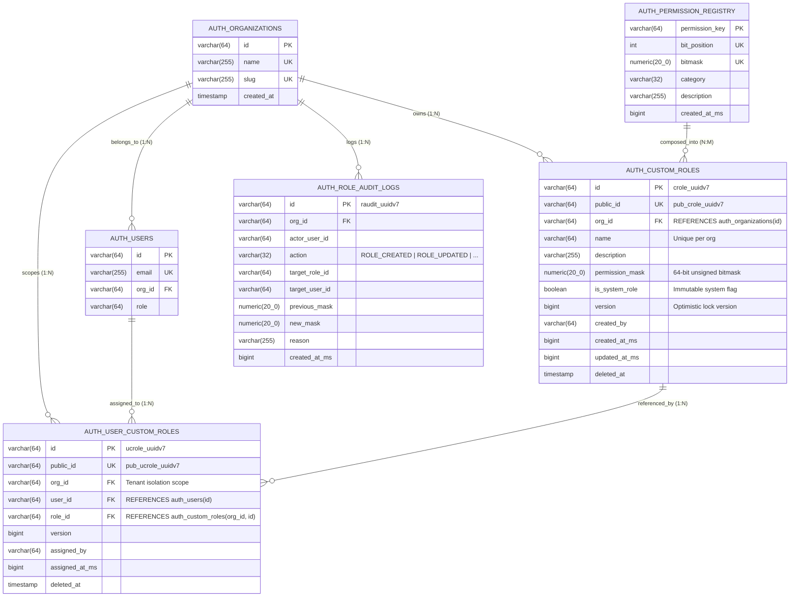

# ADR 0030: Custom Enterprise Roles and 64-Bit Permission Bitmasks

## Status
Accepted

## Context
Enterprise multi-tenant environments require fine-grained access control that moves beyond rigid fixed roles (`owner`, `admin`, `member`, `viewer`). While Relationship-Based Access Control (ReBAC / Zanzibar, ADR 0023) supports deep object-level graph relationships, high-frequency control plane operations (such as API authorization gates, UI permission checks, and telemetry endpoints) require sub-millisecond evaluation with zero graph traversal overhead.

Relational permission queries requiring joins across `users`, `roles`, `role_permissions`, and `permissions` introduce significant latency ($O(N)$ joins) and database CPU load under high request concurrency.

## Decision
We implement a **Tenant-Scoped Custom Role Engine** backed by a **64-bit Permission Bitmask**:
1. **64-bit Bitmask Architecture**:
   - Each atomic permission action is assigned a distinct bit position ($2^0$ to $2^{62}$) represented as a JavaScript `bigint` and PostgreSQL `NUMERIC(20, 0)` to guarantee safe 64-bit unsigned storage without signed integer overflow.
   - Bitwise evaluation is $O(1)$ in CPU memory: `(effectiveMask & requiredMask) === requiredMask`.
2. **Multi-Role Aggregation**:
   - Users can be assigned multiple roles within an organization.
   - The user's effective permission bitmask is computed as the bitwise OR of all active assigned role bitmasks:
     $$\text{EffectiveMask} = \bigvee_{r \in \text{Roles}} \text{Mask}_r$$
3. **Fail-Closed Verification**:
   - If an evaluation encounters an unknown permission key or empty role set without explicitly granted bits, evaluation immediately denies access.
4. **Distributed Tracing & Zero Inline Comments**:
   - All evaluation and role mutations are instrumented with OpenTelemetry spans (`withSpan`) attaching audit attributes (`auth.role_id`, `auth.permission_bitmask`, `auth.evaluation_granted`).

---

## Detailed Data Tables & Architecture Specifications

### 1. Database Table Specifications & Schema Invariants (Storage Gate)

| Table | Column | Type | Nullable | Default | Constraints & Invariants | Purpose |
|---|---|---|---|---|---|---|
| **`auth_permission_registry`** | `permission_key` | `VARCHAR(64)` | `NO` | - | `PRIMARY KEY`, uppercase canonical key | System-wide unique identifier for permission |
| | `bit_position` | `INT` | `NO` | - | `UNIQUE`, `CHECK (bit_position >= 0 AND bit_position <= 62)` | Exact bit index in 64-bit mask ($0..62$) |
| | `bitmask` | `NUMERIC(20, 0)` | `NO` | - | `UNIQUE`, `CHECK (bitmask > 0)` | Numeric representation of $2^{\text{bit\_position}}$ |
| | `category` | `VARCHAR(32)` | `NO` | - | Bounded string (e.g. `ORGANIZATION`, `USER`, `SECURITY`) | Domain categorization for UI grouping |
| | `description` | `VARCHAR(255)` | `NO` | - | Explanatory text | Human-readable explanation of granted capability |
| | `created_at_ms` | `BIGINT` | `NO` | - | Epoch milliseconds | Timestamp of registry insertion |
| **`auth_custom_roles`** | `id` | `VARCHAR(64)` | `NO` | - | `PRIMARY KEY`, internal UUIDv7 (`crole_...`) | Surrogate primary key |
| | `public_id` | `VARCHAR(64)` | `NO` | - | `UNIQUE`, external opaque ID (`pub_crole_...`) | External API and audit reference |
| | `org_id` | `VARCHAR(64)` | `NO` | - | `FK -> auth_organizations(id) ON DELETE CASCADE` | Tenant ownership & partition key |
| | `name` | `VARCHAR(64)` | `NO` | - | `CHECK (name = btrim(name) AND name <> '')` | Trimmed role name (e.g., `SRE Lead`) |
| | `description` | `VARCHAR(255)` | `NO` | `''` | Role summary | Explanation of role purpose |
| | `permission_mask` | `NUMERIC(20, 0)` | `NO` | `0` | `CHECK (permission_mask >= 0 AND <= 9223372036854775807)` | Composite bitmask of granted permissions |
| | `is_system_role` | `BOOLEAN` | `NO` | `FALSE` | Immutable system role flag | Protects default roles from deletion/mutation |
| | `version` | `BIGINT` | `NO` | `1` | `CHECK (version >= 1)` | Optimistic concurrency version counter |
| | `created_by` | `VARCHAR(64)` | `YES` | `NULL` | User ID of creator | Audit tracking of role creation |
| | `created_at_ms` | `BIGINT` | `NO` | - | Epoch milliseconds | Audit timestamp |
| | `updated_at_ms` | `BIGINT` | `NO` | - | Epoch milliseconds | Audit timestamp |
| | `deleted_at` | `TIMESTAMPTZ` | `YES` | `NULL` | Soft delete marker | 30-day retention and soft-deletion marker |
| | **Table Constraints** | - | - | - | `UNIQUE (public_id)`<br/>`UNIQUE (org_id, id)`<br/>`UNIQUE (org_id, name)` | Enforces tenant-unique names and composite FKs |
| **`auth_user_custom_roles`** | `id` | `VARCHAR(64)` | `NO` | - | `PRIMARY KEY`, internal UUIDv7 (`ucrole_...`) | Surrogate primary key |
| | `public_id` | `VARCHAR(64)` | `NO` | - | `UNIQUE`, external ID (`pub_ucrole_...`) | External API reference |
| | `org_id` | `VARCHAR(64)` | `NO` | - | `FK -> auth_organizations(id) ON DELETE CASCADE` | Tenant isolation partition key |
| | `user_id` | `VARCHAR(64)` | `NO` | - | `FK -> auth_users(id) ON DELETE CASCADE` | Assigned user |
| | `role_id` | `VARCHAR(64)` | `NO` | - | `FK (org_id, role_id) -> auth_custom_roles(org_id, id)` | Tenant-safe composite foreign key |
| | `version` | `BIGINT` | `NO` | `1` | `CHECK (version >= 1)` | Optimistic locking counter |
| | `assigned_by` | `VARCHAR(64)` | `YES` | `NULL` | User ID of assigner | Audit tracking |
| | `assigned_at_ms` | `BIGINT` | `NO` | - | Epoch milliseconds | Timestamp of assignment |
| | `deleted_at` | `TIMESTAMPTZ` | `YES` | `NULL` | Soft delete marker | Revocation timestamp |
| | **Table Constraints** | - | - | - | `UNIQUE (public_id)`<br/>`UNIQUE (org_id, user_id, role_id)` | Prevents duplicate user-role bindings |
| **`auth_role_audit_logs`** | `id` | `VARCHAR(64)` | `NO` | - | `PRIMARY KEY`, UUIDv7 (`raudit_...`) | Immutable audit event identifier |
| | `org_id` | `VARCHAR(64)` | `NO` | - | `FK -> auth_organizations(id) ON DELETE CASCADE` | Tenant scope |
| | `actor_user_id` | `VARCHAR(64)` | `NO` | - | User ID | Actor initiating the role mutation |
| | `action` | `VARCHAR(32)` | `NO` | - | `CHECK (action IN ('ROLE_CREATED', 'ROLE_UPDATED', ...))` | Audited role lifecycle event |
| | `target_role_id` | `VARCHAR(64)` | `NO` | - | Role ID | Affected role |
| | `target_user_id` | `VARCHAR(64)` | `YES` | `NULL` | User ID | Affected user (for assignments) |
| | `previous_mask` | `NUMERIC(20, 0)` | `YES` | `NULL` | Prior permission bitmask | Delta analysis for compliance |
| | `new_mask` | `NUMERIC(20, 0)` | `YES` | `NULL` | Updated permission bitmask | Delta analysis for compliance |
| | `reason` | `VARCHAR(255)` | `NO` | `''` | Justification note | Compliance audit note |
| | `created_at_ms` | `BIGINT` | `NO` | - | Epoch milliseconds | Tamper-proof audit timestamp |

---

### 2. Entity-Relationship Diagram



---

### 3. Canonical 64-Bit Permission Bit Allocation Layout

```
 Bit Index:
  63 62 61 ... 37 36 35 34 33 32 | 31 30 29 ... 25 24 | 23 22 21 ... 17 16 | 15 14 13 ... 9  8  | 7  6  5 ... 2  1  0
 ┌──┬──┬──┬───┬──┬──┬──┬──┬──┬──┬┼──┬──┬──┬───┬──┬──┬┼──┬──┬──┬───┬──┬──┬┼──┬──┬──┬───┬──┬──┬┼──┬──┬──┬───┬──┬──┐
 │0 │R │R │...│R │P │S │S │P │A ││R │R │R │...│W │R ││R │R │R │...│C │R ││R │R │R │...│I │R ││R │R │R │...│D │U │R │
 └──┴──┴──┴───┴──┴──┴──┴──┴──┴──┴┴──┴──┴──┴───┴──┴──┴┴──┴──┴──┴───┴──┴──┴┴──┴──┴──┴───┴──┴──┴┴──┴──┴──┴───┴──┴──┘
  ▲               ▲  ▲  ▲  ▲  ▲               ▲  ▲               ▲  ▲               ▲  ▲               ▲  ▲  ▲
  │               │  │  │  │  │               │  │               │  │               │  │               │  │  └─ ORG_READ (1)
  │               │  │  │  │  │               │  │               │  │               │  │               │  └─── ORG_UPDATE (2)
  │               │  │  │  │  │               │  │               │  │               │  │               └────── ORG_DELETE (4)
  │               │  │  │  │  │               │  │               │  │               │  └────────────────────── USERS_READ (256)
  │               │  │  │  │  │               │  │               │  │               └───────────────────────── USERS_INVITE (512)
  │               │  │  │  │  │               │  │               │  └───────────────────────────────────────── API_KEYS_READ (65536)
  │               │  │  │  │  │               │  │               └──────────────────────────────────────────── API_KEYS_CREATE (131072)
  │               │  │  │  │  │               │  └──────────────────────────────────────────────────────────── TELEMETRY_READ (16777216)
  │               │  │  │  │  │               └─────────────────────────────────────────────────────────────── TELEMETRY_WRITE (33554432)
  │               │  │  │  │  └─────────────────────────────────────────────────────────────────────────────── AUDIT_LOGS_READ (4294967296)
  │               │  │  │  └────────────────────────────────────────────────────────────────────────────────── POLICIES_MANAGE (8589934592)
  │               │  │  └───────────────────────────────────────────────────────────────────────────────────── SAML_MANAGE (17179869184)
  │               │  └──────────────────────────────────────────────────────────────────────────────────────── SCIM_MANAGE (34359738368)
  │               └─────────────────────────────────────────────────────────────────────────────────────────── PASSKEYS_MANAGE (68719476736)
  └─ Bit 63: Reserved for Overflow Safety (Non-negative signed BigInt boundary)
```

---

### 4. Bitwise Evaluation Runtime Flow

```mermaid
flowchart TD
    Req([Request: Evaluate User Permissions]) --> Fetch[Query User Custom Roles for Org]
    Fetch --> RolesFound{Any roles assigned?}
    
    RolesFound -- No --> LegacyCheck{Legacy role fallback?}
    LegacyCheck -- 'admin'/'owner' --> FullAccess[Grant All System Bits: (1n << 37n) - 1n]
    LegacyCheck -- Other/None --> DenyZero[EffectiveMask = 0n]
    FullAccess --> CompareBits
    DenyZero --> CompareBits
    
    RolesFound -- Yes --> Aggregate[Aggregate EffectiveMask = Bitwise OR of all Role Masks]
    Aggregate --> MapRequired[Map Required Permission Strings to BigInt RequiredMask]
    
    MapRequired --> CompareBits{"(EffectiveMask & RequiredMask) == RequiredMask"}
    CompareBits -- True --> Allow([Result: GRANTED = TRUE])
    CompareBits -- False --> Diff[MissingBits = RequiredMask & (~EffectiveMask)]
    Diff --> Deny([Result: GRANTED = FALSE, Return MissingBits])
```

---

## Consequences
- **Positive**:
  - Full adherence to [05-db-writing-rules.md](file:///home/btpl-lap-22/live/llm-obs-node-packages/llm-obs-policies/rules/folder-structure/05-db-writing-rules.md) with surrogate `id`, external `public_id`, composite `(org_id, id)` FKs, check constraints, version columns, and audit logging.
  - $O(1)$ authorization evaluation in critical telemetry and control planes.
- **Negative**:
  - Maximum 63 bits per permission set (extensible with multi-word arrays when needed).
