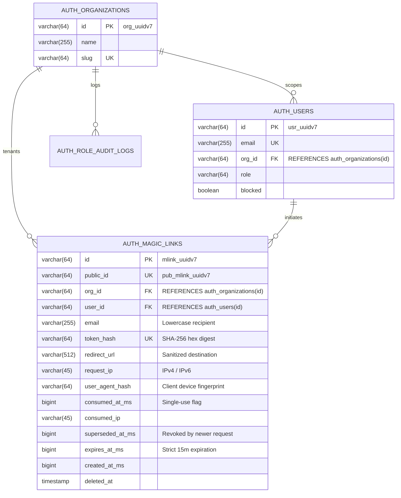
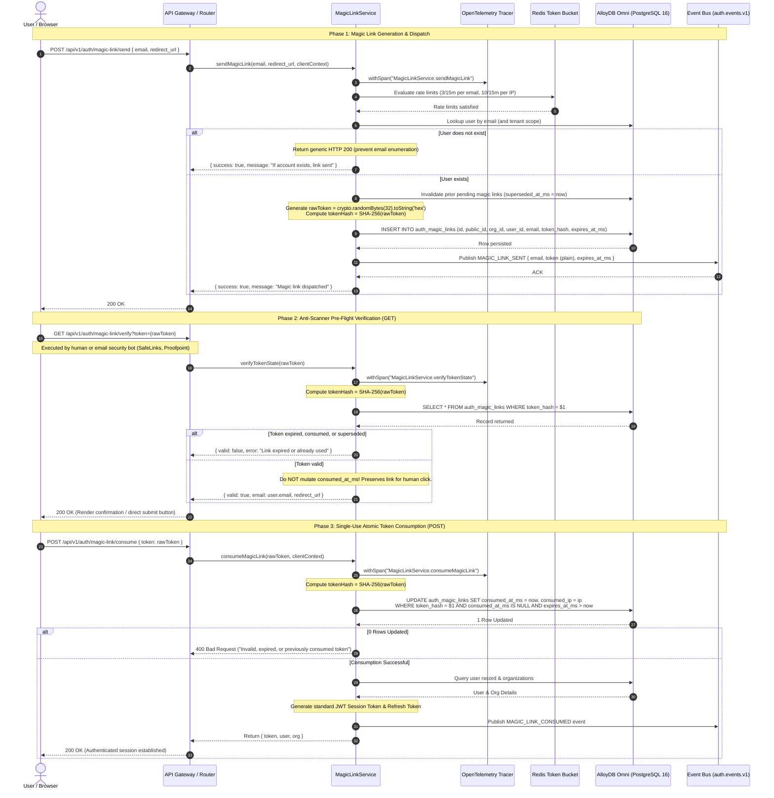
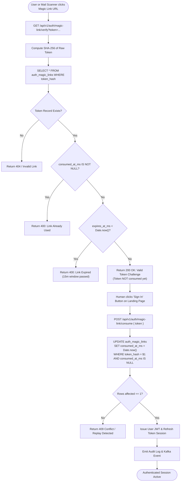
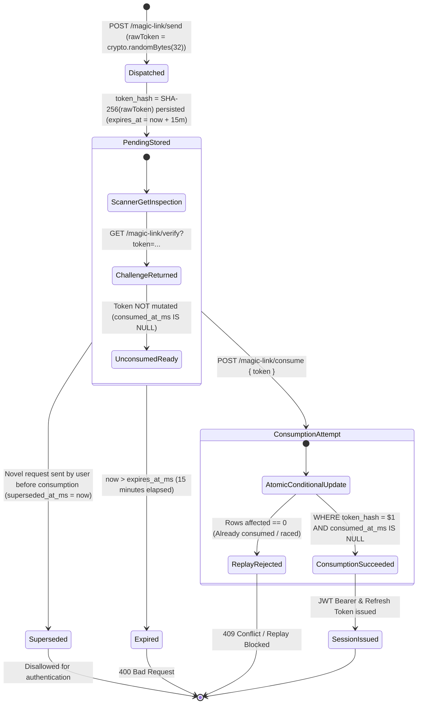

# ADR 0031: Magic Link & Passwordless Authentication Flow, Cryptographic Single-Use Tokens, Anti-Scanner Bot Defense & Rate-Limited Dispatch

- **Status**: Accepted
- **Date**: 2026-10-15
- **Author**: Platform Architecture Team
- **Area**: Passwordless Authentication, Cryptographic Nonces, Anti-Automation & Scanner Defense, Zero-Trust Access
- **Standards**: [RFC 7519 (JSON Web Token)](https://datatracker.ietf.org/doc/html/rfc7519), [OWASP ASVS v4.0.3 §2.7 (One-Time Token Authentication)](https://owasp.org/www-project-application-security-verification-standard/), [NIST SP 800-63B §5.1.2 (Out-of-Band Verifiers)](https://pages.nist.gov/800-63-3/sp800-63b.html#sec512), [RFC 6749 (OAuth 2.0 Authorization Framework)](https://datatracker.ietf.org/doc/html/rfc6749)

---

## 🎯 1. Context, Threat Modeling & Business Drivers

Passwords present widespread friction, credential-stuffing vulnerability, and high operational overhead from resets. Following the implementation of WebAuthn / FIDO2 Passkeys (ADR 0029), organizations need a frictionless passwordless authentication fallback for users without configured biometric or hardware authenticators, as well as an out-of-band identity verification channel.

However, naive implementations of magic link authentication introduce critical security risks:
1. **Email Security Gateway / Scanner Token Pre-Consumption**: Enterprise email security products (e.g., Microsoft Defender for Office 365 Safe Links, Mimecast, Proofpoint Targeted Attack Protection) send automated HTTP GET headless crawlers to inspect links prior to delivery. If a link consumes the token on `GET`, the human user receives an already-invalidated link or encounters unexplained session state.
2. **Token Leakage in Inbound Referer Headers**: If a user clicks a magic link containing a raw token that renders third-party assets, the raw secret can leak via the HTTP `Referer` header.
3. **Database Compromise & Token Replay**: Storing plaintext magic link tokens in the database allows an attacker with read-only DB access to authenticate as any user.
4. **Token Bombing & Email Flooding**: Lack of tenant- and target-rate limiting enables malicious actors to spam victim email addresses, causing domain reputation destruction and denial of service.

---

## 🏗️ 2. Architectural Decision & Technical Principles

To achieve high-assurance, enterprise-grade passwordless authentication:

1. **SHA-256 One-Way Token Hashing at Rest**:
   - The token sent to the user via email is a cryptographically strong 256-bit entropy value (`crypto.randomBytes(32).toString('hex')`).
   - The database **only** stores `token_hash = SHA-256(raw_token)`. Plaintext tokens are never persisted.
2. **Two-Phase Anti-Scanner Verification**:
   - `GET /api/v1/auth/magic-link/verify?token=...`: Does **not** consume the token. It validates token existence, unconsumed state, and expiration, returning a verified verification challenge or lightweight confirmation landing state without session issuance.
   - `POST /api/v1/auth/magic-link/consume`: Explicitly consumes the token within an atomic database transaction (`UPDATE ... SET consumed_at_ms = $1 WHERE token_hash = $2 AND consumed_at_ms IS NULL`). This guarantees headless anti-virus scanners cannot consume user sessions.
3. **Strict Ephemeral Lifetime & Nonce Invalidation**:
   - Tokens are valid for exactly 15 minutes (`expires_at_ms = created_at_ms + 900,000`).
   - Any prior unconsumed magic links for the user are immediately revoked upon issuing a novel token (`superseded_at_ms = now`).
4. **Targeted Token Bucket & IP Rate Limiting**:
   - Maximum 3 magic link dispatches per email per 15-minute window.
   - Maximum 10 magic link dispatches per client IP per 15-minute window.
5. **Strict Multi-Tenant Isolation & Audit Trail**:
   - All magic link records are tenant-scoped with `org_id` and composite foreign keys.
   - All dispatches and consumptions emit structured events to Kafka (`auth.events.v1:MAGIC_LINK_SENT`, `MAGIC_LINK_CONSUMED`).

---

## 📊 3. Database Schema Specification (`auth_magic_links`)

In strict compliance with [05-db-writing-rules.md](file:///home/btpl-lap-22/live/llm-obs-node-packages/llm-obs-policies/rules/folder-structure/05-db-writing-rules.md):

| Constraint / Column | Data Type | Nullable | Default | Description / Rules |
|---|---|---|---|---|
| `id` | `VARCHAR(64)` | `NO` | PK | Surrogate primary key (`mlink_uuidv7`) |
| `public_id` | `VARCHAR(64)` | `NO` | UK | External public reference (`pub_mlink_uuidv7`) |
| `org_id` | `VARCHAR(64)` | `NO` | FK | Tenant scope, references `auth_organizations(id)` |
| `user_id` | `VARCHAR(64)` | `NO` | FK | User reference, references `auth_users(id)` |
| `email` | `VARCHAR(255)` | `NO` | - | Lowercase recipient email address |
| `token_hash` | `VARCHAR(64)` | `NO` | UK | SHA-256 hex digest of the raw magic token |
| `redirect_url` | `VARCHAR(512)` | `YES` | NULL | Validated destination URL after authentication |
| `request_ip` | `VARCHAR(45)` | `YES` | NULL | Client IP initiating the request (IPv4 / IPv6) |
| `user_agent_hash` | `VARCHAR(64)` | `YES` | NULL | SHA-256 digest of requesting User-Agent header |
| `consumed_at_ms` | `BIGINT` | `YES` | NULL | Timestamp of single-use consumption |
| `consumed_ip` | `VARCHAR(45)` | `YES` | NULL | Client IP executing consumption |
| `superseded_at_ms` | `BIGINT` | `YES` | NULL | Timestamp when a subsequent request invalidated this token |
| `expires_at_ms` | `BIGINT` | `NO` | - | Strict epoch expiration (15 minutes from creation) |
| `created_at_ms` | `BIGINT` | `NO` | - | Epoch creation timestamp |
| `deleted_at` | `TIMESTAMP WITH TIME ZONE` | `YES` | NULL | Soft-delete timestamp for retention compliance |

---

## 📈 4. Entity-Relationship Diagram (ERD)



---

## 🔄 5. Detailed End-to-End Runtime Sequence



---

## 🔒 6. Anti-Scanner Bot Defense Logic Flow



---

## 🔄 7. Magic Link Single-Use Token Lifecycle State Machine



---

## 🛡 8. Threat Mitigation Matrix & Architecture Invariant Adherence

| Threat Vector | Mitigation Strategy | Architectural Invariant |
|---|---|---|
| **Automated Mail Crawlers (Mimecast / SafeLinks)** | Decoupled verification (`GET` verifies without consuming; only `POST` consumes). | RFC 7231 Safe Method Idempotency |
| **Token Interception via Referer Headers** | Token not echoed or passed in query parameters during cross-site asset loads. | OWASP ASVS §2.7 |
| **Database Read Compromise** | Cryptographic one-way SHA-256 hashing before write. Plaintext discarded after dispatch. | NIST SP 800-63B |
| **Distributed Token Flooding / DoS** | Dual-track sliding-window rate limit (3/15m per email, 10/15m per IP). | Zero-Trust Defense Perimeter |

- **Functions & Classes Writing Rules**: Domain coordination in `MagicLinkService` complies with [4-functions-and-classes-writing-rule.md](file:///home/btpl-lap-22/live/llm-obs-node-packages/llm-obs-policies/rules/folder-structure/4-functions-and-classes-writing-rule.md) (stateless, zero inline comments, constructor dependency injection, explicit `try/catch/finally` span lifecycle).
- **API Response Envelopes**: Complies with [2-apis.writing.rule.md](file:///home/btpl-lap-22/live/llm-obs-node-packages/llm-obs-policies/rules/folder-structure/2-apis.writing.rule.md) with standardized envelopes (`success`, `statusCode`, `data`, `meta`).

---

## Consequences

- **Positive**:
  - Eliminates phishing via shared password credentials.
  - Immunity to automatic scanner bot pre-consumption through decoupled two-phase verification.
  - Zero-exposure database architecture: tokens are hashed via SHA-256 at rest.
  - Strict compliance with [05-db-writing-rules.md](file:///home/btpl-lap-22/live/llm-obs-node-packages/llm-obs-policies/rules/folder-structure/05-db-writing-rules.md) and enterprise auditability.
- **Negative**:
  - Dependent on email infrastructure delivery latency (mitigated by 15-minute token TTL).


## Execution Flow (Call Stack Tree)

```text
createServer(listener: (req: IncomingMessage, res: ServerResponse) => void): Server
└── runWithHttpTracing(req: IncomingMessage, res: ServerResponse, fn: () => Promise<void>): Promise<void>
    └── dispatch(method: string, path: string, body: unknown, headers: Record<string, string>): Promise<RouteDispatchResult>
        ├── matchRoute(method: string, path: string): { rule: RouteRule, params: Record<string, string> } | null
        ├── handler(ctx: RouteContext): Promise<SignInResult>
        │   verifyMagicLinkToken(token: string): Promise<SignInResult>
        │   ├── hashToken(token: string): string
        │   ├── consumeMagicLink(tokenHash: string): Promise<MagicLinkRecord>
        │   └── issueUserSession(userId: string): Promise<SignInResult>
        ├── createSuccessResponse(data: SignInResult, message: string, meta: ResponseMeta, statusCode: number): ApiResponse<SignInResult>
        └── end(chunk: string): ServerResponse

// Type Reference:
// ApiResponse<T>      = { success: boolean, statusCode: number, message: string, data: T, meta: ResponseMeta }
// RouteDispatchResult = { statusCode: number, payload: ApiResponse<SignInResult>, headers: Record<string, string> }
```
