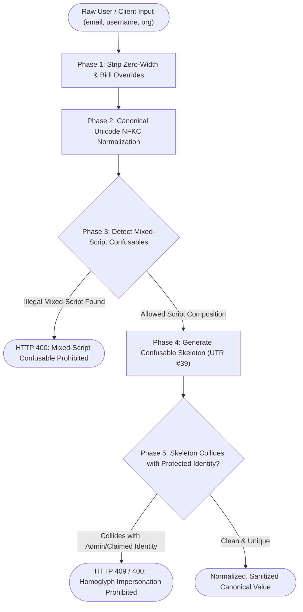
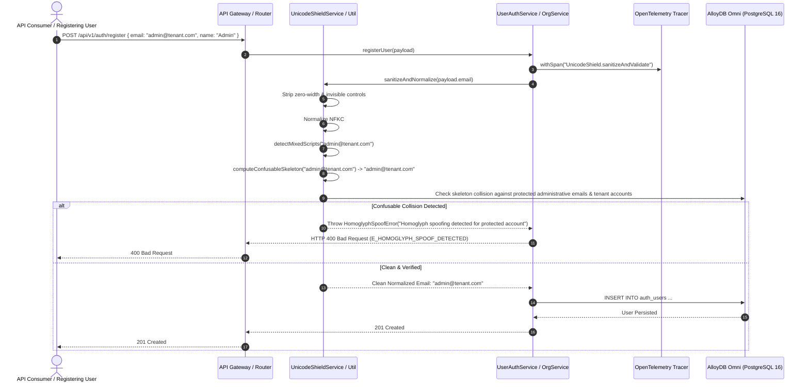

# ADR 0032: Anti-Homoglyph & Unicode Normalization Shield (NFKC / Unicode TR39), Confusable Skeleton Collision Defense & Zero-Width Sanitization

- **Status**: Accepted
- **Date**: 2026-10-15
- **Author**: Platform Architecture Team
- **Area**: Defensive Security, Identity Verification, Internationalization & Unicode Defense, Anti-Impersonation
- **Standards**: [Unicode Standard Annex #15 (Unicode Normalization Forms)](https://www.unicode.org/reports/tr15/), [Unicode Technical Report #39 (Unicode Security Mechanisms)](https://www.unicode.org/reports/tr39/), [RFC 8264 (PRECIS Framework)](https://datatracker.ietf.org/doc/html/rfc8264), [OWASP Top 10 A07:2021 (Identification and Authentication Failures)](https://owasp.org/Top10/A07_2021-Identification_and_Authentication_Failures/)

---

## 🎯 1. Context, Threat Modeling & Business Drivers

Modern cloud and multi-tenant observability platforms allow users from diverse linguistic backgrounds to register email addresses, invite team members, create organization slugs, and define system identities. However, naive string handling that relies solely on standard string trimming or ASCII-centric checks opens critical identity spoofing vulnerabilities:

1. **Internationalized Domain Name (IDN) & Homoglyph Spoofing**:
   - Attackers leverage characters from different Unicode scripts that are visually indistinguishable (homoglyphs) to human operators.
   - For example, the Cyrillic Small Letter A (`\u0430`) renders identically in most UI fonts to the Latin Small Letter A (`\u0061`).
   - An attacker registering `аdmin@company.com` (using Cyrillic `а`) bypasses duplicate account collision checks while deceiving teammates and enterprise administrators into trusting an impersonator.
2. **Failure of Standard Normalization Alone**:
   - Standard Unicode NFKC (`String.prototype.normalize('NFKC')`) resolves compatibility characters (e.g., ligature `fi` to `fi` or full-width `Ａ` to `A`), but explicitly **preserves** distinct script identities.
   - Hence, `'аdmin'.normalize('NFKC') === 'admin'` evaluates to `false`. Relying solely on `NFKC` leaves the system completely vulnerable to cross-script spoofing.
3. **Zero-Width & Invisible Formatting Smuggling**:
   - Attackers embed zero-width spaces (`\u200B`), zero-width non-joiners (`\u200C`), right-to-left overrides (`\u202E`), or soft hyphens (`\u00AD`) into emails and usernames.
   - This bypasses exact-match denylists, creates invisible duplicate accounts, alters audit log display order, and disrupts downstream SIEM alerts.
4. **Mixed-Script Confusable Attacks**:
   - Combining Latin with Cyrillic or Greek in a single domain or username token creates high-risk spoofing vectors against corporate accounts and claimed domains (ADR 0021).

---

## 🏗️ 2. Architectural Decision & Technical Principles

To eliminate homoglyph spoofing and invisible character smuggling across `@observability/auth`:

### 1. Multi-Stage Sanitization Pipeline
Every incoming string input (email, username, organization name, slug, role name) passes through a multi-stage deterministic pipeline before schema validation, database querying, or hashing:

1. **Invisible Character Stripping**:
   - Removes zero-width characters (`\u200B`, `\u200C`, `\u200D`, `\uFEFF`), bidirectional overrides (`\u202A`–`\u202E`, `\u2066`–`\u2069`), and non-printable control characters.
2. **Canonical NFKC Normalization**:
   - Decomposes compatibility characters and recomposes them into canonical forms (`NFKC`).
3. **Mixed-Script Detection (UTR #39 §5)**:
   - Evaluates the Unicode script membership of each character. Flags strings that mix Latin with non-Latin confusable scripts (Cyrillic, Greek).
4. **Confusable Skeleton Transformation (UTR #39 §4)**:
   - Maps visually identical glyphs across scripts to a prototypical canonical ASCII skeleton.
   - E.g., `а` (Cyrillic `\u0430`) $\rightarrow$ `a` (Latin `\u0061`), `о` (Cyrillic `\u043E`) $\rightarrow$ `o` (Latin `\u006F`).
5. **Collision & Impersonation Guard**:
   - Verifies that the candidate identifier's skeleton does not collide with protected administrative names (`admin`, `owner`, `root`, `support`, `security`) or existing tenant members.

---

## 📊 3. Entity-Relationship & Processing Flow

---

## 🔄 4. Detailed End-to-End Runtime Sequence

---

## 🛡️ 5. Implementation Standards & Error Envelopes

- **Sanitization Invariant**: All input entering domain services (`UserAuthService`, `OrganizationService`, `MagicLinkService`) must be stripped of invisible characters and NFKC-normalized.
- **Error Codes**:
  - `E_INVALID_UNICODE`: Input contains malformed UTF-8 byte sequences or unassigned private use characters.
  - `E_HOMOGLYPH_SPOOF_DETECTED`: Input visually mimics an existing or protected identity via cross-script confusables.
  - `E_MIXED_SCRIPT_CONFUSABLE`: Input inappropriately mixes Cyrillic/Greek with Latin in identifiers where single-script integrity is required.
