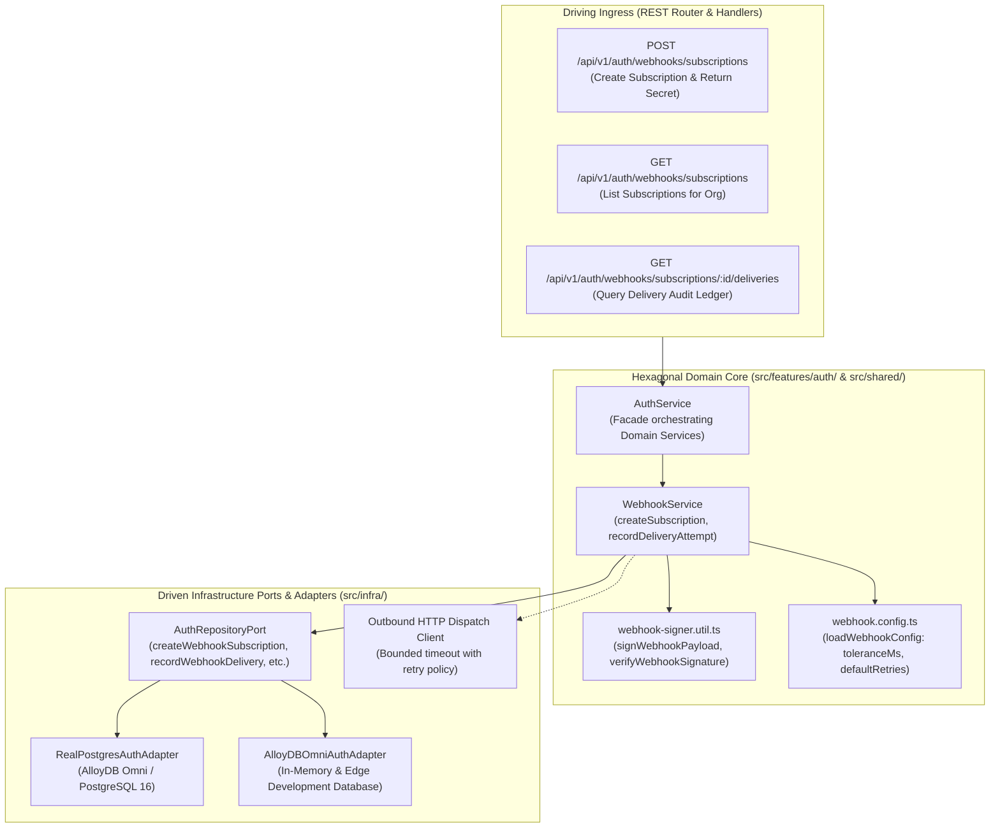
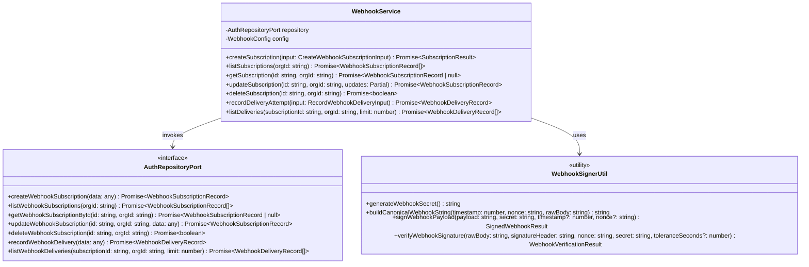
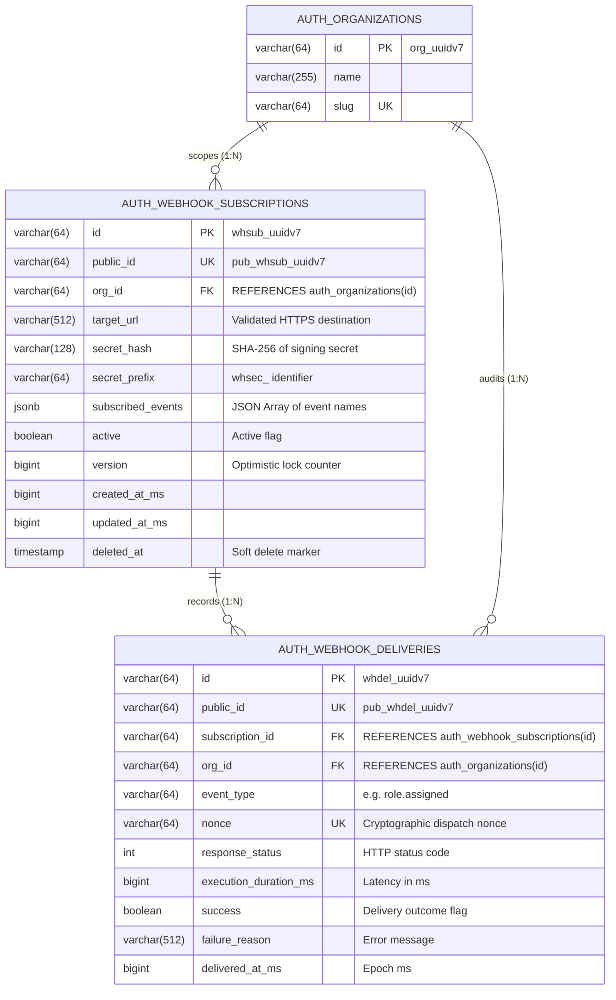
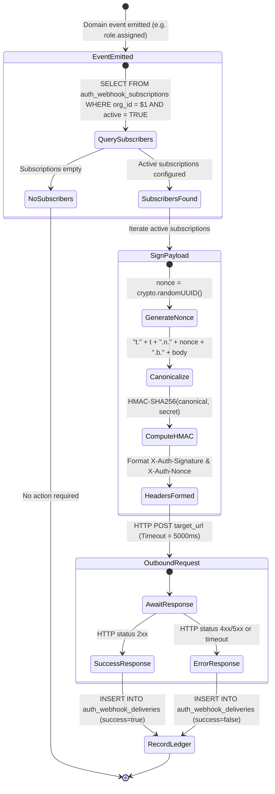
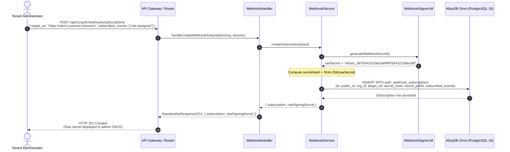
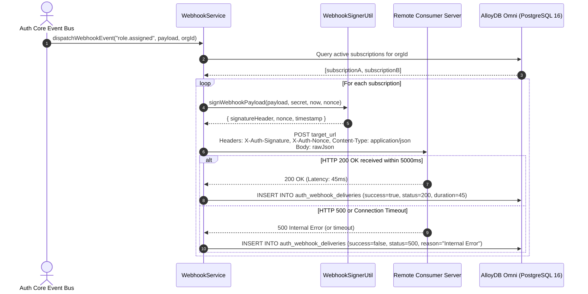
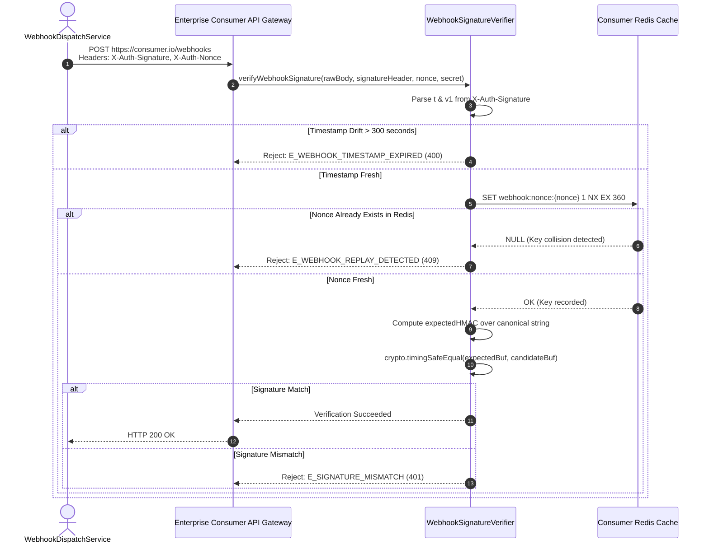

# ADR 0033: Webhook Cryptographic Signatures (RFC 2104 HMAC-SHA256), Anti-Replay Nonces & Delivery Ledger

- **Status**: Accepted
- **Date**: 2026-10-15
- **Author**: Platform Architecture Team
- **Area**: Event Delivery, Cryptographic Signatures, Anti-Replay Nonces, Webhook Perimeter Defense, Zero-Trust
- **Standards**: [RFC 2104 (HMAC: Keyed-Hashing for Message Authentication)](https://datatracker.ietf.org/doc/html/rfc2104), [RFC 2898 (PKCS #5: Password-Based Cryptography)](https://datatracker.ietf.org/doc/html/rfc2898), [RFC 8941 (Structured Field Values for HTTP)](https://datatracker.ietf.org/doc/html/rfc8941), [OWASP ASVS v4.0.3 §13.2 (API Verification)](https://owasp.org/www-project-application-security-verification-standard/)

---

## 📑 Table of Contents

1. [Context, Threat Modeling & Business Drivers](#-1-context-threat-modeling--business-drivers)
   - [1.1 Threat Vectors Addressed](#11-threat-vectors-addressed)
   - [1.2 Cryptographic Invariants & Guarantees](#12-cryptographic-invariants--guarantees)
2. [Architectural Decision & Technical Principles](#-2-architectural-decision--technical-principles)
   - [2.1 Cryptographic Signatures & Canonical Serialization](#21-cryptographic-signatures--canonical-serialization)
   - [2.2 Anti-Replay Nonce Cache & Drift Window Enforcement](#22-anti-replay-nonce-cache--drift-window-enforcement)
   - [2.3 Constant-Time Verification](#23-constant-time-verification)
3. [Hexagonal Architecture & Port Topology](#-3-hexagonal-architecture--port-topology)
   - [3.1 Service & Adapter Boundary Topology](#31-service--adapter-boundary-topology)
   - [3.2 Class and Port Contract Model](#32-class-and-port-contract-model)
4. [Database Schema Specification & Invariants](#-4-database-schema-specification--invariants)
   - [4.1 `auth_webhook_subscriptions` Table Specification](#41-auth_webhook_subscriptions-table-specification)
   - [4.2 `auth_webhook_deliveries` Table Specification](#42-auth_webhook_deliveries-table-specification)
   - [4.3 Entity-Relationship Diagram](#43-entity-relationship-diagram)
5. [Webhook Dispatch & Verification State Machines](#-5-webhook-dispatch--verification-state-machines)
   - [5.1 Outbound Dispatch Lifecycle](#51-outbound-dispatch-lifecycle)
   - [5.2 Subscription State & Rotation Lifecycle](#52-subscription-state--rotation-lifecycle)
6. [Detailed End-to-End Sequence Workflows](#-6-detailed-end-to-end-sequence-workflows)
   - [6.1 Subscription Registration & Secret Generation](#61-subscription-registration--secret-generation)
   - [6.2 Outbound Event Dispatch & Delivery Ledgering](#62-outbound-event-dispatch--delivery-ledgering)
   - [6.3 Enterprise Consumer Verification Sequence](#63-enterprise-consumer-verification-sequence)
7. [Comprehensive Error Envelopes & REST API Status Codes](#-7-comprehensive-error-envelopes--rest-api-status-codes)
8. [OpenTelemetry Distributed Tracing & Span Attributes](#-8-opentelemetry-distributed-tracing--span-attributes)
9. [Comprehensive cURL Protocol Reference](#-9-comprehensive-curl-protocol-reference)
   - [9.1 Create Webhook Subscription](#91-create-webhook-subscription)
   - [9.2 List Webhook Subscriptions](#92-list-webhook-subscriptions)
   - [9.3 Query Delivery Ledger Attempts](#93-query-delivery-ledger-attempts)
10. [Consequences & Architecture Invariant Adherence](#-10-consequences--architecture-invariant-adherence)

---

## 🎯 1. Context, Threat Modeling & Business Drivers

Security, audit, and identity lifecycle events (e.g. `user.created`, `role.assigned`, `security.passkey_cloned`, `account.locked`) must be reliably dispatched to downstream consumer endpoints (SIEM collectors, HRIS directories, IT automation platforms, and customer API gateways).

Dispatching unauthenticated or unscheduled HTTP POST payloads over the public internet exposes consumers to critical vulnerabilities:

### 1.1 Threat Vectors Addressed

1. **Adversary Payload Forgery**:
   - Without cryptographic signatures, an attacker can dispatch fake HTTP POST requests mimicking `@observability/auth`, forging administrative role escalations or triggering fraudulent account deletions in downstream systems.
2. **Replay Attacks**:
   - An eavesdropper or intermediate network interceptor can capture a legitimate webhook payload and replay it hours or days later (e.g. replaying an account suspension event to cause unauthorized downtime).
3. **Payload Tampering in Transit**:
   - Modifying JSON attributes (such as changing an assigned role or user permissions) between the auth service and consumer endpoint.
4. **Timing Attack Vulnerabilities in Signature Verification**:
   - Naive string comparisons (`signature === expected`) leak byte-matching timing information, enabling attackers to deduce cryptographic signatures byte by byte.

### 1.2 Cryptographic Invariants & Guarantees

| Invariant | Value | Standard / Description |
|---|---|---|
| **Hash Algorithm** | `HMAC-SHA256` | RFC 2104 compliant keyed-hash message authentication |
| **Secret Prefix & Entropy** | `whsec_` + 48 hex chars | 192-bit cryptographic randomness via `crypto.randomBytes(24)` |
| **Secret Storage at Rest** | SHA-256 Digest | Raw secret shown once upon creation; DB persists only SHA-256 hash |
| **Drift Window Tolerance** | 300 seconds (5 min) | Rejects timestamps where $|t_{\text{current}} - t_{\text{event}}| > 300\text{s}$ |
| **Nonce Uniqueness Window** | 360 seconds TTL | Recorded in Redis with `SET key 1 NX EX 360` to block replays |
| **Buffer Equality Check** | `crypto.timingSafeEqual` | Fixed-length 32-byte constant-time comparison |

---

## 🏗️ 2. Architectural Decision & Technical Principles

To guarantee authenticated, tamper-proof, and non-replayable event delivery across `@observability/auth`:

### 2.1 Cryptographic Signatures & Canonical Serialization

Every outbound webhook includes standardized cryptographic headers:
- `X-Auth-Signature`: `t={timestamp_epoch_ms},v1={hmac_sha256_hex}`
- `X-Auth-Nonce`: `{uuid_v7}` (unique per dispatch attempt)

The HMAC-SHA256 is computed over a canonical payload string:
$$\text{canonical} = \text{"t."} + \text{timestamp} + \text{".n."} + \text{nonce} + \text{".b."} + \text{rawJsonBody}$$

This strictly binds the dispatch timestamp, dispatch nonce, and full raw HTTP request body to the tenant's shared cryptographic secret (`whsec_...`).

### 2.2 Anti-Replay Nonce Cache & Drift Window Enforcement

- Consumers reject webhooks if $|\text{current\_time} - \text{timestamp}| > 300\text{ seconds}$ (strict 5-minute drift window).
- Nonces are tracked in distributed memory (Redis) with a 360-second TTL to guarantee absolute single-delivery execution.

### 2.3 Constant-Time Verification

All signature verifications convert the expected hexadecimal digest and incoming candidate digest to binary buffers and evaluate them via Node's `crypto.timingSafeEqual` to eliminate side-channel timing leaks.

---

## 🔌 3. Hexagonal Architecture & Port Topology

### 3.1 Service & Adapter Boundary Topology



### 3.2 Class and Port Contract Model



---

## 📊 4. Database Schema Specification & Invariants

In strict compliance with [05-db-writing-rules.md](file:///home/btpl-lap-22/live/llm-obs-node-packages/llm-obs-policies/rules/folder-structure/05-db-writing-rules.md):

### 4.1 `auth_webhook_subscriptions` Table Specification

| Column | Data Type | Nullable | Default | Constraints & Rules | Description |
|---|---|---|---|---|---|
| `id` | `VARCHAR(64)` | `NO` | PK | Primary Key (`whsub_uuidv7`) | Internal surrogate identifier |
| `public_id` | `VARCHAR(64)` | `NO` | UK | Unique (`pub_whsub_uuidv7`) | External opaque API identifier |
| `org_id` | `VARCHAR(64)` | `NO` | FK | `REFERENCES auth_organizations(id) ON DELETE CASCADE` | Multi-tenant organization boundary |
| `target_url` | `VARCHAR(512)` | `NO` | - | `CHECK (target_url ~* '^https?://')` | Validated consumer webhook URL |
| `secret_hash` | `VARCHAR(128)` | `NO` | - | SHA-256 digest | Prevents raw secret compromise from DB reads |
| `secret_prefix` | `VARCHAR(64)` | `NO` | - | `whsec_` prefix | Identifying prefix for rotation verification |
| `subscribed_events` | `JSONB` | `NO` | `'[]'` | JSON Array | List of subscribed domain events (e.g. `["user.created"]`) |
| `active` | `BOOLEAN` | `NO` | `TRUE` | Boolean flag | Controls active dispatch status |
| `version` | `BIGINT` | `NO` | `1` | `CHECK (version >= 1)` | Optimistic concurrency control counter |
| `created_at_ms` | `BIGINT` | `NO` | - | Epoch milliseconds | Audit timestamp |
| `updated_at_ms` | `BIGINT` | `NO` | - | Epoch milliseconds | Audit timestamp |
| `deleted_at` | `TIMESTAMPTZ` | `YES` | `NULL` | Soft delete marker | 30-day cascade retention marker |

### 4.2 `auth_webhook_deliveries` Table Specification

| Column | Data Type | Nullable | Default | Constraints & Rules | Description |
|---|---|---|---|---|---|
| `id` | `VARCHAR(64)` | `NO` | PK | Primary Key (`whdel_uuidv7`) | Internal delivery attempt identifier |
| `public_id` | `VARCHAR(64)` | `NO` | UK | Unique (`pub_whdel_uuidv7`) | External audit log identifier |
| `subscription_id` | `VARCHAR(64)` | `NO` | FK | `REFERENCES auth_webhook_subscriptions(id) ON DELETE CASCADE` | Associated subscription |
| `org_id` | `VARCHAR(64)` | `NO` | FK | `REFERENCES auth_organizations(id) ON DELETE CASCADE` | Tenant boundary |
| `event_type` | `VARCHAR(64)` | `NO` | - | Max 64 chars | Dispatched event type (e.g. `role.assigned`) |
| `nonce` | `VARCHAR(64)` | `NO` | UK | Unique per delivery attempt | Anti-replay cryptographic nonce |
| `response_status` | `INT` | `NO` | - | HTTP Status Code | Consumer HTTP response code (e.g. 200, 500) |
| `execution_duration_ms` | `BIGINT` | `NO` | - | Bounded latency metric | Round-trip request latency in milliseconds |
| `success` | `BOOLEAN` | `NO` | - | Boolean flag | True if response status is 2xx |
| `failure_reason` | `VARCHAR(512)` | `YES` | `NULL` | Error details | Network timeout, connection refused, or error payload |
| `delivered_at_ms` | `BIGINT` | `NO` | - | Epoch milliseconds | Append-only delivery timestamp |

### 4.3 Entity-Relationship Diagram



---

## 🔄 5. Webhook Dispatch & Verification State Machines

### 5.1 Outbound Dispatch Lifecycle



### 5.2 Subscription State & Rotation Lifecycle

```mermaid
stateDiagram-v2
    [*] --> Created: POST /webhooks/subscriptions (version=1, active=true)
    Created --> Active: Secret returned to user once
    
    Active --> Paused: PATCH { active: false } (Dispatches halted)
    Paused --> Active: PATCH { active: true } (Dispatches resumed)
    
    Active --> SecretRotated: POST /webhooks/subscriptions/:id/rotate-secret
    SecretRotated --> Active: New secret issued; secret_hash updated (version++)
    
    Active --> SoftDeleted: DELETE /webhooks/subscriptions/:id (deleted_at = NOW())
    Paused --> SoftDeleted: DELETE /webhooks/subscriptions/:id (deleted_at = NOW())
    SoftDeleted --> [*]: Excluded from runtime subscriber queries
```



---

## 🔄 6. Detailed End-to-End Sequence Workflows

### 6.1 Subscription Registration & Secret Generation



### 6.2 Outbound Event Dispatch & Delivery Ledgering



### 6.3 Enterprise Consumer Verification Sequence



---

## 🛡️ 7. Comprehensive Error Envelopes & REST API Status Codes

All responses adhere strictly to [2-apis.writing.rule.md](file:///home/btpl-lap-22/live/llm-obs-node-packages/llm-obs-policies/rules/folder-structure/2-apis.writing.rule.md):

### 7.1 Webhook Replay Detected Error (`HTTP 409 Conflict`)

```json
{
  "success": false,
  "statusCode": 409,
  "error": {
    "code": "E_WEBHOOK_REPLAY_DETECTED",
    "message": "Dispatch nonce 'whdel_01928374-1234-7000-8000-abcdef012345' was already consumed within the last 360 seconds."
  },
  "meta": {
    "timestamp": 1729000000000,
    "requestId": "req_01928374-9999-7000-8000-abcdef012399"
  }
}
```

### 7.2 Webhook Timestamp Expired Error (`HTTP 400 Bad Request`)

```json
{
  "success": false,
  "statusCode": 400,
  "error": {
    "code": "E_WEBHOOK_TIMESTAMP_EXPIRED",
    "message": "Webhook timestamp drift exceeds maximum allowable window of 300 seconds."
  },
  "meta": {
    "timestamp": 1729000000000,
    "requestId": "req_01928374-8888-7000-8000-abcdef012388"
  }
}
```

---

## 🔭 8. OpenTelemetry Distributed Tracing & Span Attributes

All webhook management, dispatch, and verification operations are traced:

| Span Name | Key Attributes | Description |
|---|---|---|
| `WebhookService.createSubscription` | `auth.org_id`, `auth.target_url`, `auth.event_count` | Tracks subscription provisioning |
| `WebhookService.dispatchWebhookEvent` | `auth.subscription_id`, `auth.event_type`, `auth.nonce` | Tracks outbound dispatch attempt |
| `WebhookService.recordDeliveryAttempt` | `auth.delivery_status`, `auth.duration_ms`, `auth.success` | Records delivery outcome in ledger |
| `WebhookSigner.verifySignature` | `auth.is_valid`, `auth.drift_seconds`, `auth.failure_reason` | Traces incoming consumer verification |

---

## 💻 9. Comprehensive cURL Protocol Reference

### 9.1 Create Webhook Subscription

```bash
curl -X POST http://localhost:3001/api/v1/auth/webhooks/subscriptions \
  -H "Authorization: Bearer <ADMIN_JWT_TOKEN>" \
  -H "Content-Type: application/json" \
  -d '{
    "target_url": "https://siem.corp.internal/webhooks/auth-events",
    "subscribed_events": ["user.created", "role.assigned", "security.passkey_cloned"]
  }'
```

**Response (HTTP 201 Created):**
```json
{
  "success": true,
  "statusCode": 201,
  "data": {
    "subscription": {
      "id": "whsub_01928374-1234-7000-8000-abcdef012345",
      "public_id": "pub_whsub_01928374-1234-7000-8000-abcdef012345",
      "org_id": "org_enterprise99",
      "target_url": "https://siem.corp.internal/webhooks/auth-events",
      "secret_prefix": "whsec_",
      "subscribed_events": ["user.created", "role.assigned", "security.passkey_cloned"],
      "active": true,
      "version": 1,
      "created_at_ms": 1729000000000
    },
    "rawSigningSecret": "whsec_9876543210abcdef9876543210abcdef9876543210abcdef"
  }
}
```

### 9.2 List Webhook Subscriptions

```bash
curl -X GET http://localhost:3001/api/v1/auth/webhooks/subscriptions \
  -H "Authorization: Bearer <ADMIN_JWT_TOKEN>"
```

### 9.3 Query Delivery Ledger Attempts

```bash
curl -X GET "http://localhost:3001/api/v1/auth/webhooks/subscriptions/whsub_01928374-1234-7000-8000-abcdef012345/deliveries?limit=10" \
  -H "Authorization: Bearer <ADMIN_JWT_TOKEN>"
```

---

## ⚖️ 10. Consequences & Architecture Invariant Adherence

- **Positive Consequences**:
  - Eliminates unauthenticated payload injection into downstream consumer systems.
  - Guarantees replay defense: nonces and timestamps prevent duplicate execution of security-sensitive events.
  - Zero plain secret exposure: database only stores SHA-256 hashes of signing secrets.
  - Full auditability via immutable `auth_webhook_deliveries` ledger.
- **Negative Consequences**:
  - Consumers must implement HMAC-SHA256 signature verification and nonce deduplication.
- **Clean Code & Policy Conformance**:
  - Stateless service design adhering to [4-functions-and-classes-writing-rule.md](file:///home/btpl-lap-22/live/llm-obs-node-packages/llm-obs-policies/rules/folder-structure/4-functions-and-classes-writing-rule.md).
  - Database migration follows [05-db-writing-rules.md](file:///home/btpl-lap-22/live/llm-obs-node-packages/llm-obs-policies/rules/folder-structure/05-db-writing-rules.md).
  - Pure cryptographic utilities in `src/shared/utils/webhook-signer.util.ts`.
