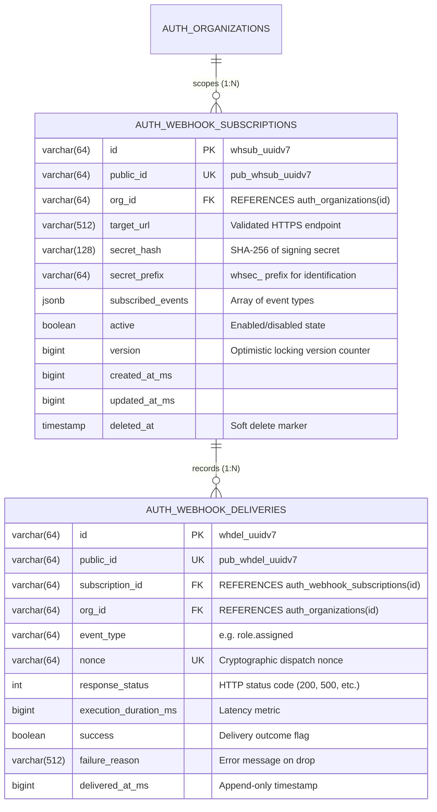
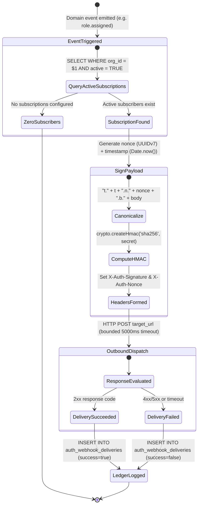
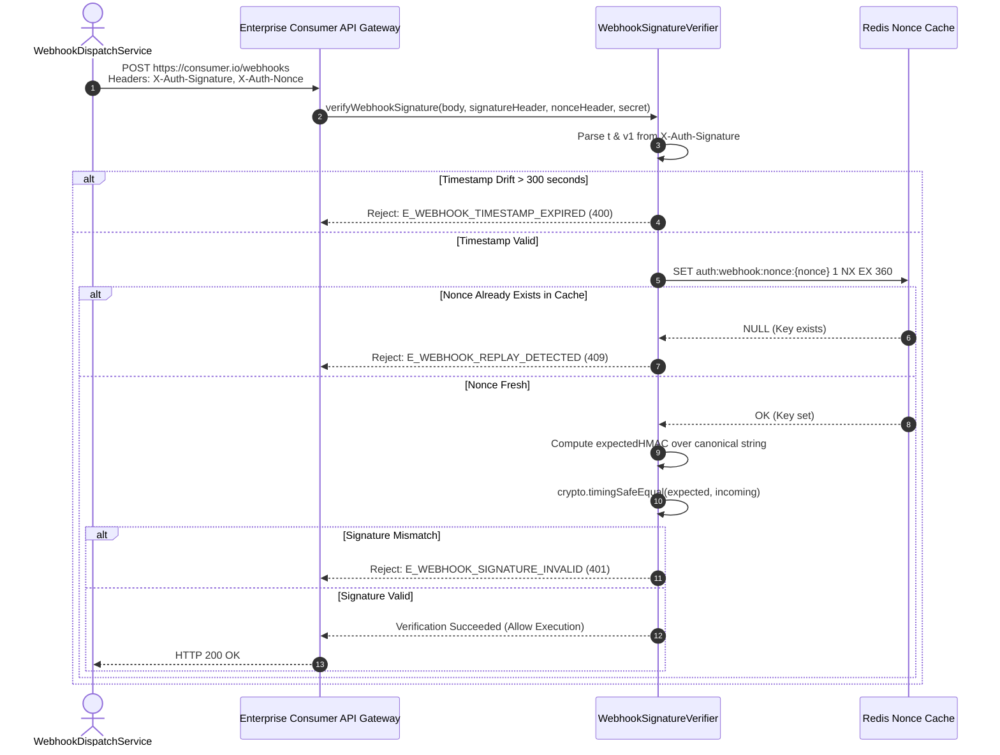

# ADR 0033: Webhook Cryptographic Signatures (RFC 2104 HMAC-SHA256), Anti-Replay Nonces & Delivery Ledger

- **Status**: Accepted
- **Date**: 2026-10-15
- **Author**: Platform Architecture Team
- **Area**: Event Delivery, Cryptographic Signatures, Anti-Replay Nonces, Webhook Perimeter Defense, Zero-Trust
- **Standards**: [RFC 2104 (HMAC: Keyed-Hashing for Message Authentication)](https://datatracker.ietf.org/doc/html/rfc2104), [RFC 2898 (PKCS #5: Password-Based Cryptography)](https://datatracker.ietf.org/doc/html/rfc2898), [RFC 8941 (Structured Field Values for HTTP)](https://datatracker.ietf.org/doc/html/rfc8941), [OWASP ASVS v4.0.3 §13.2 (API Verification)](https://owasp.org/www-project-application-security-verification-standard/)

---

## 🎯 1. Context, Threat Modeling & Business Drivers

Security, audit, and identity lifecycle events (e.g. `user.created`, `role.assigned`, `security.passkey_cloned`, `account.locked`) must be reliably dispatched to downstream consumer endpoints (SIEM collectors, HRIS directories, IT automation platforms, and customer API gateways).

Dispatching unauthenticated or unscheduled HTTP POST payloads over the public internet exposes consumers to critical vulnerabilities:
1. **Adversary Payload Forgery**: Without cryptographic signatures, an attacker can dispatch fake webhook requests mimicking `@observability/auth`, forging administrative role escalations or triggering fraudulent account deletions in downstream systems.
2. **Replay Attacks**: An eavesdropper or intermediate network interceptor can capture a legitimate webhook payload and replay it hours or days later (e.g. replaying an account suspension event to cause unauthorized downtime).
3. **Payload Tampering in Transit**: Modifying JSON attributes (such as changing an assigned role or user permissions) between the auth service and consumer endpoint.
4. **Timing Attack Vulnerabilities in Signature Verification**: Naive string comparisons (`signature === expected`) leak byte-matching timing information, enabling attackers to deduce cryptographic signatures byte by byte.

---

## 🏗️ 2. Architectural Decision & Technical Principles

To guarantee authenticated, tamper-proof, and non-replayable event delivery:

### 1. Cryptographic HMAC-SHA256 Signatures
Every outbound webhook includes standardized cryptographic headers:
- `X-Auth-Signature`: `t={timestamp_epoch_ms},v1={hmac_sha256_hex}`
- `X-Auth-Nonce`: `{uuid_v7}` (unique per dispatch attempt)

### 2. Canonical Signature Representation
The HMAC-SHA256 is computed over a canonical payload string:
$$\text{canonical} = \text{"t."} + \text{timestamp} + \text{".n."} + \text{nonce} + \text{".b."} + \text{rawJsonBody}$$
This binds the timestamp, nonce, and full payload to the tenant's shared cryptographic secret (`whsec_...`).

### 3. Anti-Replay Drift Window & Nonce Cache
- Consumers reject webhooks if $|\text{current\_time} - \text{timestamp}| > 300\text{ seconds}$ (strict 5-minute drift window).
- Nonces are tracked in Redis with a 360-second TTL to guarantee absolute single-delivery execution.

### 4. Constant-Time Timing-Safe Comparison
All signature verifications use `crypto.timingSafeEqual` over fixed 32-byte binary buffers to eliminate side-channel timing leaks.

---

## 📊 3. Database Schema Specification (`auth_webhook_subscriptions` & `auth_webhook_deliveries`)

In strict compliance with [05-db-writing-rules.md](file:///home/btpl-lap-22/live/llm-obs-node-packages/llm-obs-policies/rules/folder-structure/05-db-writing-rules.md):

---

## 🔄 4. Webhook Dispatch & Verification Lifecycle State Machine

---

## 🔄 5. End-to-End Consumer Verification Sequence

---

## 🛡 6. Implementation Invariants & Clean Code Standards

- **Functions & Classes**: Adheres strictly to [4-functions-and-classes-writing-rule.md](file:///home/btpl-lap-22/live/llm-obs-node-packages/llm-obs-policies/rules/folder-structure/4-functions-and-classes-writing-rule.md) (stateless service, zero inline comments, constructor dependency injection, explicit `try/catch/finally` span ownership).
- **Shared Code Discipline**: Conforms to [3.shared.code.writing.rule.md](file:///home/btpl-lap-22/live/llm-obs-node-packages/llm-obs-policies/rules/folder-structure/3.shared.code.writing.rule.md) with pure cryptographic signing functions in `src/shared/utils/`.
- **API Response Envelopes**: Complies with [2-apis.writing.rule.md](file:///home/btpl-lap-22/live/llm-obs-node-packages/llm-obs-policies/rules/folder-structure/2-apis.writing.rule.md) with standardized envelopes (`success`, `statusCode`, `data`, `meta`).
- **Database Writing Rules**: Migration `0026_create_auth_webhook_subscriptions.sql` strictly follows [05-db-writing-rules.md](file:///home/btpl-lap-22/live/llm-obs-node-packages/llm-obs-policies/rules/folder-structure/05-db-writing-rules.md).
