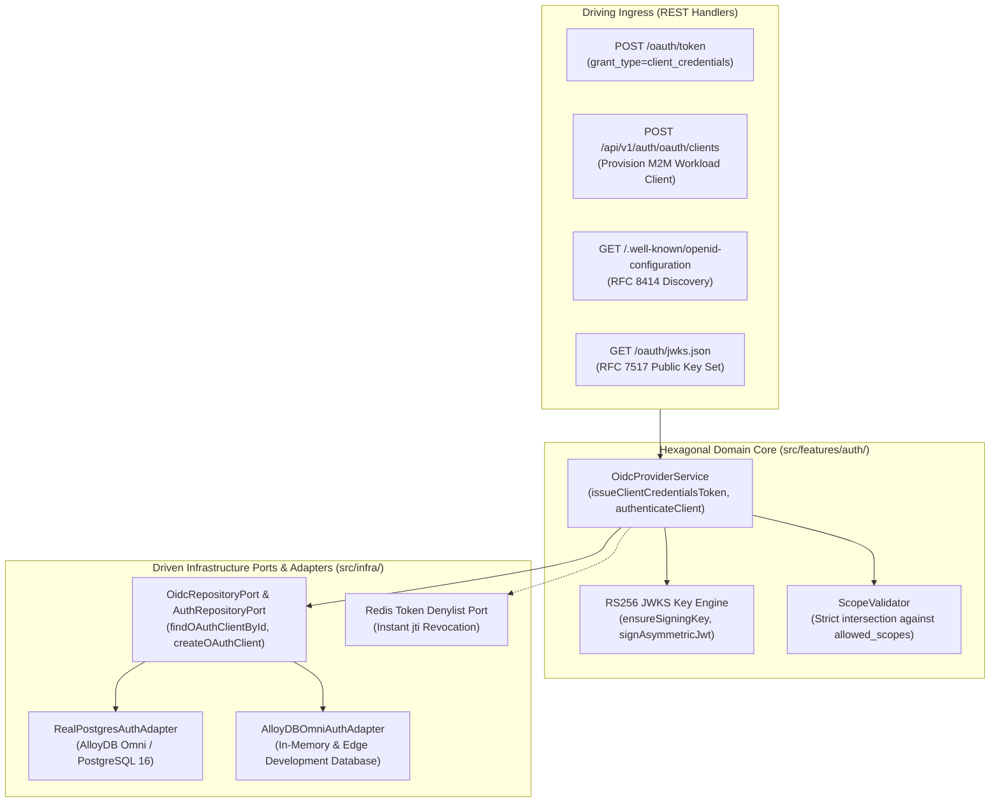
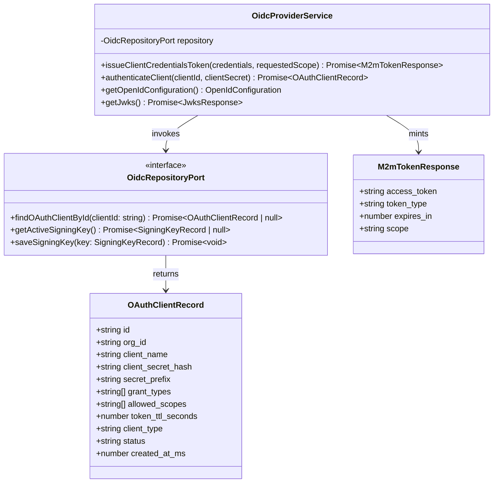
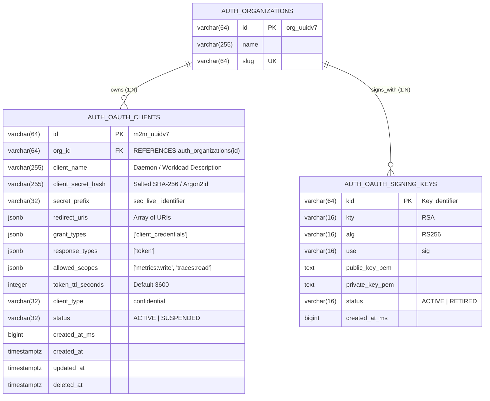
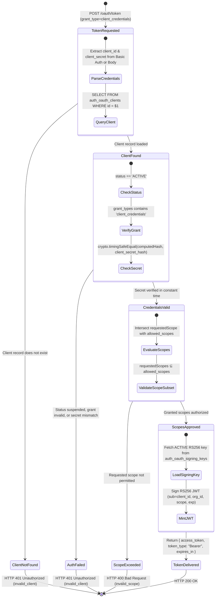
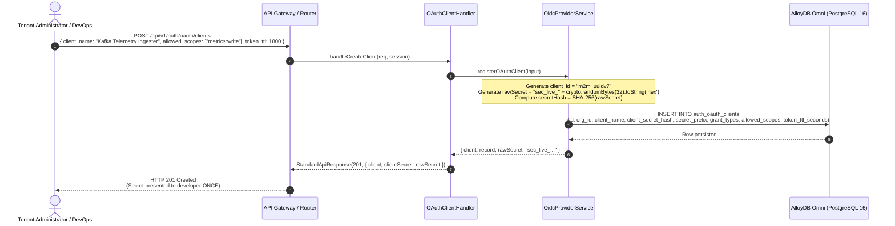
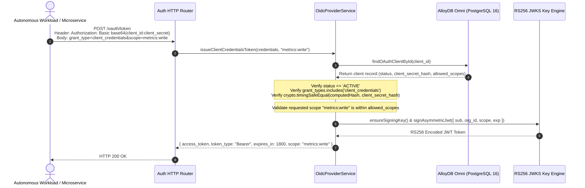
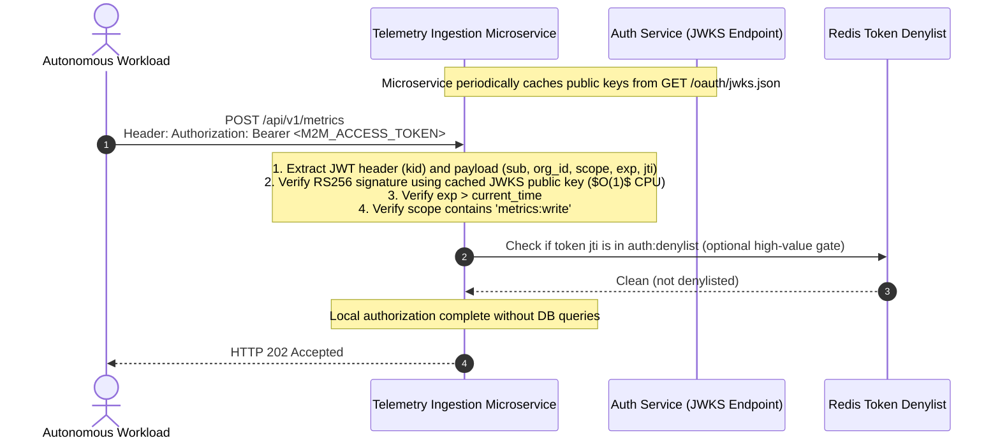

# ADR 0034: Machine-to-Machine (M2M) Client Credentials Grant (RFC 6749 §4.4) & Autonomous Workload Authentication

- **Status**: Accepted
- **Date**: 2026-10-16
- **Author**: Platform Architecture Team
- **Area**: Machine-to-Machine Identity, Daemon Services, OAuth 2.0 Client Credentials Grant, Zero-Trust
- **Standards**: [RFC 6749 §4.4 (OAuth 2.0 Client Credentials Grant)](https://datatracker.ietf.org/doc/html/rfc6749#section-4.4), [RFC 7519 (JSON Web Token)](https://datatracker.ietf.org/doc/html/rfc7519), [RFC 7517 (JSON Web Key)](https://datatracker.ietf.org/doc/html/rfc7517), [RFC 7662 (OAuth 2.0 Token Introspection)](https://datatracker.ietf.org/doc/html/rfc7662), [RFC 8725 (JWT Best Current Practices)](https://datatracker.ietf.org/doc/html/rfc8725)

---

## 📑 Table of Contents

1. [Context, Threat Modeling & Business Drivers](#-1-context-threat-modeling--business-drivers)
   - [1.1 Threat Vectors Addressed](#11-threat-vectors-addressed)
   - [1.2 Architectural Shortcomings of Static Shared Secrets](#12-architectural-shortcomings-of-static-shared-secrets)
2. [Architectural Decision & Technical Principles](#-2-architectural-decision--technical-principles)
   - [2.1 RFC 6749 §4.4 Client Credentials Protocol](#21-rfc-6749-44-client-credentials-protocol)
   - [2.2 Dual Ingress Client Authentication Channels](#22-dual-ingress-client-authentication-channels)
   - [2.3 Cryptographic Storage & Constant-Time Verification](#23-cryptographic-storage--constant-time-verification)
   - [2.4 Asymmetric RS256 Workload Token Minting](#24-asymmetric-rs256-workload-token-minting)
3. [Hexagonal Architecture & Port Topology](#-3-hexagonal-architecture--port-topology)
   - [3.1 Service & Adapter Boundary Topology](#31-service--adapter-boundary-topology)
   - [3.2 Class and Port Contract Model](#32-class-and-port-contract-model)
4. [Database Schema Specification & Invariants](#-4-database-schema-specification--invariants)
   - [4.1 `auth_oauth_clients` Table Migration Specification (Migration 0027)](#41-auth_oauth_clients-table-migration-specification-migration-0027)
   - [4.2 Entity-Relationship Diagram](#42-entity-relationship-diagram)
5. [Workload Token Lifecycle & State Machines](#-5-workload-token-lifecycle--state-machines)
   - [5.1 Workload Authentication & Minting State Machine](#51-workload-authentication--minting-state-machine)
   - [5.2 OAuth Client Provisioning & Lifecycle](#52-oauth-client-provisioning--lifecycle)
6. [Detailed End-to-End Sequence Workflows](#-6-detailed-end-to-end-sequence-workflows)
   - [6.1 M2M Client Provisioning & Secret Derivation](#61-m2m-client-provisioning--secret-derivation)
   - [6.2 Client Credentials Token Exchange Workflow](#62-client-credentials-token-exchange-workflow)
   - [6.3 Downstream Microservice Local Cryptographic Verification](#63-downstream-microservice-local-cryptographic-verification)
7. [Comprehensive Error Envelopes & REST API Status Codes](#-7-comprehensive-error-envelopes--rest-api-status-codes)
8. [OpenTelemetry Distributed Tracing & Span Attributes](#-8-opentelemetry-distributed-tracing--span-attributes)
9. [Comprehensive cURL Protocol Reference](#-9-comprehensive-curl-protocol-reference)
   - [9.1 Token Exchange via HTTP Basic Authentication](#91-token-exchange-via-http-basic-authentication)
   - [9.2 Token Exchange via Request Body Parameters](#92-token-exchange-via-request-body-parameters)
   - [9.3 Unauthorized Scope Request Rejection](#93-unauthorized-scope-request-rejection)
10. [Consequences & Architecture Invariant Adherence](#-10-consequences--architecture-invariant-adherence)

---

## 🎯 1. Context, Threat Modeling & Business Drivers

Modern cloud and AI platforms require backend daemon services, cron workers, CI/CD runners, and automated data pipelines to communicate securely with internal APIs without end-user interaction. In the absence of a standardized Machine-to-Machine (M2M) protocol:

### 1.1 Threat Vectors Addressed

1. **Static API Key Sprawl**: Developers embed high-privilege long-lived API keys into container environment variables, leading to catastrophic credential leaks when container snapshots or logging streams are exfiltrated.
2. **Lack of Dynamic Scope Scoping**: Static credentials frequently lack granular scope constraints (e.g., `audit:read`, `metrics:write`), granting ambient super-admin privileges to autonomous workers.
3. **No Short-Lived Ephemeral Identity**: Breached static secrets remain valid indefinitely until manually identified and rotated, violating NIST SP 800-207 Zero-Trust architectural tenets.
4. **Asymmetric Ingress Inefficiency**: Downstream services must perform centralized synchronous database queries to validate caller identity rather than locally verifying cryptographically signed asymmetric JSON Web Tokens (RS256 / Ed25519) via JWKS.

### 1.2 Architectural Shortcomings of Static Shared Secrets

| Dimension | Legacy Static API Keys | Ephemeral M2M Client Credentials |
|---|---|---|
| **Lifespan** | Months to years | 3600 seconds (1 hour) default |
| **Verification Pattern** | Synchronous DB / Redis query on every API call | Local asymmetric public-key JWKS verification ($O(1)$ CPU) |
| **Revocation Velocity** | Requires rotating global service configuration | Automatic expiry; optional instant `jti` ban |
| **Scope Boundary** | Ambient static permissions | Strict runtime scope down-scoping per request |
| **Tenant Isolation** | Implicit | Cryptographically sealed `org_id` claim in JWT payload |

---

## 🏗️ 2. Architectural Decision & Technical Principles

To provide standardized, ephemeral, and cryptographic workload identity across `@observability/auth`:

### 2.1 RFC 6749 §4.4 Client Credentials Protocol

Clients exchange their registered credentials for an asymmetric JWT Access Token at:
`POST /oauth/token`

Headers: `Content-Type: application/x-www-form-urlencoded` or `application/json`

**Parameters:**
- `grant_type`: `client_credentials` (mandatory)
- `client_id`: Registered client identifier (`m2m_uuidv7` or `oidc_uuidv7`)
- `client_secret`: High-entropy shared secret (`sec_...`)
- `scope`: Optional space-delimited subset of authorized scopes (e.g. `metrics:write traces:read`)
- `audience`: Optional resource indicator identifying the target microservice

### 2.2 Dual Ingress Client Authentication Channels

In strict compliance with RFC 6749 §2.3.1:
1. **HTTP Basic Authentication**: `Authorization: Basic base64(client_id:client_secret)`
2. **Request Body Authentication**: Form-encoded or JSON body parameters (`client_id`, `client_secret`)

### 2.3 Cryptographic Storage & Constant-Time Verification

- Client secrets are never stored in plaintext. They are generated with 256 bits of CSPRNG entropy (`crypto.randomBytes(32).toString('hex')`) and stored hashed via SHA-256 / Argon2id with unique salts.
- Verification uses constant-time byte comparisons (`crypto.timingSafeEqual`) over fixed-length 32-byte binary buffers to eliminate side-channel timing leaks.

### 2.4 Asymmetric RS256 Workload Token Minting

The minted access token is an asymmetric RS256 JWT verifiable against `/.well-known/openid-configuration` and `/oauth/jwks.json`:
- `iss`: Authoritative Auth Service URL (`http://localhost:3001`)
- `sub`: The `client_id` of the calling autonomous workload
- `aud`: Target audience (defaults to issuer or requested resource)
- `org_id`: Tenant organization isolation boundary
- `scope`: Space-delimited granted scopes (strictly bounded to `allowed_scopes`)
- `token_use`: `access_token`
- `exp`: Short-lived expiration (default 3600 seconds / 1 hour, configurable per client)
- `iat`: Timestamp of minting
- `jti`: Unique JWT ID to facilitate instant distributed revocation via Redis token denylist

---

## 🔌 3. Hexagonal Architecture & Port Topology

### 3.1 Service & Adapter Boundary Topology



### 3.2 Class and Port Contract Model



---

## 📊 4. Database Schema Specification & Invariants

### 4.1 `auth_oauth_clients` Table Migration Specification (Migration 0027)

In strict compliance with [05-db-writing-rules.md](file:///home/btpl-lap-22/live/llm-obs-node-packages/llm-obs-policies/rules/folder-structure/05-db-writing-rules.md):

| Column | Data Type | Nullable | Default | Constraints & Rules | Purpose |
|---|---|---|---|---|---|
| `id` | `VARCHAR(64)` | `NO` | PK | Primary Key (`m2m_uuidv7` or `oidc_uuidv7`) | Unique public client identifier (`client_id`) |
| `org_id` | `VARCHAR(64)` | `NO` | FK | `REFERENCES auth_organizations(id) ON DELETE CASCADE` | Multi-tenant tenant boundary |
| `client_name` | `VARCHAR(255)` | `NO` | - | Non-empty trimmed string | Human-readable service name (e.g. `Telemetry Collector Daemon`) |
| `client_secret_hash` | `VARCHAR(255)` | `YES` | `NULL` | Salted SHA-256 / Argon2id digest | Secret storage at rest; null for public clients |
| `secret_prefix` | `VARCHAR(32)` | `YES` | `NULL` | `sec_live_` prefix | Identifying prefix for safe client display |
| `redirect_uris` | `JSONB` | `NO` | `'[]'` | JSON Array | Empty for pure M2M workloads |
| `grant_types` | `JSONB` | `NO` | `'["client_credentials"]'` | JSON Array | Allowed OAuth2 grants (`client_credentials`, `authorization_code`) |
| `response_types` | `JSONB` | `NO` | `'["token"]'` | JSON Array | Expected response types |
| `allowed_scopes` | `JSONB` | `NO` | `'[]'` | JSON Array | Whitelisted scopes permitted for this workload |
| `token_ttl_seconds` | `INTEGER` | `NO` | `3600` | `CHECK (token_ttl_seconds BETWEEN 60 AND 86400)` | Workload access token lifetime in seconds |
| `client_type` | `VARCHAR(32)` | `NO` | `'confidential'` | `CHECK (client_type IN ('confidential', 'public'))` | M2M clients are strictly `confidential` |
| `status` | `VARCHAR(32)` | `NO` | `'ACTIVE'` | `CHECK (status IN ('ACTIVE', 'SUSPENDED'))` | Immediate kill-switch status flag |
| `created_at_ms` | `BIGINT` | `NO` | - | Epoch milliseconds | Audit timestamp |
| `created_at` | `TIMESTAMPTZ` | `NO` | `NOW()` | System timestamp | Audit timestamp |
| `updated_at` | `TIMESTAMPTZ` | `NO` | `NOW()` | System timestamp | Audit timestamp |
| `deleted_at` | `TIMESTAMPTZ` | `YES` | `NULL` | Soft delete marker | 30-day retention marker |

### 4.2 Entity-Relationship Diagram



---

## 🔄 5. Workload Token Lifecycle & State Machines

### 5.1 Workload Authentication & Minting State Machine



### 5.2 OAuth Client Provisioning & Lifecycle

```mermaid
stateDiagram-v2
    [*] --> Created: POST /api/v1/auth/oauth/clients (client_type=confidential)
    Created --> Active: Secret returned to developer ONCE (sec_live_...)
    
    Active --> ScopesUpdated: PUT /api/v1/auth/oauth/clients/:id (allowed_scopes modified)
    ScopesUpdated --> Active
    
    Active --> SecretRotated: POST /api/v1/auth/oauth/clients/:id/rotate-secret
    SecretRotated --> Active: New secret generated; client_secret_hash updated
    
    Active --> Suspended: PATCH { status: "SUSPENDED" }
    Suspended --> Active: PATCH { status: "ACTIVE" }
    
    Active --> SoftDeleted: DELETE /api/v1/auth/oauth/clients/:id (deleted_at = NOW())
    Suspended --> SoftDeleted: DELETE /api/v1/auth/oauth/clients/:id (deleted_at = NOW())
    SoftDeleted --> [*]: Excluded from runtime token exchange queries
```



---

## 🔄 6. Detailed End-to-End Sequence Workflows

### 6.1 M2M Client Provisioning & Secret Derivation



### 6.2 Client Credentials Token Exchange Workflow



### 6.3 Downstream Microservice Local Cryptographic Verification



---

## 🛡️ 7. Comprehensive Error Envelopes & REST API Status Codes

All responses comply with RFC 6749 §5.2 OAuth 2.0 Error Response specifications:

### 7.1 Invalid Client Secret or Unknown Client ID (`HTTP 401 Unauthorized`)

```json
{
  "error": "invalid_client",
  "error_description": "Client authentication failed: invalid client_id or client_secret"
}
```

### 7.2 Unauthorized Scope Request (`HTTP 400 Bad Request`)

```json
{
  "error": "invalid_scope",
  "error_description": "The requested scope 'admin:all' exceeds the allowed scopes registered for this client."
}
```

### 7.3 Unsupported Grant Type (`HTTP 400 Bad Request`)

```json
{
  "error": "unsupported_grant_type",
  "error_description": "Grant type 'password' is not supported. Use 'client_credentials'."
}
```

---

## 🔭 8. OpenTelemetry Distributed Tracing & Span Attributes

All token exchanges and client verifications are instrumented with OpenTelemetry:

| Span Name | Key Attributes | Description |
|---|---|---|
| `OidcProviderService.issueClientCredentialsToken` | `oauth.client_id`, `oauth.grant_type`, `oauth.scope` | Tracks M2M token request lifecycle |
| `OidcProviderService.authenticateClient` | `oauth.client_id`, `oauth.client_type`, `oauth.auth_method` | Tracks credential verification outcomes |
| `RS256Signer.signAsymmetricJwt` | `jwt.kid`, `jwt.alg`, `jwt.exp_seconds` | Tracks asymmetric signature execution |

---

## 💻 9. Comprehensive cURL Protocol Reference

### 9.1 Token Exchange via HTTP Basic Authentication

```bash
curl -X POST http://localhost:3001/oauth/token \
  -u "m2m_01928374-1234-7000-8000-abcdef012345:sec_live_9876543210abcdef9876543210abcdef" \
  -H "Content-Type: application/x-www-form-urlencoded" \
  -d "grant_type=client_credentials&scope=metrics:write"
```

**Response (HTTP 200 OK):**
```json
{
  "access_token": "eyJhbGciOiJSUzI1NiIsImtpZCI6ImtleV8wMSJ9.eyJpc3MiOiJodHRwOi8vbG9jYWxob3N0OjMwMDEiLCJzdWIiOiJtMm1fMDE5MjgzNzQtMTIzNC03MDAwLTgwMDAtYWJjZGVmMDEyMzQ1Iiwib3JnX2lkIjoib3JnX2VudGVycHJpc2U5OSIsInNjb3BlIjoibWV0cmljczp3cml0ZSIsInRva2VuX3VzZSI6ImFjY2Vzc190b2tlbiIsImV4cCI6MTcyOTAwMzYwMCwiaWF0IjoxNzI5MDAwMDAwfQ.XYZ...",
  "token_type": "Bearer",
  "expires_in": 3600,
  "scope": "metrics:write"
}
```

### 9.2 Token Exchange via Request Body Parameters

```bash
curl -X POST http://localhost:3001/oauth/token \
  -H "Content-Type: application/json" \
  -d '{
    "grant_type": "client_credentials",
    "client_id": "m2m_01928374-1234-7000-8000-abcdef012345",
    "client_secret": "sec_live_9876543210abcdef9876543210abcdef",
    "scope": "traces:read"
  }'
```

### 9.3 Unauthorized Scope Request Rejection

```bash
curl -X POST http://localhost:3001/oauth/token \
  -u "m2m_01928374-1234-7000-8000-abcdef012345:sec_live_9876543210abcdef9876543210abcdef" \
  -H "Content-Type: application/x-www-form-urlencoded" \
  -d "grant_type=client_credentials&scope=superuser:root"
```

**Response (HTTP 400 Bad Request):**
```json
{
  "error": "invalid_scope",
  "error_description": "The requested scope 'superuser:root' exceeds the allowed scopes registered for this client."
}
```

---

## ⚖️ 10. Consequences & Architecture Invariant Adherence

- **Positive Consequences**:
  - Eliminates long-lived static API key vulnerabilities across backend workloads.
  - Enables local, decentralized verification at edge microservices via asymmetric JWKS (`/oauth/jwks.json`), eliminating database connection saturation.
  - Zero plain secret exposure: client secrets are hashed at rest via salted SHA-256 / Argon2id.
  - Fully compliant with RFC 6749 §4.4, RFC 7519, and RFC 8725 JWT Best Current Practices.
- **Negative Consequences**:
  - Microservices must implement JWKS discovery caching to maintain optimal performance.
- **Clean Code & Policy Conformance**:
  - Migration `0027_add_m2m_client_credentials.sql` adheres strictly to [05-db-writing-rules.md](file:///home/btpl-lap-22/live/llm-obs-node-packages/llm-obs-policies/rules/folder-structure/05-db-writing-rules.md).
  - Clean separation between OIDC orchestration and repository adapters.
