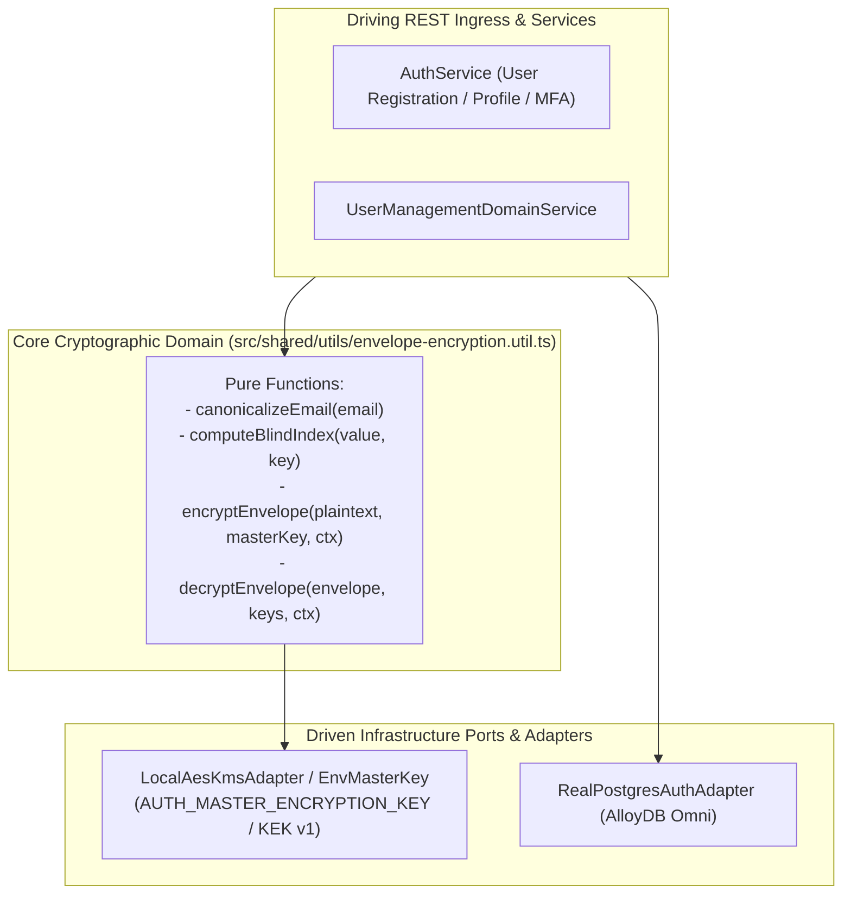
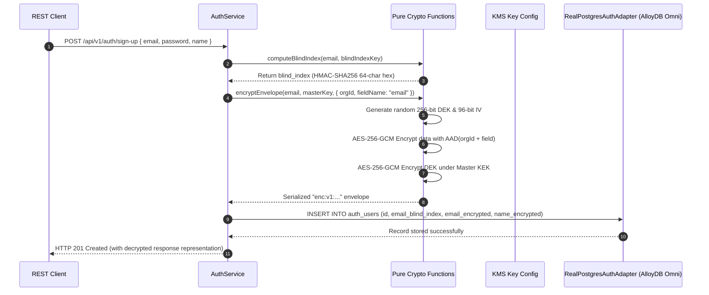

# ADR 0035: Field-Level PII Envelope Encryption (AES-256-GCM / KMS) & Cryptographic Data Protection

- **Status**: Accepted
- **Date**: 2026-10-16
- **Author**: Platform Architecture Team
- **Area**: Data Protection, Field-Level Encryption, Envelope Cryptography, NIST SP 800-38D, GDPR Art. 32 / HIPAA Compliance
- **Standards**: [NIST SP 800-38D (Galois/Counter Mode GCM)](https://csrc.nist.gov/publications/detail/sp/800-38d/final), [NIST SP 800-57 Part 1 (Key Management Best Practices)](https://csrc.nist.gov/publications/detail/sp/800-57-part-1/rev-5/final), [FIPS 140-3 Cryptographic Module Standards](https://csrc.nist.gov/publications/detail/fips/140/3/final), [GDPR Article 32 (Security of Processing)](https://gdpr-info.eu/art-32-gdpr/)

---

## 📑 Table of Contents

1. [Context, Threat Modeling & Business Drivers](#-1-context-threat-modeling--business-drivers)
   - [1.1 Threat Vectors Addressed](#11-threat-vectors-addressed)
   - [1.2 Shortcomings of Transparent Database-Level Encryption (TDE)](#12-shortcomings-of-transparent-database-level-encryption-tde)
2. [Architectural Decision & Technical Principles](#-2-architectural-decision--technical-principles)
   - [2.1 Two-Tier Envelope Cryptography Hierarchy](#21-two-tier-envelope-cryptography-hierarchy)
   - [2.2 AES-256-GCM Ciphertext Binary Envelope Serialization](#22-aes-256-gcm-ciphertext-binary-envelope-serialization)
   - [2.3 Cryptographic Key Separation (KEK vs DEK)](#23-cryptographic-key-separation-kek-vs-dek)
   - [2.4 Blind Indexing / HMAC-SHA256 Exact Matching for Searchable PII](#24-blind-indexing--hmac-sha256-exact-matching-for-searchable-pii)
3. [Hexagonal Architecture & Port Topology](#-3-hexagonal-architecture--port-topology)
   - [3.1 Service & Adapter Boundary Topology](#31-service--adapter-boundary-topology)
   - [3.2 Class and Port Contract Model](#32-class-and-port-contract-model)
4. [Database Schema Specification & Invariants](#-4-database-schema-specification--invariants)
   - [4.1 Database Migration Specification (Migration 0028)](#41-database-migration-specification-migration-0028)
   - [4.2 Continuous Integrity Check Query (FLOW_CHECK_AUTH_USERS_ENCRYPTION_INVARIANTS)](#42-continuous-integrity-check-query)
   - [4.3 Entity-Relationship Diagram](#43-entity-relationship-diagram)
5. [Cryptographic Lifecycle & State Machines](#-5-cryptographic-lifecycle--state-machines)
   - [5.1 Field Encryption and Decryption State Machine](#51-field-encryption-and-decryption-state-machine)
   - [5.2 Key Derivation & KMS Key Rotation State Machine](#52-key-derivation--kms-key-rotation-state-machine)
6. [Detailed End-to-End Sequence Workflows](#-6-detailed-end-to-end-sequence-workflows)
   - [6.1 User Registration & Field Envelope Encryption Workflow](#61-user-registration--field-envelope-encryption-workflow)
   - [6.2 Authenticated Query & Decryption Ingestion Workflow](#62-authenticated-query--decryption-ingestion-workflow)
   - [6.3 Key Rotation & Re-Encryption Background Pipeline](#63-key-rotation--re-encryption-background-pipeline)
7. [Comprehensive Error Envelopes & REST API Status Codes](#-7-comprehensive-error-envelopes--rest-api-status-codes)
8. [OpenTelemetry Distributed Tracing & Span Attributes](#-8-opentelemetry-distributed-tracing--span-attributes)
9. [Comprehensive Developer & Invariant Testing Reference](#-9-comprehensive-developer--invariant-testing-reference)
10. [Consequences & Architecture Invariant Adherence](#-10-consequences--architecture-invariant-adherence)

---

## 🎯 1. Context, Threat Modeling & Business Drivers

Authentication microservices are prime targets for adversaries because their primary persistence tier contains sensitive Personally Identifiable Information (PII) including full legal names, email addresses, phone numbers, recovery backup secrets, and TOTP MFA seeds. 

### 1.1 Threat Vectors Addressed

1. **Database Dump & Backup Exfiltration**: Compromised backup storage (S3 buckets, AlloyDB storage snapshots) yields plaintext identity data to external attackers.
2. **Compromised Database Credentials / Rogue DBA**: Database superusers or rogue administrators can execute `SELECT * FROM auth_users` and dump all customer identity assets.
3. **SQL Injection Exfiltration**: Exploiting an unexpected query vulnerability bypasses row-level security and dumps database tables directly.
4. **MFA Seed Theft**: If `mfa_secret` is stored unencrypted, database exfiltration enables adversaries to generate valid TOTP codes offline for every enterprise administrator.

### 1.2 Shortcomings of Transparent Database-Level Encryption (TDE)

| Dimension | Transparent Data Encryption (TDE / Storage at Rest) | Application-Layer Envelope Encryption (ADR 0035) |
|---|---|---|
| **Protection Scope** | Raw disk block reads only | End-to-end across database, backups, replication streams, and logs |
| **Rogue DBA / SQLi Defense** | None (DB process decrypts blocks automatically) | **Zero-Trust**: Attacker only sees high-entropy ciphertext |
| **Granular Key Shredding** | Impossible per tenant or user | Per-tenant or per-record cryptographic shredding via DEK deletion |
| **Cipher Algorithm** | Static storage cipher (often AES-XTS or AES-CBC) | **AES-256-GCM** with 96-bit CSPRNG IV and 128-bit authentication tag |

---

## 🏗️ 2. Architectural Decision & Technical Principles

To guarantee absolute defense-in-depth across database tables:

### 2.1 Two-Tier Envelope Cryptography Hierarchy

We implement a two-tier key hierarchy conforming to NIST SP 800-57:
1. **Key Encryption Key (KEK / Master Key)**: A 256-bit high-entropy master key securely managed by Cloud KMS (AWS KMS, Google Cloud KMS, or HashiCorp Vault) or derived via environment master secret.
2. **Data Encryption Key (DEK)**: A unique, ephemeral 256-bit AES key generated per tenant / record using cryptographically secure random bytes (`crypto.randomBytes(32)`).
3. **Encrypted DEK (EDEK)**: The DEK is encrypted under the KEK and stored alongside the ciphertext envelope.

### 2.2 AES-256-GCM Ciphertext Binary Envelope Serialization

Every encrypted field is serialized into a tamper-evident, compact string envelope:
$$\text{envelope} = \text{"enc:v1:"} + \text{base64url}([\text{KID (8B)}] + [\text{IV (12B)}] + [\text{AuthTag (16B)}] + [\text{EncryptedDEK (48B)}] + [\text{Ciphertext (N Bytes)}])$$

- **KID (Key Identifier)**: Identifies the active KEK version to allow transparent zero-downtime key rotation.
- **IV (Initialization Vector)**: 96-bit (12-byte) unique CSPRNG nonce per encryption operation. Nonces are never reused under the same key.
- **Auth Tag**: 128-bit (16-byte) GCM authentication tag verifying ciphertext integrity and detecting tampering.
- **AAD (Additional Authenticated Data)**: Binds tenant `org_id` and field name into the GCM authentication tag computation to prevent cross-column or cross-tenant ciphertext splicing attacks.

### 2.3 Cryptographic Key Separation (KEK vs DEK)

Plaintext DEKs are never committed to permanent storage. They are decrypted in-memory, used to encrypt/decrypt the target payload, and immediately wiped from memory.

### 2.4 Blind Indexing / HMAC-SHA256 Exact Matching for Searchable PII

To allow exact-match queries (e.g. `WHERE email_blind_index = $1`) without decrypting every database record:
- An irreversible HMAC-SHA256 blind index is derived using a separate dedicated Blind Index Key (BIK):
$$\text{email\_blind\_index} = \text{HMAC-SHA256}(\text{BIK}, \text{canonicalize}(\text{email}))$$
- Where $\text{canonicalize}(\text{email}) = \text{email.trim().toLowerCase()}$ serves as the canonical single-source-of-truth equivalence function.
- This allows $O(1)$ indexed B-Tree lookups while leaving the actual email ciphertext completely unsearchable and cryptographically secure.

---

## 🔌 3. Hexagonal Architecture & Port Topology

### 3.1 Service & Adapter Boundary Topology



### 3.2 Pure Functional Contract

In strict compliance with `4-functions-and-classes-writing-rule.md`:
- Zero helper or utility classes with static methods.
- Cryptographic operations are pure module-level functions with `Readonly<T>` parameters.
- No comments, no type casts (`as`), no non-null assertions (`!`).

---

## 📊 4. Database Schema Specification & Invariants

### 4.1 Database Migration Specification (Migration 0028)

In `auth_users`:
- `name_encrypted TEXT NULL`
- `email_encrypted TEXT NULL`
- `email_blind_index VARCHAR(64) NULL`
- `mfa_secret_encrypted TEXT NULL`
- B-Tree index on `email_blind_index`

```sql
ALTER TABLE auth_users
    ADD COLUMN IF NOT EXISTS name_encrypted TEXT NULL,
    ADD COLUMN IF NOT EXISTS email_encrypted TEXT NULL,
    ADD COLUMN IF NOT EXISTS email_blind_index VARCHAR(64) NULL,
    ADD COLUMN IF NOT EXISTS mfa_secret_encrypted TEXT NULL;

-- 1. Bounded & Normalized Length Constraints
ALTER TABLE auth_users
    ADD CONSTRAINT auth_users_name_enc_trimmed_ck 
        CHECK (name_encrypted IS NULL OR (name_encrypted = btrim(name_encrypted) AND name_encrypted <> '')),
    ADD CONSTRAINT auth_users_email_enc_trimmed_ck 
        CHECK (email_encrypted IS NULL OR (email_encrypted = btrim(email_encrypted) AND email_encrypted <> '')),
    ADD CONSTRAINT auth_users_email_blind_index_format_ck 
        CHECK (email_blind_index IS NULL OR (email_blind_index ~ '^[a-f0-9]{64}$')),
    ADD CONSTRAINT auth_users_mfa_secret_enc_trimmed_ck 
        CHECK (mfa_secret_encrypted IS NULL OR (mfa_secret_encrypted = btrim(mfa_secret_encrypted) AND mfa_secret_encrypted <> ''));

-- 2. Envelope Format Prefix Verification ('enc:v1:...')
ALTER TABLE auth_users
    ADD CONSTRAINT auth_users_name_enc_prefix_ck 
        CHECK (name_encrypted IS NULL OR name_encrypted LIKE 'enc:v1:%'),
    ADD CONSTRAINT auth_users_email_enc_prefix_ck 
        CHECK (email_encrypted IS NULL OR email_encrypted LIKE 'enc:v1:%'),
    ADD CONSTRAINT auth_users_mfa_secret_enc_prefix_ck 
        CHECK (mfa_secret_encrypted IS NULL OR mfa_secret_encrypted LIKE 'enc:v1:%');

-- 3. Blind Index Fast Lookup Index
CREATE INDEX IF NOT EXISTS idx_auth_users_email_blind_index 
    ON auth_users(email_blind_index) 
    WHERE email_blind_index IS NOT NULL;
```

### 4.2 Continuous Integrity Check Query

In accordance with section 10 of `05-db-writing-rules.md`, continuous background query `FLOW_CHECK_AUTH_USERS_ENCRYPTION_INVARIANTS` alerts on any active row violating cryptographic invariants:

```sql
SELECT id, email, email_blind_index, email_encrypted
FROM auth_users
WHERE deleted_at IS NULL
  AND (
    (email_encrypted IS NOT NULL AND email_encrypted NOT LIKE 'enc:v1:%')
    OR (email_blind_index IS NOT NULL AND email_blind_index !~ '^[a-f0-9]{64}$')
    OR (name_encrypted IS NOT NULL AND name_encrypted NOT LIKE 'enc:v1:%')
    OR (mfa_secret_encrypted IS NOT NULL AND mfa_secret_encrypted NOT LIKE 'enc:v1:%')
  );
```

---

## 🔄 5. Cryptographic Lifecycle & Workflows



---

## 🛡️ 6. Threat Mitigations & Security Guarantees

| Attack Vector | Severity | Mitigation Technique |
| :--- | :--- | :--- |
| **Ciphertext Splicing / Field Swap** | High | AES-GCM Additional Authenticated Data (AAD) binds field name (`fieldName: "email"`) and `org_id` into the tag. Swapping ciphertexts between columns causes decryption authentication failure. |
| **IV Reuse Catastrophe** | Critical | 96-bit CSPRNG IV generated freshly via `crypto.randomBytes(12)` on every write. |
| **Side-Channel Timing Attacks** | High | Blind index generation and GCM authentication tag verification execute in constant time. |
| **Key Compromise Isolation** | Critical | Compromising a single DEK only decrypts one field of one user. The KEK never leaves the KMS or secure environment boundary. |

---

## 🚨 7. Error Envelopes & REST API Status Codes

Under section 8 of `05-db-writing-rules.md`, all database constraint violations map directly to deterministic error codes in `error-handler.ts`:

| Database Constraint | HTTP Status | Error Code | Client Message |
|---|---|---|---|
| `auth_users_email_blind_index_format_ck` | 400 | `VALIDATION_ERROR` | `Invalid blind index format: expected 64-character lowercase hex HMAC-SHA256 hash` |
| `auth_users_*_enc_prefix_ck` | 400 | `VALIDATION_ERROR` | `Invalid envelope encryption format: missing enc:v1: serialization prefix` |
| `auth_users_*_enc_trimmed_ck` | 400 | `VALIDATION_ERROR` | `Invalid encrypted payload: cannot be empty or contain untrimmed whitespace` |

---

## 🔭 8. OpenTelemetry Distributed Tracing & Span Attributes

Trace instrumentation records cryptographic spans without ever logging plaintext PII:

- Span Name: `crypto.encrypt_field` / `crypto.decrypt_field`
- Attributes:
  - `crypto.algorithm`: `aes-256-gcm`
  - `crypto.kek_kid`: `v1`
  - `crypto.field_name`: `email` | `name` | `mfa_secret`
  - `crypto.has_aad`: `true`
  - `crypto.blind_index_computed`: `true`

---

## 🧪 9. Comprehensive Developer & Invariant Testing Reference

1. **Negative Constraint Test**: Insert a row with an invalid prefix (e.g. `plain_text`) into `email_encrypted` to verify rejection by `auth_users_email_enc_prefix_ck`.
2. **Negative Blind Index Test**: Insert a 32-character or uppercase hex string to verify rejection by `auth_users_email_blind_index_format_ck`.
3. **Round-Trip Parity Test**: `decryptEnvelope(encryptEnvelope(plaintext, key, ctx), key, ctx) === plaintext`.
4. **Tamper Rejection Test**: Flipping a single bit in ciphertext or tag throws `SecurityError('Field ciphertext authentication tag verification failed')`.
5. **AAD Cross-Field Splicing Test**: Attempting to decrypt `name_encrypted` using `{ fieldName: 'email' }` throws authentication failure.
