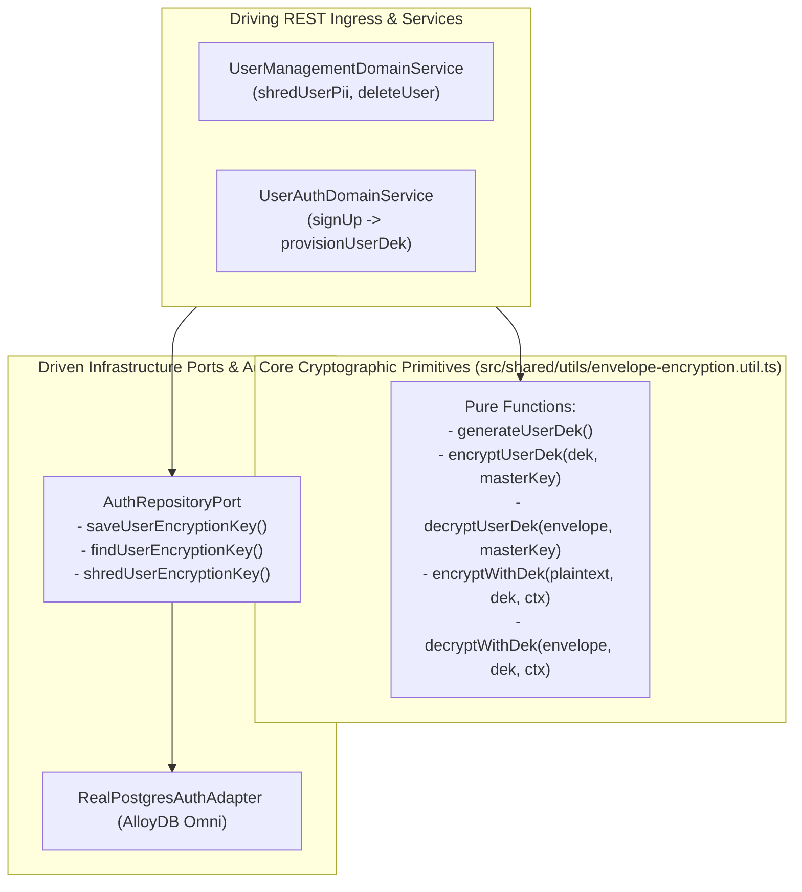
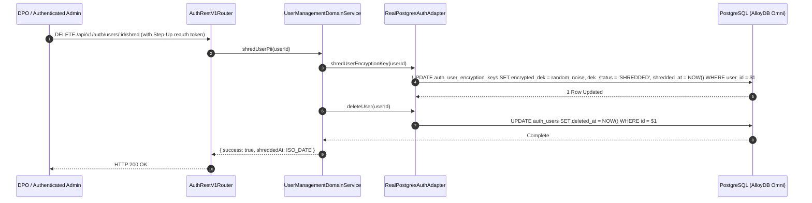

# ADR 0036: Cryptographic Shredding & User DEK Registry (GDPR Article 17 & NIST SP 800-88)

- **Status**: Accepted
- **Date**: 2026-10-16
- **Author**: Platform Architecture Team
- **Area**: Data Protection, Privacy Engineering, Right to be Forgotten, GDPR Article 17, NIST SP 800-88 Rev. 1
- **Standards**: [GDPR Article 17 (Right to Erasure)](https://gdpr-info.eu/art-17-gdpr/), [NIST SP 800-88 Rev. 1 (Guidelines for Media Sanitization)](https://csrc.nist.gov/publications/detail/sp/800-88/rev-1/final), [NIST SP 800-57 Part 1 (Key Erasure & Shredding)](https://csrc.nist.gov/publications/detail/sp/800-57-part-1/rev-5/final), [ISO/IEC 27001:2022 Control A.8.10 (Information Deletion)](https://www.iso.org/standard/27001)

---

## 📑 Table of Contents

1. [Context, Threat Modeling & Compliance Requirements](#-1-context-threat-modeling--compliance-requirements)
   - [1.1 The Inadequacy of Standard Database Row Deletions](#11-the-inadequacy-of-standard-database-row-deletions)
   - [1.2 Threat Vectors Addressed](#12-threat-vectors-addressed)
2. [Architectural Decision & Technical Principles](#-2-architectural-decision--technical-principles)
   - [2.1 Dedicated User DEK Registry Architecture](#21-dedicated-user-dek-registry-architecture)
   - [2.2 $O(1)$ Irrecoverable Zero-Residual Cryptographic Shredding](#22-o1-irrecoverable-zero-residual-cryptographic-shredding)
   - [2.3 Multi-Tier Key Lifecycle & Immutability](#23-multi-tier-key-lifecycle--immutability)
3. [Hexagonal Architecture & Port Topology](#-3-hexagonal-architecture--port-topology)
   - [3.1 Service & Adapter Boundary Topology](#31-service--adapter-boundary-topology)
   - [3.2 Class and Port Contract Model](#32-class-and-port-contract-model)
4. [Database Schema Specification & Invariants](#-4-database-schema-specification--invariants)
   - [4.1 Database Migration Specification (Migration 0029)](#41-database-migration-specification-migration-0029)
   - [4.2 Continuous Integrity Check Query (FLOW_CHECK_AUTH_USERS_KEY_SHREDDING_INVARIANTS)](#42-continuous-integrity-check-query)
5. [Cryptographic Lifecycle & State Machines](#-5-cryptographic-lifecycle--state-machines)
   - [5.1 Key Provisioning & Shredding State Machine](#51-key-provisioning--shredding-state-machine)
   - [5.2 Shredded Key Decryption Rejection Workflow](#52-shredded-key-decryption-rejection-workflow)
6. [Detailed End-to-End Sequence Workflows](#-6-detailed-end-to-end-sequence-workflows)
   - [6.1 User Provisioning with Registered DEK](#61-user-provisioning-with-registered-dek)
   - [6.2 User Cryptographic Shredding Workflow (DELETE /api/v1/auth/users/:id/shred)](#62-user-cryptographic-shredding-workflow)
7. [Comprehensive Error Envelopes & REST API Status Codes](#-7-comprehensive-error-envelopes--rest-api-status-codes)
8. [OpenTelemetry Distributed Tracing & Span Attributes](#-8-opentelemetry-distributed-tracing--span-attributes)
9. [Comprehensive Developer & Invariant Testing Reference](#-9-comprehensive-developer--invariant-testing-reference)
10. [Consequences & Architecture Invariant Adherence](#-10-consequences--architecture-invariant-adherence)

---

## 🎯 1. Context, Threat Modeling & Compliance Requirements

### 1.1 The Inadequacy of Standard Database Row Deletions

Under GDPR Article 17 ("Right to be Forgotten"), data controllers must permanently delete all personal data concerning a data subject upon request. In modern enterprise cloud architectures:
1. **Immutable Backup Archives**: Automated database snapshots (e.g. daily AlloyDB snapshots, AWS S3/Glacier backups) cannot be retroactively modified without rewriting petabytes of immutable block storage.
2. **Replication Streams & WAL Logs**: Write-Ahead Logs (WAL) contain historical plaintext records that persist across disaster recovery replicas for 30–90 days.
3. **Audit Trail Preservation**: Deleting database rows outright destroys necessary referential integrity for non-PII financial ledgers and access logs.

### 1.2 Threat Vectors Addressed

1. **Cold-Backup Dump Exfiltration**: An attacker dumps a 6-month-old database snapshot containing "deleted" users. Because the DEKs were destroyed, the ciphertexts remain mathematically impossible to decrypt.
2. **Replication Stream Interception**: Intercepted replica stream data for deleted users cannot be weaponized without the shredded DEK.
3. **Legal Audit Failure**: Demonstrates mathematical proof of non-recoverability ($O(1)$ crypto shredding) to regulatory supervisory authorities.

---

## 🏗️ 2. Architectural Decision & Technical Principles

### 2.1 Dedicated User DEK Registry Architecture

Each user is assigned a unique, high-entropy 256-bit AES Data Encryption Key (DEK). This DEK is stored wrapped under the Master KEK inside a dedicated `auth_user_encryption_keys` table:
- All sensitive fields of that user (`name_encrypted`, `email_encrypted`, `mfa_secret_encrypted`) are encrypted using this user-specific DEK.
- The field ciphertext itself does not contain the master key-wrapped DEK; it references the user's registry record.

### 2.2 $O(1)$ Irrecoverable Zero-Residual Cryptographic Shredding

When a user exercises their Right to Erasure:
1. `auth_user_encryption_keys.encrypted_dek` is overwritten with zero-entropy random noise (`enc:v1:<randomUUID>`).
2. `dek_status` is updated to `'SHREDDED'`.
3. `shredded_at` is set to `CURRENT_TIMESTAMP`.
4. Subsequent decryption attempts fail immediately with `SecurityError('User DEK authentication tag verification failed (key shredded or corrupted)')`.
5. Every past snapshot or backup holding this user's ciphertext becomes permanently undecryptable without touching backup media.

---

## 🔌 3. Hexagonal Architecture & Port Topology

### 3.1 Service & Adapter Boundary Topology



---

## 📊 4. Database Schema Specification & Invariants

### 4.1 Database Migration Specification (Migration 0029)

```sql
CREATE TABLE IF NOT EXISTS auth_user_encryption_keys (
    id VARCHAR(64) NOT NULL,
    user_id VARCHAR(64) NOT NULL,
    org_id VARCHAR(64) NOT NULL,
    kid VARCHAR(64) NOT NULL,
    encrypted_dek TEXT NOT NULL,
    dek_status VARCHAR(16) NOT NULL DEFAULT 'ACTIVE',
    version BIGINT NOT NULL DEFAULT 1,
    shredded_at TIMESTAMPTZ NULL,
    created_at TIMESTAMPTZ NOT NULL DEFAULT CURRENT_TIMESTAMP,
    updated_at TIMESTAMPTZ NOT NULL DEFAULT CURRENT_TIMESTAMP,

    CONSTRAINT auth_user_keys_pk PRIMARY KEY (id),
    CONSTRAINT auth_user_keys_user_id_uk UNIQUE (user_id),
    CONSTRAINT auth_user_keys_user_id_fk FOREIGN KEY (user_id) REFERENCES auth_users(id) ON DELETE CASCADE,
    CONSTRAINT auth_user_keys_status_ck CHECK (dek_status IN ('ACTIVE', 'SHREDDED')),
    CONSTRAINT auth_user_keys_dek_trimmed_ck CHECK (encrypted_dek = btrim(encrypted_dek) AND encrypted_dek <> ''),
    CONSTRAINT auth_user_keys_dek_prefix_ck CHECK (encrypted_dek LIKE 'enc:v1:%'),
    CONSTRAINT auth_user_keys_shred_state_ck CHECK (
        (dek_status = 'ACTIVE' AND shredded_at IS NULL) OR
        (dek_status = 'SHREDDED' AND shredded_at IS NOT NULL)
    )
);
```

### 4.2 Continuous Integrity Check Query

```sql
SELECT u.id, u.email, k.dek_status, k.shredded_at
FROM auth_users u
JOIN auth_user_encryption_keys k ON k.user_id = u.id
WHERE k.dek_status = 'SHREDDED' AND u.deleted_at IS NULL;
```

---

## 🔄 5. Cryptographic Lifecycle & Workflows



---

## 🚨 7. Error Envelopes & REST API Status Codes

| Constraint / Condition | HTTP Status | Error Code | Client Message |
|---|---|---|---|
| `auth_user_keys_status_ck` | 400 | `VALIDATION_ERROR` | `Invalid DEK status: must be ACTIVE or SHREDDED` |
| `auth_user_keys_dek_prefix_ck` | 400 | `VALIDATION_ERROR` | `Invalid DEK envelope format: missing enc:v1: serialization prefix` |
| `auth_user_keys_shred_state_ck` | 400 | `VALIDATION_ERROR` | `Invalid DEK state: shredded_at timestamp must correspond to SHREDDED status` |
| Decrypting Shredded Record | 400 | `SECURITY_ERROR` | `User DEK authentication tag verification failed (key shredded or corrupted)` |
