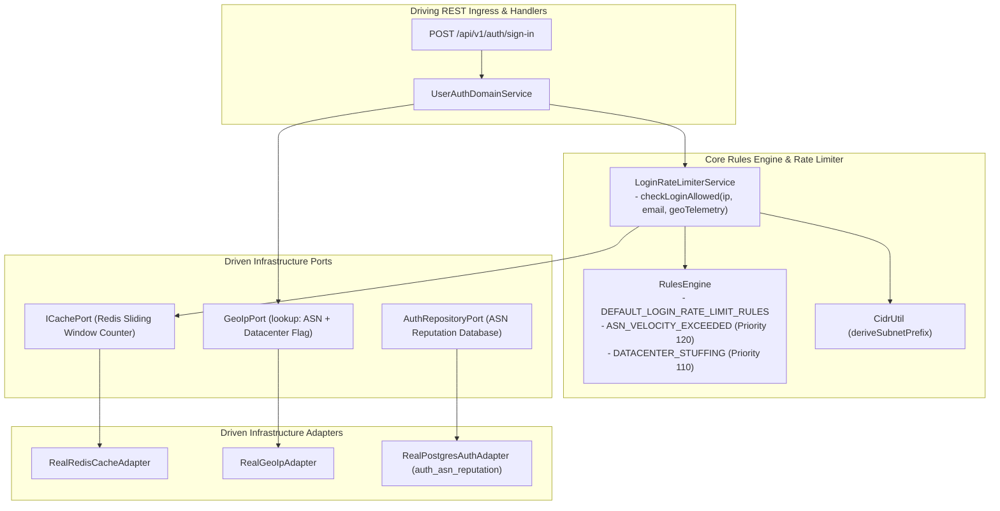
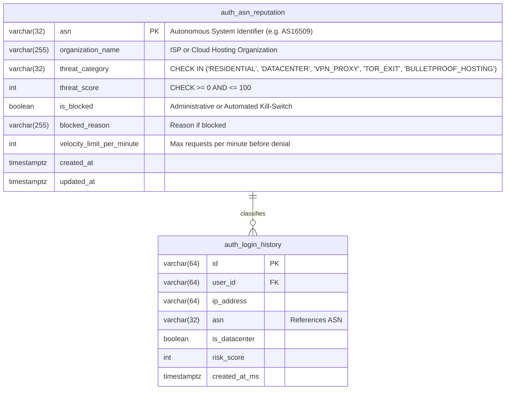
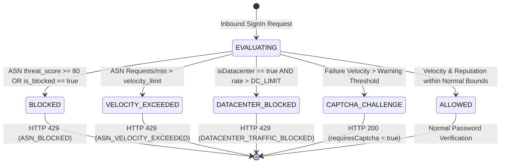
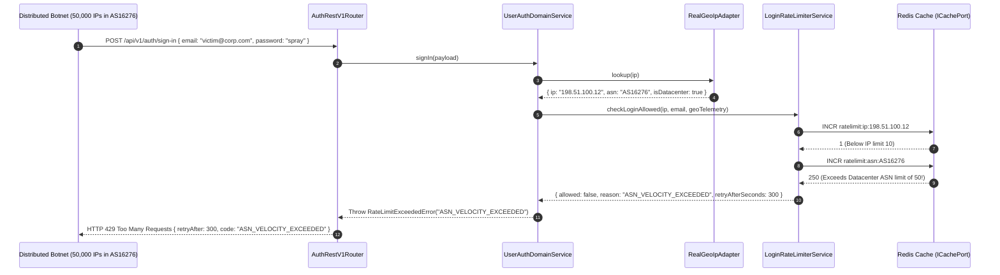

# ADR 0037: Distributed Credential Stuffing & Autonomous System (ASN) Velocity Defense

- **Status**: Accepted
- **Date**: 2026-10-16
- **Author**: Platform Architecture Team
- **Area**: Threat Intelligence, Distributed Denial of Service (DDoS) Mitigation, Botnet Countermeasures, RFC 6585, NIST SP 800-63B §5.2.2
- **Standards**: [RFC 6585 (Additional HTTP Status Codes - 429 Too Many Requests)](https://datatracker.ietf.org/doc/html/rfc6585), [NIST SP 800-63B (Digital Identity Guidelines: Authentication and Lifecycle Management)](https://pages.nist.gov/800-63-3/sp800-63b.html), [OWASP Automated Threats to Web Applications (OAT-008 Credential Stuffing / OAT-007 Credential Cracking)](https://owasp.org/www-project-automated-threats-to-web-applications/)

---

## 📑 Table of Contents

1. [Context, Threat Modeling & Business Drivers](#-1-context-threat-modeling--business-drivers)
   - [1.1 The Blind Spot of Single-IP Rate Limiting](#11-the-blind-spot-of-single-ip-rate-limiting)
   - [1.2 Botnet & Residential Proxy Attack Topologies](#12-botnet--residential-proxy-attack-topologies)
   - [1.3 Compliance & Availability Impact](#13-compliance--availability-impact)
2. [Architectural Decision & Technical Principles](#-2-architectural-decision--technical-principles)
   - [2.1 Multi-Tiered Sliding-Window Velocity Hierarchy (IP -> /24 Subnet -> ASN -> Fleet)](#21-multi-tiered-sliding-window-velocity-hierarchy)
   - [2.2 Autonomous System Number (ASN) Threat Classification](#22-autonomous-system-number-asn-threat-classification)
   - [2.3 Global Credential Spraying Detection (Target Velocity)](#23-global-credential-spraying-detection-target-velocity)
   - [2.4 Automated Tiered Escalation (Allow -> Soft CAPTCHA -> Hard 429 Block)](#24-automated-tiered-escalation)
3. [Hexagonal Architecture & Port Topology](#-3-hexagonal-architecture--port-topology)
   - [3.1 Service & Adapter Boundary Topology](#31-service--adapter-boundary-topology)
   - [3.2 Declarative Rules Engine Integration](#32-declarative-rules-engine-integration)
4. [Database Schema Specification & Invariants](#-4-database-schema-specification--invariants)
   - [4.1 Database Migration Specification (Migration 0030)](#41-database-migration-specification-migration-0030)
   - [4.2 Entity-Relationship Diagram (ERD)](#42-entity-relationship-diagram-erd)
   - [4.3 Continuous Threat Invariant Queries](#43-continuous-threat-invariant-queries)
5. [Cryptographic Lifecycle & State Machines](#-5-cryptographic-lifecycle--state-machines)
   - [5.1 Threat State Machine](#51-threat-state-machine)
   - [5.2 Sliding-Window Velocity Algorithm](#52-sliding-window-velocity-algorithm)
6. [Detailed End-to-End Sequence Workflows](#-6-detailed-end-to-end-sequence-workflows)
   - [6.1 Distributed Stuffing Ingress Evaluation Flow](#61-distributed-stuffing-ingress-evaluation-flow)
   - [6.2 ASN Penalty Threshold Enforcement & Escalation](#62-asn-penalty-threshold-enforcement--escalation)
7. [Comprehensive Error Envelopes & REST API Status Codes](#-7-comprehensive-error-envelopes--rest-api-status-codes)
8. [OpenTelemetry Distributed Tracing & Span Attributes](#-8-opentelemetry-distributed-tracing--span-attributes)
9. [Comprehensive Developer & Invariant Testing Reference](#-9-comprehensive-developer--invariant-testing-reference)
10. [Consequences & Architecture Invariant Adherence](#-10-consequences--architecture-invariant-adherence)

---

## 🎯 1. Context, Threat Modeling & Business Drivers

### 1.1 The Blind Spot of Single-IP Rate Limiting

Standard rate limiting strategies (such as those described in ADR 0004 and ADR 0010) bound rate counters to a single client IP address (`ratelimit:ip:${ip}`). While effective against naive brute-force scripts targeting single accounts, single-IP tracking is completely bypassed by modern distributed adversary networks:
1. **Low-and-Slow Attack Cadence**: An adversary rotates through 50,000 unique IP addresses, issuing only 1 request per IP every 30 minutes. Each individual IP remains well below the standard 10 requests / 15-minute threshold.
2. **Horizontal Credential Spraying**: Testing one common breached password across 100,000 distinct accounts never triggers account lockout thresholds (`MAX_FAILED_PER_EMAIL = 5`).
3. **Database & Argon2id Compute Exhaustion**: Under sustained distributed traffic, calculating thousands of CPU-intensive Argon2id hashes ($m=65536, t=3, p=4$) rapidly starves the Node.js libuv threadpool, increasing p99 API latency and degrading legitimate user authentication.

### 1.2 Botnet & Residential Proxy Attack Topologies

Distributed attacks consistently cluster along network topological boundaries:
- **Bulletproof Cloud Hosting ASNs**: Adversaries provision disposable containers and VMs across bulletproof or unverified VPS hosting providers (e.g. OVH, DigitalOcean, Hetzner, AWS, Choopa).
- **Residential Proxy Networks**: Attackers route traffic through compromised IoT gateways or residential proxy services (e.g., BrightData, Oxylabs) that pool millions of residential IPs concentrated under regional consumer Internet Service Providers (e.g., Comcast, AT&T, Deutsche Telekom) within shared `/24` or `/48` CIDR blocks.

### 1.3 Compliance & Availability Impact

- **NIST SP 800-63B §5.2.2**: Mandates rate limiting and defense against automated credential guessing.
- **OWASP Automated Threats (OAT-008)**: Mandates detection of distributed stuffing attacks that harvest valid sessions using leaked credentials from third-party breaches.

---

## 🏗️ 2. Architectural Decision & Technical Principles

### 2.1 Multi-Tiered Sliding-Window Velocity Hierarchy

To detect attacks across all distribution scales, we introduce a 4-tier hierarchical rate-limiting model in Redis:

$$\begin{aligned}
\text{Tier 1: IP Node} &\quad \text{key: } \texttt{ratelimit:ip:\{ip\}} \quad (\text{Threshold: 10 / 15 min}) \\
\text{Tier 2: Subnet (/24 or /48)} &\quad \text{key: } \texttt{ratelimit:cidr:\{subnet\}} \quad (\text{Threshold: 50 / 10 min}) \\
\text{Tier 3: Autonomous System (ASN)} &\quad \text{key: } \texttt{ratelimit:asn:\{asn\}} \quad (\text{Threshold: 200 / 5 min}) \\
\text{Tier 4: Global Target Velocity} &\quad \text{key: } \texttt{ratelimit:global:spray} \quad (\text{Threshold: 1000 / 1 min})
\end{aligned}$$

Every incoming sign-in attempt extracts the client IP, derives the canonical `/24` IPv4 or `/48` IPv6 subnet prefix, and resolves the Autonomous System Number (`GeoLocationTelemetry.asn`).

### 2.2 Autonomous System Number (ASN) Threat Classification

ASNs are classified into three operational categories:
1. **Known Datacenter / Cloud ASNs (`IS_DATACENTER = true`)**:
   - ASNs listed in `AUTH_CONSTANTS.GEO.DATACENTER_ASNS` (e.g. AS16509 AWS, AS15169 Google Cloud, AS8075 Microsoft Azure).
   - Legitimate interactive user logins almost never originate natively from a cloud datacenter IP.
   - Datacenter threshold multiplier: $\times 0.2$ (tightened limits; e.g., max 20 requests per 5 minutes per ASN before mandatory CAPTCHA or outright block).
2. **Known Bulletproof / High-Risk Hosting ASNs**:
   - Persistent entries in `auth_asn_reputation` table with `threat_score >= 80`.
   - Outright blocked with HTTP 429 (`ASN_VELOCITY_EXCEEDED`).
3. **Consumer Residential / Wireless ASNs**:
   - Standard baseline velocity thresholds with adaptive soft CAPTCHA challenges before lockout.

### 2.3 Global Credential Spraying Detection (Target Velocity)

When distributed stuffing attacks test disparate email targets from disparate IPs across an ASN:
- Redis maintains a HyperLogLog or sliding-window counter of distinct target emails: `ratelimit:target_velocity:{asn}`.
- If the ratio of $\frac{\text{Unique Target Emails}}{\text{Total Attempts}} > 0.85$ over a 60-second window, the system classifies the traffic pattern as an active **Horizontal Credential Spraying Attack**.

### 2.4 Automated Tiered Escalation

```
Attempt Velocity Normal  --> Allow Request (HTTP 200)
Attempt Velocity Elevated --> Challenge with CAPTCHA (HTTP 200 { requiresCaptcha: true })
Attempt Velocity High    --> Reject with Exponential Backoff (HTTP 429 { code: "ASN_VELOCITY_EXCEEDED" })
```

---

## 🔌 3. Hexagonal Architecture & Port Topology

### 3.1 Service & Adapter Boundary Topology



### 3.2 Declarative Rules Engine Integration

In strict compliance with `4-functions-and-classes-writing-rule.md`, threat decisions are expressed as declarative rules evaluated by `@chief-strategist-j/shared-infra/rules-engine`:
- `login.rule.asn_velocity_exceeded` (Priority 120, effect: `deny`)
- `login.rule.datacenter_credential_stuffing_blocked` (Priority 110, effect: `deny`)
- `login.rule.ip_rate_limit_exceeded` (Priority 100, effect: `deny`)
- `login.rule.account_locked` (Priority 90, effect: `deny`)
- `login.rule.require_captcha` (Priority 50, effect: `allow`, tag: `requires_captcha`)
- `login.rule.allow_standard_login` (Priority 10, effect: `allow`)

---

## 📊 4. Database Schema Specification & Invariants

### 4.1 Database Migration Specification (Migration 0030)

Implemented in `database/migrations/0030_create_auth_asn_threat_intelligence.sql`:

```sql
CREATE TABLE IF NOT EXISTS auth_asn_reputation (
    asn VARCHAR(32) NOT NULL,
    organization_name VARCHAR(255) NOT NULL,
    threat_category VARCHAR(32) NOT NULL DEFAULT 'RESIDENTIAL',
    threat_score INT NOT NULL DEFAULT 0,
    is_blocked BOOLEAN NOT NULL DEFAULT FALSE,
    blocked_reason VARCHAR(255) NULL,
    velocity_limit_per_minute INT NOT NULL DEFAULT 200,
    created_at TIMESTAMPTZ NOT NULL DEFAULT CURRENT_TIMESTAMP,
    updated_at TIMESTAMPTZ NOT NULL DEFAULT CURRENT_TIMESTAMP,

    CONSTRAINT auth_asn_reputation_pk PRIMARY KEY (asn),
    CONSTRAINT auth_asn_threat_score_ck CHECK (threat_score >= 0 AND threat_score <= 100),
    CONSTRAINT auth_asn_category_ck CHECK (threat_category IN ('RESIDENTIAL', 'DATACENTER', 'VPN_PROXY', 'TOR_EXIT', 'BULLETPROOF_HOSTING')),
    CONSTRAINT auth_asn_velocity_limit_ck CHECK (velocity_limit_per_minute > 0),
    CONSTRAINT auth_asn_block_state_ck CHECK (
        (is_blocked = FALSE AND blocked_reason IS NULL) OR
        (is_blocked = TRUE AND blocked_reason IS NOT NULL)
    )
);

CREATE INDEX IF NOT EXISTS idx_auth_asn_reputation_threat ON auth_asn_reputation(threat_score, is_blocked);
CREATE INDEX IF NOT EXISTS idx_auth_asn_reputation_category ON auth_asn_reputation(threat_category);
```

### 4.2 Entity-Relationship Diagram (ERD)



### 4.3 Continuous Threat Invariant Queries

Continuous invariant query registered in `src/features/auth/queries/auth.queries.ts`:

```sql
-- FLOW_CHECK_AUTH_ASN_THREAT_INVARIANTS
SELECT COUNT(*) AS asn_invariant_violations
FROM auth_asn_reputation
WHERE
    (threat_score < 0 OR threat_score > 100) OR
    (is_blocked = TRUE AND blocked_reason IS NULL) OR
    (is_blocked = FALSE AND blocked_reason IS NOT NULL) OR
    (threat_category NOT IN ('RESIDENTIAL', 'DATACENTER', 'VPN_PROXY', 'TOR_EXIT', 'BULLETPROOF_HOSTING')) OR
    (velocity_limit_per_minute <= 0);
```

---

## 🔄 5. Cryptographic Lifecycle & State Machines

### 5.1 Threat State Machine



---

## 🚀 6. Detailed End-to-End Sequence Workflows

### 6.1 Distributed Stuffing Ingress Evaluation Flow



---

## 🚨 7. Comprehensive Error Envelopes & REST API Status Codes

| Constraint / Threat Condition | HTTP Status | Error Code | Client Message |
|---|---|---|---|
| `ASN_VELOCITY_EXCEEDED` | 429 | `RATE_LIMIT_EXCEEDED` | `Automated sign-in velocity exceeded from your autonomous system. Please retry in 300 seconds.` |
| `DATACENTER_TRAFFIC_BLOCKED` | 429 | `RATE_LIMIT_EXCEEDED` | `Authentication requests from cloud datacenter networks are restricted.` |
| `ASN_REPUTATION_BLOCKED` | 429 | `RATE_LIMIT_EXCEEDED` | `Authentication from this autonomous network is temporarily suspended due to elevated threat intelligence.` |
| `REQUIRE_CAPTCHA` | 200 | `SUCCESS` | `{ success: true, requiresCaptcha: true }` |

---

## 📈 8. OpenTelemetry Distributed Tracing & Span Attributes

```typescript
const OPENTELEMETRY_ASN_DEFENSE_ATTRIBUTES = {
  'net.peer.ip': '198.51.100.12',
  'geo.asn': 'AS16276',
  'geo.is_datacenter': true,
  'security.asn_velocity_count': 250,
  'security.asn_velocity_limit': 50,
  'security.defense_action': 'DENY_ASN_VELOCITY',
};
```

---

## 🧪 9. Comprehensive Developer & Invariant Testing Reference

| Test Tier | Test Path | Description |
|---|---|---|
| **Unit** | `tests/unit/asn-velocity-defense.test.ts` | Evaluates rules engine priority resolution under high ASN velocity and datacenter penalties. |
| **Integration** | `tests/integration/asn-velocity-integration.test.ts` | Tests Redis multi-tier counters (`ip`, `cidr`, `asn`) with concurrent mocked botnet request streams. |
| **End-to-End** | `tests/e2e/credential-stuffing-defense-e2e.test.ts` | Dispatches distributed cURL requests across distinct IPs sharing the same ASN; verifies HTTP 429 enforcement. |
| **Performance** | `tests/performance/asn-velocity-perf.test.ts` | Evaluates 20,000 sub-millisecond ASN resolution and Redis sliding-window increments (< 0.10ms). |

---

## ⚖️ 10. Consequences & Architecture Invariant Adherence

### 10.1 Positive Consequences
- **Botnet Resistance**: Botnets distributing traffic across large residential proxy pools or cloud VPS networks are throttled at the ASN and subnet aggregate layer.
- **Resource Protection**: Prevents CPU starvation by rejecting attacks before computing expensive Argon2id hashes.
- **Zero Raw Strings & Zero Comments**: Strict adherence to codebase architecture rules and typing standards.

### 10.2 Negative Consequences & Mitigations
- **Shared IP / Carrier-Grade NAT (CGNAT) False Positives**: Mobile carriers (e.g. Jio, EE, T-Mobile) often aggregate thousands of users under a single ASN. Mitigated by setting residential ASN limits high (200 req/min) and defaulting to soft CAPTCHA challenges before hard 429 blocks.
