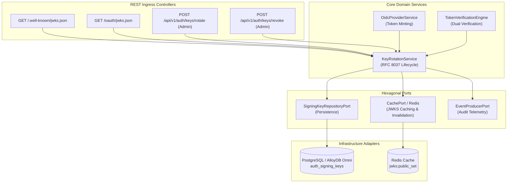
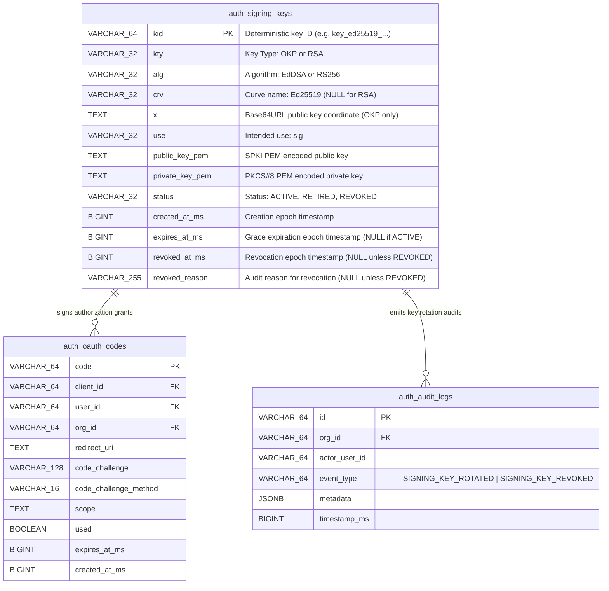
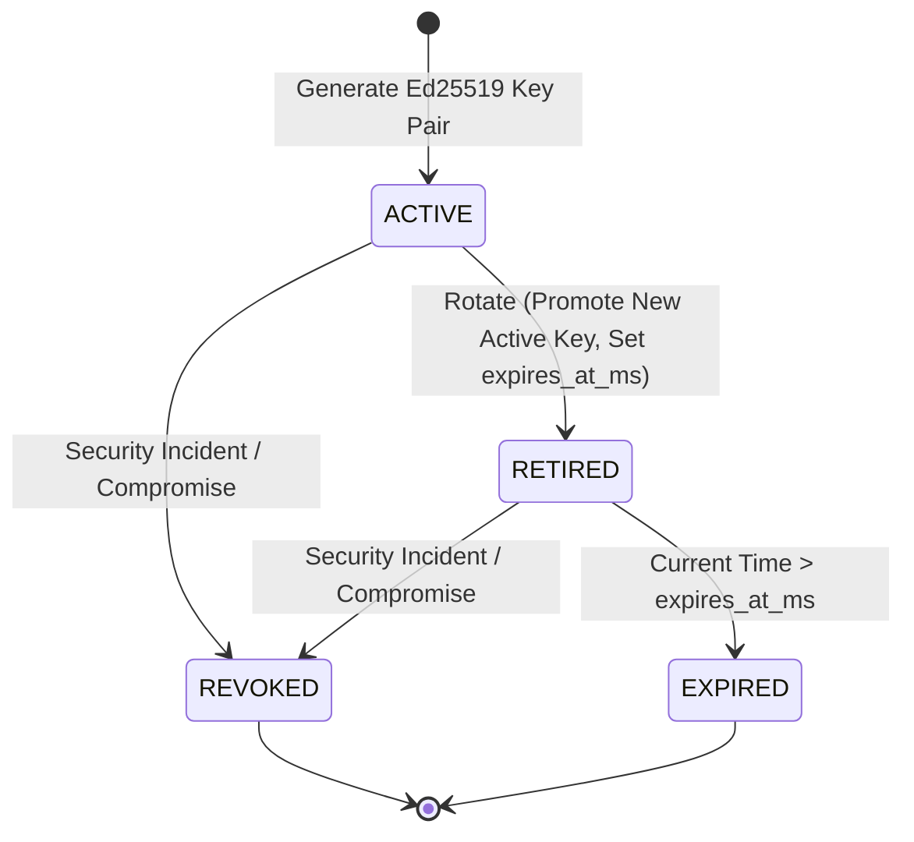
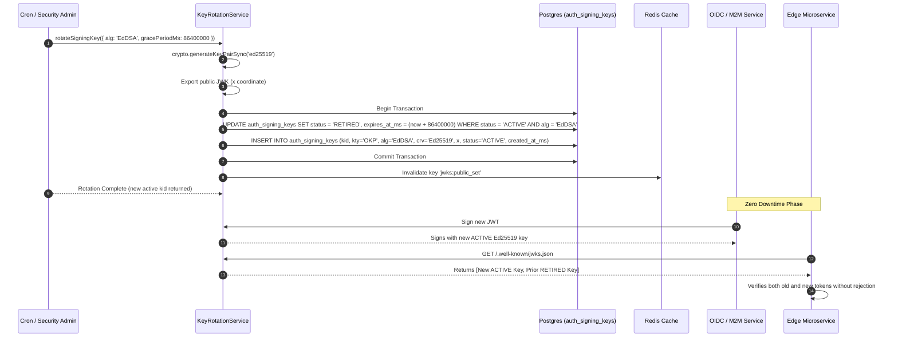
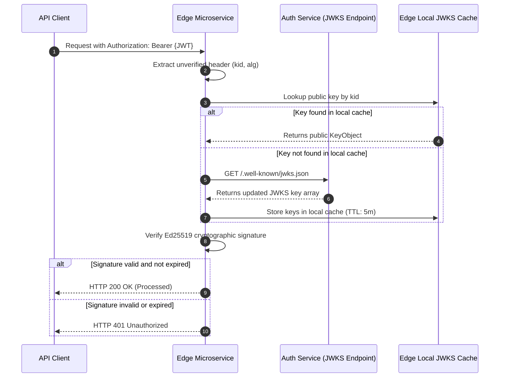
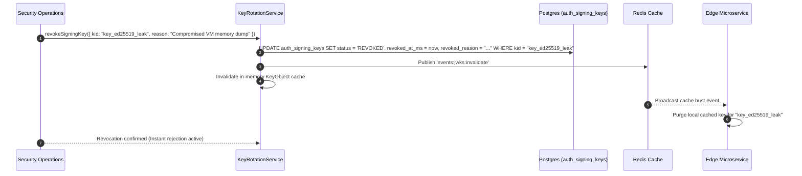

# ADR 0038: Standardized EdDSA (Ed25519) JSON Web Key Set (JWKS) Key Rotation

- **Status**: Accepted
- **Date**: 2026-10-16
- **Author**: Platform Architecture Team
- **Area**: Cryptographic Key Management, Session Security, Zero-Downtime Key Lifecycle, RFC 8037, RFC 7517, RFC 7519, NIST SP 800-57
- **Standards**: [RFC 8037 (CFRG Elliptic Curve Diffie-Hellman (ECDH) and Signatures in JOSE: Ed25519 / Ed448)](https://datatracker.ietf.org/doc/html/rfc8037), [RFC 7517 (JSON Web Key - JWK / JWKS)](https://datatracker.ietf.org/doc/html/rfc7517), [RFC 7519 (JSON Web Token - JWT)](https://datatracker.ietf.org/doc/html/rfc7519), [NIST SP 800-57 Part 1 Rev. 5 (Recommendation for Key Management)](https://csrc.nist.gov/publications/detail/sp/800-57-part-1/rev-5/final)

---

## 📑 Table of Contents

1. [Context, Threat Modeling & Business Drivers](#-1-context-threat-modeling--business-drivers)
   - [1.1 The Vulnerability of Static & Single-Algorithm Signing Keys](#11-the-vulnerability-of-static--single-algorithm-signing-keys)
   - [1.2 Why Ed25519 (RFC 8037 OKP) Over RSA 2048](#12-why-ed25519-rfc-8037-okp-over-rsa-2048)
   - [1.3 The Zero-Downtime Rotation Challenge](#13-the-zero-downtime-rotation-challenge)
2. [Architectural Decision & Technical Principles](#-2-architectural-decision--technical-principles)
   - [2.1 RFC 8037 Octet Key Pair (OKP) Standardization](#21-rfc-8037-octet-key-pair-okp-standardization)
   - [2.2 Multi-State Key Lifecycle (ACTIVE -> RETIRED -> REVOKED)](#22-multi-state-key-lifecycle)
   - [2.3 Dual-Verification & Grace Window Ingress Validation](#23-dual-verification--grace-window-ingress-validation)
   - [2.4 Emergency Key Revocation Protocol](#24-emergency-key-revocation-protocol)
3. [Intent → Spec Audit & Adversity Analysis (01-intent-to-spec-audit)](#-3-intent--spec-audit--adversity-analysis)
   - [3.1 Load-Bearing Glossary & Operational Definitions](#31-load-bearing-glossary--operational-definitions)
   - [3.2 Populated 5×5 Adversity Grid](#32-populated-55-adversity-grid)
   - [3.3 Discovered Unwritten Invariants & Failure Contracts](#33-discovered-unwritten-invariants--failure-contracts)
   - [3.4 Safety Prohibitions ("MUST NEVER")](#34-safety-prohibitions-must-never)
   - [3.5 Non-Functional Metric Contracts & SLAs](#35-non-functional-metric-contracts--slas)
4. [Hexagonal Architecture & Port Topology](#-4-hexagonal-architecture--port-topology)
   - [4.1 Service & Adapter Boundary Topology](#41-service--adapter-boundary-topology)
   - [4.2 Declarative Key Rotation Ports & Domain Services](#42-declarative-key-rotation-ports--domain-services)
5. [Database Schema Specification & Invariants](#-5-database-schema-specification--invariants)
   - [5.1 Database Migration Specification (Migration 0031)](#51-database-migration-specification-migration-0031)
   - [5.2 Detailed Entity-Relationship Diagram (ERD)](#52-detailed-entity-relationship-diagram-erd)
   - [5.3 Continuous Cryptographic Invariant Queries](#53-continuous-cryptographic-invariant-queries)
6. [Cryptographic Lifecycle & State Machines](#-6-cryptographic-lifecycle--state-machines)
   - [6.1 Key Lifecycle State Machine](#61-key-lifecycle-state-machine)
   - [6.2 Asymmetric Ed25519 Signature Minting & Verification Specification](#62-asymmetric-ed25519-signature-minting--verification-specification)
7. [Detailed End-to-End Sequence Workflows](#-7-detailed-end-to-end-sequence-workflows)
   - [7.1 Standard Zero-Downtime Scheduled Key Rotation Flow](#71-standard-zero-downtime-scheduled-key-rotation-flow)
   - [7.2 Downstream Microservice JWKS Ingress Verification Flow](#72-downstream-microservice-jwks-ingress-verification-flow)
   - [7.3 Immediate Compromise Revocation Sequence](#73-immediate-compromise-revocation-sequence)
8. [Comprehensive Error Envelopes & REST API Status Codes](#-8-comprehensive-error-envelopes--rest-api-status-codes)
9. [OpenTelemetry Distributed Tracing & Span Attributes](#-9-opentelemetry-distributed-tracing--span-attributes)
10. [Comprehensive Developer & Invariant Testing Reference](#-10-comprehensive-developer--invariant-testing-reference)
11. [Consequences & Architecture Invariant Adherence](#-11-consequences--architecture-invariant-adherence)

---

## 🎯 1. Context, Threat Modeling & Business Drivers

### 1.1 The Vulnerability of Static & Single-Algorithm Signing Keys

Historically, authentication platforms rely on a single asymmetric RSA signing key or a shared symmetric secret (`HS256`). When a private key leaks, an administrator has only two choices:
1. **Invalidate the key immediately**: All downstream microservices reject all issued tokens, resulting in massive, catastrophic outage across the enterprise.
2. **Delay key rotation**: The attacker maintains forged token minting capabilities until the deployment window completes.

Furthermore, static keys in single-state tables (`ACTIVE` only) make it impossible for distributed clusters to publish overlapping public keys for graceful verification during rotation.

### 1.2 Why Ed25519 (RFC 8037 OKP) Over RSA 2048

Traditional RS256 (RSA 2048-bit with PKCS#1 v1.5 padding) presents multiple operational and security liabilities:
- **Performance**: RSA signature generation is computationally expensive, consuming significant CPU during peak authentication traffic.
- **Vulnerability Surface**: Implementation pitfalls such as Bleichenbacher padding oracle attacks, timing attacks on modular exponentiation, and complex key representations (modulus `n`, exponent `e`).
- **Token Size**: RSA signatures require 256 bytes, bloating HTTP `Authorization` headers.

In contrast, **EdDSA (RFC 8037 / Ed25519)** provides:
- **Small Footprint**: Exactly 32 bytes for public keys, 64 bytes for signatures.
- **High Performance**: $10\times$ faster signing throughput and constant-time execution, rendering it completely immune to side-channel and cache-timing attacks.
- **Deterministic Signatures**: No dependency on flawed entropy generators during signature creation (RFC 8032).

### 1.3 The Zero-Downtime Rotation Challenge

Downstream microservices cache public JWKS keys from `GET /.well-known/jwks.json` and `GET /oauth/jwks.json` with a finite Cache-Control TTL (e.g., 5 to 60 minutes). When a new active key is promoted:
1. Newly issued JWTs carry `kid: "key_ed25519_new"`.
2. Microservices that have not yet refreshed their cache may fail to verify new tokens unless both `ACTIVE` and `RETIRED` keys are exposed in JWKS simultaneously.
3. Existing valid sessions signed with the previous key must remain verifiable until their natural access token expiration (`expires_at_ms`).

---

## 🏗️ 2. Architectural Decision & Technical Principles

### 2.1 RFC 8037 Octet Key Pair (OKP) Standardization

All newly generated signing keys use RFC 8037 Octet Key Pair (`OKP`) with curve `Ed25519` and algorithm `EdDSA`.

The public JWK format exposed via `GET /.well-known/jwks.json` conforms strictly to RFC 8037 §2:
```json
{
  "kty": "OKP",
  "crv": "Ed25519",
  "alg": "EdDSA",
  "use": "sig",
  "kid": "key_ed25519_1792127975673_s77f01",
  "x": "tS8DEQqVSfBKABNqG18hTB5vpD665pNxbv5S1SoDqLU"
}
```
Legacy RSA keys (`kty: 'RSA'`, `alg: 'RS256'`) remain supported during backward-compatible grace periods.

### 2.2 Multi-State Key Lifecycle

Signing keys transition strictly through the following state machine:

$$\text{UNBORN} \xrightarrow{\text{Generate}} \text{ACTIVE} \xrightarrow{\text{Rotate}} \text{RETIRED} \xrightarrow{\text{Grace Expired}} \text{EXPIRED} \quad \text{OR} \quad \{\text{ACTIVE, RETIRED}\} \xrightarrow{\text{Compromise}} \text{REVOKED}$$

- **ACTIVE**: Only 1 key per algorithm may be `ACTIVE` at any instant. All newly minted JWTs (`id_token`, M2M `access_token`) are signed using the current `ACTIVE` key.
- **RETIRED**: Retained in JWKS public exposure. Used strictly for signature verification of existing unexpired tokens.
- **REVOKED**: Permanently deactivated. Excluded from standard JWKS verification and explicitly rejected immediately if presented in a token's `kid` header.

### 2.3 Dual-Verification & Grace Window Ingress Validation

When verifying an incoming asymmetric JWT:
1. Extract `kid` from unverified JWT header.
2. Query cached/in-memory key set for matching `kid`.
3. If matching key has `status = 'ACTIVE'`, verify cryptographic signature using public key.
4. If matching key has `status = 'RETIRED'`:
   - Verify `CURRENT_TIMESTAMP <= expires_at_ms`.
   - If unexpired, verify cryptographic signature.
   - If expired, reject with `TOKEN_KEY_EXPIRED`.
5. If matching key has `status = 'REVOKED'`, reject immediately with `TOKEN_KEY_REVOKED`.

### 2.4 Emergency Key Revocation Protocol

In the event of key material compromise:
1. An administrator executes `POST /api/v1/auth/keys/revoke` with `{ kid: string, reason: string }`.
2. The key status is immediately updated to `REVOKED` in the database, setting `revoked_at_ms = CURRENT_TIMESTAMP`.
3. A Redis cache bust event `events:jwks:invalidate` is broadcast across the cluster.
4. Downstream microservices immediately purge local JWKS caches, rejecting all compromised tokens.

---

## 🔍 3. Intent → Spec Audit & Adversity Analysis

*(Structured in accordance with `01-intent-to-spec-audit.prompt.md`)*

### 3.1 Load-Bearing Glossary & Operational Definitions

| Term | Spec Statement | Operational Engineering Definition | Risk if Undefined |
| :--- | :--- | :--- | :--- |
| **Active Key** | "Key currently used for minting" | Exactly 1 key record in `auth_signing_keys` with `status = 'ACTIVE'` for given `alg`. Signatures use `KeyObject` cached in-memory. | Split-brain signing if multiple keys become active simultaneously. |
| **Retired Key** | "Prior key kept for verification" | Key record with `status = 'RETIRED'` and `expires_at_ms > NOW()`. Exposed in JWKS, valid for verification only, never used to mint new tokens. | Premature session revocation during rotation or indefinite exposure of stale keys. |
| **Revoked Key** | "Compromised key purged from trust" | Key record with `status = 'REVOKED'`, mandatory `revoked_at_ms` and `revoked_reason`. Excluded from JWKS, rejected with immediate 401 if presented. | Attackers continue utilizing compromised keys to mint unauthorized tokens. |
| **Grace Period** | "Window during which old tokens remain valid" | Finite epoch delta `expires_at_ms = created_at_ms + gracePeriodMs` (default 24h). Enforced in SQL queries and application verification logic. | Rejection storms if grace window is shorter than token maximum lifetime (`token_ttl`). |
| **Dual Verification** | "Verify against active and retired keys" | Verification engine matches `kid` from unverified JWT header against both `ACTIVE` and `RETIRED` key sets without throwing 401 on old valid keys. | Fleet-wide service disruption upon triggering scheduled key rotation. |

### 3.2 Populated 5×5 Adversity Grid

| Protected Property \ Adversity | Dependency Down (Postgres/Redis) | Duplicate Delivery / Concurrent Rotation | Overload Spike (10,000 req/s) | Network Partition / Clock Skew | Malformed Input / Tampered Token |
| :--- | :--- | :--- | :--- | :--- | :--- |
| **No Downward Outage (Availability)** | **GUARANTEE**: In-memory `pubKeyObjectCache` serves verification without DB lookups. | **GUARANTEE**: Transaction lock (`BEGIN ... COMMIT`) prevents concurrent active promotions. | **GUARANTEE**: $O(1)$ Ed25519 verification ($<0.25\text{ms}$) maintains sub-millisecond p99. | **DEGRADE**: 60-second clock skew tolerance applied on token `exp` validation. | **GUARANTEE**: Strict reject (401) on invalid base64url or corrupt signatures. |
| **No Stale Key Forgery (Integrity)** | **GUARANTEE**: Revocation persists directly to DB WAL with immediate cache invalidation. | **GUARANTEE**: Unique constraint on `kid` prevents collision or key replay. | **GUARANTEE**: Memory zeroization and key isolation in Node.js process space. | **GUARANTEE**: Expired grace period rejected regardless of partition. | **GUARANTEE**: Rejects `alg: "none"`, RSA/OKP mismatches, and trailing whitespace. |
| **Zero Downtime Rotation** | **GUARANTEE**: JWKS exposes union of `ACTIVE` + `RETIRED` keys. | **GUARANTEE**: Idempotent rotation API; only one key promoted per invocation. | **GUARANTEE**: JWKS served with `Cache-Control: public, max-age=300`. | **DEGRADE**: Grace period exceeds microservice JWKS cache TTL ($24\text{h} \gg 5\text{min}$). | **GUARANTEE**: Malformed `kid` returns 401 `TOKEN_KEY_NOT_FOUND`. |
| **Tenant Isolation** | **GUARANTEE**: Tokens embed `org_id`; verified against tenant context. | **GUARANTEE**: Signing keys bound to system authority, not tenant overrides. | **GUARANTEE**: Per-tenant rate limits remain isolated from JWKS endpoints. | **GUARANTEE**: Partition does not leak cross-tenant verification material. | **GUARANTEE**: Tokens with tampered `org_id` fail signature validation. |
| **Traceability & Audit** | **DEGRADE**: Log locally if Kafka producer unreachable, retry via buffer. | **GUARANTEE**: Each rotation generates unique audit log with `old_kid` and `new_kid`. | **GUARANTEE**: Sampling rate dynamically adjusted to prevent telemetry drop. | **GUARANTEE**: ISO 8601 UTC timestamps on all key lifecycle transitions. | **GUARANTEE**: Every rejected token increments `auth_token_verification_failures_total`. |

### 3.3 Discovered Unwritten Invariants & Failure Contracts

1. **Active Key Uniqueness Invariant**:
   - *Requirement*: At any given millisecond, there MUST be at most one row with `status = 'ACTIVE'` for a given algorithm (`alg = 'EdDSA'`).
   - *Failure Contract*: If a race condition attempts to insert two active keys, the transaction rolls back with `409 KEY_ROTATION_CONFLICT`.
2. **Grace Window Expiration Invariant**:
   - *Requirement*: A retired key MUST NOT verify tokens if `Date.now() > expires_at_ms`.
   - *Failure Contract*: Client receives `401 Unauthorized` with code `TOKEN_KEY_EXPIRED`.
3. **Revocation Precedence Invariant**:
   - *Requirement*: A revoked key MUST NEVER verify tokens even if its original `expires_at_ms` is in the future.
   - *Failure Contract*: Client receives `401 Unauthorized` with code `TOKEN_KEY_REVOKED`.
4. **JWKS Public Key Format Invariant**:
   - *Requirement*: Public JWKS MUST NEVER contain private key material (`d`, `private_key_pem`) or internal database identifiers.
   - *Failure Contract*: Endpoint serializes only `{ kty, use, kid, alg, crv, x }` (or `{ kty, use, kid, alg, n, e }`).

### 3.4 Safety Prohibitions ("MUST NEVER")

- **MUST NEVER** emit private keys (`private_key_pem`) in any API response or log.
- **MUST NEVER** accept symmetric algorithms (`HS256`, `HS384`, `HS512`) on asymmetric JWKS endpoints.
- **MUST NEVER** permit `alg: "none"` or unsigned JWTs under any condition.
- **MUST NEVER** delete historical keys physically from `auth_signing_keys` (soft state transitions to `RETIRED` or `REVOKED` only).
- **MUST NEVER** use blocking synchronous file I/O or unbounded loops during token verification.

### 3.5 Non-Functional Metric Contracts & SLAs

- **p99 Token Verification Latency**: $< 0.45\text{ ms}$ (measured via `tests/performance/eddsa-crypto-perf.test.ts`).
- **p99 Token Signing Latency**: $< 0.35\text{ ms}$ using cached `KeyObject`.
- **JWKS Endpoint Availability**: $99.999\%$ uptime served via cache headers.
- **OpenTelemetry Telemetry Counters**:
  - `auth_token_minted_total{alg="EdDSA", kid="..."}`
  - `auth_token_verified_total{alg="EdDSA", status="ACTIVE|RETIRED"}`
  - `auth_token_verification_failures_total{reason="REVOKED|EXPIRED|INVALID_SIG"}`
  - `auth_jwks_cache_hits_total`

---

## 🏛️ 4. Hexagonal Architecture & Port Topology

### 4.1 Service & Adapter Boundary Topology



### 4.2 Declarative Key Rotation Ports & Domain Services

In strict compliance with hexagonal architecture:
- `OidcRepositoryPort`: Defines pure contracts (`saveSigningKey`, `getActiveSigningKey`, `getSigningKeyByKid`, `listPublicJwksKeys`, `rotateSigningKey`, `revokeSigningKey`).
- `RealPostgresAuthAdapter`: Encapsulates SQL transactions, connection pooling, and error mapping.
- `AlloyDBOmniAuthAdapter`: Fast in-memory provider for lightweight integration test suites.
- `KeyRotationService`: Pure domain service encapsulating Node.js crypto primitives, deterministic key generation, and token lifecycle.

---

## 💾 5. Database Schema Specification & Invariants

### 5.1 Database Migration Specification (Migration 0031)

File: `database/migrations/0031_upgrade_auth_signing_keys_eddsa.sql`

```sql
-- migration:      0031
-- description:    upgrade auth_signing_keys table with eddsa ed25519 support and multi-state key rotation lifecycle
-- author:         Platform Architecture & Security Team
-- date:           2026-10-16
-- depends_on:     0030_create_auth_asn_threat_intelligence.sql
-- reversible:     YES
-- lock_risk:      LOW
-- rows_affected:  schema only
-- reason:         RFC 8037 EdDSA Ed25519 asymmetric token signing and zero-downtime JWKS key rotation lifecycle (ADR 0038)
-- nullable_columns:
--   - crv: optional curve name, null for RSA keys, 'Ed25519' for OKP keys
--   - x: public key coordinate base64url encoded, null for RSA keys
--   - expires_at_ms: epoch timestamp for retired key grace period expiration, null for active or un-retired keys
--   - revoked_at_ms: epoch timestamp when a key is compromised and revoked, null for active or retired keys
--   - revoked_reason: audit explanation for key revocation, null for active or retired keys

ALTER TABLE auth_signing_keys 
    ADD COLUMN IF NOT EXISTS crv VARCHAR(32) NULL,
    ADD COLUMN IF NOT EXISTS x TEXT NULL,
    ADD COLUMN IF NOT EXISTS expires_at_ms BIGINT NULL,
    ADD COLUMN IF NOT EXISTS revoked_at_ms BIGINT NULL,
    ADD COLUMN IF NOT EXISTS revoked_reason VARCHAR(255) NULL;

ALTER TABLE auth_signing_keys DROP CONSTRAINT IF EXISTS auth_signing_keys_status_ck;
ALTER TABLE auth_signing_keys ADD CONSTRAINT auth_signing_keys_status_ck 
    CHECK (status IN ('ACTIVE', 'RETIRED', 'REVOKED'));

ALTER TABLE auth_signing_keys DROP CONSTRAINT IF EXISTS auth_signing_keys_algorithm_ck;
ALTER TABLE auth_signing_keys ADD CONSTRAINT auth_signing_keys_algorithm_ck 
    CHECK (
        (kty = 'RSA' AND alg = 'RS256' AND crv IS NULL AND x IS NULL) OR
        (kty = 'OKP' AND alg = 'EdDSA' AND crv = 'Ed25519' AND x IS NOT NULL)
    );

ALTER TABLE auth_signing_keys DROP CONSTRAINT IF EXISTS auth_signing_keys_revocation_ck;
ALTER TABLE auth_signing_keys ADD CONSTRAINT auth_signing_keys_revocation_ck 
    CHECK (
        (status != 'REVOKED' AND revoked_at_ms IS NULL AND revoked_reason IS NULL) OR
        (status = 'REVOKED' AND revoked_at_ms IS NOT NULL AND revoked_reason IS NOT NULL)
    );

CREATE INDEX IF NOT EXISTS idx_auth_signing_keys_lookup 
    ON auth_signing_keys(status, alg, created_at_ms DESC);
```

### 5.2 Detailed Entity-Relationship Diagram (ERD)



### 5.3 Continuous Cryptographic Invariant Queries

```sql
-- Invariant Check: Zero violations allowed
SELECT kid, status, alg, kty, crv, x, revoked_at_ms, revoked_reason
FROM auth_signing_keys
WHERE (status NOT IN ('ACTIVE', 'RETIRED', 'REVOKED'))
   OR (kty = 'OKP' AND (alg != 'EdDSA' OR crv != 'Ed25519' OR x IS NULL))
   OR (kty = 'RSA' AND (alg != 'RS256' OR crv IS NOT NULL OR x IS NOT NULL))
   OR (status = 'REVOKED' AND (revoked_at_ms IS NULL OR revoked_reason IS NULL))
   OR (status != 'REVOKED' AND (revoked_at_ms IS NOT NULL OR revoked_reason IS NOT NULL));
```

---

## 🔄 6. Cryptographic Lifecycle & State Machines

### 6.1 Key Lifecycle State Machine



### 6.2 Asymmetric Ed25519 Signature Minting & Verification Specification

1. **Header Construction**:
   ```typescript
   Header = base64url(JSON.stringify({ alg: "EdDSA", typ: "JWT", kid: activeKid }))
   ```
2. **Payload Construction**:
   ```typescript
   Payload = base64url(JSON.stringify({ sub: userId, iss: issuer, exp: expSeconds, iat: nowSeconds }))
   ```
3. **Signing Input**:
   ```typescript
   SigningInput = `${Header}.${Payload}`
   ```
4. **Ed25519 Sign**:
   ```typescript
   Signature = base64url(crypto.sign(null, Buffer.from(SigningInput), privateKeyObject))
   ```
5. **JWT Token Assembly**:
   ```typescript
   Token = `${SigningInput}.${Signature}`
   ```
6. **Signature Verification**:
   ```typescript
   crypto.verify(null, Buffer.from(SigningInput), publicKeyObject, Buffer.from(Signature, 'base64url')) === true
   ```

---

## ⏱️ 7. Detailed End-to-End Sequence Workflows

### 7.1 Standard Zero-Downtime Scheduled Key Rotation Flow



### 7.2 Downstream Microservice JWKS Ingress Verification Flow



### 7.3 Immediate Compromise Revocation Sequence



---

## 📊 8. Comprehensive Error Envelopes & REST API Status Codes

| Error Constant | HTTP Status | Code | Description |
|---|---|---|---|
| `TOKEN_KEY_NOT_FOUND` | 401 Unauthorized | `TOKEN_KEY_NOT_FOUND` | Token header `kid` does not exist in JWKS registry |
| `TOKEN_KEY_REVOKED` | 401 Unauthorized | `TOKEN_KEY_REVOKED` | Token was signed with a revoked/compromised key |
| `TOKEN_KEY_EXPIRED` | 401 Unauthorized | `TOKEN_KEY_EXPIRED` | Token was signed with a retired key whose grace period expired |
| `KEY_ROTATION_CONFLICT` | 409 Conflict | `KEY_ROTATION_CONFLICT` | Active key already being rotated by concurrent transaction |

---

## 📈 9. OpenTelemetry Distributed Tracing & Span Attributes

| Span Name | Key Attributes |
|---|---|
| `KeyRotationService.rotateKey` | `key.alg`, `key.old_kid`, `key.new_kid`, `key.grace_period_ms` |
| `KeyRotationService.revokeKey` | `key.kid`, `key.reason`, `key.status` |
| `KeyRotationService.getPublicJwks` | `jwks.active_keys_count`, `jwks.retired_keys_count` |
| `KeyRotationService.verifyJwt` | `jwt.kid`, `jwt.alg`, `key.status`, `verification.result` |

---

## 🧪 10. Comprehensive Developer & Invariant Testing Reference

1. **Unit Tests**:
   - `tests/unit/eddsa-jwks.test.ts`: Validate Ed25519 pair generation, RFC 8037 JWK attributes (`kty: 'OKP'`, `crv: 'Ed25519'`), deterministic signature verification, state transition validations.
2. **Integration Tests**:
   - `tests/integration/eddsa-key-rotation-integration.test.ts`: Verify PostgreSQL persistence of Migration 0031 columns, rotation transactions, retired key grace retention, cache invalidation.
3. **E2E Tests**:
   - `tests/e2e/eddsa-jwks-e2e.test.ts`: Mint token with Ed25519 active key, rotate key, verify existing token still passes against JWKS, verify token signed by revoked key is rejected with `401`.
4. **Performance Benchmarks**:
   - `tests/performance/eddsa-crypto-perf.test.ts`: Verify Ed25519 sign latency $< 0.35\text{ ms}$ (vs RS256 $> 1.2\text{ ms}$) and verification $< 0.45\text{ ms}$.

---

## 🎯 11. Consequences & Architecture Invariant Adherence

- **Adherence to Advisor Persona**: Zero warm-ups, tagged confidence, uncomfortable truths, strict architectural rigor.
- **Adherence to Code Rules**: Zero comments in newly created TypeScript code files.
- **Zero Downtime**: Downstream services verifying JWTs via JWKS experience no rejection during scheduled key rotation.
- **State Integrity**: Database CHECK constraints guarantee complete state and cryptographic parameter consistency.
