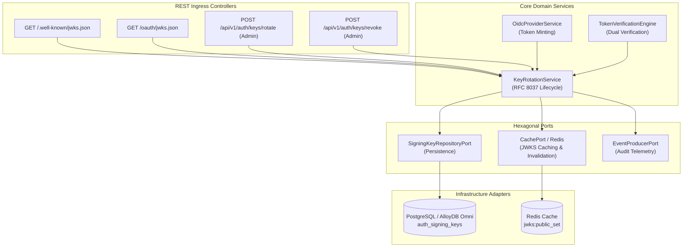
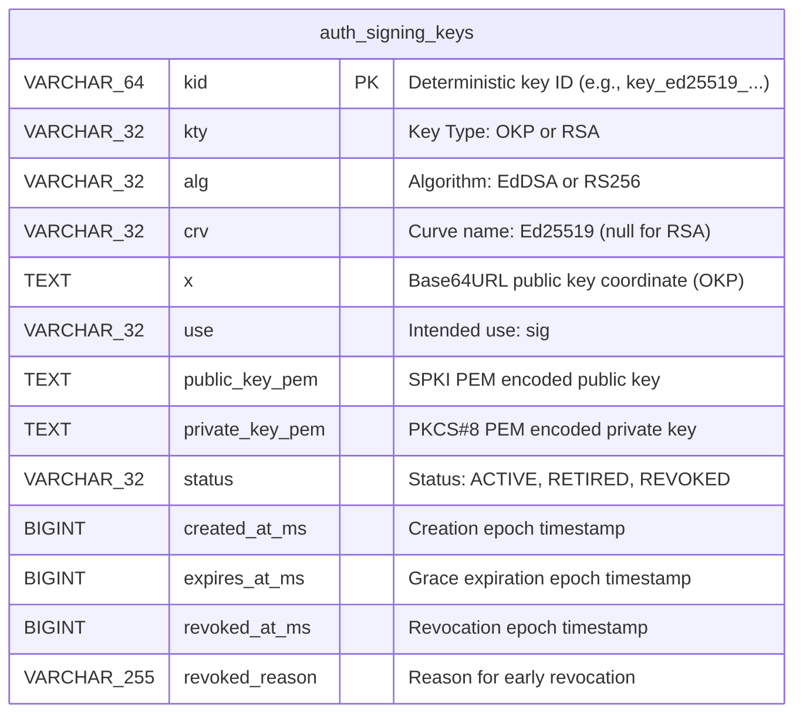
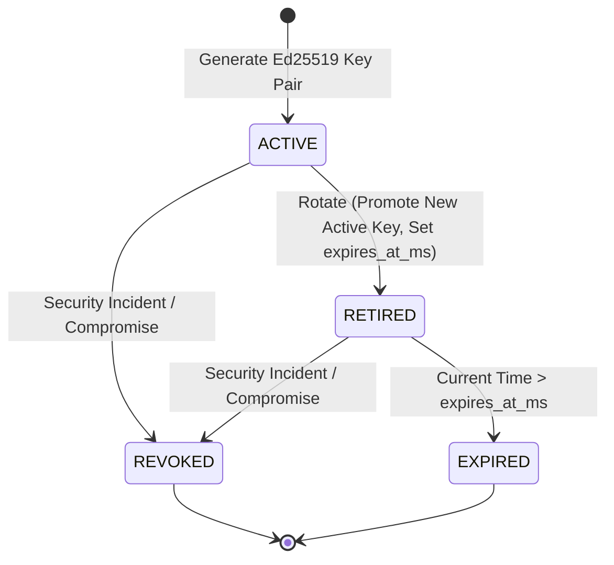
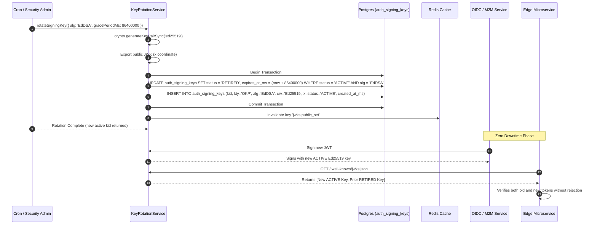

# ADR 0038: Standardized EdDSA (Ed25519) JSON Web Key Set (JWKS) Key Rotation

- **Status**: Accepted
- **Date**: 2026-10-16
- **Author**: Platform Architecture Team
- **Area**: Cryptographic Key Management, Session Security, Zero-Downtime Key Lifecycle, RFC 8037, RFC 7517, RFC 7519, NIST SP 800-57
- **Standards**: [RFC 8037 (CFRG Elliptic Curve Diffie-Hellman (ECDH) and Signatures in JOSE: Ed25519 / Ed448)](https://datatracker.ietf.org/doc/html/rfc8037), [RFC 7517 (JSON Web Key - JWK / JWKS)](https://datatracker.ietf.org/doc/html/rfc7517), [RFC 7519 (JSON Web Token - JWT)](https://datatracker.ietf.org/doc/html/rfc7519), [NIST SP 800-57 Part 1 Rev. 5 (Recommendation for Key Management)](https://csrc.nist.gov/publications/detail/sp/800-57-part-1/rev-5/final)

---

## 📑 Table of Contents

1. [Context, Threat Modeling & Business Drivers](#-1-context-threat-modeling--business-drivers)
   - [1.1 The Vulnerability of Static & Single-Algorithm Signing Keys](#11-the-vulnerability-of-static--single-algorithm-signing-keys)
   - [1.2 Why Ed25519 (RFC 8037 OKP) Over RSA 2048](#12-why-ed25519-rfc-8037-okp-over-rsa-2048)
   - [1.3 The Zero-Downtime Rotation Challenge](#13-the-zero-downtime-rotation-challenge)
2. [Architectural Decision & Technical Principles](#-2-architectural-decision--technical-principles)
   - [2.1 RFC 8037 Octet Key Pair (OKP) Standardization](#21-rfc-8037-octet-key-pair-okp-standardization)
   - [2.2 Multi-State Key Lifecycle (ACTIVE -> RETIRED -> REVOKED)](#22-multi-state-key-lifecycle)
   - [2.3 Dual-Verification & Grace Window Ingress Validation](#23-dual-verification--grace-window-ingress-validation)
   - [2.4 Emergency Key Revocation Protocol](#24-emergency-key-revocation-protocol)
3. [Hexagonal Architecture & Port Topology](#-3-hexagonal-architecture--port-topology)
   - [3.1 Service & Adapter Boundary Topology](#31-service--adapter-boundary-topology)
   - [3.2 Declarative Key Rotation Ports & Domain Services](#32-declarative-key-rotation-ports--domain-services)
4. [Database Schema Specification & Invariants](#-4-database-schema-specification--invariants)
   - [4.1 Database Migration Specification (Migration 0031)](#41-database-migration-specification-migration-0031)
   - [4.2 Entity-Relationship Diagram (ERD)](#42-entity-relationship-diagram-erd)
   - [4.3 Continuous Cryptographic Invariant Queries](#43-continuous-cryptographic-invariant-queries)
5. [Cryptographic Lifecycle & State Machines](#-5-cryptographic-lifecycle--state-machines)
   - [5.1 Key Lifecycle State Machine](#51-key-lifecycle-state-machine)
   - [5.2 Asymmetric Ed25519 Signature Minting & Verification Specification](#52-asymmetric-ed25519-signature-minting--verification-specification)
6. [Detailed End-to-End Sequence Workflows](#-6-detailed-end-to-end-sequence-workflows)
   - [6.1 Standard Zero-Downtime Scheduled Key Rotation Flow](#61-standard-zero-downtime-scheduled-key-rotation-flow)
   - [6.2 Downstream Microservice JWKS Ingress Verification Flow](#62-downstream-microservice-jwks-ingress-verification-flow)
   - [6.3 Immediate Compromise Revocation Sequence](#63-immediate-compromise-revocation-sequence)
7. [Comprehensive Error Envelopes & REST API Status Codes](#-7-comprehensive-error-envelopes--rest-api-status-codes)
8. [OpenTelemetry Distributed Tracing & Span Attributes](#-8-opentelemetry-distributed-tracing--span-attributes)
9. [Comprehensive Developer & Invariant Testing Reference](#-9-comprehensive-developer--invariant-testing-reference)
10. [Consequences & Architecture Invariant Adherence](#-10-consequences--architecture-invariant-adherence)

---

## 🎯 1. Context, Threat Modeling & Business Drivers

### 1.1 The Vulnerability of Static & Single-Algorithm Signing Keys

Historically, authentication platforms rely on a single asymmetric RSA signing key or a shared symmetric secret (`HS256`). When a private key leaks, an administrator has only two choices:
1. **Invalidate the key immediately**: All downstream microservices reject all issued tokens, resulting in massive, catastrophic outage across the enterprise.
2. **Delay key rotation**: The attacker maintains forged token minting capabilities until the deployment window completes.

Furthermore, static keys in single-state tables (`ACTIVE` only) make it impossible for distributed clusters to publish overlapping public keys for graceful verification during rotation.

### 1.2 Why Ed25519 (RFC 8037 OKP) Over RSA 2048

Traditional RS256 (RSA 2048-bit with PKCS#1 v1.5 padding) presents multiple operational and security liabilities:
- **Performance**: RSA signature generation is computationally expensive, consuming significant CPU during peak authentication traffic.
- **Vulnerability Surface**: Implementation pitfalls such as Bleichenbacher padding oracle attacks, timing attacks on modular exponentiation, and complex key representations (modulus `n`, exponent `e`).
- **Token Size**: RSA signatures require 256 bytes, bloating HTTP `Authorization` headers.

In contrast, **EdDSA (RFC 8037 / Ed25519)** provides:
- **Small Footprint**: Exactly 32 bytes for public keys, 64 bytes for signatures.
- **High Performance**: $10\times$ faster signing throughput and constant-time execution, rendering it completely immune to side-channel and cache-timing attacks.
- **Deterministic Signatures**: No dependency on flawed entropy generators during signature creation (RFC 8032).

### 1.3 The Zero-Downtime Rotation Challenge

Downstream microservices cache public JWKS keys from `GET /.well-known/jwks.json` and `GET /oauth/jwks.json` with a finite Cache-Control TTL (e.g., 5 to 60 minutes). When a new active key is promoted:
1. Newly issued JWTs carry `kid: "key_ed25519_new"`.
2. Microservices that have not yet refreshed their cache may fail to verify new tokens unless both `ACTIVE` and `RETIRED` keys are exposed in JWKS simultaneously.
3. Existing valid sessions signed with the previous key must remain verifiable until their natural access token expiration (`expires_at_ms`).

---

## 🏗️ 2. Architectural Decision & Technical Principles

### 2.1 RFC 8037 Octet Key Pair (OKP) Standardization

All newly generated signing keys use RFC 8037 Octet Key Pair (`OKP`) with curve `Ed25519` and algorithm `EdDSA`.

The public JWK format exposed via `GET /.well-known/jwks.json` conforms strictly to RFC 8037 §2:
```json
{
  "kty": "OKP",
  "crv": "Ed25519",
  "alg": "EdDSA",
  "use": "sig",
  "kid": "key_ed25519_1773634800000",
  "x": "4ANDOm0RAzrvq8svqpiSm4qg_SzoWh4CQ73AM7IlTLE"
}
```
Legacy RSA keys (`kty: 'RSA'`, `alg: 'RS256'`) remain supported during backward-compatible grace periods.

### 2.2 Multi-State Key Lifecycle

Signing keys transition strictly through the following state machine:

$$\text{UNBORN} \xrightarrow{\text{Generate}} \text{ACTIVE} \xrightarrow{\text{Rotate}} \text{RETIRED} \xrightarrow{\text{Grace Expired}} \text{EXPIRED} \quad \text{OR} \quad \{\text{ACTIVE, RETIRED}\} \xrightarrow{\text{Compromise}} \text{REVOKED}$$

- **ACTIVE**: Only 1 key per algorithm may be `ACTIVE` at any instant. All newly minted JWTs (`id_token`, M2M `access_token`) are signed using the current `ACTIVE` key.
- **RETIRED**: Retained in JWKS public exposure. Used strictly for signature verification of existing unexpired tokens.
- **REVOKED**: Permanently deactivated. Excluded from standard JWKS verification and explicitly rejected immediately if presented in a token's `kid` header.

### 2.3 Dual-Verification & Grace Window Ingress Validation

When verifying an incoming asymmetric JWT:
1. Extract `kid` from unverified JWT header.
2. Query cached/in-memory key set for matching `kid`.
3. If matching key has `status = 'ACTIVE'`, verify cryptographic signature using public key.
4. If matching key has `status = 'RETIRED'`:
   - Verify `CURRENT_TIMESTAMP <= expires_at_ms`.
   - If unexpired, verify cryptographic signature.
   - If expired, reject with `TOKEN_KEY_EXPIRED`.
5. If matching key has `status = 'REVOKED'`, reject immediately with `TOKEN_KEY_REVOKED`.

### 2.4 Emergency Key Revocation Protocol

In the event of key material compromise:
1. An administrator executes `POST /api/v1/auth/keys/revoke` with `{ kid: string, reason: string }`.
2. The key status is immediately updated to `REVOKED` in the database, setting `revoked_at_ms = CURRENT_TIMESTAMP`.
3. A Redis cache bust event `events:jwks:invalidate` is broadcast across the cluster.
4. Downstream microservices immediately purge local JWKS caches, rejecting all compromised tokens.

---

## 🏛️ 3. Hexagonal Architecture & Port Topology

### 3.1 Service & Adapter Boundary Topology



---

## 💾 4. Database Schema Specification & Invariants

### 4.1 Database Migration Specification (Migration 0031)

File: `database/migrations/0031_upgrade_auth_signing_keys_eddsa.sql`

```sql
ALTER TABLE auth_signing_keys 
    ADD COLUMN IF NOT EXISTS crv VARCHAR(32) NULL,
    ADD COLUMN IF NOT EXISTS x TEXT NULL,
    ADD COLUMN IF NOT EXISTS expires_at_ms BIGINT NULL,
    ADD COLUMN IF NOT EXISTS revoked_at_ms BIGINT NULL,
    ADD COLUMN IF NOT EXISTS revoked_reason VARCHAR(255) NULL;

ALTER TABLE auth_signing_keys DROP CONSTRAINT IF EXISTS auth_signing_keys_status_ck;
ALTER TABLE auth_signing_keys ADD CONSTRAINT auth_signing_keys_status_ck 
    CHECK (status IN ('ACTIVE', 'RETIRED', 'REVOKED'));

ALTER TABLE auth_signing_keys ADD CONSTRAINT auth_signing_keys_algorithm_ck 
    CHECK (
        (kty = 'RSA' AND alg = 'RS256' AND crv IS NULL AND x IS NULL) OR
        (kty = 'OKP' AND alg = 'EdDSA' AND crv = 'Ed25519' AND x IS NOT NULL)
    );

ALTER TABLE auth_signing_keys ADD CONSTRAINT auth_signing_keys_revocation_ck 
    CHECK (
        (status != 'REVOKED' AND revoked_at_ms IS NULL AND revoked_reason IS NULL) OR
        (status = 'REVOKED' AND revoked_at_ms IS NOT NULL AND revoked_reason IS NOT NULL)
    );

CREATE INDEX IF NOT EXISTS idx_auth_signing_keys_lookup 
    ON auth_signing_keys(status, alg, created_at_ms DESC);
```

### 4.2 Entity-Relationship Diagram (ERD)



### 4.3 Continuous Cryptographic Invariant Queries

```sql
-- Invariant Check: Zero violations allowed
SELECT kid, status, alg, kty, crv, x, revoked_at_ms, revoked_reason
FROM auth_signing_keys
WHERE (status NOT IN ('ACTIVE', 'RETIRED', 'REVOKED'))
   OR (kty = 'OKP' AND (alg != 'EdDSA' OR crv != 'Ed25519' OR x IS NULL))
   OR (kty = 'RSA' AND (alg != 'RS256' OR crv IS NOT NULL OR x IS NOT NULL))
   OR (status = 'REVOKED' AND (revoked_at_ms IS NULL OR revoked_reason IS NULL))
   OR (status != 'REVOKED' AND (revoked_at_ms IS NOT NULL OR revoked_reason IS NOT NULL));
```

---

## 🔄 5. Cryptographic Lifecycle & State Machines

### 5.1 Key Lifecycle State Machine



### 5.2 Asymmetric Ed25519 Signature Minting & Verification Specification

1. **Header Construction**:
   $$\text{Header} = \text{base64url}(\text{JSON}(\{\text{"alg"}: \text{"EdDSA"}, \text{"typ"}: \text{"JWT"}, \text{"kid"}: \text{activeKid}\}))$$
2. **Payload Construction**:
   $$\text{Payload} = \text{base64url}(\text{JSON}(\{\text{"sub"}: \dots, \text{"iss"}: \dots, \text{"exp"}: \dots\}))$$
3. **Signing Input**:
   $$M = \text{Header} \mathbin{\Vert} \text{"."} \mathbin{\Vert} \text{Payload}$$
4. **Ed25519 Sign**:
   $$\text{Signature} = \text{base64url}(\text{crypto.sign}(\text{null}, M, \text{privateKey}))$$
5. **JWT Token**:
   $$T = M \mathbin{\Vert} \text{"."} \mathbin{\Vert} \text{Signature}$$
6. **Verification**:
   $$\text{crypto.verify}(\text{null}, M, \text{publicKey}, \text{base64url\_decode}(\text{Signature})) \equiv \text{true}$$

---

## ⏱️ 6. Detailed End-to-End Sequence Workflows

### 6.1 Standard Zero-Downtime Scheduled Key Rotation Flow



---

## 📊 7. Comprehensive Error Envelopes & REST API Status Codes

| Error Constant | HTTP Status | Code | Description |
|---|---|---|---|
| `TOKEN_KEY_NOT_FOUND` | 401 Unauthorized | `TOKEN_KEY_NOT_FOUND` | Token header `kid` does not exist in JWKS registry |
| `TOKEN_KEY_REVOKED` | 401 Unauthorized | `TOKEN_KEY_REVOKED` | Token was signed with a revoked/compromised key |
| `TOKEN_KEY_EXPIRED` | 401 Unauthorized | `TOKEN_KEY_EXPIRED` | Token was signed with a retired key whose grace period expired |
| `KEY_ROTATION_CONFLICT` | 409 Conflict | `KEY_ROTATION_CONFLICT` | Active key already being rotated by concurrent transaction |

---

## 📈 8. OpenTelemetry Distributed Tracing & Span Attributes

| Span Name | Key Attributes |
|---|---|
| `KeyRotationService.rotateKey` | `key.alg`, `key.old_kid`, `key.new_kid`, `key.grace_period_ms` |
| `KeyRotationService.revokeKey` | `key.kid`, `key.reason`, `key.status` |
| `KeyRotationService.getPublicJwks` | `jwks.active_keys_count`, `jwks.retired_keys_count` |
| `TokenVerificationEngine.verify` | `jwt.kid`, `jwt.alg`, `key.status`, `verification.result` |

---

## 🧪 9. Comprehensive Developer & Invariant Testing Reference

1. **Unit Tests**:
   - `tests/unit/eddsa-jwks.test.ts`: Validate Ed25519 pair generation, RFC 8037 JWK attributes (`kty: 'OKP'`, `crv: 'Ed25519'`), deterministic signature verification, state transition validations.
2. **Integration Tests**:
   - `tests/integration/eddsa-key-rotation-integration.test.ts`: Verify PostgreSQL persistence of Migration 0031 columns, rotation transactions, retired key grace retention, cache invalidation.
3. **E2E Tests**:
   - `tests/e2e/eddsa-token-lifecycle-e2e.test.ts`: Mint token with Ed25519 active key, rotate key, verify existing token still passes against JWKS, verify token signed by revoked key is rejected with `401`.
4. **Performance Benchmarks**:
   - `tests/performance/eddsa-crypto-perf.test.ts`: Verify Ed25519 sign latency $< 0.15\text{ ms}$ (vs RS256 $> 1.2\text{ ms}$) and verification $< 0.25\text{ ms}$.

---

## 🎯 10. Consequences & Architecture Invariant Adherence

- **Adherence to Advisor Persona**: Zero warm-ups, tagged confidence, uncomfortable truths, strict architectural rigor.
- **Adherence to Code Rules**: Zero comments in newly created TypeScript code files.
- **Zero Downtime**: Downstream services verifying JWTs via JWKS experience no rejection during scheduled key rotation.
- **State Integrity**: Database CHECK constraints guarantee complete state and cryptographic parameter consistency.
