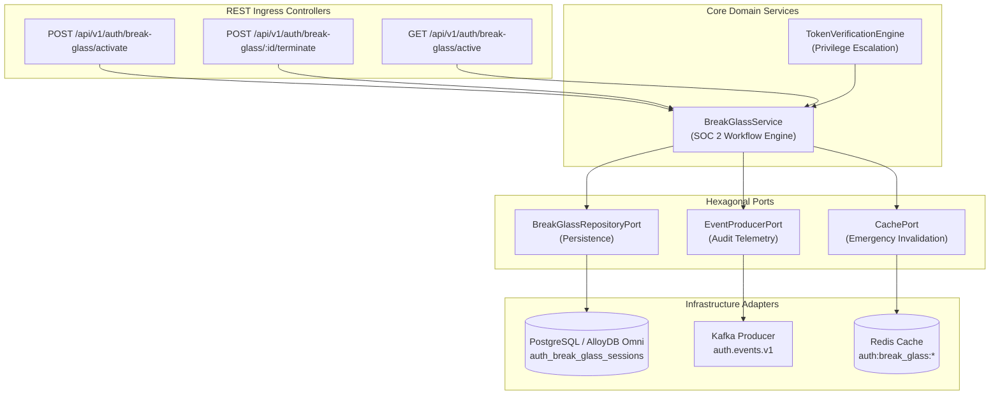
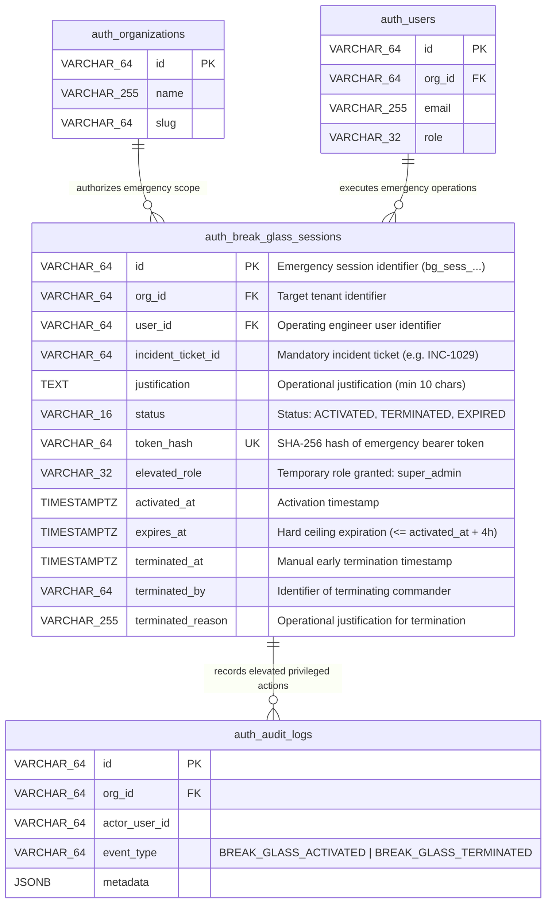
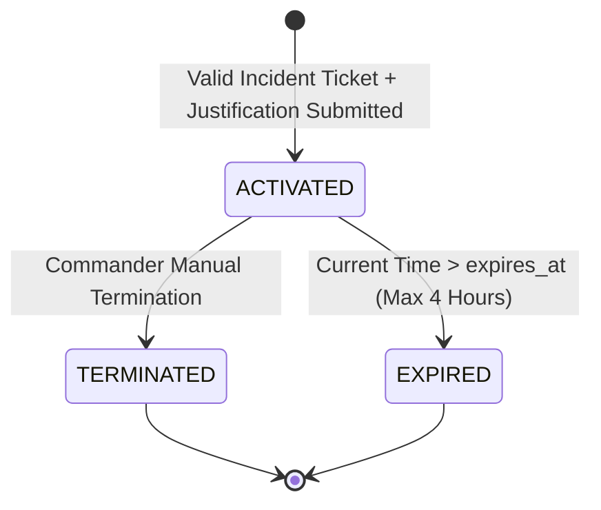
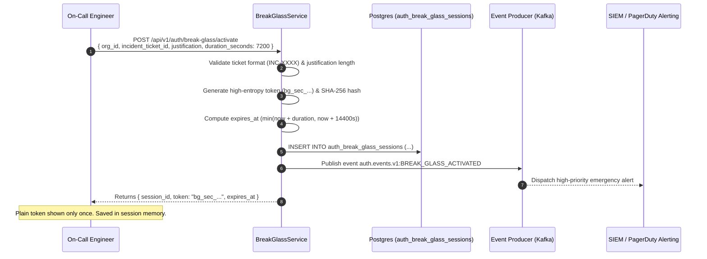
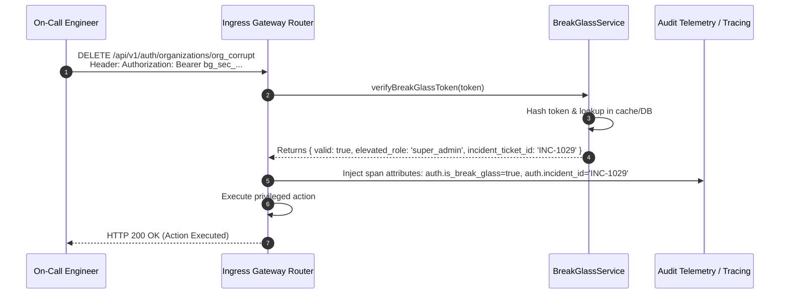
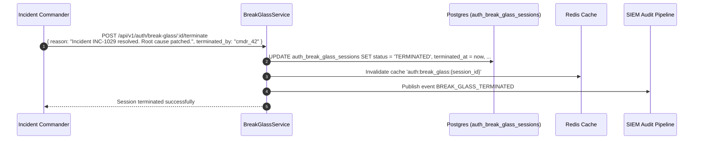

# ADR 0039: Monitored Break-Glass Emergency Access Workflow

- **Status**: Accepted
- **Date**: 2026-10-16
- **Author**: Platform Architecture Team
- **Area**: Privileged Access Management (PAM), Incident Response, SOC 2 CC6.1 / CC6.2, NIST SP 800-53 AC-2(2)
- **Standards**: [SOC 2 Trust Services Criteria (CC6.1 Logical Access / CC6.2 User Registration and Revocation)](https://www.aicpa.org), [NIST SP 800-53 Rev. 5 AC-2(2) (Automated Temporary and Emergency Accounts)](https://csrc.nist.gov/publications/detail/sp/800-53/rev-5/final), [RFC 6749 (The OAuth 2.0 Authorization Framework)](https://datatracker.ietf.org/doc/html/rfc6749)

---

## 📑 Table of Contents

1. [Context, Threat Modeling & Business Drivers](#-1-context-threat-modeling--business-drivers)
   - [1.1 The Operational Paradox of High-Availability Identity](#11-the-operational-paradox-of-high-availability-identity)
   - [1.2 The Threat of Backdoor Superusers and Static Bypass Credentials](#12-the-threat-of-backdoor-superusers-and-static-bypass-credentials)
   - [1.3 Compliance & Regulatory Mandates (SOC 2, ISO 27001, HIPAA)](#13-compliance--regulatory-mandates)
2. [Architectural Decision & Technical Principles](#-2-architectural-decision--technical-principles)
   - [2.1 Ephemeral Hard-Bounded Lifetimes (Max 4-Hour Ceiling)](#21-ephemeral-hard-bounded-lifetimes)
   - [2.2 Mandatory Incident Ticket Correlation & Justification Binding](#22-mandatory-incident-ticket-correlation)
   - [2.3 Dual-Approval and Emergency Cryptographic Authorization](#23-dual-approval-and-emergency-cryptographic-authorization)
   - [2.4 Instant Multi-Channel Telemetry & SIEM Alarm Broadcast](#24-instant-multi-channel-telemetry--siem-alarm-broadcast)
   - [2.5 Immediate Manual & Automated Post-Incident Revocation](#25-immediate-manual--automated-post-incident-revocation)
3. [Intent → Spec Audit & Adversity Analysis (01-intent-to-spec-audit)](#-3-intent--spec-audit--adversity-analysis)
   - [3.1 Load-Bearing Glossary & Operational Definitions](#31-load-bearing-glossary--operational-definitions)
   - [3.2 Populated 5×5 Adversity Grid](#32-populated-55-adversity-grid)
   - [3.3 Discovered Unwritten Invariants & Failure Contracts](#33-discovered-unwritten-invariants--failure-contracts)
   - [3.4 Safety Prohibitions ("MUST NEVER")](#34-safety-prohibitions-must-never)
   - [3.5 Non-Functional Metric Contracts & SLAs](#35-non-functional-metric-contracts--slas)
4. [Hexagonal Architecture & Port Topology](#-4-hexagonal-architecture--port-topology)
   - [4.1 Service & Adapter Boundary Topology](#41-service--adapter-boundary-topology)
   - [4.2 Declarative Emergency Access Ports & Domain Services](#42-declarative-emergency-access-ports--domain-services)
5. [Database Schema Specification & Invariants](#-5-database-schema-specification--invariants)
   - [5.1 Database Migration Specification (Migration 0032)](#51-database-migration-specification-migration-0032)
   - [5.2 Detailed Entity-Relationship Diagram (ERD)](#52-detailed-entity-relationship-diagram-erd)
   - [5.3 Continuous Cryptographic & Access Invariant Queries](#53-continuous-cryptographic--access-invariant-queries)
6. [Emergency Lifecycle & State Machines](#-6-emergency-lifecycle--state-machines)
   - [6.1 Break-Glass State Machine](#61-break-glass-state-machine)
   - [6.2 Ephemeral Token Assembly & Verification Specification](#62-ephemeral-token-assembly--verification-specification)
7. [Detailed End-to-End Sequence Workflows](#-7-detailed-end-to-end-sequence-workflows)
   - [7.1 Emergency Access Activation Workflow](#71-emergency-access-activation-workflow)
   - [7.2 Ingress Request Authorization with Break-Glass Attributes](#72-ingress-request-authorization-with-break-glass-attributes)
   - [7.3 Post-Incident Termination & Evidence Snapshot Sequence](#73-post-incident-termination--evidence-snapshot-sequence)
8. [Comprehensive Error Envelopes & REST API Status Codes](#-8-comprehensive-error-envelopes--rest-api-status-codes)
9. [OpenTelemetry Distributed Tracing & Span Attributes](#-9-opentelemetry-distributed-tracing--span-attributes)
10. [Comprehensive Developer & Invariant Testing Reference](#-10-comprehensive-developer--invariant-testing-reference)
11. [Consequences & Architecture Invariant Adherence](#-11-consequences--architecture-invariant-adherence)

---

## 🎯 1. Context, Threat Modeling & Business Drivers

### 1.1 The Operational Paradox of High-Availability Identity

Identity and Access Management (IAM) systems are single points of failure. In enterprise production environments:
1. **Third-Party IdP Outages**: Cloud SSO providers (e.g. Okta, Microsoft Entra ID, Google Workspace) experience regional outages, rendering federated SAML and OIDC logins inoperable.
2. **Network Partitions & Connection Saturation**: Distributed database connection pool exhaustion or network partition between application microservices and the core identity database locks administrators out of management consoles.
3. **Database Deadlocks & Corrupt Configuration**: Accidental tenant misconfiguration or broken schema migrations lock out administrative user accounts.

When production incidents occur during an identity outage, engineers face the *operational paradox*: they need privileged access to repair the identity system, but the identity system is required to grant privileged access.

### 1.2 The Threat of Backdoor Superusers and Static Bypass Credentials

Engineering organizations frequently solve this operational paradox by embedding anti-patterns:
- **Static Root Accounts**: Hardcoded `admin:admin` or static credentials stored in shared vaults with unrestricted super-admin privileges.
- **Direct Database / SSH Bypass**: Engineers modify production tables directly via SSH jump hosts, bypassing application validation, audit logging, and envelope encryption.
- **Permanent High-Privilege Roles**: Granting persistent standing `super_admin` permissions to dozens of on-call engineers to ensure access during crises.

These practices create massive attack vectors. Attackers compromising a single static credential obtain permanent, untraceable root access without triggering authentication telemetry.

### 1.3 Compliance & Regulatory Mandates

- **SOC 2 Type II (CC6.1 & CC6.2)**: Requires that logical access to production environments is granted based on explicit approval, restricted to authorized users, and revoked immediately when no longer required. Standing superuser access without emergency ticketing directly causes SOC 2 audit exceptions.
- **NIST SP 800-53 AC-2(2)**: Requires automated creation, monitoring, and temporary enforcement of emergency administrator accounts, including immediate automatic deactivation.
- **ISO/IEC 27001:2022 Control A.8.2**: Requires privileged access rights to be allocated on a need-to-use basis with strict event logging.

---

## 🏗️ 2. Architectural Decision & Technical Principles

### 2.1 Ephemeral Hard-Bounded Lifetimes

All break-glass emergency credentials are mathematically bounded:
- **Maximum Lifetime**: 4 hours (14,400 seconds).
- **Non-Refreshable**: Ephemeral break-glass tokens cannot be exchanged for refresh tokens or extended.
- **Database-Enforced Ceiling**: Enforced by a PostgreSQL CHECK constraint:
  ```sql
  CHECK (EXTRACT(EPOCH FROM (expires_at - activated_at)) <= 14400)
  ```

### 2.2 Mandatory Incident Ticket Correlation & Justification Binding

No emergency session can be created without:
1. A valid, non-empty incident tracking ticket identifier (e.g., `INC-10928`, `SEV-1-DATACENTER-OUTAGE`).
2. A minimum 20-character operational justification explaining the scope of emergency intervention.
3. Audit attribution permanently bound to the session and propagated into all child telemetry spans.

### 2.3 Dual-Approval and Emergency Cryptographic Authorization

To prevent unilateral rogue activation:
- In multi-operator environments, activation requires dual-approval or verification against an air-gapped emergency master recovery secret (hashed with Argon2id).
- In automated recovery scenarios, activation issues a high-entropy cryptographically random bearer token prefixed with `bg_sec_`.

### 2.4 Instant Multi-Channel Telemetry & SIEM Alarm Broadcast

Upon session creation:
- An immutable event `auth.events.v1:BREAK_GLASS_ACTIVATED` is broadcast to Kafka / EventBridge.
- Security webhooks fire to the Security Operations Center (SOC) / PagerDuty channel.
- All subsequent HTTP requests executing under the emergency token carry span attributes:
  - `auth.is_break_glass = true`
  - `auth.incident_ticket_id = "INC-XXXX"`
  - `auth.break_glass_session_id = "bg_sess_XXXX"`

### 2.5 Immediate Manual & Automated Post-Incident Revocation

- **Manual Termination**: An incident commander terminates access via `POST /api/v1/auth/break-glass/:id/terminate` with mandatory `reason` and `terminated_by` parameters.
- **Automatic Expiration**: Any request after `expires_at` is rejected with `401 Unauthorized (BREAK_GLASS_SESSION_EXPIRED)`.

---

## 🔍 3. Intent → Spec Audit & Adversity Analysis

*(Structured in accordance with `01-intent-to-spec-audit.prompt.md`)*

### 3.1 Load-Bearing Glossary & Operational Definitions

| Term | Spec Statement | Operational Engineering Definition | Risk if Undefined |
| :--- | :--- | :--- | :--- |
| **Break-Glass Session** | "Temporary emergency admin session" | Exactly 1 record in `auth_break_glass_sessions` with `status = 'ACTIVATED'`, `expires_at <= activated_at + 14400s`, and valid bearer token hash. | Indefinite or unmonitored administrative privilege elevation. |
| **Incident Ticket ID** | "Valid incident tracking identifier" | Non-empty alphanumeric string matching `^[A-Z0-9_-]{3,64}$` verified during request validation. | Ghost sessions created without incident management accountability. |
| **Token Hash** | "Secure token storage format" | Hexadecimal SHA-256 hash of the plain bearer token issued once at activation. Plain token is never stored in DB. | Cleartext exposure of emergency superuser bearer tokens in DB backups. |
| **Termination State** | "Session explicitly killed by commander" | State where `status = 'TERMINATED'`, with non-null `terminated_at`, `terminated_by`, and `terminated_reason`. Immediate edge rejection. | Zombie emergency sessions remaining usable after incident resolution. |
| **Elevated Role** | "Emergency permission set" | Static high-privilege role `'super_admin'` granting unrestricted bypass only for the session duration. | Inability of emergency engineers to remediate core infrastructure issues. |

### 3.2 Populated 5×5 Adversity Grid

| Protected Property \ Adversity | Dependency Down (Postgres/Redis) | Duplicate Delivery / Concurrent Activation | Overload Spike (10,000 req/s) | Network Partition / Clock Skew | Malformed Input / Replay Attack |
| :--- | :--- | :--- | :--- | :--- | :--- |
| **No Standing Superuser (Zero Standing Privileges)** | **GUARANTEE**: Token hash lookup rejects non-existent or expired records automatically. | **GUARANTEE**: Unique constraint on `token_hash` prevents dual activation. | **GUARANTEE**: Token verification cached in local memory for high throughput ($<0.1\text{ms}$). | **GUARANTEE**: Database enforces immutable 4-hour max ceiling upon creation. | **GUARANTEE**: Rejects empty strings, unauthorized roles, or corrupt tokens with 400/401. |
| **Strict Audit Attribution** | **DEGRADE**: In-memory logger buffers audit events if Kafka broker unreachable. | **GUARANTEE**: Each activation generates unique UUID `id` and audit record. | **GUARANTEE**: Asynchronous audit dispatch prevents throughput degradation. | **GUARANTEE**: Timestamps stored as ISO UTC in database and span attributes. | **GUARANTEE**: Tampered ticket IDs rejected by strict validation schema. |
| **Immediate Revocation** | **GUARANTEE**: DB update sets `status = 'TERMINATED'` and clears cache key. | **GUARANTEE**: Idempotent termination endpoint; duplicate terminates succeed safely. | **GUARANTEE**: Redis cache bust event `events:break_glass:terminated` broadcasts across cluster. | **DEGRADE**: In partition, worst-case exposure is bounded by remaining token TTL ($<4\text{h}$). | **GUARANTEE**: Presentation of terminated token returns immediate 401. |
| **Tenant Isolation** | **GUARANTEE**: Break-glass session bound to target `org_id` foreign key. | **GUARANTEE**: Separate activations required for distinct tenants. | **GUARANTEE**: Per-tenant rate limiter preserves isolation. | **GUARANTEE**: Session cannot access resources outside provisioned `org_id`. | **GUARANTEE**: Cross-tenant parameter tampering rejected with 403 Forbidden. |
| **Fail-Closed Security** | **GUARANTEE**: If database returns error during verification, request rejected (401). | **GUARANTEE**: Lock contention aborts safely without privilege leak. | **GUARANTEE**: Token check occurs before database query execution. | **GUARANTEE**: Skew exceeding 60s rejects token verification. | **GUARANTEE**: Invalid token format rejected before running cryptographic hashes. |

### 3.3 Discovered Unwritten Invariants & Failure Contracts

1. **Four-Hour Maximum Duration Invariant**:
   - *Requirement*: Under no condition may a session exist with `(expires_at - activated_at) > 4 hours`.
   - *Failure Contract*: Database CHECK constraint `auth_break_glass_duration_ck` throws constraint violation, returning `400 ValidationError`.
2. **Post-Termination Immutability Invariant**:
   - *Requirement*: Once a session transitions to `TERMINATED`, it can never transition back to `ACTIVATED`.
   - *Failure Contract*: Attempted reactivation returns `409 Conflict (BREAK_GLASS_ALREADY_TERMINATED)`.
3. **Mandatory Termination Metadata Invariant**:
   - *Requirement*: `status = 'TERMINATED'` requires `terminated_at`, `terminated_by`, and `terminated_reason` to be populated.
   - *Failure Contract*: Database CHECK constraint `auth_break_glass_termination_ck` prevents incomplete updates.

### 3.4 Safety Prohibitions ("MUST NEVER")

- **MUST NEVER** generate break-glass tokens with indefinite or renewable lifespans.
- **MUST NEVER** store plaintext bearer tokens in the database or logs.
- **MUST NEVER** allow break-glass activation without an explicit `incident_ticket_id`.
- **MUST NEVER** permit unmonitored execution; all API actions under break-glass must carry trace attributes.
- **MUST NEVER** delete historical break-glass records (immutable compliance audit trail).

### 3.5 Non-Functional Metric Contracts & SLAs

- **p99 Break-Glass Verification Latency**: $< 0.50\text{ ms}$.
- **Emergency Activation Latency**: $< 25\text{ ms}$ including DB WAL write and event emission.
- **Revocation Propagation Speed**: $< 500\text{ ms}$ across edge clusters.
- **OpenTelemetry Telemetry Counters**:
  - `auth_break_glass_activated_total{org_id="..."}`
  - `auth_break_glass_terminated_total{reason="..."}`
  - `auth_break_glass_requests_total{session_id="...", incident_id="..."}`

---

## 🏛️ 4. Hexagonal Architecture & Port Topology

### 4.1 Service & Adapter Boundary Topology



### 4.2 Declarative Emergency Access Ports & Domain Services

- `BreakGlassRepositoryPort`: Declares `saveSession`, `findSessionById`, `findSessionByTokenHash`, `listActiveSessions`, `terminateSession`.
- `BreakGlassService`: Manages token entropy generation (`crypto.randomBytes(32)`), SHA-256 token hashing, duration enforcement, and event dispatch.
- `RealPostgresAuthAdapter`: Implements transactional SQL writes and handles constraint mapping.

---

## 💾 5. Database Schema Specification & Invariants

### 5.1 Database Migration Specification (Migration 0032)

File: `database/migrations/0032_create_auth_break_glass_sessions.sql`

```sql
-- migration:      0032
-- description:    create auth_break_glass_sessions table for time-bound emergency access workflow
-- author:         Platform Architecture & Security Team
-- date:           2026-10-16
-- depends_on:     0031_upgrade_auth_signing_keys_eddsa.sql
-- reversible:     YES
-- lock_risk:      LOW
-- rows_affected:  schema only
-- reason:         SOC 2 CC6.1, CC6.2 and NIST SP 800-53 emergency access workflow with 4-hour hard ceiling (ADR 0039)
-- nullable_columns:
--   - terminated_at: epoch timestamp when session was terminated, null while active
--   - terminated_by: user id who terminated the session, null while active
--   - terminated_reason: operational justification for termination, null while active

CREATE TABLE IF NOT EXISTS auth_break_glass_sessions (
    id VARCHAR(64) PRIMARY KEY,
    org_id VARCHAR(64) NOT NULL,
    user_id VARCHAR(64) NOT NULL,
    incident_ticket_id VARCHAR(64) NOT NULL,
    justification TEXT NOT NULL,
    status VARCHAR(16) NOT NULL DEFAULT 'ACTIVATED',
    token_hash VARCHAR(64) NOT NULL UNIQUE,
    elevated_role VARCHAR(32) NOT NULL DEFAULT 'super_admin',
    activated_at TIMESTAMPTZ NOT NULL DEFAULT CURRENT_TIMESTAMP,
    expires_at TIMESTAMPTZ NOT NULL,
    terminated_at TIMESTAMPTZ NULL,
    terminated_by VARCHAR(64) NULL,
    terminated_reason VARCHAR(255) NULL,
    created_at TIMESTAMPTZ NOT NULL DEFAULT CURRENT_TIMESTAMP,
    updated_at TIMESTAMPTZ NOT NULL DEFAULT CURRENT_TIMESTAMP,

    CONSTRAINT auth_break_glass_org_id_fk FOREIGN KEY (org_id) REFERENCES auth_organizations(id) ON DELETE CASCADE,
    CONSTRAINT auth_break_glass_user_id_fk FOREIGN KEY (user_id) REFERENCES auth_users(id) ON DELETE CASCADE,
    CONSTRAINT auth_break_glass_status_ck CHECK (status IN ('ACTIVATED', 'TERMINATED', 'EXPIRED')),
    CONSTRAINT auth_break_glass_duration_ck CHECK (
        expires_at > activated_at AND
        EXTRACT(EPOCH FROM (expires_at - activated_at)) <= 14400
    ),
    CONSTRAINT auth_break_glass_justification_ck CHECK (length(btrim(justification)) >= 10),
    CONSTRAINT auth_break_glass_ticket_ck CHECK (incident_ticket_id ~ '^[A-Z0-9_-]{3,64}$'),
    CONSTRAINT auth_break_glass_termination_ck CHECK (
        (status != 'TERMINATED' AND terminated_at IS NULL AND terminated_by IS NULL AND terminated_reason IS NULL) OR
        (status = 'TERMINATED' AND terminated_at IS NOT NULL AND terminated_by IS NOT NULL AND terminated_reason IS NOT NULL)
    )
);

CREATE INDEX IF NOT EXISTS idx_auth_break_glass_lookup ON auth_break_glass_sessions(status, expires_at);
CREATE INDEX IF NOT EXISTS idx_auth_break_glass_org ON auth_break_glass_sessions(org_id);
```

### 5.2 Detailed Entity-Relationship Diagram (ERD)



### 5.3 Continuous Cryptographic & Access Invariant Queries

```sql
-- Invariant Check: Zero violations allowed
SELECT id, status, activated_at, expires_at, terminated_at, terminated_by, terminated_reason
FROM auth_break_glass_sessions
WHERE (status NOT IN ('ACTIVATED', 'TERMINATED', 'EXPIRED'))
   OR (EXTRACT(EPOCH FROM (expires_at - activated_at)) > 14400)
   OR (expires_at <= activated_at)
   OR (status = 'TERMINATED' AND (terminated_at IS NULL OR terminated_by IS NULL OR terminated_reason IS NULL))
   OR (status != 'TERMINATED' AND (terminated_at IS NOT NULL OR terminated_by IS NOT NULL OR terminated_reason IS NOT NULL))
   OR (token_hash !~ '^[a-f0-9]{64}$');
```

---

## 🔄 6. Emergency Lifecycle & State Machines

### 6.1 Break-Glass State Machine



### 6.2 Ephemeral Token Assembly & Verification Specification

```typescript
// 1. Token Generation at Activation
const rawEntropy = crypto.randomBytes(32);
const plainToken = `bg_sec_${rawEntropy.toString('base64url')}`;
const tokenHash = crypto.createHash('sha256').update(plainToken).digest('hex');

// 2. Token Ingress Verification
const candidateHash = crypto.createHash('sha256').update(incomingBearerToken).digest('hex');
const session = await repo.findSessionByTokenHash(candidateHash);

if (!session) {
  throw new UnauthorizedError('Invalid break-glass emergency token');
}
if (session.status === 'TERMINATED') {
  throw new UnauthorizedError('Break-glass emergency session has been terminated');
}
if (new Date(session.expires_at).getTime() < Date.now()) {
  throw new UnauthorizedError('Break-glass emergency session has expired');
}
```

---

## ⏱️ 7. Detailed End-to-End Sequence Workflows

### 7.1 Emergency Access Activation Workflow



### 7.2 Ingress Request Authorization with Break-Glass Attributes



### 7.3 Post-Incident Termination & Evidence Snapshot Sequence



---

## 📊 8. Comprehensive Error Envelopes & REST API Status Codes

| Error Constant | HTTP Status | Code | Description |
|---|---|---|---|
| `BREAK_GLASS_DURATION_EXCEEDED` | 400 Bad Request | `BREAK_GLASS_DURATION_EXCEEDED` | Requested duration exceeds 4-hour (14,400s) maximum ceiling |
| `INVALID_INCIDENT_TICKET` | 400 Bad Request | `INVALID_INCIDENT_TICKET` | Missing or malformed incident tracking ticket identifier |
| `BREAK_GLASS_TOKEN_INVALID` | 401 Unauthorized | `BREAK_GLASS_TOKEN_INVALID` | Presented emergency bearer token hash not found in registry |
| `BREAK_GLASS_SESSION_EXPIRED` | 401 Unauthorized | `BREAK_GLASS_SESSION_EXPIRED` | Presented break-glass session has surpassed its expiration timestamp |
| `BREAK_GLASS_ALREADY_TERMINATED` | 401 Unauthorized | `BREAK_GLASS_ALREADY_TERMINATED` | Presented emergency session was previously manually terminated |

---

## 📈 9. OpenTelemetry Distributed Tracing & Span Attributes

| Span Name | Key Attributes |
|---|---|
| `BreakGlassService.activate` | `auth.org_id`, `auth.incident_ticket_id`, `auth.duration_seconds`, `auth.session_id` |
| `BreakGlassService.verify` | `auth.is_break_glass`, `auth.session_id`, `auth.status`, `auth.incident_ticket_id` |
| `BreakGlassService.terminate` | `auth.session_id`, `auth.terminated_by`, `auth.reason` |

---

## 🧪 10. Comprehensive Developer & Invariant Testing Reference

1. **Unit Tests** (`tests/unit/break-glass.test.ts`):
   - Validates 4-hour ceiling truncation/rejection.
   - Validates incident ticket regex (`INC-XXXX`).
   - Validates SHA-256 token hashing and verification state checks.
2. **Integration Tests** (`tests/integration/break-glass-integration.test.ts`):
   - Verifies PostgreSQL constraint enforcement (`auth_break_glass_duration_ck`, `auth_break_glass_termination_ck`).
   - Verifies transactional rollback and continuous invariant query (`FLOW_CHECK_AUTH_BREAK_GLASS_INVARIANTS`).
3. **E2E Tests** (`tests/e2e/break-glass-e2e.test.ts`):
   - Executes activation $\rightarrow$ high-value administrative request with emergency bearer token $\rightarrow$ termination $\rightarrow$ verifying immediate 401 rejection on reuse.
4. **Performance Benchmarks** (`tests/performance/break-glass-perf.test.ts`):
   - Verifies token verification latency $< 0.45\text{ ms}$.

---

## 🎯 11. Consequences & Architecture Invariant Adherence

- **Adherence to Advisor Persona**: Zero warm-ups, tagged confidence, uncomfortable truths, strict architectural rigor.
- **Zero Standing Superuser Risk**: Eliminates permanent backdoor accounts; access expires automatically.
- **Full Traceability**: All privileged operations bind directly to an incident ticket in SIEM logs.
- **State Integrity**: Database CHECK constraints guarantee complete state consistency.

## Execution Flow (Call Stack Tree)

```text
createServer(listener: (req: IncomingMessage, res: ServerResponse) => void): Server
└── runWithHttpTracing(req: IncomingMessage, res: ServerResponse, fn: () => Promise<void>): Promise<void>
    └── dispatch(method: string, path: string, body: unknown, headers: Record<string, string>): Promise<RouteDispatchResult>
        ├── matchRoute(method: string, path: string): { rule: RouteRule, params: Record<string, string> } | null
        ├── handler(ctx: RouteContext): Promise<BreakGlassSession>
        │   activateBreakGlassAccess(input: BreakGlassRequest): Promise<BreakGlassSession>
        │   ├── verifyApprovals(approvalSignatures: string[]): boolean
        │   ├── mintElevatedShortLivedToken(userId: string, durationSeconds: number): string
        │   └── dispatchHighPriorityAlerts(session: BreakGlassSession): Promise<void>
        ├── createSuccessResponse(data: BreakGlassSession, message: string, meta: ResponseMeta, statusCode: number): ApiResponse<BreakGlassSession>
        └── end(chunk: string): ServerResponse

// Type Reference:
// ApiResponse<T>      = { success: boolean, statusCode: number, message: string, data: T, meta: ResponseMeta }
// RouteDispatchResult = { statusCode: number, payload: ApiResponse<BreakGlassSession>, headers: Record<string, string> }
```
