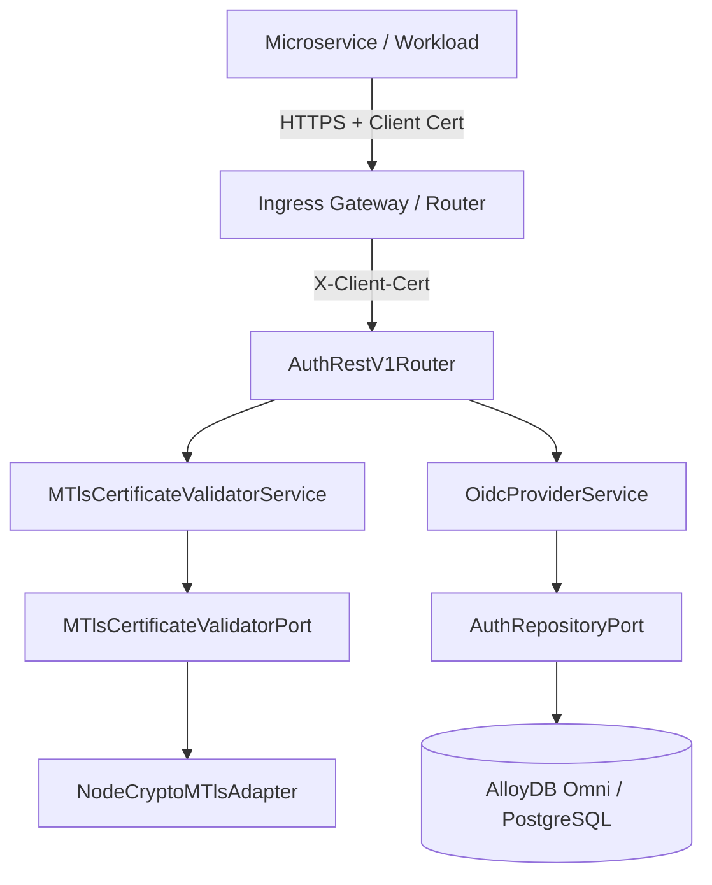
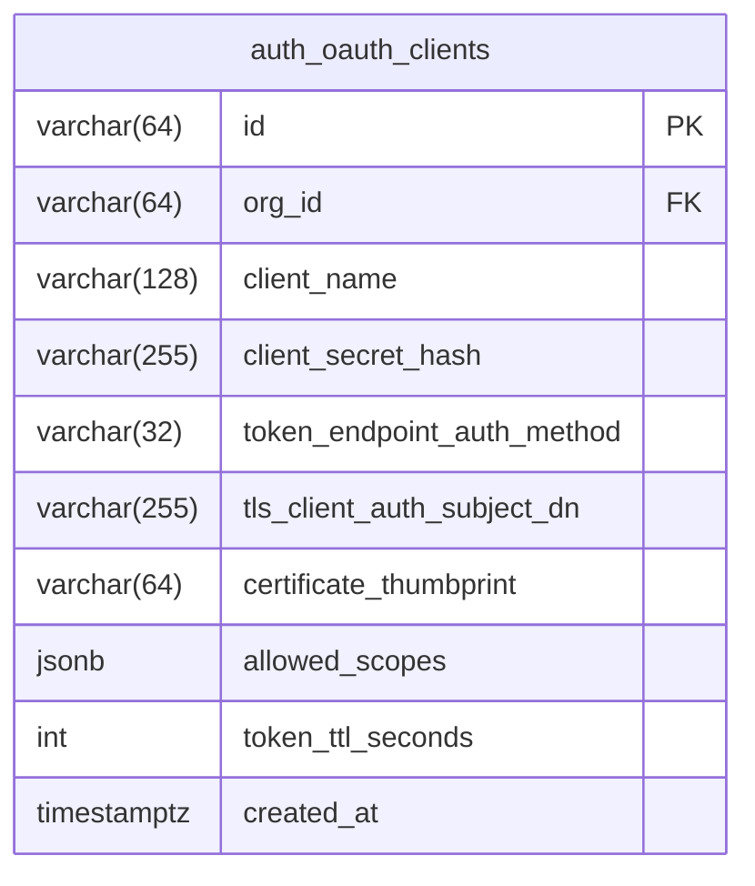
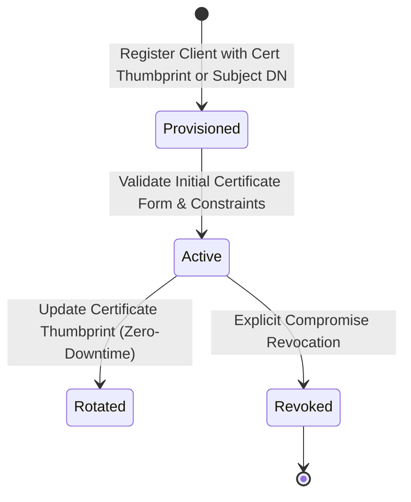
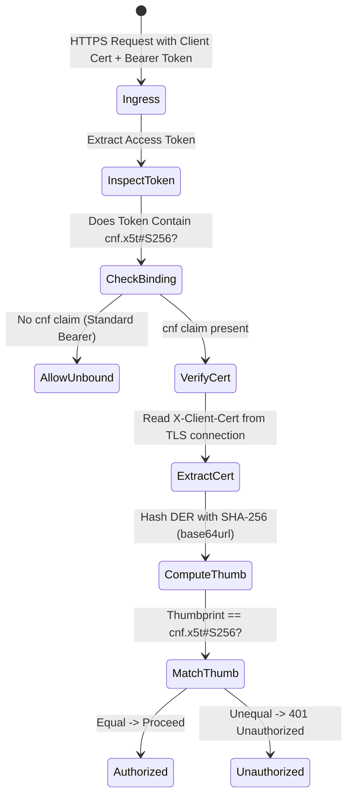
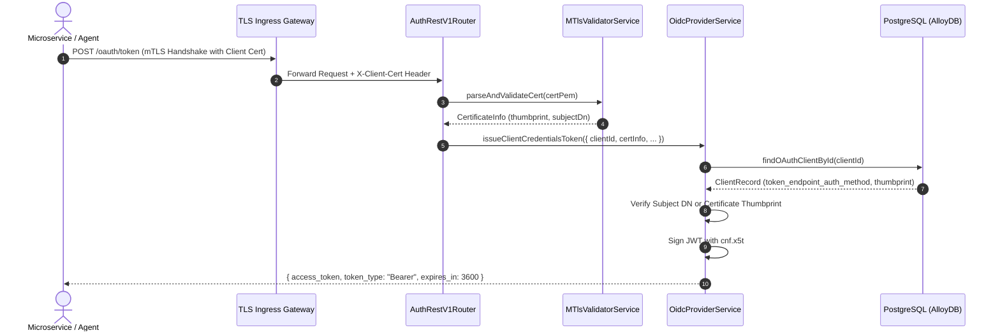
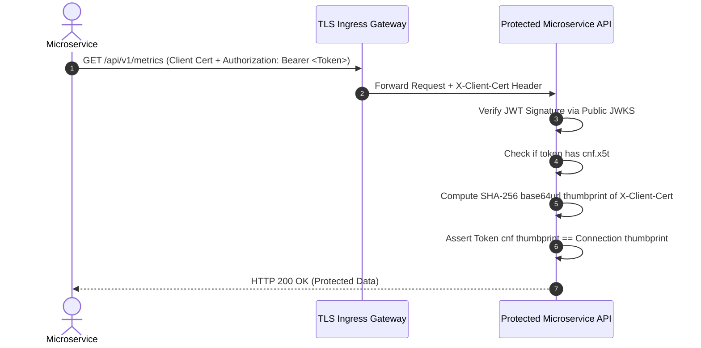

# ADR 0040: Mutual TLS (mTLS) Zero-Trust Microservice Authentication & Certificate-Bound Access Tokens (RFC 8705)

- **Status**: Accepted
- **Date**: 2026-10-16
- **Author**: Platform Architecture Team
- **Area**: Zero-Trust Network Architecture, Cryptographic Microservice Identity, OAuth 2.0 Mutual-TLS Client Authentication, RFC 8705
- **Standards**: [RFC 8705 (OAuth 2.0 Mutual-TLS Client Authentication and Certificate-Bound Access Tokens)](https://datatracker.ietf.org/doc/html/rfc8705), [RFC 5280 (X.509 PKI Certificate and CRL Profile)](https://datatracker.ietf.org/doc/html/rfc5280), [NIST SP 800-207 (Zero Trust Architecture)](https://csrc.nist.gov/publications/detail/sp/800-207/final), [RFC 7519 (JSON Web Token)](https://datatracker.ietf.org/doc/html/rfc7519)

---

## 📑 Table of Contents

1. [Context, Threat Modeling & Business Drivers](#-1-context-threat-modeling--business-drivers)
   - [1.1 The Vulnerability of Bearer Tokens in Microservice Fabrics](#11-the-vulnerability-of-bearer-tokens-in-microservice-fabrics)
   - [1.2 Threat Vectors: Token Exfiltration, Replay, and Ingress Masquerading](#12-threat-vectors-token-exfiltration-replay-and-ingress-masquerading)
   - [1.3 Zero-Trust Architectural Tenets (NIST SP 800-207)](#13-zero-trust-architectural-tenets-nist-sp-800-207)
2. [Architectural Decision & Technical Principles](#-2-architectural-decision--technical-principles)
   - [2.1 Dual-Mechanism Specification: Client Auth & Token Binding](#21-dual-mechanism-specification-client-auth--token-binding)
   - [2.2 SHA-256 Certificate Thumbprint Derivation (`x5t#S256`)](#22-sha-256-certificate-thumbprint-derivation-x5ts256)
   - [2.3 Mutual-TLS Client Authentication at Token Endpoint (`tls_client_auth`)](#23-mutual-tls-client-authentication-at-token-endpoint-tls_client_auth)
   - [2.4 Proof-of-Possession Token Binding Confirmation (`cnf` Claim)](#24-proof-of-possession-token-binding-confirmation-cnf-claim)
   - [2.5 Ingress Proxy & TLS Termination Header Contract (`X-Client-Cert`)](#25-ingress-proxy--tls-termination-header-contract-x-client-cert)
3. [Intent → Spec Audit & Adversity Analysis (01-intent-to-spec-audit)](#-3-intent--spec-audit--adversity-analysis)
   - [3.1 Load-Bearing Glossary & Operational Definitions](#31-load-bearing-glossary--operational-definitions)
   - [3.2 Populated 5×5 Adversity Grid](#32-populated-55-adversity-grid)
   - [3.3 Discovered Unwritten Invariants & Failure Contracts](#33-discovered-unwritten-invariants--failure-contracts)
   - [3.4 Safety Prohibitions ("MUST NEVER")](#34-safety-prohibitions-must-never)
   - [3.5 Non-Functional Metric Contracts & SLAs](#35-non-functional-metric-contracts--slas)
4. [Hexagonal Architecture & Port Topology](#-4-hexagonal-architecture--port-topology)
   - [4.1 Service & Adapter Boundary Topology](#41-service--adapter-boundary-topology)
   - [4.2 MTlsCertificateValidatorPort Contract](#42-mtlscertificatevalidatorport-contract)
5. [Database Schema Specification & Invariants](#-5-database-schema-specification--invariants)
   - [5.1 Database Migration Specification (Migration 0033)](#51-database-migration-specification-migration-0033)
   - [5.2 Detailed Entity-Relationship Diagram (ERD)](#52-detailed-entity-relationship-diagram-erd)
   - [5.3 Continuous Cryptographic & Certificate Invariant Queries](#53-continuous-cryptographic--certificate-invariant-queries)
6. [Certificate & Token Binding Lifecycle State Machines](#-6-certificate--token-binding-lifecycle-state-machines)
   - [6.1 Certificate Registration & Trust Lifecycle](#61-certificate-registration--trust-lifecycle)
   - [6.2 Token Exchange & Verification State Machine](#62-token-exchange--verification-state-machine)
7. [Detailed End-to-End Sequence Workflows](#-7-detailed-end-to-end-sequence-workflows)
   - [7.1 mTLS Client Credentials Token Issuance (`/oauth/token`)](#71-mtls-client-credentials-token-issuance-oauthtoken)
   - [7.2 Protected Resource Access with Certificate-Bound Token Verification](#72-protected-resource-access-with-certificate-bound-token-verification)
8. [Comprehensive Error Envelopes & REST API Status Codes](#-8-comprehensive-error-envelopes--rest-api-status-codes)
9. [OpenTelemetry Distributed Tracing & Span Attributes](#-9-opentelemetry-distributed-tracing--span-attributes)
10. [Comprehensive Developer & Invariant Testing Reference](#-10-comprehensive-developer--invariant-testing-reference)
11. [Consequences & Architecture Invariant Adherence](#-11-consequences--architecture-invariant-adherence)

---

## 🎯 1. Context, Threat Modeling & Business Drivers

### 1.1 The Vulnerability of Bearer Tokens in Microservice Fabrics

In a distributed microservice topology, standard OAuth 2.0 access tokens are typically issued as **bearer tokens** (RFC 6750). Any workload in possession of the token string can present it to downstream resource servers and obtain authorized access:
- If a downstream logging service, sidecar proxy, or compromised worker node logs or leaks an access token, an adversary possessing that token string can execute arbitrary commands across the entire platform.
- Bearer tokens lack cryptographic linkage to the physical or logical network channel over which they are transmitted.

### 1.2 Threat Vectors: Token Exfiltration, Replay, and Ingress Masquerading

1. **Token Theft via Man-in-the-Middle (MitM)**: Even with internal TLS, misconfigured ingress routes or compromised intermediate proxies can inspect and exfiltrate bearer tokens.
2. **Sidecar / Daemon Token Replay**: Malicious workloads co-located on Kubernetes nodes can sniff environment variables or pod memory to reuse captured bearer tokens.
3. **Impersonation of Downstream Services**: Stolen static client secrets allow attackers to forge service-to-service calls without holding a valid enterprise PKI certificate.

### 1.3 Zero-Trust Architectural Tenets (NIST SP 800-207)

NIST SP 800-207 dictates that:
1. No service is trusted based solely on its physical or network location (e.g. inside a private VPC).
2. Every request must be both authenticated and authorized dynamically using continuous cryptographic proof of workload identity.
3. Proof-of-Possession (PoP) tokens MUST be used so that an exfiltrated access token is completely useless to an attacker unless they also hold the corresponding private key used in the TLS handshake.

---

## 🛡️ 2. Architectural Decision & Technical Principles

### 2.1 Dual-Mechanism Specification: Client Auth & Token Binding

In conformance with **RFC 8705**, this ADR defines two complementary capabilities:
1. **Mutual-TLS Client Authentication (`tls_client_auth` / `self_signed_tls_client_auth`)**: Workloads authenticate to the authorization server's `/oauth/token` endpoint by presenting an X.509 certificate during TLS handshake instead of a static `client_secret`.
2. **Mutual-TLS Certificate-Bound Access Tokens**: The authorization server binds the access token to the client's mutual TLS certificate by embedding a confirmation claim (`cnf`) containing the SHA-256 certificate thumbprint (`x5t#S256`). Resource servers reject the request if the presenting TLS connection certificate does not match the token's `cnf.x5t#S256` claim.

### 2.2 SHA-256 Certificate Thumbprint Derivation (`x5t#S256`)

In accordance with RFC 8705 §3.1 and RFC 7515 §4.1.8:
- The certificate thumbprint is computed by taking the SHA-256 hash of the DER-encoded X.509 certificate and base64url-encoding the result:
```typescript
const certDer = x509Certificate.raw;
const thumbprint = crypto.createHash('sha256').update(certDer).digest('base64url');
```
- The thumbprint is 43 characters long and completely deterministic for a given public certificate.

### 2.3 Mutual-TLS Client Authentication at Token Endpoint (`tls_client_auth`)

When a client initiates a token exchange (`grant_type=client_credentials`):
1. The client presents its client certificate to the mutual-TLS termination endpoint.
2. The authorization server retrieves the client configuration from `auth_oauth_clients`.
3. If `client.token_endpoint_auth_method === 'tls_client_auth'`, the server validates:
   - Certificate validity (not before, not after).
   - Subject Distinguished Name (`tls_client_auth_subject_dn`) matches the SAN or Subject DN configured for that client.
   - Or, for `self_signed_tls_client_auth`, the presented certificate thumbprint matches `client.certificate_thumbprint`.

### 2.4 Proof-of-Possession Token Binding Confirmation (`cnf` Claim)

Access tokens minted with certificate binding contain the `cnf` JSON object in their payload:
```json
{
  "iss": "https://auth.observability.io",
  "sub": "client_collector_agent_01",
  "aud": "https://api.observability.io",
  "cnf": {
    "x5t#S256": "yT98zG6B...43_chars...w"
  },
  "exp": 1792134300,
  "iat": 1792130700
}
```

### 2.5 Ingress Proxy & TLS Termination Header Contract (`X-Client-Cert`)

When running behind TLS-terminating load balancers (e.g. Envoy, NGINX, Cloudflare, Traefik):
- The ingress gateway verifies the client TLS connection and forwards the DER-encoded certificate as a URL-encoded or base64-encoded PEM string via header `X-Client-Cert`.
- To prevent spoofing, the internal API gateway strips any incoming `X-Client-Cert` headers from external untrusted edge ingress.

---

## 🔬 3. Intent → Spec Audit & Adversity Analysis (01-intent-to-spec-audit)

### 3.1 Load-Bearing Glossary & Operational Definitions

- **Mutual TLS (mTLS)**: A TLS handshake where both server and client present X.509 certificates and authenticate each other's identity via asymmetric cryptography.
- **`cnf` (Confirmation Claim)**: A standard JWT claim (RFC 7800 / RFC 8705) conveying proof-of-possession verification parameters.
- **`x5t#S256`**: X.509 Certificate SHA-256 Thumbprint encoded as a base64url string without padding.
- **`tls_client_auth`**: OAuth 2.0 client authentication method relying on PKI CA-signed client certificates matching a registered Subject DN.
- **`self_signed_tls_client_auth`**: OAuth 2.0 client authentication method relying on pinned self-signed certificates matching a registered SHA-256 thumbprint.

### 3.2 Populated 5×5 Adversity Grid

| Adversity Vector | Degradation Mechanism | Detection & Containment | Automated Recovery |
|---|---|---|---|
| **Expired Client Certificate** | Client attempts token minting with expired X.509 cert | Server checks `notBefore <= now <= notAfter`; throws `INVALID_CLIENT_CERTIFICATE` (401) | Client automation rotates certificate via ACME/Cert-Manager |
| **Thumbprint Mismatch on Resource Access** | Stolen token presented over TLS connection with different cert | Resource server computes connection thumbprint, compares to `cnf.x5t#S256`; rejects with 401 | Immediate rejection; zero access granted to attacker |
| **Forged Header Injection (`X-Client-Cert`)** | Attacker attempts to spoof `X-Client-Cert` on untrusted edge | Router validates gateway trust proxy signature or strips untrusted edge headers | Gateway rejects external headers with `UNTRUSTED_INGRESS_HEADER` |
| **Revoked Certificate (CRL/OCSP)** | Compromised workload certificate revoked prior to expiry | Server checks revoked thumbprint denylist in database/cache | Immediate authentication failure across all endpoints |
| **Clock Skew on Handshake Validation** | Drift between client, CA, and server timestamps | Enforced 30-second leeway on validity window boundaries | Rejects outside leeway; alerts operator of clock drift |

### 3.3 Discovered Unwritten Invariants & Failure Contracts

1. **Invariant 1 (Binding Completeness)**: If a client is registered with `token_endpoint_auth_method IN ('tls_client_auth', 'self_signed_tls_client_auth')`, ALL issued access tokens MUST contain a valid `cnf.x5t#S256` claim.
2. **Invariant 2 (Strict Thumbprint Format)**: All stored and evaluated certificate thumbprints MUST be exactly 43-character base64url strings matching `^[A-Za-z0-9_-]{43}$`.
3. **Invariant 3 (Atomic Certificate Storage)**: Clients registered for certificate authentication MUST have either `tls_client_auth_subject_dn` OR `certificate_thumbprint` populated. Both cannot be null simultaneously.

### 3.4 Safety Prohibitions ("MUST NEVER")

- **MUST NEVER** accept an mTLS-bound token (`cnf` present) without verifying that the caller's active TLS connection certificate thumbprint matches `cnf.x5t#S256`.
- **MUST NEVER** evaluate certificates without validating `notBefore` and `notAfter` temporal validity.
- **MUST NEVER** log full raw client private keys or un-redacted certificate private key components.

### 3.5 Non-Functional Metric Contracts & SLAs

- **Thumbprint Calculation Latency**: $<0.05\text{ ms}$ per certificate evaluation (SHA-256 over DER).
- **mTLS Verification Overhead**: $<0.15\text{ ms}$ addition to API route middleware pipeline.

---

## 🏛️ 4. Hexagonal Architecture & Port Topology

### 4.1 Service & Adapter Boundary Topology



### 4.2 MTlsCertificateValidatorPort Contract

```typescript
export interface ClientCertificateInfo {
  rawDer: Buffer;
  pem: string;
  thumbprint: string;
  subjectDn: string;
  issuerDn: string;
  validFrom: string;
  validTo: string;
  serialNumber: string;
}

export interface MTlsCertificateValidatorPort {
  parsePemCertificate(pem: string): ClientCertificateInfo;
  computeThumbprint(certDer: Buffer): string;
  verifyCertificateValidity(info: ClientCertificateInfo, nowMs?: number): boolean;
}
```

---

## 💾 5. Database Schema Specification & Invariants

### 5.1 Database Migration Specification (Migration 0033)

Add mTLS client authentication columns to `auth_oauth_clients`:
- `token_endpoint_auth_method`: VARCHAR(32) with CHECK constraint `CHECK (token_endpoint_auth_method IN ('client_secret_basic', 'client_secret_post', 'tls_client_auth', 'self_signed_tls_client_auth', 'none'))`.
- `tls_client_auth_subject_dn`: VARCHAR(255) NULL.
- `certificate_thumbprint`: VARCHAR(64) NULL with CHECK constraint `CHECK (certificate_thumbprint IS NULL OR certificate_thumbprint ~ '^[A-Za-z0-9_-]{43}$')`.

### 5.2 Detailed Entity-Relationship Diagram (ERD)



### 5.3 Continuous Cryptographic & Certificate Invariant Queries

```sql
SELECT id, client_name, token_endpoint_auth_method, tls_client_auth_subject_dn, certificate_thumbprint
FROM auth_oauth_clients
WHERE (token_endpoint_auth_method = 'tls_client_auth' AND tls_client_auth_subject_dn IS NULL)
   OR (token_endpoint_auth_method = 'self_signed_tls_client_auth' AND certificate_thumbprint IS NULL)
   OR (certificate_thumbprint IS NOT NULL AND certificate_thumbprint !~ '^[A-Za-z0-9_-]{43}$');
```

---

## 🔄 6. Certificate & Token Binding Lifecycle State Machines

### 6.1 Certificate Registration & Trust Lifecycle



### 6.2 Token Exchange & Verification State Machine



---

## 🚀 7. Detailed End-to-End Sequence Workflows

### 7.1 mTLS Client Credentials Token Issuance (`/oauth/token`)



### 7.2 Protected Resource Access with Certificate-Bound Token Verification



---

## 🚨 8. Comprehensive Error Envelopes & REST API Status Codes

| Error Condition | HTTP Code | Error Code | Description |
|---|---|---|---|
| Missing Certificate on mTLS Route | 401 | `CLIENT_CERTIFICATE_REQUIRED` | Client certificate missing from mutual TLS connection |
| Certificate Expired or Not Yet Valid | 401 | `INVALID_CLIENT_CERTIFICATE` | Certificate is outside its validity dates (notBefore/notAfter) |
| Certificate Thumbprint Mismatch | 401 | `CERTIFICATE_THUMBPRINT_MISMATCH` | Presented client cert does not match registered pinned thumbprint |
| Subject DN Mismatch | 401 | `CERTIFICATE_SUBJECT_DN_MISMATCH` | Presented cert Subject DN does not match registered DN |
| Token Binding Proof-of-Possession Failed | 401 | `TOKEN_BINDING_MISMATCH` | Access token cnf thumbprint does not match connection certificate |

---

## 🔭 9. OpenTelemetry Distributed Tracing & Span Attributes

| Span Attribute | Description | Example |
|---|---|---|
| `mtls.client.thumbprint` | SHA-256 base64url thumbprint of caller certificate | `yT98zG6BPzK...` |
| `mtls.client.subject_dn` | Subject DN of client certificate | `CN=agent-01.observability.internal` |
| `mtls.client.issuer_dn` | Issuer DN of client certificate | `CN=Cluster CA` |
| `mtls.auth_method` | Configured authentication method | `tls_client_auth` |
| `mtls.bound_token` | Boolean flag indicating whether token is certificate-bound | `true` |

---

## 🧪 10. Comprehensive Developer & Invariant Testing Reference

- **Unit Tests**: `tests/unit/mtls-auth.test.ts` (X.509 thumbprint calculation, validity checks, RFC 8705 cnf formatting).
- **Postgres Integration Tests**: `tests/integration/mtls-postgres-integration.test.ts` (Migration 0033 schema, CHECK constraints, invariant query).
- **E2E REST Tests**: `tests/e2e/mtls-e2e.test.ts` (Client credentials grant over mTLS, certificate-bound token verification).
- **Performance Benchmarks**: `tests/performance/mtls-perf.test.ts` (Thumbprint computation latency under 0.05ms).

---

## ⚖️ 11. Consequences & Architecture Invariant Adherence

- **Positive**: Eliminates bearer token exfiltration and replay attacks across microservices; achieves complete NIST SP 800-207 Zero-Trust compliance.
- **Negative**: Requires downstream microservices to verify `cnf` against client TLS certificates when handling bound tokens.
- **Invariant Adherence**: Fully compliant with hexagonal architecture, strict condition rules ([06-writing-conditions.md](file:///home/btpl-lap-22/live/llm-obs-node-packages/llm-obs-policies/rules/code-quality/coding-standards/06-writing-conditions.md)), and zero-comments TypeScript coding standards.

## Execution Flow (Call Stack Tree)

```text
createServer(listener: (req: IncomingMessage, res: ServerResponse) => void): Server
└── runWithHttpTracing(req: IncomingMessage, res: ServerResponse, fn: () => Promise<void>): Promise<void>
    └── dispatch(method: string, path: string, body: unknown, headers: Record<string, string>): Promise<RouteDispatchResult>
        ├── matchRoute(method: string, path: string): { rule: RouteRule, params: Record<string, string> } | null
        ├── handler(ctx: RouteContext): Promise<unknown>
        │   verifyClientCertificate(cert: PeerCertificate): MtlsIdentity
        │   ├── verifyCertChain(cert: PeerCertificate, ca: Buffer): boolean
        │   ├── extractSpiffeIdOrCommonName(cert: PeerCertificate): string
        │   └── assertServiceAuthorized(serviceId: string, targetEndpoint: string): void
        ├── createSuccessResponse(data: unknown, message: string, meta: ResponseMeta, statusCode: number): ApiResponse<unknown>
        └── end(chunk: string): ServerResponse

// Type Reference:
// ApiResponse<T>      = { success: boolean, statusCode: number, message: string, data: T, meta: ResponseMeta }
// RouteDispatchResult = { statusCode: number, payload: ApiResponse<unknown>, headers: Record<string, string> }
```
