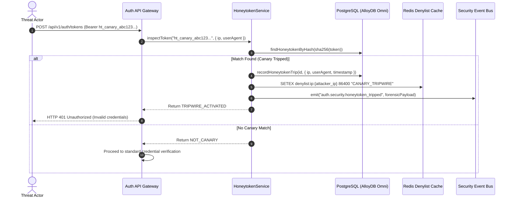

# ADR 0041: Honeytokens & Active Canary Secret Scanning (Deception Technology)

- **Status**: Accepted
- **Date**: 2026-10-16
- **Author**: Platform Architecture & Security Team
- **Area**: Deception Technology, Canary Tripwires, Automated Threat Response, SIEM Telemetry
- **Standards**: [NIST SP 800-160 Vol. 2 (Developing Cyber-Resilient Systems)](https://csrc.nist.gov/pubs/sp/800/160/v2/r1/final), [MITRE ATT&CK® Deception (DS0029)](https://attack.mitre.org/datasources/DS0029/), [RFC 6749 (OAuth 2.0)](https://datatracker.ietf.org/doc/html/rfc6749)

---

## 📑 Table of Contents

1. [Context, Threat Modeling & Business Drivers](#-1-context-threat-modeling--business-drivers)
2. [Architectural Decision & Honeytoken Lifecycle](#-2-architectural-decision--honeytoken-lifecycle)
3. [Configuration & Environment Specification](#-3-configuration--environment-specification)
4. [Database Schema Specification (Migration 0034)](#-4-database-schema-specification-migration-0034)
5. [Hexagonal Architecture & Service Contracts](#-5-hexagonal-architecture--service-contracts)
6. [Tripwire Detection, Forensics & Automated Defense Workflow](#-6-tripwire-detection-forensics--automated-defense-workflow)
7. [REST API Contracts & Response Envelopes](#-7-rest-api-contracts--response-envelopes)
8. [OpenTelemetry Tracing & Incident Security Metrics](#-8-opentelemetry-tracing--incident-security-metrics)

---

## 🎯 1. Context, Threat Modeling & Business Drivers

### 1.1 Threat Landscape: Credential Leaks in the Wild
Threat actors continuously harvest credentials from:
- Public GitHub/GitLab repositories accidentally committing `.env` files or API test fixtures.
- Compromised developer workstations and staging shell histories (`~/.bash_history`, `~/.zshrc`).
- Decommissioned CI/CD runner build logs and debug artifacts.
- Discarded database dumps and staging backups.

### 1.2 The Deception Security Posture
Passive security controls (rate limiting, WAFs) only react once an adversary attacks known valid infrastructure. **Honeytokens** provide proactive deception:
- Decoy API keys and bearer tokens (`ht_canary_...`) seeded deliberately across canary locations (e.g. `.env.example`, documentation, developer scratchpads).
- Legitimate users and workloads **never** touch honeytokens.
- Any presentation of a honeytoken to the auth gateway constitutes definitive proof of adversarial activity (0% false positive rate).

---

## ⚙️ 2. Architectural Decision & Honeytoken Lifecycle

### 2.1 Principle of Silent Tripping
When a tripwire is activated, the auth gateway:
1. **Never leaks that a canary was tripped**: Returning `403 Honeytoken Detected` immediately tips off the attacker that their harvested secret is burned.
2. **Returns standard error response**: Responds with standard `401 Unauthorized` (`INVALID_CREDENTIALS`).
3. **Executes Asynchronous Security Defense**:
   - Records forensic metadata (IP address, User-Agent, request path, HTTP method, timestamp).
   - Increments `tripwire_count` and updates `status = 'TRIPPED'`.
   - Automatically blacklists caller IP in Redis (`denylist:ip:{ip}`) with emergency TTL (e.g. 24 hours).
   - Emits a high-severity security event to Kafka (`auth.security.honeytoken_tripped`).

---

## 🔧 3. Configuration & Environment Specification

The Honeytoken engine is configured through environment variables:

```bash
# Enable or disable the Honeytoken deception subsystem (default: true)
AUTH_HONEYTOKEN_ENABLED=true

# Canonical prefix used to generate and identify canary secrets
AUTH_HONEYTOKEN_PREFIX=ht_canary_

# Automatically blacklist the source IP of any tripped honeytoken in Redis
AUTH_HONEYTOKEN_AUTO_BLOCK_IP=true

# Duration (in seconds) to ban offending IPs in Redis (default: 86400 / 24 hours)
AUTH_HONEYTOKEN_BLOCK_TTL_SECONDS=86400

# Optional Kafka security topic for canary incident publishing
AUTH_HONEYTOKEN_KAFKA_TOPIC=auth.security.honeytoken_tripped
```

### Docker & Deployment Configuration
In production containers (`Dockerfile`), the variables are set via environment blocks:
```dockerfile
ENV AUTH_HONEYTOKEN_ENABLED=true
ENV AUTH_HONEYTOKEN_PREFIX=ht_canary_
ENV AUTH_HONEYTOKEN_AUTO_BLOCK_IP=true
ENV AUTH_HONEYTOKEN_BLOCK_TTL_SECONDS=86400
```

---

## 🗄️ 4. Database Schema Specification (Migration 0034)

```sql
CREATE TABLE IF NOT EXISTS auth_honeytokens (
    id VARCHAR(64) PRIMARY KEY,
    token_hash VARCHAR(255) NOT NULL UNIQUE,
    token_prefix VARCHAR(32) NOT NULL DEFAULT 'ht_canary_',
    name VARCHAR(255) NOT NULL,
    org_id VARCHAR(64) NOT NULL REFERENCES auth_organizations(id) ON DELETE CASCADE,
    deployed_location VARCHAR(255) NULL,
    tripwire_count INT NOT NULL DEFAULT 0,
    last_tripped_at_ms BIGINT NULL,
    last_tripped_ip VARCHAR(64) NULL,
    last_tripped_user_agent VARCHAR(512) NULL,
    status VARCHAR(32) NOT NULL DEFAULT 'ACTIVE',
    created_at_ms BIGINT NOT NULL,
    created_at TIMESTAMPTZ NOT NULL DEFAULT CURRENT_TIMESTAMP,
    updated_at TIMESTAMPTZ NOT NULL DEFAULT CURRENT_TIMESTAMP,
    deleted_at TIMESTAMPTZ NULL,

    CONSTRAINT auth_honeytokens_status_ck CHECK (status IN ('ACTIVE', 'TRIPPED', 'REVOKED'))
);

CREATE INDEX IF NOT EXISTS idx_auth_honeytokens_lookup 
    ON auth_honeytokens(token_hash) WHERE deleted_at IS NULL;

CREATE INDEX IF NOT EXISTS idx_auth_honeytokens_org 
    ON auth_honeytokens(org_id, status) WHERE deleted_at IS NULL;
```

---

## 🔌 5. Hexagonal Architecture & Service Contracts

### 5.1 Repository Port Interface (`HoneytokenRepositoryPort`)
```typescript
export interface HoneytokenRecord {
  id: string;
  token_hash: string;
  token_prefix: string;
  name: string;
  org_id: string;
  deployed_location?: string | null;
  tripwire_count: number;
  last_tripped_at_ms?: number | null;
  last_tripped_ip?: string | null;
  last_tripped_user_agent?: string | null;
  status: 'ACTIVE' | 'TRIPPED' | 'REVOKED';
  created_at_ms: number;
}

export interface HoneytokenRepositoryPort {
  saveHoneytoken(record: HoneytokenRecord): Promise<void>;
  findHoneytokenByHash(hash: string): Promise<HoneytokenRecord | null>;
  recordHoneytokenTrip(id: string, metadata: { ip: string; userAgent: string; timestampMs: number }): Promise<void>;
  listHoneytokensByOrg(orgId: string): Promise<ReadonlyArray<HoneytokenRecord>>;
  revokeHoneytoken(id: string, orgId: string): Promise<void>;
}
```

---

## 🛡️ 6. Tripwire Detection, Forensics & Automated Defense Workflow



---

## 📡 7. REST API Contracts & Response Envelopes

### 7.1 Create Honeytoken (`POST /api/v1/auth/honeytokens`)
- **Headers**: `Authorization: Bearer <ADMIN_JWT>`
- **Request Body**:
```json
{
  "name": "CI Runner GitHub Actions Leak Trap",
  "deployed_location": "repo:llm-obs-node-packages/.env.example"
}
```
- **Response `201 Created`**:
```json
{
  "success": true,
  "data": {
    "id": "ht_99182312",
    "name": "CI Runner GitHub Actions Leak Trap",
    "token": "ht_canary_39fba243019842aef91209bca3",
    "prefix": "ht_canary_",
    "status": "ACTIVE",
    "created_at_ms": 1729083400000
  }
}
```

### 7.2 List Honeytokens (`GET /api/v1/auth/honeytokens`)
- **Response `200 OK`**:
```json
{
  "success": true,
  "data": [
    {
      "id": "ht_99182312",
      "name": "CI Runner GitHub Actions Leak Trap",
      "deployed_location": "repo:llm-obs-node-packages/.env.example",
      "tripwire_count": 1,
      "last_tripped_at_ms": 1729083500000,
      "last_tripped_ip": "198.51.100.42",
      "status": "TRIPPED"
    }
  ]
}
```

---

## 📈 8. OpenTelemetry Tracing & Incident Security Metrics

- **Span Name**: `HoneytokenService.inspectToken`
- **Span Attributes**:
  - `security.canary.tripped`: `true`
  - `security.canary.token_id`: `ht_99182312`
  - `security.attacker.ip`: `198.51.100.42`
  - `security.attacker.user_agent`: `curl/7.88.1`
- **Prometheus Metrics**:
  - `auth_honeytoken_trips_total{org_id="...", status="TRIPPED"}` (Counter)
  - `auth_honeytoken_active_gauge{org_id="..."}` (Gauge)
