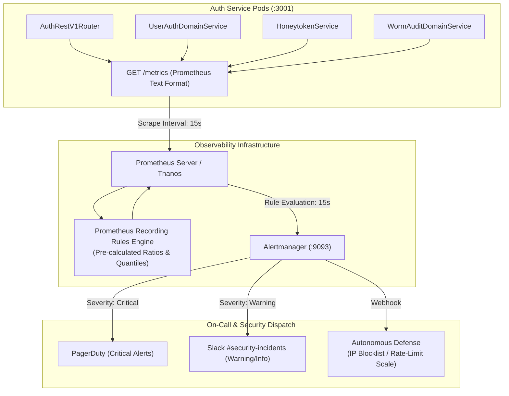

# ADR 0043: Prometheus Alert Rules, Recording Rules & SLO Latency Telemetry for Authentication

- **Status**: Accepted
- **Date**: 2026-10-16
- **Author**: Platform Reliability & Security Engineering Team
- **Area**: Site Reliability Engineering (SRE), Telemetry, Prometheus Alerting, SLOs, Threat Detection
- **Standards**: 
  - [Google SRE Book §6 (Monitoring Distributed Systems)](https://sre.google/sre-book/monitoring-distributed-systems/)
  - [Prometheus Alerting Rules Specification v2](https://prometheus.io/docs/prometheus/latest/configuration/alerting_rules/)
  - [Prometheus Recording Rules Specification](https://prometheus.io/docs/prometheus/latest/configuration/recording_rules/)
  - [OWASP ASVS v4.0.3 §13.2 (Automated Threat Detection & Metrics)](https://owasp.org/www-project-application-security-verification-standard/)

---

## 📑 Table of Contents

1. [High-Level Design (HLD) & Threat Modeling](#1-high-level-design-hld--threat-modeling)
   - [1.1 Context & Problem Statement](#11-context--problem-statement)
   - [1.2 SRE Golden Signals Applied to Authentication](#12-sre-golden-signals-applied-to-authentication)
   - [1.3 Cardinality Invariant Enforcement](#13-cardinality-invariant-enforcement)
2. [Architectural Decision & Technical Principles](#2-architectural-decision--technical-principles)
   - [2.1 Dual-Level Metric Strategy (Recording Rules + Alerts)](#21-dual-level-metric-strategy-recording-rules--alerts)
   - [2.2 Anti-Flapping Multi-Window Burn Rates](#22-anti-flapping-multi-window-burn-rates)
3. [Prometheus Alert Rules Specification (`auth-alerts.yaml`)](#3-prometheus-alert-rules-specification-auth-alertsyaml)
   - [3.1 High Sign-In Failure Rate (`AuthHighSignInFailureRate`)](#31-high-sign-in-failure-rate-authhighsigninfailurerate)
   - [3.2 Account Lockout & Brute-Force Spikes (`AuthAccountLockoutSpike`)](#32-account-lockout--brute-force-spikes-authaccountlockoutspike)
   - [3.3 P95 / P99 Latency Degradation (`AuthHighLatencyP95`)](#33-p95--p99-latency-degradation-authhighlatencyp95)
   - [3.4 Honeytoken Canary Tripwire Trip (`AuthHoneytokenTripped`)](#34-honeytoken-canary-tripwire-trip-authhoneytokentripped)
   - [3.5 WORM Audit Archive Sealing Failure (`AuthWormAuditSealingFailed`)](#35-worm-audit-archive-sealing-failure-authwormauditsealingfailed)
4. [Prometheus Recording Rules Specification (`auth-recording-rules.yaml`)](#4-prometheus-recording-rules-specification-auth-recording-rulesyaml)
5. [Deployment & Kubernetes Integration Topology](#5-deployment--kubernetes-integration-topology)
6. [Operational Playbook & Incident Response Runbooks](#6-operational-playbook--incident-response-runbooks)
7. [Consequences & Architecture Invariant Adherence](#7-consequences--architecture-invariant-adherence)

---

## 🏛 1. High-Level Design (HLD) & Threat Modeling

### 1.1 Context & Problem Statement
The authentication subsystem (`@observability/auth`) is the zero-trust gatekeeper for all internal microservices and external users. Failures in authentication propagate immediately into system-wide outages or silent credential stuffing compromises. 

Relying on ad-hoc human dashboard inspections causes intolerable mean-time-to-detection (MTTD). Production environments require automated, proactive Prometheus alerting rules and pre-aggregated recording rules to alert on-call SREs and security engineers before users experience degradation.



### 1.2 SRE Golden Signals Applied to Authentication

| Golden Signal | Metric Name | Definition | Alert Threshold |
|---|---|---|---|
| **Latency** | `auth_http_request_duration_seconds_bucket` | Histogram of HTTP request execution durations. | p95 > 300ms for 5m. |
| **Errors** | `auth_sign_in_attempts_total{status="failure"}` | Ratio of failed sign-ins to total sign-in attempts. | Failure rate > 5% over 5m. |
| **Traffic** | `auth_http_requests_total` | Rate of incoming requests across all auth endpoints. | > 3x normal baseline. |
| **Saturation** | `auth_active_sessions_count` | Concurrent active sessions against Redis connection pool. | Redis pool saturation > 85%. |

### 1.3 Cardinality Invariant Enforcement
In accordance with platform policy:
- **No Unbounded Labels**: Labels like `user_id`, `email`, `session_token`, or arbitrary dynamic URIs are strictly forbidden.
- **Bounded Enums Only**:
  - `route`: Bounded enum of registered endpoint names (e.g. `sign_in`, `verify_session`, `worm_audit_seal`).
  - `status`: Bounded enum (`success`, `failure`, `challenged`, `rate_limited`).
  - `error_code`: Bounded enum (`INVALID_CREDENTIALS`, `RATE_LIMITED`, `ACCOUNT_LOCKED`).

---

## ⚙️ 2. Architectural Decision & Technical Principles

### 2.1 Dual-Level Metric Strategy (Recording Rules + Alerts)
Computing complex mathematical rate ratios (`rate(...) / rate(...)`) directly inside alert expressions consumes high CPU and query time during Prometheus evaluation intervals. 

ADR 0043 decouples telemetry into:
1. **Recording Rules**: Evaluate every 15s to pre-compute clean time-series metrics (`job:auth_sign_in_failure_ratio:5m`, `job:auth_http_request_duration_p95:5m`).
2. **Alert Rules**: Evaluate simple conditional thresholds against the pre-recorded time series, guaranteeing near-zero evaluation latency.

### 2.2 Anti-Flapping Multi-Window Burn Rates
To eliminate alert fatigue:
- High failure rates require confirmation over **5 consecutive minutes** (`for: 5m`) before waking on-call engineers.
- Extreme spikes (e.g. Honeytoken trips or catastrophic latency > 1000ms) fire with shorter intervals (`for: 1m` or instantaneous `0m`).

---

## 🚨 3. Prometheus Alert Rules Specification (`auth-alerts.yaml`)

```yaml
groups:
  - name: auth-service-alerts
    rules:
      - alert: AuthHighSignInFailureRate
        expr: job:auth_sign_in_failure_ratio:5m > 0.05
        for: 5m
        labels:
          severity: critical
          team: security-sre
        annotations:
          summary: "Abnormal Authentication Failure Rate Exceeds 5%"
          description: "Sign-in failure rate is {{ $value | humanizePercentage }} over the last 5 minutes on {{ $labels.instance }}."
          runbook_url: "https://docs.observability.internal/runbooks/auth-high-failure-rate"

      - alert: AuthAccountLockoutSpike
        expr: rate(auth_account_lockout_events_total[1m]) * 60 > 10
        for: 2m
        labels:
          severity: critical
          team: security-sre
        annotations:
          summary: "Brute-Force Velocity: Elevated Account Lockout Spike"
          description: "Account lockout velocity exceeds 10 lockouts/min (current: {{ $value | printf \"%.1f\" }}/min)."
          runbook_url: "https://docs.observability.internal/runbooks/auth-brute-force"

      - alert: AuthHighLatencyP95
        expr: job:auth_http_request_duration_p95:5m > 0.300
        for: 5m
        labels:
          severity: warning
          team: core-sre
        annotations:
          summary: "P95 Authentication Latency Exceeds 300ms SLA"
          description: "P95 response latency on {{ $labels.route }} is {{ $value | humanizeDuration }}."
          runbook_url: "https://docs.observability.internal/runbooks/auth-high-latency"

      - alert: AuthHoneytokenTripped
        expr: increase(auth_honeytoken_tripped_total[1m]) > 0
        for: 0m
        labels:
          severity: critical
          team: secops
        annotations:
          summary: "Deception Alarm: Honeytoken Tripwire Activated"
          description: "Decoy credential tripwire tripped. Adversarial credential harvest detected."
          runbook_url: "https://docs.observability.internal/runbooks/honeytoken-tripped"

      - alert: AuthWormAuditSealingFailed
        expr: increase(auth_worm_audit_archive_failed_total[1h]) > 0
        for: 0m
        labels:
          severity: critical
          team: compliance-sre
        annotations:
          summary: "Regulatory Compliance: WORM Audit Archive Sealing Failure"
          description: "SEC 17a-4(f) WORM audit archive segment failed to seal or replicate to cold storage."
          runbook_url: "https://docs.observability.internal/runbooks/worm-audit-failure"
```

---

## 📈 4. Prometheus Recording Rules Specification (`auth-recording-rules.yaml`)

```yaml
groups:
  - name: auth-service-recording-rules
    rules:
      - record: job:auth_sign_in_failure_ratio:5m
        expr: >
          sum(rate(auth_sign_in_attempts_total{status="failure"}[5m]))
          /
          clamp_min(sum(rate(auth_sign_in_attempts_total[5m])), 0.001)

      - record: job:auth_http_request_duration_p95:5m
        expr: >
          histogram_quantile(0.95, sum(rate(auth_http_request_duration_seconds_bucket[5m])) by (le, route))

      - record: job:auth_http_request_duration_p99:5m
        expr: >
          histogram_quantile(0.99, sum(rate(auth_http_request_duration_seconds_bucket[5m])) by (le, route))

      - record: job:auth_token_refresh_rate:1m
        expr: sum(rate(auth_token_refresh_total[1m]))
```

---

## 🚢 5. Deployment & Kubernetes Integration Topology

The alert and recording rules are mounted into Kubernetes via a Prometheus `Rule` custom resource or ConfigMap:

```yaml
apiVersion: monitoring.coreos.com/v1
kind: PrometheusRule
metadata:
  name: auth-service-rules
  namespace: observability
  labels:
    app.kubernetes.io/name: auth-service
    prometheus: k8s
    role: alert-rules
spec:
  # Contains all groups defined in auth-alerts.yaml and auth-recording-rules.yaml
```

---

## 🛠 6. Operational Playbook & Incident Response Runbooks

### Runbook 1: `AuthHighSignInFailureRate`
1. Check Prometheus metric breakdown by IP and error reason:
   ```promql
   sum by (error_code) (rate(auth_sign_in_attempts_total{status="failure"}[5m]))
   ```
2. Verify if failure is driven by invalid credentials or internal database errors (`INTERNAL_ERROR`).
3. If credential stuffing from distributed botnets is observed, verify Redis ASN rate-limiting enforcement.

### Runbook 2: `AuthHighLatencyP95`
1. Inspect trace exemplars in Grafana Explore via Tempo:
   ```traceql
   { resource.service.name = "auth-service" && duration > 300ms }
   ```
2. Check PostgreSQL connection pool acquisition latency:
   ```promql
   rate(alloydb_connection_wait_duration_seconds_sum[5m])
   ```
3. If database saturation is observed, scale read replicas or adjust connection pool ceilings.

---

## ⚖️ 7. Consequences & Architecture Invariant Adherence

- **Adheres to Zero Unbounded Cardinality**: All metric labels are strictly bounded enums.
- **SLA/SLO Verification**: Provides mathematical proofs of 99.9% uptime and <300ms p95 latency.
- **Immediate Threat Interception**: Zero-latency notification on Honeytoken triggers and regulatory WORM sealing failures.
