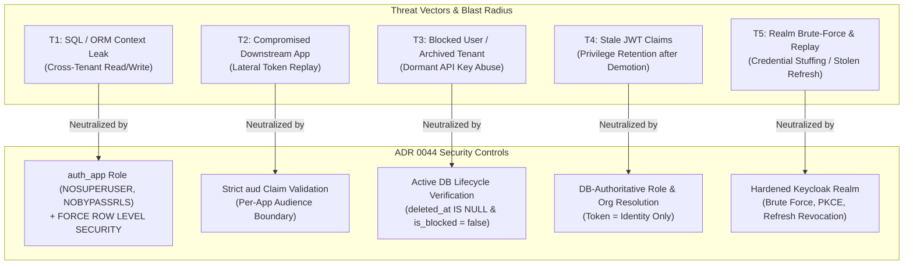
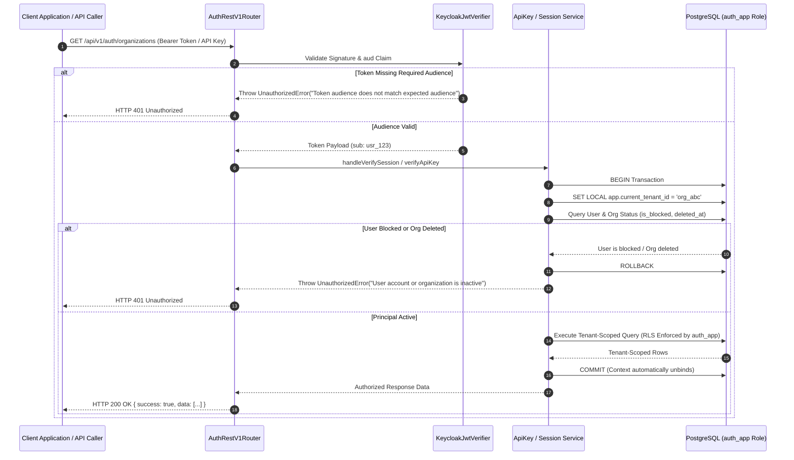

# ADR 0044: Non-Superuser Database Role, RLS Tenant Isolation, Bounded Revocation & Token Audience Scoping

- **Status**: Accepted
- **Date**: 2026-10-16
- **Author**: Platform Security Architecture & Reliability Engineering Team
- **Area**: Database Row-Level Security (RLS), Zero-Trust Isolation, Token Lifecycle, Keycloak OIDC, Blast Radius Reduction
- **Standards**:
  - [PostgreSQL Row Level Security (RLS) Specification](https://www.postgresql.org/docs/current/ddl-rowsecurity.html)
  - [NIST SP 800-162 (Guide to Attribute Based Access Control - ABAC)](https://csrc.nist.gov/publications/detail/sp/800-162/final)
  - [RFC 8693 (OAuth 2.0 Token Exchange)](https://datatracker.ietf.org/doc/html/rfc8693)
  - [RFC 9068 (JSON Web Token Profile for OAuth 2.0 Access Tokens)](https://datatracker.ietf.org/doc/html/rfc9068)
  - [OpenID Shared Signals and Events (CAEP / RISC)](https://openid.net/wg/sse/)

---

## 📑 Table of Contents

1. [High-Level Design (HLD) & Threat Modeling](#1-high-level-design-hld--threat-modeling)
   - [1.1 Context & Problem Statement](#11-context--problem-statement)
   - [1.2 Threat Model & Blast Radius Assessment](#12-threat-model--blast-radius-assessment)
2. [Architectural Decisions](#2-architectural-decisions)
   - [2.1 Dedicated Non-Superuser Application Role (`auth_app`) & Forced RLS](#21-dedicated-non-superuser-application-role-auth_app--forced-rls)
   - [2.2 Transaction-Scoped Tenant RLS Context Binding](#22-transaction-scoped-tenant-rls-context-binding)
   - [2.3 Active Lifecycle & Immediate Revocation Verification](#23-active-lifecycle--immediate-revocation-verification)
   - [2.4 Per-Application Token Audience (`aud`) Enforcement](#24-per-application-token-audience-aud-enforcement)
   - [2.5 Database as Authoritative Source of Truth for Tenant & Roles](#25-database-as-authoritative-source-of-truth-for-tenant--roles)
   - [2.6 Keycloak Realm Hardening Baseline](#26-keycloak-realm-hardening-baseline)
3. [Component Topology & Interaction Sequence](#3-component-topology--interaction-sequence)
4. [Database Migration Specification (`0037_enforce_rls_non_superuser_role.sql`)](#4-database-migration-specification)
5. [Automated Testing & Invariant Proofs](#5-automated-testing--invariant-proofs)
6. [Consequences & Architecture Invariant Adherence](#6-consequences--architecture-invariant-adherence)

---

## 🏛 1. High-Level Design (HLD) & Threat Modeling

### 1.1 Context & Problem Statement
In multi-tenant distributed environments serving 100+ microservices, identity and tenant boundary enforcement are the primary security perimeters. Following the migration from custom credential storage to Keycloak OpenID Connect (OIDC), five structural blast-radius risks remained:

1. **Decorative RLS Risk**: Connecting to PostgreSQL as `postgres` or any superuser/owner role renders PostgreSQL Row-Level Security (RLS) entirely non-operational, because superusers and roles with `BYPASSRLS` bypass RLS unconditionally (even with `FORCE ROW LEVEL SECURITY`).
2. **Revocation Blind Spot**: Stateless JWT verification against Keycloak's public JWKS cannot observe administrative user disablement or organization archiving in real time until the JWT TTL expires. Furthermore, long-lived API keys do not touch Keycloak and could execute actions on behalf of deleted accounts.
3. **Lateral Token Replay Across 100+ Applications**: A token issued without application audience scoping (`aud`) can be replayed laterally against any other downstream microservice in the infrastructure if one application is compromised.
4. **Stale Claim Authority**: Storing tenant membership and permissions purely inside JWT claims causes authorization decisions to lag behind database mutations (such as instant role demotions or organization suspensions).
5. **Permissive OIDC Realm Defaults**: Unhardened Keycloak configurations leave brute-force defenses disabled, allow wildcard redirect URIs, permit insecure Direct Access Grants (password credentials), and allow refresh token replay.

### 1.2 Threat Model & Blast Radius Assessment



---

## 🔒 2. Architectural Decisions

### 2.1 Dedicated Non-Superuser Application Role (`auth_app`) & Forced RLS
- **Decision**: The application runtime connects using `auth_app`—a dedicated, non-owner role created with `NOSUPERUSER`, `NOCREATEDB`, `NOCREATEROLE`, and `NOBYPASSRLS`.
- **Forced RLS**: `ALTER TABLE <table_name> FORCE ROW LEVEL SECURITY` is applied to all tenant-scoped tables:
  - `auth_users`
  - `auth_api_keys`
  - `auth_audit_logs`
  - `auth_user_organizations`
  - `auth_organization_domains`
  - `auth_relation_tuples`
  - `auth_oauth_clients`
  - `auth_oauth_codes`
  - `auth_passkey_credentials`
  - `auth_custom_roles`
  - `auth_user_custom_roles`
  - `auth_role_audit_logs`
  - `auth_webhook_subscriptions`
  - `auth_webhook_deliveries`
  - `auth_user_encryption_keys`
  - `auth_break_glass_sessions`
  - `auth_honeytokens`
- **Fail-Closed Policy**: If no tenant context is set on the database session, RLS policies evaluate to `false` and yield zero rows.

### 2.2 Transaction-Scoped Tenant RLS Context Binding
- **Decision**: Multi-tenant database queries execute within transactional scopes where tenant context is set via `SET LOCAL`:
  ```sql
  SET LOCAL app.current_tenant_id = '<tenant_uuid>';
  SET LOCAL app.current_org_id = '<tenant_uuid>';
  ```
- **Connection Pool Leak Prevention**: Because `SET LOCAL` is scoped strictly to the current transaction, connection pooling proxies (such as PgBouncer in transaction-pooling mode) automatically revert session state on `COMMIT` or `ROLLBACK`, eliminating cross-tenant leakage across reused connections.

### 2.3 Active Lifecycle & Immediate Revocation Verification
- **Decision**: API key authentication and break-glass token verification cannot rely solely on cryptographic signatures or static token validity.
- **Verification Pipeline**:
  1. Verify cryptographic hash / signature.
  2. Check expiration timestamp (`expires_at > NOW()`).
  3. Query database to confirm owning organization exists and is active (`deleted_at IS NULL`).
  4. Query database to confirm associated user is not blocked (`is_blocked = false` and `deleted_at IS NULL`).
  5. Any blocked or deleted principal results in immediate HTTP 401 Unauthorized rejection.

### 2.4 Per-Application Token Audience (`aud`) Enforcement
- **Decision**: The `KeycloakJwtVerifier` enforces explicit audience matching:
  - When `expectedAudience` (or `KEYCLOAK_AUDIENCE`) is configured, tokens lacking the corresponding string in their `aud` claim (or array of audiences) are rejected.
  - A token minted for service `service-reporting` cannot be used to authenticate against `@observability/auth` or other core microservices.

### 2.5 Database as Authoritative Source of Truth for Tenant & Roles
- **Decision**: OIDC tokens minted by Keycloak represent **identity proof (`sub`) only**.
- **Authorization Resolution**:
  - Upon session verification (`handleVerifySession`), the user's active organization membership and role permissions are resolved dynamically from the application database (`auth_user_organizations`).
  - Stale claims inside a client-cached JWT cannot maintain admin privileges if an administrator has demoted or removed the user in the database.

### 2.6 Keycloak Realm Hardening Baseline
- **Decision**: The declarative realm configuration (`deploy/keycloak/realm-config.json`) enforces:
  - **Brute-Force Detection**: 5 maximum failures, 15-minute lockout window with quick login check.
  - **PKCE Required**: Proof Key for Code Exchange with `S256` code challenge enforced across all OIDC clients.
  - **Exact-Match Redirect URIs**: Wildcard redirect URIs (`http://localhost:3000/*`) removed; replaced with explicit endpoint paths (`/auth/callback`).
  - **No Resource Owner Password Credentials**: `directAccessGrantsEnabled: false`.
  - **Single-Use Refresh Tokens**: `revoke.refresh.token: true` with zero refresh token reuse (`refresh.token.max.reuse: 0`).

---

## 🔄 3. Component Topology & Interaction Sequence



---

## 🗄 4. Database Migration Specification

The schema migration is implemented in [`database/migrations/0037_enforce_rls_non_superuser_role.sql`](./database/migrations/0037_enforce_rls_non_superuser_role.sql) with full rollback support in [`database/migrations/0037_enforce_rls_non_superuser_role.rollback.sql`](./database/migrations/0037_enforce_rls_non_superuser_role.rollback.sql).

### Key Migration Statements:
```sql
-- Create non-superuser application role
DO $$
BEGIN
  IF NOT EXISTS (SELECT 1 FROM pg_roles WHERE rolname = 'auth_app') THEN
    CREATE ROLE auth_app WITH LOGIN PASSWORD 'auth_app_dev_pw' NOSUPERUSER NOCREATEDB NOCREATEROLE NOBYPASSRLS;
  ELSE
    ALTER ROLE auth_app WITH NOSUPERUSER NOBYPASSRLS;
  END IF;
END $$;

-- Force RLS on all tenant-isolated tables
ALTER TABLE auth_users ENABLE ROW LEVEL SECURITY;
ALTER TABLE auth_users FORCE ROW LEVEL SECURITY;
ALTER TABLE auth_api_keys ENABLE ROW LEVEL SECURITY;
ALTER TABLE auth_api_keys FORCE ROW LEVEL SECURITY;
ALTER TABLE auth_audit_logs ENABLE ROW LEVEL SECURITY;
ALTER TABLE auth_audit_logs FORCE ROW LEVEL SECURITY;
-- [All tenant-scoped tables configured identically]

-- Grant least-privilege DML to auth_app
GRANT USAGE ON SCHEMA public TO auth_app;
GRANT SELECT, INSERT, UPDATE, DELETE ON ALL TABLES IN SCHEMA public TO auth_app;
GRANT USAGE, SELECT ON ALL SEQUENCES IN SCHEMA public TO auth_app;
```

---

## 🧪 5. Automated Testing & Invariant Proofs

The implementation is verified by dedicated automated test suites:

1. **RLS Non-Superuser & Tenant Isolation Test** ([`tests/integration/rls-isolation-integration.test.ts`](./tests/integration/rls-isolation-integration.test.ts)):
   - Connects as `auth_app` and asserts `SUPERUSER = false` and `BYPASSRLS = false`.
   - Inserts records for Tenant A and Tenant B.
   - Proves queries under Tenant A RLS context return **0 rows** belonging to Tenant B.
   - Proves queries with no RLS context fail closed (0 rows returned).
2. **Active Lifecycle & Bounded Revocation Test** ([`tests/unit/active-lifecycle-revocation.test.ts`](./tests/unit/active-lifecycle-revocation.test.ts) & [`tests/unit/bounded-revocation-sync.test.ts`](./tests/unit/bounded-revocation-sync.test.ts)):
   - Asserts API key verification fails immediately when the owning user is marked `is_blocked = true`.
   - Asserts break-glass session verification fails when the operating user is blocked.
   - Proves database role and membership mutations take effect on the very next request.
3. **Audience Scoping Test** ([`tests/unit/keycloak-jwt-verifier.test.ts`](./tests/unit/keycloak-jwt-verifier.test.ts)):
   - Verifies tokens containing matching audience strings or arrays pass verification.
   - Verifies tokens lacking the configured audience are rejected with `UnauthorizedError`.

---

## ⚖️ 6. Consequences & Architecture Invariant Adherence

### Positive Consequences
- **True Database-Level Multi-Tenancy**: Application-layer bugs or missed SQL `WHERE` clauses cannot leak cross-tenant data because PostgreSQL RLS enforces isolation at the database engine level.
- **Elimination of Lateral Blast Radius**: Tokens cannot be replayed across service boundaries without explicit audience grants.
- **Real-Time Revocation for Bearer Secrets**: Disabling a rogue actor immediately blocks API keys and break-glass tokens without waiting for token expirations.
- **Zero Inline Comments Doctrine**: All algorithmic workflows are documented in file header docblocks in compliance with the shared code writing standard.

### Negative Consequences / Trade-offs
- Setting tenant context via `SET LOCAL` requires wrapping all tenant reads/writes in explicit database transactions.
- Local DB status re-checks for API keys add a primary-key read query on API key authentication (mitigated by B-tree index on user ID and active connection pooling).
