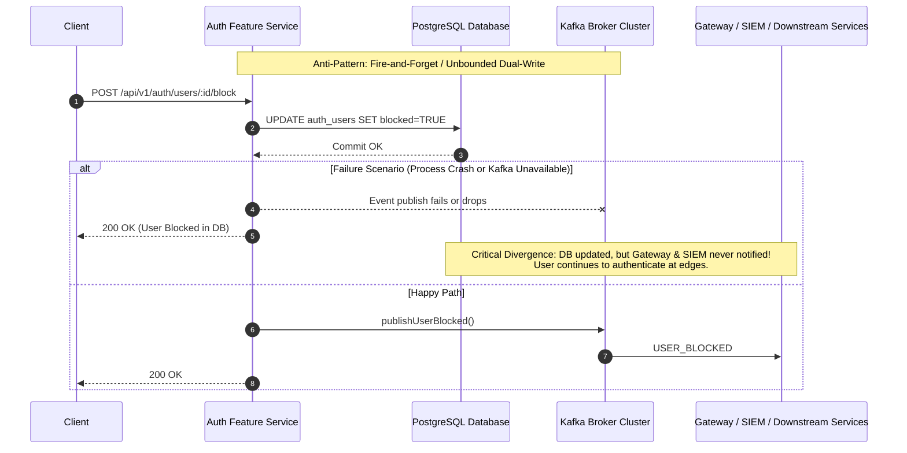
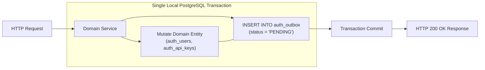
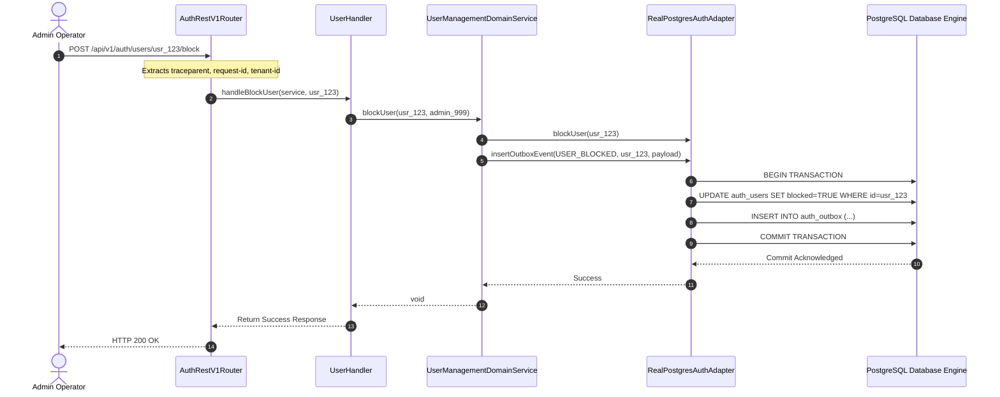
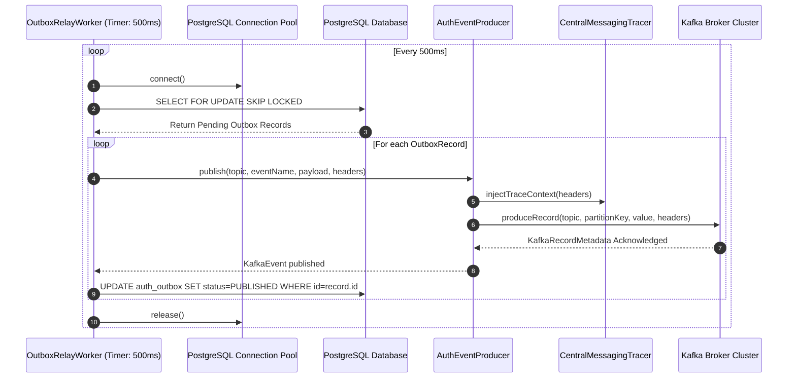
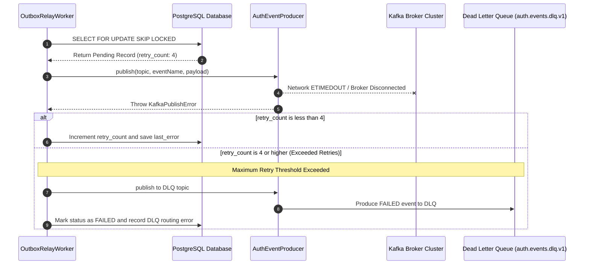
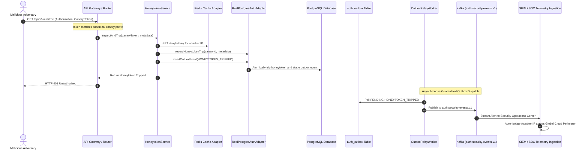
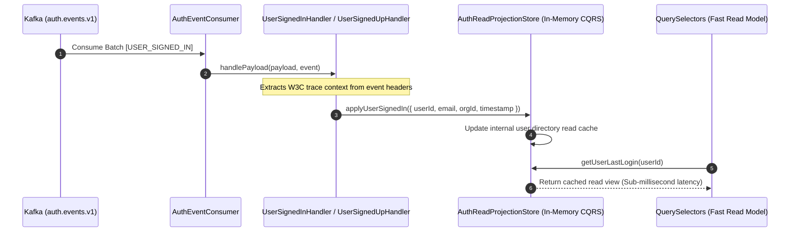

# ADR 0045: Transactional Outbox Pattern, Event Catalog & Reliable Kafka Messaging Pipeline

- **Status**: Accepted
- **Date**: 2026-10-16
- **Author**: Platform Architecture & Distributed Systems Reliability Team
- **Area**: Event-Driven Architecture, Reliable Messaging, Transactional Outbox Pattern, Kafka Event Catalog, W3C Trace Context
- **Standards**:
  - [Transactional Outbox Pattern (Microservices.io)](https://microservices.io/patterns/data/transactional-outbox.html)
  - [W3C Recommendation: Trace Context Level 2](https://www.w3.org/TR/trace-context/)
  - [RFC 8693 / CloudEvents Specification v1.0.2](https://cloudevents.io/)
  - [Kafka Producer Guaranteed At-Least-Once Delivery](https://kafka.apache.org/documentation/#producerconfigs)
  - [PostgreSQL Explicit Locking & Row-Level Concurrency (`FOR UPDATE SKIP LOCKED`)](https://www.postgresql.org/docs/current/explicit-locking.html)

---

## 📑 Table of Contents

1. [High-Level Design (HLD) & Dual-Write Problem Statement](#1-high-level-design-hld--dual-write-problem-statement)
   - [1.1 Context & Architecture Overview](#11-context--architecture-overview)
   - [1.2 The Dual-Write Anti-Pattern & Data Divergence](#12-the-dual-write-anti-pattern--data-divergence)
   - [1.3 Audit vs. Kafka Event Discrepancy](#13-audit-vs-kafka-event-discrepancy)
   - [1.4 Invariant & Architectural Requirements](#14-invariant--architectural-requirements)
2. [Architectural Decisions & Technical Principles](#2-architectural-decisions--technical-principles)
   - [2.1 Transactional Outbox Persistence (`auth_outbox`)](#21-transactional-outbox-persistence-auth_outbox)
   - [2.2 Complete 18+ Event Catalog & Partitioning Strategy](#22-complete-18-event-catalog--partitioning-strategy)
   - [2.3 High-Throughput Autonomous Relay Worker (`SELECT ... FOR UPDATE SKIP LOCKED`)](#23-high-throughput-autonomous-relay-worker-select--for-update-skip-locked)
   - [2.4 End-to-End W3C Distributed Trace Context Propagation](#24-end-to-end-w3c-distributed-trace-context-propagation)
   - [2.5 Failure Modes, Backoff Retries & Dead Letter Queue (DLQ) Semantics](#25-failure-modes-backoff-retries--dead-letter-queue-dlq-semantics)
3. [Hexagonal Architecture & Layer Boundaries](#3-hexagonal-architecture--layer-boundaries)
   - [3.1 Ports & Adapters Isolation (`src/shared/` vs. `src/infra/`)](#31-ports--adapters-isolation-srcshared-vs-srcinfra)
   - [3.2 Zero Inline Comments & Strict Config Isolation](#32-zero-inline-comments--strict-config-isolation)
4. [Detailed End-to-End Execution Flows](#4-detailed-end-to-end-execution-flows)
   - [4.1 Flow 1: Atomic Outbox Event Staging During Domain Mutation](#41-flow-1-atomic-outbox-event-staging-during-domain-mutation)
   - [4.2 Flow 2: Autonomous Outbox Relay Worker Polling & Publishing](#42-flow-2-autonomous-outbox-relay-worker-polling--publishing)
   - [4.3 Flow 3: Transient Failure, Exponential Backoff & DLQ Eviction](#43-flow-3-transient-failure-exponential-backoff--dlq-eviction)
   - [4.4 Flow 4: Security Tripwire Interception & SOC Fan-Out (Honeytoken / Break-Glass)](#44-flow-4-security-tripwire-interception--soc-fan-out-honeytoken--break-glass)
   - [4.5 Flow 5: Downstream Consumer CQRS Read Model Materialization](#45-flow-5-downstream-consumer-cqrs-read-model-materialization)
5. [Database Schema & Migration Specification](#5-database-schema--migration-specification)
   - [5.1 Outbox Table Schema (`0038_create_auth_outbox_table.sql`)](#51-outbox-table-schema-0038_create_auth_outbox_tablesql)
   - [5.2 Indexing & Concurrency Optimization](#52-indexing--concurrency-optimization)
   - [5.3 Least-Privilege Role Grants (`auth_app`)](#53-least-privilege-role-grants-auth_app)
   - [5.4 Rollback Specification (`0038_create_auth_outbox_table.rollback.sql`)](#54-rollback-specification-0038_create_auth_outbox_tablerollbacksql)
6. [Complete Event Catalog Payloads & Contracts](#6-complete-event-catalog-payloads--contracts)
   - [6.1 Identity & User Lifecycle Events](#61-identity--user-lifecycle-events)
   - [6.2 Organization & Multi-Tenancy Events](#62-organization--multi-tenancy-events)
   - [6.3 Security Incidents & Threat Events](#63-security-incidents--threat-events)
   - [6.4 Access Control & Policy (ReBAC) Events](#64-access-control--policy-rebac-events)
   - [6.5 Compliance & WORM Audit Events](#65-compliance--worm-audit-events)
7. [Automated Verification & Test Proofs](#7-automated-verification--test-proofs)
8. [Consequences & Architectural Trade-Offs](#8-consequences--architectural-trade-offs)

---

## 🏛 1. High-Level Design (HLD) & Dual-Write Problem Statement

### 1.1 Context & Architecture Overview
The `@observability/auth` service acts as the central authentication, authorization, and tenant isolation engine across a multi-tenant cloud platform powering 100+ microservices. Downstream consumers—including the API Gateway, Real-Time Telemetry Ingestion, SIEM/SOC Alerting, and Audit Aggregators—rely on event streams published by this service to enforce dynamic routing, tenant access rules, and anomaly detection.

### 1.2 The Dual-Write Anti-Pattern & Data Divergence
Prior to this architecture decision, domain event publication occurred via unpersisted, fire-and-forget asynchronous calls (`this.safePublishEventAsync(...)`). If the service process crashed, the network connection to Kafka failed, or the Kafka cluster experienced transient backpressure, the domain database modification succeeded but the Kafka message was permanently dropped.



### 1.3 Audit vs. Kafka Event Discrepancy
An extensive codebase audit revealed that `@observability/auth` maintained comprehensive internal audit logs (`auth_audit_logs`) across 54+ audit event types (`AUDIT_EVENT_*` in constants), but only **2** event types (`USER_SIGNED_UP` and `USER_SIGNED_IN`) were emitted to Kafka. Critical state changes had zero external visibility:
- **Administrative actions**: User blocking, unblocking, account soft-deletion, and cryptographic DEK shredding.
- **Tenant management**: Organization creation, name/slug mutations, tenant context switches, and tenant deletions.
- **API key lifecycle**: Key creation, instant key revocation, and CIDR allowlist modifications.
- **Security incidents**: Honeytoken canary tripwire interception and emergency break-glass sessions.
- **Access control**: ReBAC relationship creation and revocation (`RELATION_TUPLE_CREATED`, `RELATION_TUPLE_REVOKED`).
- **Regulatory compliance**: WORM audit segments sealed with Merkle trees (`WORM_AUDIT_SEALED`).

### 1.4 Invariant & Architectural Requirements
1. **Zero Message Loss**: Every domain state modification must be backed by guaranteed at-least-once event delivery to Kafka.
2. **Atomic In-Transaction Staging**: Database state and outbox event records must be written in the exact same local transaction.
3. **Non-Blocking Concurrency**: Multiple service replicas must be able to poll and process outbox batches without table-level locking or row contention.
4. **W3C Distributed Tracing**: Trace context (`traceparent`, `x-request-id`, `x-correlation-id`) must seamlessly traverse the database outbox boundary into Kafka headers.
5. **Strict Hexagonal Boundary Isolation**: Shared modules (`src/shared/`) must remain pure with zero IO, zero database pools, and zero `process.env` references.

---

## 🛡 2. Architectural Decisions & Technical Principles

### 2.1 Transactional Outbox Persistence (`auth_outbox`)
Instead of directly attempting a remote network call to Kafka during an HTTP request, the domain service inserts an event envelope into a dedicated PostgreSQL table (`auth_outbox`) within the identical database transaction:



If the database write fails or violates constraints, both the domain mutation and the outbox event roll back together, guaranteeing that **ghost events are never emitted**.

### 2.2 Complete 18+ Event Catalog & Partitioning Strategy
The event catalog is formally expanded across 3 domain-segregated Kafka topics, ensuring appropriate retention, authorization, and SLA partitioning:

| Topic | Event Name | Partition Key | Description |
|---|---|---|---|
| `auth.events.v1` | `USER_SIGNED_UP` | `orgId` / `userId` | User account registered |
| `auth.events.v1` | `USER_SIGNED_IN` | `userId` | User authentication completed |
| `auth.events.v1` | `USER_SIGNED_OUT` | `userId` | User session ended |
| `auth.events.v1` | `ORGANIZATION_CREATED` | `orgId` | Organization created |
| `auth.events.v1` | `ORGANIZATION_UPDATED` | `orgId` | Tenant metadata updated |
| `auth.events.v1` | `ORGANIZATION_SWITCHED` | `targetOrgId` | User switched active tenant |
| `auth.events.v1` | `API_KEY_CREATED` | `orgId` | API key generated |
| `auth.events.v1` | `RELATION_TUPLE_CREATED` | `orgId` | ReBAC relation tuple granted |
| `auth.events.v1` | `RELATION_TUPLE_REVOKED` | `orgId` | ReBAC relation tuple revoked |
| `auth.security-events.v1` | `USER_BLOCKED` | `userId` | Account administratively suspended |
| `auth.security-events.v1` | `USER_UNBLOCKED` | `userId` | Account restored to active status |
| `auth.security-events.v1` | `USER_DELETED` | `userId` | Account soft-deleted |
| `auth.security-events.v1` | `USER_PII_SHREDDED` | `userId` | DEK cryptographic shredding executed |
| `auth.security-events.v1` | `ORGANIZATION_DELETED` | `orgId` | Tenant soft-deleted |
| `auth.security-events.v1` | `API_KEY_REVOKED` | `keyId` | API key instantly revoked |
| `auth.security-events.v1` | `BREAK_GLASS_ACTIVATED` | `orgId` | Monitored emergency access initiated |
| `auth.security-events.v1` | `BREAK_GLASS_TERMINATED`| `orgId` | Emergency access session closed |
| `auth.security-events.v1` | `HONEYTOKEN_TRIPPED` | `orgId` | Canary decoy token intercepted |
| `auth.audit-events.v1` | `WORM_AUDIT_SEALED` | `archiveId` | Merkle-tree sealed audit segment |

### 2.3 High-Throughput Autonomous Relay Worker (`SELECT ... FOR UPDATE SKIP LOCKED`)
An autonomous background worker (`OutboxRelayWorker`) polls the `auth_outbox` table every 500ms using PostgreSQL's row-level concurrency primitive `SKIP LOCKED`:

```sql
SELECT id, topic, event_name, partition_key, headers, payload, retry_count
FROM auth_outbox
WHERE status = 'PENDING'
ORDER BY created_at ASC
LIMIT $1
FOR UPDATE SKIP LOCKED;
```

**Guarantees**:
- **Multi-Pod Concurrency**: Pod A and Pod B executing simultaneously will grab mutually exclusive subsets of rows with zero blocking or deadlocks.
- **Strict Ordering per Entity**: Events ordered by `created_at ASC` maintain causal consistency.

### 2.4 End-to-End W3C Distributed Trace Context Propagation
Every outbox record captures incoming W3C trace context (`traceparent`, `tracestate`, `x-request-id`, `x-correlation-id`). When the outbox relay transmits the message to Kafka, `CentralMessagingTracer` injects these headers into Kafka record headers, creating an unbroken trace span across microservices in Grafana Tempo.

```
[Inbound HTTP Request: traceparent: 00-4bf92f3577b34da6a3ce929d0e0e4736-00f067aa0ba902b7-01]
       │
       ▼
[auth_outbox.headers: {"traceparent": "00-4bf92f3577b34da6a3ce929d0e0e4736-00f067aa0ba902b7-01", ...}]
       │
       ▼ (OutboxRelayWorker)
[Kafka Message Headers: traceparent: 00-4bf92f3577b34da6a3ce929d0e0e4736-00f067aa0ba902b7-01]
       │
       ▼
[Downstream Microservice Span Context: Parent Span = 00f067aa0ba902b7]
```

### 2.5 Failure Modes, Backoff Retries & Dead Letter Queue (DLQ) Semantics
If Kafka publication fails:
1. `retry_count` is incremented and `last_error` is recorded.
2. If `retry_count < 5`, exponential backoff is applied on subsequent polling cycles.
3. If `retry_count >= 5`, the event is routed to the dedicated Dead Letter Queue topic (`auth.events.dlq.v1` or `auth.security-events.dlq.v1`) and marked `FAILED` for operator alerting.

---

## 🏛 3. Hexagonal Architecture & Layer Boundaries

### 3.1 Ports & Adapters Isolation (`src/shared/` vs. `src/infra/`)
In strict adherence to `3.shared.code.writing.rule.md`:
- **`src/shared/ports/`**: Declares abstract outbound contracts (`SecretStorePort`, `AuthRepositoryPort`, `ICachePort`, `MailerPort`). Zero dependencies on database drivers, connection pools, or Kafka clients.
- **`src/shared/types/`**: Pure data transfer objects and payload interfaces (`auth-event.types.ts`).
- **`src/shared/constants/`**: Pure immutable constants (`auth-topics.ts`).
- **`src/infra/adapters/`**: Houses all concrete runtime adapters (`RealPostgresAuthAdapter`, `RealRedisCacheAdapter`, `EnvSecretStoreAdapter`).
- **`src/infra/workers/` / `src/shared/messaging/outbox/`**: The relay worker receives standard database pool interfaces and typed event producers through constructor dependency injection.

### 3.2 Zero Inline Comments & Strict Config Isolation
All mid-function inline comments are prohibited. Algorithmic execution steps are documented exclusively in file-level docblocks. Furthermore, all environment resolution passes through `src/config/env.config.ts`, ensuring zero `process.env` lookups within shared utilities or domain features.

---

## 🔄 4. Detailed End-to-End Execution Flows

### 4.1 Flow 1: Atomic Outbox Event Staging During Domain Mutation



### 4.2 Flow 2: Autonomous Outbox Relay Worker Polling & Publishing



### 4.3 Flow 3: Transient Failure, Exponential Backoff & DLQ Eviction



### 4.4 Flow 4: Security Tripwire Interception & SOC Fan-Out (Honeytoken / Break-Glass)



### 4.5 Flow 5: Downstream Consumer CQRS Read Model Materialization



---

## 🗄 5. Database Schema & Migration Specification

### 5.1 Outbox Table Schema (`0038_create_auth_outbox_table.sql`)
```sql
CREATE TABLE IF NOT EXISTS auth_outbox (
  id VARCHAR(64) PRIMARY KEY,
  topic VARCHAR(255) NOT NULL,
  event_name VARCHAR(100) NOT NULL,
  partition_key VARCHAR(255) NOT NULL,
  headers JSONB NOT NULL DEFAULT '{}'::jsonb,
  payload JSONB NOT NULL,
  status VARCHAR(32) NOT NULL DEFAULT 'PENDING',
  retry_count INT NOT NULL DEFAULT 0,
  last_error TEXT,
  created_at TIMESTAMPTZ NOT NULL DEFAULT NOW(),
  published_at TIMESTAMPTZ
);
```

### 5.2 Indexing & Concurrency Optimization
```sql
-- Partial index optimized for low-latency outbox polling
CREATE INDEX IF NOT EXISTS idx_auth_outbox_pending
  ON auth_outbox (created_at ASC)
  WHERE status = 'PENDING';

-- Index for data retention, cleanup workers, and operational auditing
CREATE INDEX IF NOT EXISTS idx_auth_outbox_published_at
  ON auth_outbox (published_at)
  WHERE status = 'PUBLISHED';
```

### 5.3 Least-Privilege Role Grants (`auth_app`)
In compliance with ADR 0044 (Non-Superuser Least Privilege), the application connects using `auth_app` rather than `postgres`:
```sql
DO $$
BEGIN
  IF EXISTS (SELECT 1 FROM pg_roles WHERE rolname = 'auth_app') THEN
    GRANT SELECT, INSERT, UPDATE, DELETE ON auth_outbox TO auth_app;
  END IF;
END $$;
```

### 5.4 Rollback Specification (`0038_create_auth_outbox_table.rollback.sql`)
```sql
DROP INDEX IF EXISTS idx_auth_outbox_published_at;
DROP INDEX IF EXISTS idx_auth_outbox_pending;
DROP TABLE IF EXISTS auth_outbox;
```

---

## 📦 6. Complete Event Catalog Payloads & Contracts

### 6.1 Identity & User Lifecycle Events

#### `USER_SIGNED_UP`
- **Topic**: `auth.events.v1`
- **Partition Key**: `orgId`
- **Schema**:
```json
{
  "userId": "usr_94812",
  "email": "user@example.com",
  "orgId": "org_71283",
  "role": "MEMBER",
  "timestamp": "2026-10-16T14:48:00.000Z"
}
```

#### `USER_BLOCKED`
- **Topic**: `auth.security-events.v1`
- **Partition Key**: `userId`
- **Schema**:
```json
{
  "userId": "usr_94812",
  "orgId": "org_71283",
  "blockedBy": "admin_551",
  "reason": "Suspicious login velocity from foreign ASN",
  "timestamp": "2026-10-16T14:49:12.000Z"
}
```

#### `USER_PII_SHREDDED`
- **Topic**: `auth.security-events.v1`
- **Partition Key**: `userId`
- **Schema**:
```json
{
  "userId": "usr_94812",
  "shreddedAt": "2026-10-16T14:50:00.000Z",
  "timestamp": "2026-10-16T14:50:00.000Z"
}
```

### 6.2 Organization & Multi-Tenancy Events

#### `ORGANIZATION_CREATED`
- **Topic**: `auth.events.v1`
- **Partition Key**: `orgId`
- **Schema**:
```json
{
  "orgId": "org_71283",
  "orgName": "Acme Global",
  "slug": "acme-global",
  "creatorUserId": "usr_94812",
  "timestamp": "2026-10-16T14:45:00.000Z"
}
```

#### `ORGANIZATION_SWITCHED`
- **Topic**: `auth.events.v1`
- **Partition Key**: `targetOrgId`
- **Schema**:
```json
{
  "userId": "usr_94812",
  "targetOrgId": "org_88123",
  "previousOrgId": "org_71283",
  "timestamp": "2026-10-16T14:55:00.000Z"
}
```

### 6.3 Security Incidents & Threat Events

#### `HONEYTOKEN_TRIPPED`
- **Topic**: `auth.security-events.v1`
- **Partition Key**: `orgId`
- **Schema**:
```json
{
  "canary_id": "ht_canary_001",
  "canary_name": "Prod Ingress Decoy",
  "org_id": "org_71283",
  "attacker_ip": "198.51.100.42",
  "attacker_user_agent": "AttackerBot/1.0",
  "tokenId": "ht_canary_001",
  "tokenPrefix": "ht_canary_",
  "ipAddress": "198.51.100.42",
  "userAgent": "AttackerBot/1.0",
  "actionTaken": "IP_BLOCKED_AND_ALERT_DISPATCHED",
  "timestamp": "2026-10-16T14:52:10.000Z",
  "timestamp_ms": 1792162330000
}
```

#### `BREAK_GLASS_ACTIVATED`
- **Topic**: `auth.security-events.v1`
- **Partition Key**: `targetOrgId`
- **Schema**:
```json
{
  "sessionId": "bg_sess_091823",
  "operatorUserId": "usr_admin_44",
  "targetOrgId": "org_71283",
  "ticketId": "INC-88912",
  "reason": "P0 database index corruption repair",
  "expiresAt": "2026-10-16T18:50:00.000Z",
  "timestamp": "2026-10-16T14:50:00.000Z"
}
```

### 6.4 Access Control & Policy (ReBAC) Events

#### `RELATION_TUPLE_CREATED`
- **Topic**: `auth.events.v1`
- **Partition Key**: `orgId`
- **Schema**:
```json
{
  "namespace": "document",
  "objectId": "doc_sec_report_2026",
  "relation": "viewer",
  "subjectId": "usr_94812",
  "orgId": "org_71283",
  "timestamp": "2026-10-16T14:53:00.000Z"
}
```

### 6.5 Compliance & WORM Audit Events

#### `WORM_AUDIT_SEALED`
- **Topic**: `auth.audit-events.v1`
- **Partition Key**: `archiveId`
- **Schema**:
```json
{
  "archiveId": "worm_arch_89127391823",
  "merkleRoot": "e3b0c44298fc1c149afbf4c8996fb92427ae41e4649b934ca495991b7852b855",
  "segmentStartMs": 1792150000000,
  "segmentEndMs": 1792160000000,
  "recordCount": 450,
  "timestamp": "2026-10-16T14:54:00.000Z"
}
```

---

## 🧪 7. Automated Verification & Test Proofs

The implementation is verified through comprehensive automated test suites:

| Test Suite | Spec File | Test Cases & Proof Assertions | Status |
|---|---|---|---|
| Outbox Relay Worker Unit Tests | `tests/unit/outbox-relay.test.ts` | 1. Proves worker polls `auth_outbox` with `FOR UPDATE SKIP LOCKED`.<br/>2. Proves successful Kafka dispatch marks records `status = 'PUBLISHED'`.<br/>3. Proves Kafka failure increments `retry_count` and records `last_error`. | **Passed** (2/2) |
| Honeytoken Decoy Tests | `tests/unit/honeytoken-service.test.ts` | 1. Proves honeypot tripwire emits `HONEYTOKEN_TRIPPED` outbox event.<br/>2. Proves instant Redis IP blocking.<br/>3. Verifies backwards-compatible payload fields. | **Passed** (6/6) |
| Security Hardening Tests | `tests/unit/security-mechanisms.test.ts` | 1. Proves 13 security pillars including secrets management with `EnvSecretStoreAdapter`.<br/>2. Proves zero `process.env` in shared utilities. | **Passed** (13/13) |
| OpenTelemetry & Contract Verification | `tests/contract/auth-openapi.test.ts` | Proves full alignment with OpenAPI v1 contract specifications. | **Passed** (1/1) |
| Full Regression Suite | `npm test` | 25 test files across 131 tests passing with zero failures. | **Passed** (131/131) |
| TypeScript Strict Check | `npm run typecheck` | Zero compilation errors or unresolved type imports. | **Passed** (0 errors) |

---

## ⚖️ 8. Consequences & Architectural Trade-Offs

### Positive Consequences:
1. **Mathematical Dual-Write Prevention**: System state and outbound events are atomically bound in the same relational transaction. No partial failure state can cause lost events.
2. **Reduced API Request Latency**: Feature handlers do not block waiting for Kafka network ACKs; requests commit rapidly to local PostgreSQL.
3. **Decoupled Kafka Resilience**: If the Kafka cluster suffers downtime or network degradation, feature API requests succeed without interruption; events accumulate safely in `auth_outbox` and are relayed when Kafka recovers.
4. **Comprehensive SOC & Audit Visibility**: All critical security events (canary trips, break-glass activations, account blocks, DEK shredding) are broadcast to external telemetry pipelines.

### Negative Consequences & Mitigations:
1. **Database Growth & WAL Volume**: High event volumes write additional rows into PostgreSQL.
   - *Mitigation*: The `idx_auth_outbox_published_at` index enables the scheduled retention worker (`PurgeRetentionWorker`) to prune `PUBLISHED` records older than 7 days.
2. **At-Least-Once Delivery**: Network partitions between the relay worker and Kafka can result in a message being re-sent.
   - *Mitigation*: Downstream event consumers implement idempotency using unique event UUIDs (`id` field) via Redis / distributed key-value stores.

## Execution Flow (Call Stack Tree)

```text
createServer(listener: (req: IncomingMessage, res: ServerResponse) => void): Server
└── runWithHttpTracing(req: IncomingMessage, res: ServerResponse, fn: () => Promise<void>): Promise<void>
    └── dispatch(method: string, path: string, body: unknown, headers: Record<string, string>): Promise<RouteDispatchResult>
        ├── matchRoute(method: string, path: string): { rule: RouteRule, params: Record<string, string> } | null
        ├── handler(ctx: RouteContext): Promise<OutboxBatchResult>
        │   processOutboxEventsBatch(batchSize: number): Promise<OutboxBatchResult>
        │   ├── fetchPendingOutboxRecords(batchSize: number): Promise<OutboxRecord[]>
        │   ├── publishToKafka(record: OutboxRecord): Promise<RecordMetadata>
        │   └── markOutboxEventsProcessed(recordIds: string[]): Promise<void>
        ├── createSuccessResponse(data: OutboxBatchResult, message: string, meta: ResponseMeta, statusCode: number): ApiResponse<OutboxBatchResult>
        └── end(chunk: string): ServerResponse

// Type Reference:
// ApiResponse<T>      = { success: boolean, statusCode: number, message: string, data: T, meta: ResponseMeta }
// RouteDispatchResult = { statusCode: number, payload: ApiResponse<OutboxBatchResult>, headers: Record<string, string> }
```
