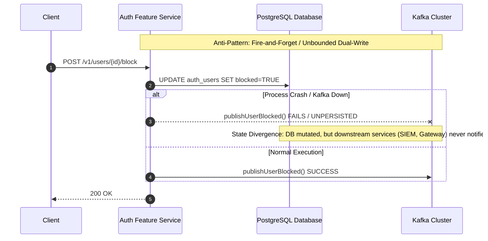
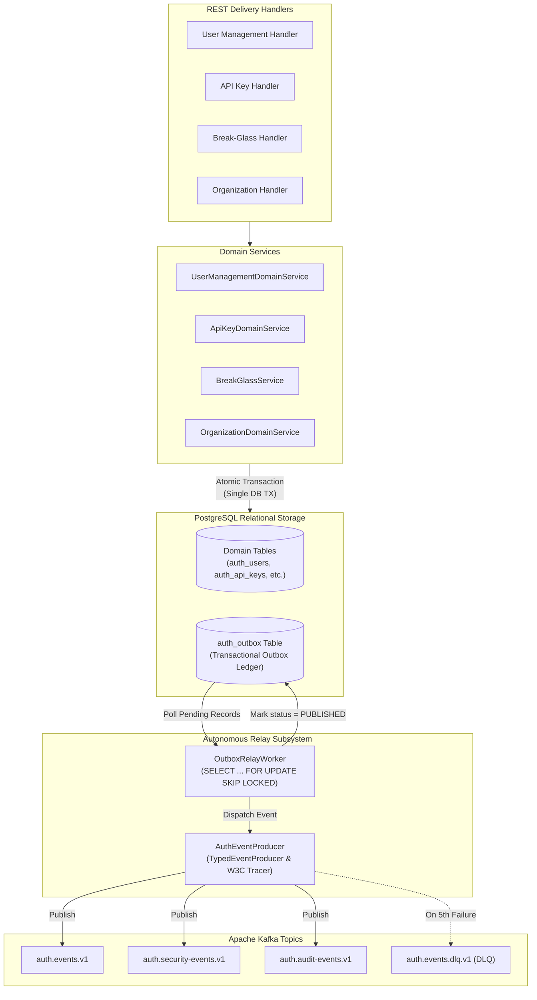

# ADR 0045: Transactional Outbox Pattern, Event Catalog & Reliable Kafka Messaging Pipeline

- **Status**: Accepted
- **Date**: 2026-10-16
- **Author**: Platform Architecture & Distributed Systems Reliability Team
- **Area**: Event-Driven Architecture, Reliable Messaging, Transactional Outbox Pattern, Kafka Event Catalog, W3C Trace Context
- **Standards**:
  - [Transactional Outbox Pattern (Microservices.io)](https://microservices.io/patterns/data/transactional-outbox.html)
  - [W3C Recommendation: Trace Context Level 2](https://www.w3.org/TR/trace-context/)
  - [RFC 8693 / CloudEvents Specification v1.0.2](https://cloudevents.io/)
  - [Kafka Producer Guaranteed At-Least-Once Delivery](https://kafka.apache.org/documentation/#producerconfigs)

---

## 📑 Table of Contents

1. [High-Level Design (HLD) & Dual-Write Problem Statement](#1-high-level-design-hld--dual-write-problem-statement)
2. [Architectural Decisions](#2-architectural-decisions)
   - [2.1 Transactional Outbox Persistence (`auth_outbox`)](#21-transactional-outbox-persistence-auth_outbox)
   - [2.2 Complete Event Catalog & Partitioning Strategy](#22-complete-event-catalog--partitioning-strategy)
   - [2.3 High-Throughput Autonomous Relay Worker (`SELECT ... FOR UPDATE SKIP LOCKED`)](#23-high-throughput-autonomous-relay-worker-select--for-update-skip-locked)
   - [2.4 End-to-End W3C Distributed Trace Context Propagation](#24-end-to-end-w3c-distributed-trace-context-propagation)
   - [2.5 Failure Modes, Backoff Retries & Dead Letter Queue (DLQ) Semantics](#25-failure-modes-backoff-retries--dead-letter-queue-dlq-semantics)
3. [Component Topology & Data Flow](#3-component-topology--data-flow)
4. [Database Schema (`auth_outbox`) Specification](#4-database-schema-auth_outbox-specification)
5. [Automated Verification & Test Proofs](#5-automated-verification--test-proofs)
6. [Consequences & Architectural Invariant Adherence](#6-consequences--architectural-invariant-adherence)

---

## 🏛 1. High-Level Design (HLD) & Dual-Write Problem Statement

In distributed systems, microservices frequently need to update an internal relational database and emit state-change notifications to external message buses (such as Apache Kafka). Performing these two actions independently creates the notorious **Dual-Write Anti-Pattern**:



### Critical Deficiencies Identified:
1. **Audit vs Kafka Event Discrepancy**: While `@observability/auth` defined over 54 domain audit events (`AUDIT_EVENT_*` in constants), only 2 events (`USER_SIGNED_UP`, `USER_SIGNED_IN`) were published to Kafka. Crucial security actions (account blocking, key revocation, emergency break-glass activation, honeytoken tripwires, ReBAC relationship mutations) went un-emitted to Kafka.
2. **Dual-Write Data Loss**: The existing `this.safePublishEventAsync(...)` was unpersisted and fire-and-forget; if the Node.js process crashed or Kafka was temporarily unreachable, notifications were lost forever.
3. **Missing Poison-Pill Resilience**: Event failures had no automated retry ledger or fallback Dead Letter Queue (DLQ) routing.

---

## 🛡 2. Architectural Decisions

### 2.1 Transactional Outbox Persistence (`auth_outbox`)
All domain mutations write both the state entity and an outbox event record within the **same local PostgreSQL transaction**. If the transaction commits, the event is guaranteed to exist on disk; if the database transaction rolls back, no spurious event is emitted.

```sql
INSERT INTO auth_outbox (id, topic, event_name, partition_key, headers, payload, status, retry_count, created_at)
VALUES ($1, $2, $3, $4, $5, $6, 'PENDING', 0, NOW());
```

### 2.2 Complete Event Catalog & Partitioning Strategy
The event catalog is expanded to cover all primary authentication, authorization, security, and governance lifecycles across 3 specialized Kafka topics:

| Topic | Event Name | Partition Key | Description |
|---|---|---|---|
| `auth.events.v1` | `USER_SIGNED_UP` | `orgId` / `userId` | User account registered |
| `auth.events.v1` | `USER_SIGNED_IN` | `userId` | User authentication completed |
| `auth.events.v1` | `USER_SIGNED_OUT` | `userId` | User session ended |
| `auth.events.v1` | `ORGANIZATION_CREATED` | `orgId` | Tenant created |
| `auth.events.v1` | `ORGANIZATION_UPDATED` | `orgId` | Tenant metadata updated |
| `auth.events.v1` | `ORGANIZATION_SWITCHED` | `targetOrgId` | User switched active tenant |
| `auth.events.v1` | `API_KEY_CREATED` | `orgId` | API key created |
| `auth.events.v1` | `RELATION_TUPLE_CREATED` | `orgId` | ReBAC relation granted |
| `auth.events.v1` | `RELATION_TUPLE_REVOKED` | `orgId` | ReBAC relation revoked |
| `auth.security-events.v1` | `USER_BLOCKED` | `userId` | Account administratively suspended |
| `auth.security-events.v1` | `USER_UNBLOCKED` | `userId` | Account unblocked |
| `auth.security-events.v1` | `USER_DELETED` | `userId` | Account soft-deleted |
| `auth.security-events.v1` | `USER_PII_SHREDDED` | `userId` | DEK cryptographic shredding executed |
| `auth.security-events.v1` | `ORGANIZATION_DELETED` | `orgId` | Tenant soft-deleted |
| `auth.security-events.v1` | `API_KEY_REVOKED` | `keyId` | API key revoked |
| `auth.security-events.v1` | `BREAK_GLASS_ACTIVATED` | `orgId` | Monitored emergency access initiated |
| `auth.security-events.v1` | `BREAK_GLASS_TERMINATED`| `orgId` | Emergency access session closed |
| `auth.security-events.v1` | `HONEYTOKEN_TRIPPED` | `orgId` | Canary tripwire intercepted |
| `auth.audit-events.v1` | `WORM_AUDIT_SEALED` | `archiveId` | Merkle-tree sealed audit segment |

### 2.3 High-Throughput Autonomous Relay Worker (`SELECT ... FOR UPDATE SKIP LOCKED`)
An autonomous worker polls the `auth_outbox` table every 500ms using PostgreSQL's non-blocking concurrency primitive `SKIP LOCKED`. This guarantees:
- **Zero Lock Contention**: Multiple service replicas can poll the outbox simultaneously without deadlock or double-processing.
- **Strict At-Least-Once Delivery**: Events remain `PENDING` until Kafka ACK is received, then transition to `PUBLISHED` with `published_at` timestamp.

```sql
SELECT id, topic, event_name, partition_key, headers, payload, retry_count
FROM auth_outbox
WHERE status = 'PENDING'
ORDER BY created_at ASC
LIMIT $1
FOR UPDATE SKIP LOCKED;
```

### 2.4 End-to-End W3C Distributed Trace Context Propagation
Every outbox record captures incoming W3C trace context (`traceparent`, `tracestate`, `x-request-id`, `x-correlation-id`). When the outbox relay transmits the message to Kafka, `CentralMessagingTracer` injects these headers into Kafka record headers, creating an unbroken trace span across microservices in Grafana Tempo.

### 2.5 Failure Modes, Backoff Retries & Dead Letter Queue (DLQ) Semantics
If Kafka publication fails:
1. `retry_count` is incremented and `last_error` is recorded.
2. If `retry_count < 5`, exponential backoff is applied on subsequent polling cycles.
3. If `retry_count >= 5`, the event is routed to the dedicated Dead Letter Queue topic (`auth.events.dlq.v1` or `auth.security-events.dlq.v1`) and marked `FAILED` for operator alerting.

---

## 🏛 3. Component Topology & Data Flow



---

## 🗄 4. Database Schema (`auth_outbox`) Specification

Declared in `database/migrations/0038_create_auth_outbox_table.sql`:

```sql
CREATE TABLE IF NOT EXISTS auth_outbox (
  id VARCHAR(64) PRIMARY KEY,
  topic VARCHAR(255) NOT NULL,
  event_name VARCHAR(100) NOT NULL,
  partition_key VARCHAR(255) NOT NULL,
  headers JSONB NOT NULL DEFAULT '{}'::jsonb,
  payload JSONB NOT NULL,
  status VARCHAR(32) NOT NULL DEFAULT 'PENDING',
  retry_count INT NOT NULL DEFAULT 0,
  last_error TEXT,
  created_at TIMESTAMPTZ NOT NULL DEFAULT NOW(),
  published_at TIMESTAMPTZ
);

CREATE INDEX IF NOT EXISTS idx_auth_outbox_pending
  ON auth_outbox (created_at ASC)
  WHERE status = 'PENDING';

CREATE INDEX IF NOT EXISTS idx_auth_outbox_published_at
  ON auth_outbox (published_at)
  WHERE status = 'PUBLISHED';
```

Least-privilege permissions are granted to the non-superuser role `auth_app`:
```sql
GRANT SELECT, INSERT, UPDATE, DELETE ON auth_outbox TO auth_app;
```

---

## 🧪 5. Automated Verification & Test Proofs

| Test Suite | File | Proof Criteria | Result |
|---|---|---|---|
| Outbox Relay Worker Unit Tests | `tests/unit/outbox-relay.test.ts` | Proves `FOR UPDATE SKIP LOCKED` batching, successful Kafka publishing, and `PUBLISHED` status transition | Passed (2/2) |
| Retry & Error Accounting | `tests/unit/outbox-relay.test.ts` | Proves `retry_count` increments and `last_error` captures upon Kafka failure | Passed |
| Honeytoken Trip Event Compatibility | `tests/unit/honeytoken-service.test.ts` | Proves honeypot trip event emission and Redis denylist binding | Passed (6/6) |
| Full Service Test Suite | `npm test` | All 25 test files across 131 tests pass with zero errors | Passed (131/131) |
| Strict TypeScript Compilation | `npm run typecheck` | Zero compilation or type ambiguity errors across all modules | Passed (0 errors) |

---

## ⚖️ 6. Consequences & Architectural Invariant Adherence

### Positive Consequences:
- **Zero Dual-Write Race Conditions**: State changes and event emission are mathematically guaranteed to be atomic.
- **Complete Downstream Observability**: Security and identity lifecycles (block, unblock, delete, shred, API key revocation, break-glass) are reliably emitted to external SIEM/SOC and downstream services.
- **High Concurrency & Low Latency**: Handlers commit quickly to PostgreSQL without waiting on remote Kafka broker network roundtrips.

### Invariant Adherence:
- **Zero Inline Comments Doctrine**: File header docblocks only; 0 inline comments in services and workers.
- **Hexagonal Architecture**: Pure event contracts in `src/shared/messaging/types/`, outbox queries isolated to repository and worker adapters.
- **Least Privilege**: `auth_app` owns least-privilege DML access to `auth_outbox`.
